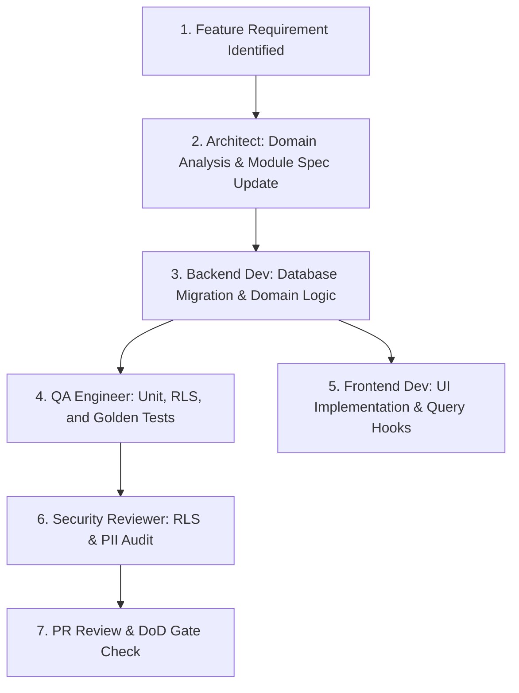

# APMS Agent-Assisted Development Guide

## 1. Executive Overview

This guide establishes the operating model and development workflows for AI-agent-assisted engineering in the APMS repository using **Google Antigravity**.

The repository is equipped with native workspace rules (`.agents/rules/`), reusable domain skills (`.agents/skills/`), specialized custom agents (`.agents/agents/`), and a progressive disclosure documentation hierarchy (`docs/`).

---

## 2. Skill and Agent Coordination Matrix (Phase 7)

The following matrix defines how specialized agents utilize skills, consume inputs, and produce verified engineering deliverables:

| Agent | Primary Assigned Skills | Core Input Documents | Primary Responsibilities | Handover Deliverables |
| :--- | :--- | :--- | :--- | :--- |
| **`architect`** | `apms-domain-analysis`<br>`database-design`<br>`multi-tenant-security`<br>`documentation-maintenance` | `SYSTEM_ARCHITECTURE.md`<br>`DATABASE_DESIGN.md`<br>`BUSINESS_RULES.md`<br>`DECISION_REGISTER.md` | System architecture, modular boundaries, schema design, ADR formulation, invariant enforcement. | Approved ADRs, ER diagrams, schema specifications, module interaction contracts. |
| **`backend-developer`** | `attendance-engine`<br>`payroll-domain`<br>`shift-scheduling`<br>`leave-management`<br>`api-development`<br>`database-design` | `docs/modules/*/SPEC.md`<br>`BUSINESS_RULES.md`<br>`CODING_STANDARDS.md`<br>`API_DESIGN.md` | Domain engine implementation, FastAPI route handlers, SQLAlchemy models, Celery background tasks. | Clean Python code (`app/*`), Alembic migrations, unit test suites, OpenAPI definitions. |
| **`frontend-developer`** | `api-development`<br>`apms-domain-analysis`<br>`documentation-maintenance` | `PRD.md`<br>`API_DESIGN.md`<br>`CODING_STANDARDS.md` | React/TypeScript UI development, TanStack Query integration, scheduling timeline, payroll wizard. | Accessible React components, client API bindings, Zod validation schemas. |
| **`qa-engineer`** | `testing-and-debugging`<br>`attendance-engine`<br>`payroll-domain`<br>`code-review` | `TESTING_STRATEGY.md`<br>`BUSINESS_RULES.md`<br>`DEFINITION_OF_DONE.md` | Unit test creation, RLS negative isolation testing, golden test suites, coverage profiling. | Pytest test files (`tests/*`), golden fixture datasets, test coverage reports. |
| **`security-reviewer`** | `multi-tenant-security`<br>`database-design`<br>`code-review` | `SECURITY_ARCHITECTURE.md`<br>`DATABASE_DESIGN.md`<br>`DEFINITION_OF_DONE.md` | Security audits, RLS policy verification, PII encryption audits, DPDP Act 2023 compliance. | Security audit reports, RLS verification logs, sign-off on database migrations. |

---

## 3. Reusable Agent Development Workflows (Phase 8)

### 3.1 Feature Development Workflow

1. **Architect** loads domain context via `apms-domain-analysis` skill and updates `docs/modules/<module>/SPEC.md`. If architectural, creates an ADR.
2. **Backend Developer** activates module-specific skill (e.g. `attendance-engine`), implements Alembic migration with RLS, and builds domain service.
3. **QA Engineer** activates `testing-and-debugging` skill, writes negative RLS isolation tests, edge case tests, and golden test vectors.
4. **Frontend Developer** consumes API contracts and builds responsive UI views.
5. **Security Reviewer** validates that RLS policies are enabled and forced, and that PII is encrypted.
6. **Code Reviewer** checks all items against `docs/engineering/DEFINITION_OF_DONE.md`.

---

### 3.2 Product Decision Analysis Workflow
1. Activate `apms-domain-analysis` skill.
2. Read `docs/requirements/BUSINESS_RULES.md` and `docs/requirements/OPEN_QUESTIONS.md`.
3. Analyze operational trade-offs across target industries (Education, Healthcare, Manufacturing, Retail).
4. Formulate explicit mathematical formulations and edge cases.
5. Formulate recommendation without marking it as confirmed.
6. Output proposal to `docs/decisions/adr/ADR_TEMPLATE.md` or dedicated decision analysis document.

---

### 3.3 Bug Fix & Regression Testing Workflow
1. **Reproduce via Test**: Before touching production code, write a failing unit test in `tests/` capturing the exact reported anomaly.
2. **Consult Single Source of Truth**: Verify expected behavior in `docs/requirements/BUSINESS_RULES.md`.
3. **Implement Minimal Fix**: Modify domain logic to resolve the defect.
4. **Verify No Regression**: Run the complete test suite including golden payroll test vectors (`pytest`).
5. **Update Trace**: If calculation logic changed, verify explanation trace schema consistency.

---

### 3.4 Database Migration Workflow
1. Activate `database-design` skill.
2. Define SQLAlchemy model with composite foreign keys `(tenant_id, id)`.
3. Generate Alembic migration file.
4. Inject `ENABLE ROW LEVEL SECURITY`, `FORCE ROW LEVEL SECURITY`, and tenant policy into `upgrade()`.
5. Add negative RLS cross-tenant leak test in `tests/integration/test_rls_isolation.py`.
6. Run migration and verify that `downgrade()` cleans up policies properly.

---

### 3.5 Release Readiness & Definition of Done Verification
1. Activate `code-review` skill.
2. Run automated validation checks:
   - `mypy --strict` $\rightarrow$ 0 errors.
   - `ruff check` $\rightarrow$ 0 violations.
   - `pytest --cov` $\rightarrow$ Meets coverage thresholds.
3. Inspect `docs/requirements/REQUIREMENTS_CATALOG.md` and confirm all deliverable requirement IDs are accounted for.
4. Ensure no unconfirmed decisions are marked as confirmed.

---

## 4. APMS Architectural Invariants Verification (Phase 9)

Every agent must continuously verify adherence to the 10 core invariants:

| Invariant # | Invariant Description | Verification Method | Enforcement Point |
| :--- | :--- | :--- | :--- |
| **INV-01** | Row-Level Security on every tenant table | `SELECT * FROM pg_tables WHERE rowsecurity = false;` | Alembic Migration & CI |
| **INV-02** | Immutable raw punch ingestion | Absence of `UPDATE` / `DELETE` triggers or endpoints | Database permissions |
| **INV-03** | Attendance decoupled from payroll | Payroll reads finalized attendance as read-only input | Module boundary checks |
| **INV-04** | Deterministic calculation explanation trace | Every attendance & payroll record has JSON trace | Table schema constraints |
| **INV-05** | Explicit dated shift instances | Roster patterns materialized into dated records | Shift scheduler job |
| **INV-06** | Double-entry leave ledger | Balances derived from append-only transaction sums | Leave repository layer |
| **INV-07** | Mid-shift gap exclusion (N65) | Gaps excluded from worked duration and overtime | Pairing engine logic |
| **INV-08** | Statutory parameterization | EPF/ESI/PT ceilings loaded from versioned tables | Statutory service layer |
| **INV-09** | Idempotent background jobs | Jobs accept idempotency keys; duplicate executions safe | Celery task decorators |
| **INV-10** | Device ingestion resilience | Out-of-order punches accommodated with re-rollups | Ingestion worker queues |

---

## 5. Antigravity Discovery & Directory Architecture (Phase 10)

```text
D:\APMS_Rebuild/
├── AGENTS.md                               <- Root project instructions (always active)
├── .agents/
│   ├── rules/                              <- Workspace rules (frontmatter trigger: always_on / model_decision)
│   │   ├── apms-core.md
│   │   ├── architecture.md
│   │   ├── security.md
│   │   └── development-standards.md
│   ├── skills/                             <- Reusable domain & engineering skills
│   │   ├── apms-domain-analysis/SKILL.md
│   │   ├── attendance-engine/SKILL.md
│   │   ├── payroll-domain/SKILL.md
│   │   ├── shift-scheduling/SKILL.md
│   │   ├── leave-management/SKILL.md
│   │   ├── database-design/SKILL.md
│   │   ├── multi-tenant-security/SKILL.md
│   │   ├── api-development/SKILL.md
│   │   ├── testing-and-debugging/SKILL.md
│   │   ├── code-review/SKILL.md
│   │   └── documentation-maintenance/SKILL.md
│   └── agents/                             <- Specialized custom agent personas
│       ├── architect.md
│       ├── backend-developer.md
│       ├── frontend-developer.md
│       ├── qa-engineer.md
│       └── security-reviewer.md
└── docs/                                   <- Progressive disclosure documentation
    ├── product/
    ├── requirements/
    ├── decisions/
    ├── architecture/
    ├── modules/
    ├── engineering/
    └── AGENT_DEVELOPMENT_GUIDE.md
```

