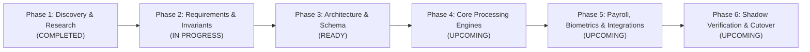

# APMS Rebuild — Master Project Tracker

## 1. Project Overview & Governance

**Project Name**: APMS Rebuild (Automated Payroll & Attendance Management System)  
**Author / Lead**: @Aniket  
**Architecture Style**: Modular Monolith (FastAPI + PostgreSQL 16+ RLS + SQLAlchemy 2.0 Async + Redis/Celery + React 18 / TypeScript)  
**Current Milestone**: Phase 2 — Requirements Engineering & Invariant Locking  
**Last Updated**: November 16, 2026  

---

## 2. Master Phase Roadmaps & Status

---

## 3. Detailed Workstream Status Matrix

### Phase 1: Product Discovery & Market Research (Status: ✅ COMPLETED)
- [x] **17-Competitor Benchmarking**: Exhaustive analysis of Indian HRMS tools (Keka, greytHR, Pocket HRMS, factoHR, ZingHR, Darwinbox, etc.) documenting failures in overnight shifts, hospital rosters, and raw punch auditing.
- [x] **8-Vertical Industry Discovery**: Analyzed Manufacturing, Healthcare, IT, Education, Retail, Hospitality, Logistics, Security. Identified Manufacturing and Healthcare as highest pain points.
- [x] **Legacy APMS Audit**: Documented 16 critical architectural flaws in the legacy system (per-customer databases, missing raw punch store, midnight punch drop, browser-calculated payroll, corrupting past periods).
- [x] **Core Principles Formulation**: Decided on One Shared Platform, Configuration-Driven behaviors, ₹80/employee/month infrastructure ceiling, and Edge Facial Verification.

---

### Phase 2: Requirements Engineering & Invariant Locking (Status: 🟡 IN PROGRESS - 90%)
- [x] **21-Module Catalog**: Defined full catalog covering P0 (Foundations), P1 (Operations), and P2 (Extensions).
- [x] **3-Way Separation Model**: Codified Layer 1 (Feature Flags), Layer 2 (Tenant Policies), Layer 3 (User Permissions).
- [x] **Authoritative Business Rules**: Documented formulas and algorithms for pairing, rollup (`DURATION_RATIO`), overnight shifts, and gap exclusion (N65).
- [x] **Attendance Engine Invariants**: Codified the 7-step pipeline, continuous multi-day duty engine (>24h/36h/48h), and configurable lone-punch policies.
- [x] **Indian Statutory Payroll Depth**: Specified EPF (₹15,000 ceiling + ECR), ESI (₹21,000 gross limit), State-specific PT & LWF, dual-regime TDS (115BAC), Form 16 Part A/B.
- [x] **Employee Lifecycle Automation**: Specified Module 21 (Trainee $\rightarrow$ Probation $\rightarrow$ Confirmed, LOP extension, notice period adjustments).
- [x] **4-Tier Field Workforce Model**: Defined Level 1 Punch GPS to Level 4 Duty Route Tracking with persistent on-duty banner and zero off-hours tracking.
- [x] **DPDP Act 2023 & Minor Consent**: Formulated mandatory verifiable parental consent for students and edge-only biometric template storage.
- [ ] **Final Open Question Resolution**: Resolve remaining partner reseller models and cut-off vs pay period defaults.

---

### Phase 3: Architecture & System Design (Status: ⚪ READY FOR COMMENCEMENT)
- [x] **High-Level System Architecture**: Modular monolith boundaries, service interfaces, event bus design.
- [x] **PostgreSQL RLS Schema Design**: Multi-tenant database design with declarative partitioning and RLS on `tenant_id`.
- [x] **API Design Conventions**: RESTful OpenAPI standards, Pydantic v2 validation, idempotency keys (`X-Idempotency-Key`).
- [ ] **Alembic Baseline Migrations**: Generate initial migration scripts for core tenant and IAM models.
- [ ] **Pydantic Contracts Implementation**: Build core domain schemas for punches, sessions, shifts, and explanation traces.

---

### Phase 4: Core Processing Engines Implementation (Status: ⚪ UPCOMING)
- [ ] **M09: Raw Punch Ingestion Engine**:
  - High-throughput endpoint (`POST /api/v1/devices/push`) sustaining 10,000 punches/min.
  - Append-only `raw_envelope` persistence with SHA-256 payload hashing.
  - Idempotency debounce deduplication (60s window).
- [ ] **M07 & M08: Shift & Roster Engine**:
  - Shift template versioning and recurring rotation generator.
  - Materialization of `dated_shift_instance` rows.
  - Ad-hoc same-day supervisor override endpoint (`N67`).
- [ ] **M10: 7-Step Attendance Processing Engine**:
  - Session-aware chronological pairing within shift ingestion windows.
  - Multi-session gap exclusion (`N65`).
  - Daily rollup calculation under `DURATION_RATIO` mode (`N66a`).
  - Session minimum presence qualification (`N66b`).
  - Multi-day duty engine (>24h / 36h / 48h) with start-calendar-date attribution.
  - Immutable JSON explanation trace persistence.
- [ ] **M11: Double-Entry Leave Ledger Engine**:
  - Append-only `leave_transactions` table with running balance calculations.
  - Configurable sandwich rule evaluator.
  - Session-targeted half-day leave mapper (`N66c`).

---

### Phase 5: Payroll, Biometrics & External Integrations (Status: ⚪ UPCOMING)
- [ ] **M14: Statutory Payroll Engine**:
  - 10-Step Pay Run execution wizard with pre-payroll reconciliation.
  - Statutory computation engine (EPF, ESI, PT, TDS Section 115BAC).
  - Cryptographically signed server-side PDF payslip generator.
  - Bank disbursement export (NEFT/RTGS/NACH CSV for HDFC, ICICI, SBI, Axis).
  - Strict Period Close locking with Arrears Engine routing.
- [ ] **M16: Biometric Device Connectors & Telemetry**:
  - Native Time Office HTTP pull/push adapter.
  - ZKTeco ADMS/Push receiver daemon.
  - Local Python/Rust Edge Sync Agent for USB/LAN devices.
  - Device heartbeat (60s) and NTP clock drift monitor.
- [ ] **External Business Integrations**:
  - **PumpOps Integration**: Specialized petrol pump forecourt attendance, shift handover, and fuel attendant cash reconciliation.
  - **ERP Accounting Export**: Direct journal export to Tally Prime XML, Zoho Books, and SAP RFC.
  - **Official Notification Hub**: Integrated WhatsApp Business Solution Provider (BSP) API, SMS gateway, and email delivery.

---

### Phase 6: Quality Assurance, Shadow Verification & Rollout (Status: ⚪ UPCOMING)
- [ ] **Automated Test Suites**:
  - Zero cross-tenant data leakage tests under PostgreSQL RLS (`tests/security/test_rls.py`).
  - Attendance pairing golden test suite (>95% branch coverage).
  - Statutory payroll golden test suite verified down to exact paisa (±₹0.00).
- [ ] **Shadow-Run Diff Engine**:
  - Parallel dual-run comparison against legacy APMS for 2 complete monthly pay cycles.
  - Automated variance diffing report to guarantee 100% numerical parity.
- [ ] **Pilot Deployments**:
  - Pilot 1: Multi-shift process manufacturing plant (overnight shifts, biometric turnstiles, OT).
  - Pilot 2: Multi-specialty hospital (24h/36h emergency shifts, on-call doctor payouts, rotating rosters).

---

## 4. The 16 Legacy Failure Safeguards

The following matrix tracks the technical mechanisms preventing regression to legacy APMS defects:

| # | Legacy APMS Failure | Rebuild Architectural Safeguard | Verification Test ID |
|---|---------------------|---------------------------------|----------------------|
| 1 | Separate server/DB per customer | Unified shared DB with PostgreSQL RLS on `tenant_id` | `TEST-RLS-01` |
| 2 | No raw punch table | Append-only `raw_envelope` with SHA-256 payload hash | `TEST-RAW-01` |
| 3 | Midnight night punch pays ₹0 | Attributed to shift start calendar date ($D$) | `TEST-ATT-03` |
| 4 | 24h duty marked absent; 36-48h breaks | Multi-day duty engine with start-date attribution | `TEST-ATT-13` |
| 5 | Lone punch pays ₹0 or phantom OT | Configurable fallback (Review / Absent / Floor) | `TEST-ATT-14` |
| 6 | Split WFH pays full day + fake OT | Pay strictly by cumulative active minutes | `TEST-ATT-17` |
| 7 | Viewing attendance mutates saved data | Read-vs-write decoupling (read-only queries) | `TEST-ATT-18` |
| 8 | Duplicate daily rows possible | Unique composite constraint `(tenant_id, emp_id, date)` | `TEST-DB-02` |
| 9 | Browser-calculated payroll | Deterministic server-side wizard with frozen snapshots | `TEST-PAY-01` |
| 10 | PF/ESI missing statutory wage ceilings | Versioned database statutory tables (₹15k / ₹21k) | `TEST-STA-01` |
| 11 | Holiday edits corrupt closed payroll | Strict period close lock; retroactive changes $\rightarrow$ Arrears | `TEST-PAY-06` |
| 12 | Custom leave types blocked by DB | Dynamic data-driven leave types table | `TEST-LVE-01` |
| 13 | Single-tier manager reporting | Recursive CTE / Adjacency list multi-level hierarchy | `TEST-ORG-01` |
| 14 | Manual migrations & no automated tests | Alembic versioned migrations + Pytest CI suite | `TEST-CI-01` |
| 15 | Secrets stored in browser local storage | Secure HTTP-only cookies + JWT rotation | `TEST-SEC-01` |
| 16 | Unofficial WhatsApp tool on customer PC | Official WhatsApp BSP Cloud API | `TEST-NTF-01` |

