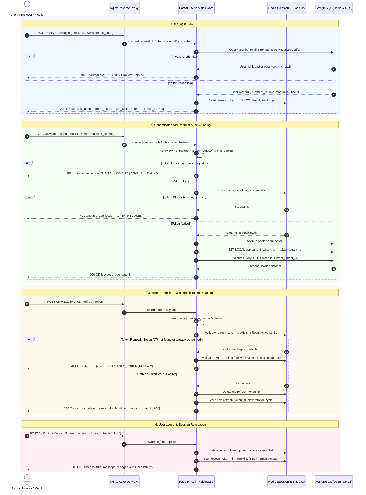
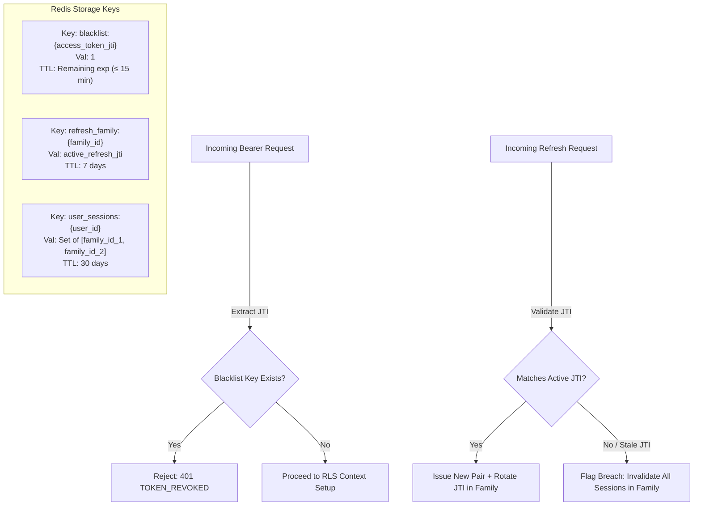

# APMS Authentication & Token Lifecycle Architecture

> **Status:** Authoritative | **Last Updated:** 2026-11-16 | **Source:** Extracted from APMS documentation

---

## 1. Overview & Authentication Invariants

APMS employs a stateless, token-based authentication architecture utilizing **JSON Web Tokens (JWT)** with dual-token issuance (short-lived Access Tokens and rotating Refresh Tokens). In addition to user identity, every token encapsulates tenant membership to enforce zero-leak multi-tenant boundary isolation.

### Key Authentication Invariants:
1. **Stateless Access Verification**: Every protected API route authenticates requests via the `Authorization: Bearer <jwt_access_token>` header.
2. **Tenant Context Binding**: The access token contains the authoritative tenant identifier (`tenant_id` / `tid`). Route parameters cannot override this claim; mismatches trigger an immediate `403 Forbidden`.
3. **Database RLS Synchronization**: Authentication middleware extracts `tenant_id` from the validated token and immediately injects it into the active PostgreSQL connection session using `SET LOCAL app.current_tenant_id = :tenant_id`.
4. **Token Revocation via Redis**: Immediate logout, session invalidation, and refresh token rotation compromise detection are enforced using distributed Redis cache key checks.

---

## 2. Complete Authentication Sequence Diagram

The following sequence diagram illustrates the five core authentication flows:
1. **Initial Login** (Authentication & Token Issuance)
2. **Authenticated Request & RLS Injection**
3. **Token Refresh with Rotation**
4. **Session Logout & Invalidation**
5. **Failed Authentication & Revocation Handling**



---

## 3. JWT Claims Structure & Token Standards

APMS issues tokens using asymmetric **RS256** (RSA Signature with SHA-256) or **EdDSA** (Ed25519) public/private key pairs. Private keys reside strictly within encrypted environment secrets or AWS/GCP KMS; public keys are exposed via `/.well-known/jwks.json`.

### 3.1 Access Token Specifications
- **Lifespan**: **15 minutes** (`900 seconds`). Minimizes exposure window in case of token interception.
- **Payload Schema**:
```json
{
  "iss": "https://auth.apms.cloud",
  "sub": "018f3a5b-9a8c-7000-8b01-234567890abc",
  "aud": "apms-api",
  "tid": "018f3a5b-7b2e-7111-9a00-112233445566",
  "role": "HR_MANAGER",
  "email": "priya.sharma@acme-corp.com",
  "emp_id": "018f3a5b-8000-7222-aa11-aabbccddeeff",
  "branch_id": "018f3a5b-9000-7333-bb22-1234567890ab",
  "jti": "jwt_access_a1b2c3d4e5f6",
  "iat": 1731754800,
  "exp": 1731755700
}
```

#### Claim Descriptions:
| Claim | Type | Description |
| :--- | :--- | :--- |
| `iss` | `string` | Authoritative token issuer (`https://auth.apms.cloud`). |
| `sub` | `UUID` | Unique User UUID in `users` table. |
| `aud` | `string` | Intended audience (`apms-api`). |
| `tid` | `UUID` | **Authoritative Tenant UUID**. Injected directly into PostgreSQL `SET LOCAL app.current_tenant_id`. |
| `role` | `enum` | One of `SUPERADMIN`, `TENANT_ADMIN`, `HR_MANAGER`, `PAYROLL_OFFICER`, `EMPLOYEE`. |
| `emp_id` | `UUID` | Associated employee ID in `employee_master` for ESS scoping (null for pure admins). |
| `branch_id`| `UUID` | Associated physical branch for location-fenced operations. |
| `jti` | `string` | Unique JWT Token Identifier used for blacklist revocation checks in Redis. |
| `iat` | `integer` | Epoch timestamp of token generation. |
| `exp` | `integer` | Epoch timestamp of token expiration. |

---

### 3.2 Refresh Token Specifications
- **Lifespan**: **7 days** (Standard Web/Portal) or **30 days** (Mobile App with biometrics).
- **Format**: Cryptographically signed JWT or opaque 256-bit cryptographically secure string stored in Redis.
- **Payload Schema (JWT Format)**:
```json
{
  "iss": "https://auth.apms.cloud",
  "sub": "018f3a5b-9a8c-7000-8b01-234567890abc",
  "tid": "018f3a5b-7b2e-7111-9a00-112233445566",
  "jti": "jwt_refresh_8899aabbccdd",
  "family_id": "fam_01j7b9k4m1n2",
  "token_type": "refresh",
  "iat": 1731754800,
  "exp": 1732359600
}
```

---

## 4. Redis Session Storage & Revocation Architecture

While access token verification is performed cryptographically in-memory without hitting the primary database, Redis 7+ serves as an ultra-fast in-memory cache for revocation and session state.



### 4.1 Refresh Token Family Rotation & Reuse Detection
To prevent refresh token theft and replay attacks:
1. Every login initiates a new **Token Family ID** (`family_id`).
2. Upon each refresh operation:
   - The old refresh token is immediately invalidated in Redis.
   - A new refresh token with a new `jti` is issued within the same `family_id`.
3. **Breach Detection**: If a previously consumed refresh token is presented again (indicating token compromise or man-in-the-middle replay), Redis detects that the provided `jti` does not match the active head of `family_id`. The backend immediately purges all tokens associated with that user and forces re-authentication.

### 4.2 Logout & Blacklist TTL
- When a user logs out (`POST /api/v1/auth/logout`), the access token's `jti` is added to Redis with a TTL equal to its remaining lifespan (`exp - current_time`).
- Once the access token's natural expiry elapses, Redis automatically evicts the blacklist key, maintaining zero memory leakage.

---

## 5. Failed Authentication & Error Envelopes

Authentication errors strictly adhere to the RFC 7807 (Problem Details for HTTP APIs) format with HTTP status code `401 Unauthorized` or `403 Forbidden`.

### 5.1 Invalid Credentials (Login Failure)
```http
HTTP/1.1 401 Unauthorized
Content-Type: application/problem+json

{
  "success": false,
  "error": {
    "code": "INVALID_CREDENTIALS",
    "message": "The email, password, or tenant code provided is incorrect.",
    "details": []
  },
  "meta": {
    "timestamp": "2026-11-16T10:50:00Z",
    "requestId": "req_01j7auth001"
  }
}
```

### 5.2 Expired Access Token
```http
HTTP/1.1 401 Unauthorized
WWW-Authenticate: Bearer error="invalid_token", error_description="The access token has expired"
Content-Type: application/problem+json

{
  "success": false,
  "error": {
    "code": "TOKEN_EXPIRED",
    "message": "JWT access token has expired. Please refresh your session.",
    "details": [
      {
        "field": "exp",
        "issue": "Token expired at 2026-11-16T10:45:00Z"
      }
    ]
  },
  "meta": {
    "timestamp": "2026-11-16T10:50:00Z",
    "requestId": "req_01j7auth002"
  }
}
```

### 5.3 Tenant Isolation Violation (`403 Forbidden`)
If a user authenticated under Tenant A attempts to access resources belonging to Tenant B via path or body parameter tampering:
```http
HTTP/1.1 403 Forbidden
Content-Type: application/problem+json

{
  "success": false,
  "error": {
    "code": "TENANT_MISMATCH_FORBIDDEN",
    "message": "Access denied: Request target does not match authenticated tenant scope.",
    "details": [
      {
        "field": "tenant_id",
        "issue": "Token tenant '018f3a5b-...' cannot access resource in '018f9999-...'"
      }
    ]
  },
  "meta": {
    "timestamp": "2026-11-16T10:50:00Z",
    "requestId": "req_01j7auth003"
  }
}
```
