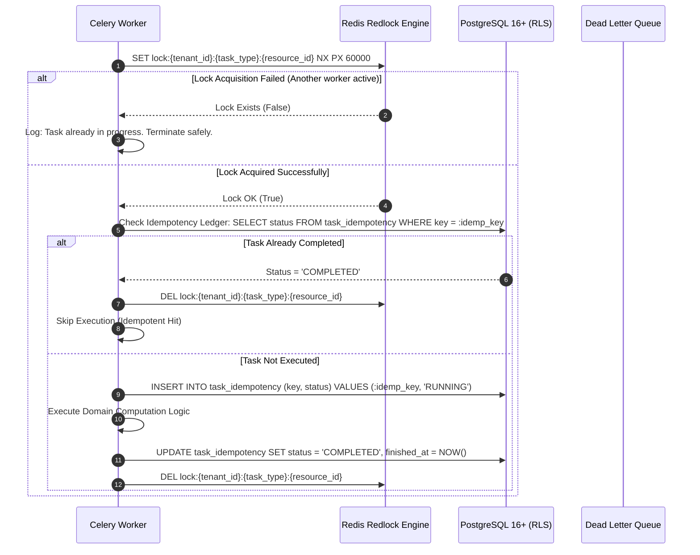
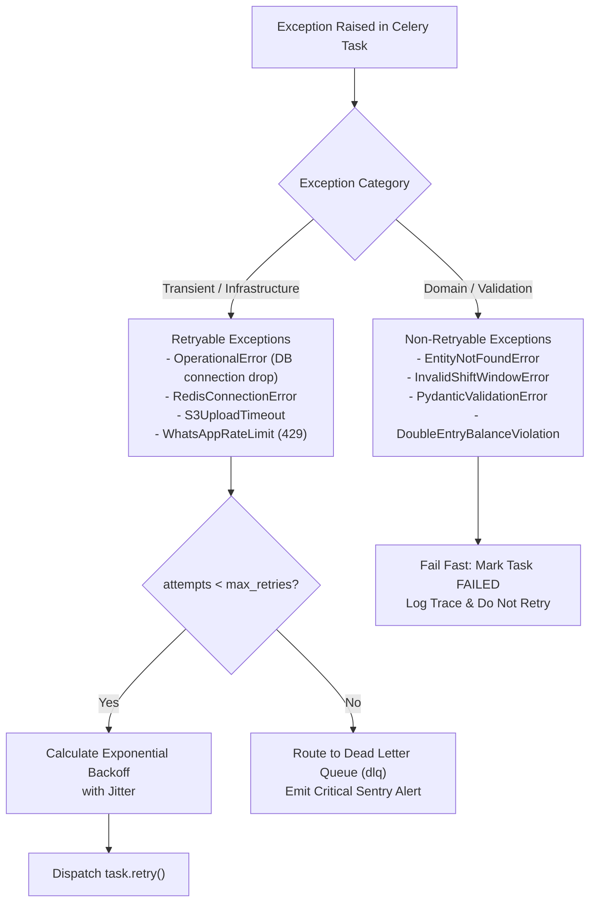

# APMS Background Task Architecture & Celery Task Graph

> **Status:** Authoritative | **Last Updated:** 2026-11-16 | **Source:** Derived from SYSTEM_ARCHITECTURE.md, DEPLOYMENT.md, SPEC.md (Attendance & Payroll), DECISION_REGISTER.md

---

## 1. Architectural Overview

APMS relies on a distributed asynchronous task execution architecture powered by **Python 3.12+**, **Celery 5.4+**, and **Redis 7+** (acting as both the message broker and result backend).

Asynchronous processing is fundamental to the APMS modular monolith to satisfy strict non-functional requirements:
1. **Low-Latency HTTP Responses**: Web and mobile client requests return within sub-100ms by offloading non-blocking workloads (punch pairing, daily rollups, PDF generation, notification delivery) to background workers.
2. **High-Throughput Ingestion**: Biometric terminals and Edge Sync Agents transmit high-volume punch bursts (up to 10,000 punches/minute during shift changeover) which are buffered and processed asynchronously without degrading user-facing API performance.
3. **Deterministic Batch Calculations**: Long-running computational batch operations (10-step payroll runs, statutory calculations, monthly muster roll exports) execute in dedicated worker processes isolated from API server resources.
4. **Idempotency & Concurrency Safety**: Redlock distributed locking prevents duplicate task execution, race conditions on double-entry leave ledgers, and conflicting payroll runs.

---

## 2. Complete Celery Background Task Graph

The following directed flowchart maps the end-to-end task lifecycle, including trigger sources, broker queue distribution, task workflows (chains, groups, chords), worker execution, and Dead Letter Queue (DLQ) routing.

```mermaid
flowchart TD
    %% ─── Styling Definitions ──────────────────────────────────────────
    classDef trigger fill:#e1f5fe,stroke:#0288d1,stroke-width:2px,color:#01579b;
    classDef broker fill:#fce4ec,stroke:#c2185b,stroke-width:2px,color:#880e4f;
    classDef qHigh fill:#ffcdd2,stroke:#d32f2f,stroke-width:2px,color:#b71c1c;
    classDef qDef fill:#fff9c4,stroke:#fbc02d,stroke-width:2px,color:#f57f17;
    classDef qBatch fill:#e8f5e9,stroke:#388e3c,stroke-width:2px,color:#1b5e20;
    classDef qDlq fill:#d7ccc8,stroke:#5d4037,stroke-width:2px,color:#3e2723;
    classDef worker fill:#ede7f6,stroke:#7b1fa2,stroke-width:2px,color:#4a148c;
    classDef storage fill:#f5f5f5,stroke:#616161,stroke-width:2px,color:#212121;

    %% ─── 1. Trigger Sources ───────────────────────────────────────────
    subgraph TRIGGERS["1. Task Trigger Sources"]
        direction TB
        TR_API["REST API Mutations<br/>(Punch push, Pay run execute,<br/>Regularize, Leave apply)"]:::trigger
        TR_BEAT["Celery Beat Scheduler<br/>(Daily cron, clock drift,<br/>partition pre-creation)"]:::trigger
        TR_EDGE["Edge Sync Agent<br/>(Batch biometric relay)"]:::trigger
        TR_RETRY["Task Retry Engine<br/>(Exponential backoff)"]:::trigger
    end

    %% ─── 2. Redis Message Broker & Queues ─────────────────────────────
    subgraph BROKER["2. Redis 7+ Message Broker & Task Queues"]
        direction TB
        REDIS_IN["Redis Task Exchange<br/>(Routing Key Matcher)"]:::broker
        
        Q_HIGH["Queue: high_priority<br/>Priority: 10<br/>Prefetch: 4<br/>Concurrency: 8 (prefork)"]:::qHigh
        Q_DEFAULT["Queue: default<br/>Priority: 5<br/>Prefetch: 2<br/>Concurrency: 4 (prefork)"]:::qDef
        Q_BATCH["Queue: batch_heavy<br/>Priority: 1<br/>Prefetch: 1<br/>Concurrency: 2 (prefork)"]:::qBatch
        Q_DLQ["Queue: dlq (Dead Letter)<br/>Priority: 0<br/>Retained for Diagnostics"]:::qDlq

        REDIS_IN -->|"routing_key: high.*"| Q_HIGH
        REDIS_IN -->|"routing_key: default.*"| Q_DEFAULT
        REDIS_IN -->|"routing_key: batch.*"| Q_BATCH
        REDIS_IN -->|"max_retries_exceeded"| Q_DLQ
    end

    %% ─── 3. Worker Execution Pools ────────────────────────────────────
    subgraph WORKERS["3. Celery Worker Execution Pools"]
        direction TB
        
        %% High Priority Tasks
        subgraph W_HIGH["Worker: apms-worker-high"]
            T_PUNCH["tasks.device.normalize_and_pair<br/>(Normalize raw punches & pair sessions)"]:::worker
            T_AUTH_LOG["tasks.auth.audit_login_event<br/>(Geo-IP, Device fingerprinting)"]:::worker
            T_ALERT_URGENT["tasks.notify.send_urgent_sms_otp<br/>(MFA, Security alerts)"]:::worker
        end

        %% Default Tasks
        subgraph W_DEFAULT["Worker: apms-worker-default"]
            T_ROLLUP["tasks.attendance.daily_rollup_cutoff<br/>(04:00 AM Daily status evaluation)"]:::worker
            T_DRIFT["tasks.device.check_clock_drift<br/>(Every 15 min NTP delta check)"]:::worker
            T_HEARTBEAT["tasks.device.check_heartbeat_offline<br/>(Every 2 min device lag monitor)"]:::worker
            T_WF_SLA["tasks.workflow.escalate_sla_breaches<br/>(Every 10 min approval escalator)"]:::worker
            T_NOTIFY["tasks.notify.dispatch_event_notifications<br/>(WhatsApp, Email, In-App alerts)"]:::worker
            T_OUT_OF_ORDER["tasks.attendance.reprocess_out_of_order<br/>(Delayed punches re-rollup)"]:::worker
        end

        %% Batch Heavy Tasks
        subgraph W_BATCH["Worker: apms-worker-batch"]
            subgraph PAYROLL_CHORD["Payroll Pay Run Chord Pipeline"]
                T_PAY_RECON["tasks.payroll.reconcile_attendance_step"]:::worker
                T_PAY_GROSS["tasks.payroll.compute_gross_batch"]:::worker
                T_PAY_STAT["tasks.payroll.compute_statutory_deductions"]:::worker
                T_PAY_LOCK["tasks.payroll.finalize_and_snapshot_lock"]:::worker
                
                T_PAY_RECON --> T_PAY_GROSS --> T_PAY_STAT --> T_PAY_LOCK
            end

            subgraph PDF_GROUP["Parallel PDF Generation (Group)"]
                T_PDF_GEN["tasks.payroll.generate_encrypted_payslip_pdf<br/>(AES-128 Password Protected)"]:::worker
            end

            T_PAY_LOCK --> PDF_GROUP

            T_PARTITION["tasks.db.precreate_monthly_partitions<br/>(1st of month: raw, punch, att)"]:::worker
            T_LEAVE_ACCRUAL["tasks.leave.monthly_accrual_run<br/>(1st of month double-entry credits)"]:::worker
            T_REPORT_EXPORT["tasks.report.generate_large_export<br/>(Muster roll, Tally XML, ECR)"]:::worker
        end
    end

    %% ─── 4. Concurrency & Locking Control ─────────────────────────────
    subgraph LOCKING["4. Concurrency & Idempotency Layer"]
        REDLOCK["Redis Redlock Manager<br/>Distributed lock per tenant & resource<br/>TTL: 30s to 600s"]:::storage
        IDEMP_TBL["Idempotency Ledger Table<br/>(PostgreSQL / Redis cache)"]:::storage
    end

    %% ─── 5. Persistence & Output ──────────────────────────────────────
    subgraph PERSISTENCE["5. Persistence & Storage Outputs"]
        PG_DB[("PostgreSQL 16+<br/>(RLS Context Enforced)")]:::storage
        S3_STORAGE[("MinIO / AWS S3<br/>(Encrypted Payslips & Reports)")]:::storage
        EXT_CHANNELS["External APIs<br/>(WhatsApp, SMTP, Bank Portals)"]:::storage
    end

    %% ─── 6. DLQ Diagnostic & Alerting ─────────────────────────────────
    subgraph DLQ_HANDLER["6. Dead Letter Queue & Alerting"]
        DLQ_INSPECT["DLQ Consumer & Sentry Alert<br/>Logs failure context & stack trace"]:::qDlq
        ADMIN_REPLAY["Admin Manual Replay Endpoint<br/>POST /api/v1/system/dlq/replay"]:::qDlq
        DLQ_INSPECT --> ADMIN_REPLAY
    end

    %% ─── Flow Connections ─────────────────────────────────────────────
    TR_API --> REDIS_IN
    TR_BEAT --> REDIS_IN
    TR_EDGE --> REDIS_IN
    TR_RETRY --> REDIS_IN

    Q_HIGH --> W_HIGH
    Q_DEFAULT --> W_DEFAULT
    Q_BATCH --> W_BATCH
    Q_DLQ --> DLQ_INSPECT

    %% Workers to Locking
    W_HIGH <-->|"Acquire / Release Lock"| REDLOCK
    W_DEFAULT <-->|"Acquire / Release Lock"| REDLOCK
    W_BATCH <-->|"Acquire / Release Lock"| REDLOCK
    REDLOCK <--> IDEMP_TBL

    %% Workers to Output
    W_HIGH --> PG_DB
    W_DEFAULT --> PG_DB
    W_DEFAULT --> EXT_CHANNELS
    W_BATCH --> PG_DB
    PDF_GROUP --> S3_STORAGE
    T_REPORT_EXPORT --> S3_STORAGE

    %% Failure Routing
    T_PUNCH -.->|"Max Retries Exceeded"| Q_DLQ
    T_ROLLUP -.->|"Max Retries Exceeded"| Q_DLQ
    T_PAY_LOCK -.->|"Max Retries Exceeded"| Q_DLQ
```



---

## 3. Celery Queue Architecture & Worker Allocation

APMS isolates tasks into three designated queues based on priority, latency sensitivity, and resource consumption. This prevents long-running payroll calculations from starving critical real-time biometric ingestion.

| Queue Name | Priority | Concurrency Model | Worker Command | Target Workloads | SLA / Max Latency |
| :--- | :---: | :--- | :--- | :--- | :--- |
| **`high_priority`** | 10 | Prefork (8 workers)<br/>`--prefetch-multiplier=4` | `celery -A app.core.tasks worker -Q high_priority -c 8 -l info` | Real-time punch ingestion, biometric normalization, pairing calculations, MFA SMS/OTP dispatch, login security audits. | $\le 500\text{ ms}$ |
| **`default`** | 5 | Prefork (4 workers)<br/>`--prefetch-multiplier=2` | `celery -A app.core.tasks worker -Q default -c 4 -l info` | Daily attendance rollups, clock drift checks, workflow notifications (WhatsApp/Email), SLA escalations, out-of-order punch re-pairing. | $\le 5\text{ seconds}$ |
| **`batch_heavy`** | 1 | Prefork (2 workers)<br/>`--prefetch-multiplier=1`<br/>`--max-tasks-per-child=100` | `celery -A app.core.tasks worker -Q batch_heavy -c 2 -l info` | 10-step payroll runs, statutory calculations, encrypted PDF payslip generation, large CSV/Tally exports, table partition pre-creation. | $\le 15\text{ minutes}$ |
| **`dlq`** | 0 | Single consumer (1 worker)<br/>`--prefetch-multiplier=1` | `celery -A app.core.tasks worker -Q dlq -c 1 -l warn` | Dead letter processing, diagnostic logging, Sentry alert firing, payload preservation. | Diagnostic only |

> [!IMPORTANT]
> **Prefetch Multiplier Invariant**: The `batch_heavy` queue MUST use `--prefetch-multiplier=1`. Because payroll runs and report generation consume heavy CPU and RAM, workers must never prefetch multiple batch tasks simultaneously; this prevents head-of-line blocking and memory spikes.

---

## 4. Celery Beat Periodic Cron Schedule

Celery Beat acts as the master periodic scheduler. In production, Celery Beat runs as a single-replica deployment protected by a Redis distributed lease lock to prevent duplicate scheduler execution in clustered environments.

| Task Identifier | Cron / Schedule | Target Queue | Distributed Lock Name & TTL | Purpose & Business Impact | Authoritative Rule Reference |
| :--- | :--- | :--- | :--- | :--- | :--- |
| `tasks.attendance.daily_rollup_cutoff` | `0 4 * * *`<br/>(04:00 AM daily) | `default` | `lock:cron:daily_rollup` (TTL: 3,600s) | Evaluates the prior calendar day's paired punches for all active employees. Calculates coverage ratio $R$, evaluates session minimums, enforces mid-shift gap exclusions (N65), maps daily attendance status (`PRESENT`, `HALF_DAY`, `ABSENT`), and persists immutable explanation traces. | `ADR-16`, `ADR-17`, `BR-ATT-02`, `BR-ROL-01` |
| `tasks.devices.check_clock_drift` | `*/15 * * * *`<br/>(Every 15 min) | `default` | `lock:cron:clock_drift` (TTL: 600s) | Queries all active biometric terminals and Edge Sync Agents for reported clock timestamps. Compares against server NTP time. If drift exceeds $\pm 5\text{ minutes}$, marks device with `CLOCK_DRIFT_WARNING` and generates maintenance ticket. | `DEV-02`, `BR-ATT-03` |
| `tasks.devices.check_heartbeat_offline` | `*/2 * * * *`<br/>(Every 2 min) | `default` | `lock:cron:heartbeat_check` (TTL: 120s) | Scans `device_telemetry` for devices whose last ping exceeds 5 minutes. Transitions status to `OFFLINE` and notifies tenant device administrator. | `DEV-02`, `M07-SPEC` |
| `tasks.db.precreate_monthly_partitions` | `30 0 1 * *`<br/>(1st of month, 00:30 AM) | `batch_heavy` | `lock:cron:partition_maint` (TTL: 1,800s) | Pre-creates declarative PostgreSQL partitions for the next 2 months for high-volume tables: `raw_envelope`, `punch_event`, and `attendance_daily_records`. Prevents insert failures on month boundaries. | `ADR-28`, `BR-DB-01` |
| `tasks.workflows.escalate_sla_breaches` | `*/10 * * * *`<br/>(Every 10 min) | `default` | `lock:cron:workflow_sla` (TTL: 300s) | Evaluates open workflow approval requests against configured SLA thresholds (e.g., 24h/48h). Escalates overdue requests to the next supervisor in the hierarchy and sends urgent notifications. | `M10-SPEC`, `REQ-WF-04` |
| `tasks.leave.monthly_accrual_run` | `0 1 1 * *`<br/>(1st of month, 01:00 AM) | `batch_heavy` | `lock:cron:leave_accrual` (TTL: 3,600s) | Computes monthly periodic leave accruals (Earned Leave, Casual Leave, Sick Leave) based on policy eligibility; inserts append-only credit entries into `leave_transactions`. | `ADR-08`, `BR-LVE-01` |
| `tasks.attendance.reprocess_out_of_order` | `*/30 * * * *`<br/>(Every 30 min) | `default` | `lock:cron:out_of_order` (TTL: 1,200s) | Identifies backdated punches uploaded by reconnected Edge Sync Agents. Re-executes pairing and daily rollups for affected employee-dates; generates explanation trace diffs. | `ADR-29`, `BR-ATT-14` |
| `tasks.payroll.statutory_deposit_reminder` | `0 9 10,14 * *`<br/>(10th & 14th of month, 09:00 AM) | `default` | `lock:cron:statutory_reminder` (TTL: 300s) | Checks locked pay runs for the previous month. If EPF, ESI, or PT challan deposits have not been marked complete, dispatches high-priority reminder alerts to HR admins prior to the 15th statutory due date. | `ADR-25`, `BR-PAY-12` |
| `tasks.security.purge_expired_sessions` | `0 * * * *`<br/>(Hourly) | `default` | `lock:cron:purge_sessions` (TTL: 300s) | Scans Redis token revocation blacklists and expired user session records; removes stale entries to maintain optimal Redis memory consumption. | `ADR-02`, `SEC-04` |

---

## 5. Distributed Locking (`Redlock`) & Idempotency Engine

To enforce strict consistency across distributed Celery workers and prevent duplicate mutations, APMS mandates a **Distributed Redlock Pattern** using Redis:



### 5.1 Lock Key Naming Conventions

Locks are structured strictly with tenant namespaces to prevent cross-tenant contention:

```
lock:{tenant_id}:{task_name}:{resource_id}
```

**Concrete Examples**:
- Pay Run Execution Lock: `lock:018f3a5b-9a8c-7000:payroll_run:2026-11-PAYGROUP-01`
- Daily Rollup Lock: `lock:018f3a5b-9a8c-7000:daily_rollup:2026-11-13`
- Single Employee Rollup Lock: `lock:018f3a5b-9a8c-7000:employee_rollup:EMP-10492:2026-11-13`
- Leave Accrual Lock: `lock:018f3a5b-9a8c-7000:leave_accrual:2026-11`

### 5.2 Idempotency Key Design

Every mutating Celery task accepts a mandatory `idempotency_key` argument in its payload:
```python
idempotency_key = f"{tenant_id}:{task_name}:{hashlib.sha256(payload_bytes).hexdigest()}"
```
If a task crashes or a network partition causes a Celery message redelivery, the worker inspects the database ledger. If the record is already `COMPLETED`, the task acknowledges the message immediately without re-executing business logic.

---

## 6. Retry Policy & Exponential Backoff Strategy

Tasks subject to transient infrastructure failures (network timeouts, database connection pool exhaustion, third-party API rate limits) follow a **Jittered Exponential Backoff Strategy**.

### 6.1 Backoff Mathematical Formulation

$$\Delta t_{\text{retry}} = \min\left(T_{\text{max}}, T_{\text{base}} \times 2^{\text{attempt}} + \text{Uniform}(0, \text{jitter})\right)$$

Where:
- $T_{\text{base}} = 5\text{ seconds}$
- $T_{\text{max}} = 300\text{ seconds}$ (5 minutes)
- $\text{jitter} = 3\text{ seconds}$ random perturbation to prevent thundering herd on recovery.

### 6.2 Error Classification



| Queue | Max Retries | Base Interval | Max Interval | Retryable Exceptions |
| :--- | :---: | :---: | :---: | :--- |
| **`high_priority`** | 5 | 2 seconds | 30 seconds | `asyncpg.exceptions.ConnectionDoesNotExistError`, `redis.exceptions.ConnectionError`, `httpx.ConnectTimeout`. |
| **`default`** | 3 | 10 seconds | 120 seconds | `sqlalchemy.exc.DBAPIError`, `aiosmtplib.SMTPException`, `httpx.HTTPStatusError` (5xx, 429). |
| **`batch_heavy`** | 3 | 30 seconds | 600 seconds | `botocore.exceptions.EndpointConnectionError`, `sqlalchemy.exc.OperationalError`. |

---

## 7. Dead Letter Queue (DLQ) Architecture & Alerting

When a task exceeds its maximum permitted retries without success, Celery intercepts the final failure and diverts the execution payload to the **Dead Letter Queue (`dlq`)**:

```json
{
  "task_id": "018f3a5b-9a8c-7000-8b01-999999999999",
  "task_name": "tasks.attendance.normalize_and_pair",
  "tenant_id": "018f3a5b-9a8c-7000-8b01-111111111111",
  "queue": "high_priority",
  "args": ["018f3a5b-9a8c-7000-8b01-222222222222", "2026-11-13"],
  "kwargs": {"idempotency_key": "idemp_punch_norm_49102"},
  "failed_at": "2026-11-13T04:15:32.182Z",
  "total_attempts": 5,
  "exception_class": "asyncpg.exceptions.DeadlockDetectedError",
  "exception_message": "deadlock detected: Process 4102 waits for ShareLock...",
  "stack_trace": "Traceback (most recent call last):\n  File \"app/tasks/attendance.py\", line 142..."
}
```

### DLQ Governance & Sentry Alerting
1. **Immediate Sentry Alert**: Every DLQ routing triggers an immediate Sentry issue tagged with `level=error`, `component=celery_dlq`, and `tenant_id`.
2. **Payload Preservation**: The DLQ preserves the original JSON arguments in `system_dead_letter_tasks` table for 30 days.
3. **Admin Replay Endpoint**: Tenant administrators and platform engineers can trigger a safe, idempotent replay of resolved DLQ tasks via:
   ```http
   POST /api/v1/system/dlq/{task_id}/replay
   Authorization: Bearer <superadmin_jwt>
   ```

---

## 8. Authoritative Background Task Catalog

This inventory enumerates all background tasks implemented across the APMS modular monolith:

| Task Name | Queue | Trigger Source | Payload / Parameters | Lock Key Pattern | Soft / Hard Timeout | Max Retries & Backoff | Error & DLQ Policy |
| :--- | :--- | :--- | :--- | :--- | :--- | :--- | :--- |
| `tasks.device.normalize_and_pair` | `high_priority` | Biometric push endpoint / Edge relay | `tenant_id`, `raw_envelope_ids: list[UUID]` | `lock:{tid}:punch_norm:{batch_id}` | 30s / 60s | 5 retries (2s $\rightarrow$ 30s) | Route to DLQ on max retries; alert Device Admin. |
| `tasks.auth.audit_login_event` | `high_priority` | AuthRouter (`POST /login`) | `tenant_id`, `user_id`, `ip_address`, `user_agent` | None | 5s / 10s | 2 retries (1s $\rightarrow$ 5s) | Log and drop; non-critical to core operations. |
| `tasks.notify.send_urgent_sms_otp` | `high_priority` | MFA challenge / Security alert | `tenant_id`, `phone_number`, `otp_code_hash` | `lock:{tid}:sms:{phone}` | 10s / 20s | 3 retries (2s $\rightarrow$ 10s) | Route to DLQ; trigger fallback email alert. |
| `tasks.attendance.daily_rollup_cutoff` | `default` | Celery Beat (04:00 AM) | `tenant_id`, `attendance_date: date` | `lock:{tid}:daily_rollup:{date}` | 300s / 600s | 3 retries (10s $\rightarrow$ 120s) | Route to DLQ; alert HR Admin before morning shift. |
| `tasks.attendance.reprocess_out_of_order` | `default` | Celery Beat / Edge sync event | `tenant_id`, `employee_ids: list[UUID]`, `date_range` | `lock:{tid}:reprocess:{date}` | 180s / 360s | 3 retries (10s $\rightarrow$ 120s) | Route to DLQ; log recalculation audit diff. |
| `tasks.device.check_clock_drift` | `default` | Celery Beat (*/15 min) | `tenant_id` | `lock:{tid}:clock_drift` | 60s / 120s | 2 retries (5s $\rightarrow$ 20s) | Log warning; create device maintenance ticket. |
| `tasks.device.check_heartbeat_offline` | `default` | Celery Beat (*/2 min) | `tenant_id` | `lock:{tid}:heartbeat` | 30s / 60s | 1 retry (5s) | Mark device offline; push WebSocket notification. |
| `tasks.workflow.escalate_sla_breaches` | `default` | Celery Beat (*/10 min) | `tenant_id` | `lock:{tid}:wf_sla` | 60s / 120s | 2 retries (10s $\rightarrow$ 30s) | Route to DLQ; log audit failure. |
| `tasks.notify.dispatch_event_notifications` | `default` | Domain Event Bus | `tenant_id`, `channel: enum`, `recipient`, `template_id`, `context` | `lock:{tid}:notify:{event_id}` | 30s / 60s | 3 retries (5s $\rightarrow$ 60s) | Route to DLQ; retry via secondary channel (Email). |
| `tasks.payroll.reconcile_attendance_step` | `batch_heavy` | Payroll Step 1 Wizard | `tenant_id`, `pay_run_id: UUID` | `lock:{tid}:pay_run:{id}` | 600s / 1200s | 3 retries (30s $\rightarrow$ 300s) | Abort step; transition pay run to `ERROR` state. |
| `tasks.payroll.compute_gross_batch` | `batch_heavy` | Payroll Step 5 Wizard | `tenant_id`, `pay_run_id: UUID`, `employee_batch: list[UUID]` | `lock:{tid}:pay_gross:{id}` | 900s / 1800s | 3 retries (30s $\rightarrow$ 300s) | Fail batch; permit selective retry in wizard UI. |
| `tasks.payroll.compute_statutory_deductions` | `batch_heavy` | Payroll Step 6 Wizard | `tenant_id`, `pay_run_id: UUID` | `lock:{tid}:pay_stat:{id}` | 900s / 1800s | 3 retries (30s $\rightarrow$ 300s) | Fail step; lock pay run against subsequent stages. |
| `tasks.payroll.finalize_and_snapshot_lock` | `batch_heavy` | Payroll Step 8 Wizard | `tenant_id`, `pay_run_id: UUID` | `lock:{tid}:pay_lock:{id}` | 600s / 1200s | 3 retries (30s $\rightarrow$ 300s) | Route to DLQ; require supervisor unlock intervention. |
| `tasks.payroll.generate_encrypted_payslip_pdf` | `batch_heavy` | Post-Lock Chord Group | `tenant_id`, `pay_run_id: UUID`, `employee_id: UUID` | `lock:{tid}:pdf:{pay_run}:{emp}` | 60s / 120s | 3 retries (10s $\rightarrow$ 60s) | Route to DLQ; permit individual payslip regenerate. |
| `tasks.leave.monthly_accrual_run` | `batch_heavy` | Celery Beat (1st of month) | `tenant_id`, `accrual_month: str` | `lock:{tid}:leave_accrual:{month}` | 900s / 1800s | 3 retries (30s $\rightarrow$ 300s) | Route to DLQ; alert HR Admin; freeze balance queries. |
| `tasks.db.precreate_monthly_partitions` | `batch_heavy` | Celery Beat (1st of month) | None (Platform-wide) | `lock:platform:partition_maint` | 300s / 600s | 3 retries (30s $\rightarrow$ 120s) | High-priority platform Sentry alert; notify DBA. |
| `tasks.report.generate_large_export` | `batch_heavy` | ReportRouter (`POST /exports`) | `tenant_id`, `report_type`, `params`, `requesting_user_id` | `lock:{tid}:export:{report_id}` | 600s / 1200s | 2 retries (20s $\rightarrow$ 60s) | Mark export job `FAILED`; notify requesting user. |

---

## 9. Monitoring & Operational Health Verification

To guarantee zero silent failures in production background processing:
1. **Flower Dashboard**: Celery Flower is deployed under `/admin/flower` (restricted to platform superadmins) to monitor real-time worker capacity, queue depths, and latency.
2. **Prometheus Metrics**: The Celery exporter exports:
   - `celery_queue_length{queue="high_priority|default|batch_heavy"}`
   - `celery_task_runtime_seconds_bucket{task="..."}`
   - `celery_task_failed_total{task="..."}`
3. **Queue Health Alerts**:
   - Alert fires if `high_priority` queue depth $> 500$ messages for $> 2\text{ minutes}$.
   - Alert fires if `default` queue depth $> 2,000$ messages for $> 10\text{ minutes}$.
   - Alert fires if `dlq` message count $> 0$ (immediate notification).
