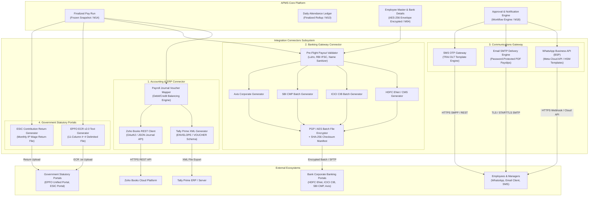

# APMS Integration Connectors Architecture & Specifications

> **Status:** Authoritative | **Last Updated:** 2026-11-16 | **Module:** M14 (Payroll), M16 (Hardware Integration), M18 (Workflows & Integrations) | **Author:** integrations-webhooks specialist

---

## 1. Architectural Overview & Connector SPI

The **APMS Integration Connectors Engine** provides enterprise-grade, bidirectional connectivity between the core APMS platform and external corporate ecosystems. Built on Python 3.12+, FastAPI, and Celery, it abstracts complex third-party protocols into a standardized **Connector Service Provider Interface (SPI)**.

The engine coordinates four mission-critical subsystems:
1. **Accounting & Enterprise Resource Planning (ERP)**: Direct automated export of finalized payroll journal vouchers into Tally Prime XML and Zoho Books REST API.
2. **Banking Gateway**: Automated generation of secure, encrypted bulk disbursement files (NEFT, RTGS, FT, NACH) formatted for India's major commercial banks (HDFC, ICICI, SBI, Axis Bank) with rigorous pre-flight validation.
3. **Communications Gateway**: Multi-channel transactional alert dispatch via WhatsApp Business API (BSP), encrypted PDF payslip delivery via authenticated SMTP, and regulatory TRAI DLT-compliant SMS OTP verification.
4. **Government Statutory Portals**: Automated generation of regulatory compliance filing artifacts, specifically the EPFO Unified Portal Electronic Challan cum Return (ECR v2.0) text file and the ESIC Monthly Contribution Return file.



---

## 2. Subsystem 1: Accounting & ERP Connectors (`INT-01`, `PAY-07`)

### 2.1 Payroll Journal Voucher Architecture & Account Mapping

When a payroll run transitions to `LOCKED` / `FINALIZED`, the accounting engine generates a balanced double-entry journal voucher. The engine maps statutory employee deductions, employer statutory overheads, allowances, and net salaries to the tenant's Chart of Accounts.

#### Standard Payroll Journal Ledger Mapping Matrix

| Transaction Line | Ledger Name (Standard APMS Tag) | Account Type | Entry Type | Rule / Calculation Basis |
| :--- | :--- | :--- | :--- | :--- |
| **Gross Salary Expense** | `Salary & Wages Expense` | Expense | **DEBIT** | Sum of all Earned Basic, HRA, DA, Special & Other Allowances. |
| **Employer EPF Expense** | `Employer PF Contribution Expense` | Expense | **DEBIT** | Sum of EPF Employer A/c 1 (3.67%) + EPS A/c 10 (8.33%) + EDLI A/c 21 (0.50%) + PF Admin A/c 2 (0.50%). |
| **Employer ESI Expense** | `Employer ESI Contribution Expense` | Expense | **DEBIT** | Sum of Employer ESI Contribution (3.25% of eligible gross wages). |
| **Employee EPF Payable** | `PF Payable Account` | Current Liability | **CREDIT** | Total 12% employee PF contribution deducted from wages. |
| **Employer EPF Payable** | `PF Payable Account` (or Sub-Ledger) | Current Liability | **CREDIT** | Total 12% employer PF + 1% EDLI & Admin remitted to EPFO. |
| **Employee ESI Payable** | `ESI Payable Account` | Current Liability | **CREDIT** | Total 0.75% employee ESI contribution deducted from wages. |
| **Employer ESI Payable** | `ESI Payable Account` (or Sub-Ledger) | Current Liability | **CREDIT** | Total 3.25% employer ESI contribution payable to ESIC. |
| **Professional Tax** | `Professional Tax Payable` | Current Liability | **CREDIT** | Sum of state-specific PT deductions remitted to State Tax Dept. |
| **TDS / Income Tax** | `TDS on Salary Payable` | Current Liability | **CREDIT** | Sum of Section 192 TDS withholdings for the pay cycle. |
| **Net Salary Payable** | `Salaries Payable / Bank Clearing` | Current Liability | **CREDIT** | Total Net Salary disbursement to be credited to employee bank accounts. |

> [!IMPORTANT]
> **Zero-Discrepancy Invariant**: The Journal Voucher export generator enforces an absolute balance check before serialization:
> $$\sum \text{Debits} - \sum \text{Credits} = 0.00$$
> If the imbalance exceeds ₹0.00 (down to exact paisa), voucher generation fails immediately and raises an unhandled ledger reconciliation exception.

---

### 2.2 Tally Prime XML Schema Generation (`INT-01`)

APMS exports finalized payroll vouchers in native Tally Prime XML (Tally XML Envelope format). This format supports seamless, one-click automated XML import via Tally Prime Gateway or Server without requiring manual data entry.

#### Tally XML Schema Structure
The XML document strictly follows the Tally schema hierarchy:
- `<ENVELOPE>`: Top-level wrapper.
  - `<HEADER>`: Contains `<TALLYREQUEST>Export Data</TALLYREQUEST>`.
  - `<BODY>`:
    - `<IMPORTDATA>`:
      - `<REQUESTDESC>`: Defines `REPORTNAME="Vouchers"` and company details.
      - `<REQUESTDATA>`:
        - `<TALLYMESSAGE xmlns:UDF="TallyUDF">`:
          - `<VOUCHER VCHTYPE="Journal" ACTION="Create" OBJVIEW="Accounting Voucher View">`: Contains voucher date, voucher number, narration, and all debit/credit ledger lines.

#### Production Tally XML Payload Example

```xml
<ENVELOPE>
  <HEADER>
    <TALLYREQUEST>Export Data</TALLYREQUEST>
  </HEADER>
  <BODY>
    <IMPORTDATA>
      <REQUESTDESC>
        <REPORTNAME>Vouchers</REPORTNAME>
        <STATICVARIABLES>
          <SVCURRENTCOMPANY>ACME ENTERPRISES PRIVATE LIMITED</SVCURRENTCOMPANY>
        </STATICVARIABLES>
      </REQUESTDESC>
      <REQUESTDATA>
        <TALLYMESSAGE xmlns:UDF="TallyUDF">
          <VOUCHER VCHTYPE="Journal" ACTION="Create" OBJVIEW="Accounting Voucher View">
            <DATE>20261031</DATE>
            <VOUCHERTYPENAME>Journal</VOUCHERTYPENAME>
            <VOUCHERNUMBER>APMS/JV/2026-10/001</VOUCHERNUMBER>
            <REFERENCE>PAYRUN-202610-01</REFERENCE>
            <NARRATION>APMS Finalized Payroll Journal for Period 01-Oct-2026 to 31-Oct-2026 across 450 Active Employees. Trace ID: trc_01j7b9k4</NARRATION>
            <EFFECTIVEDATE>20261031</EFFECTIVEDATE>
            <ISINVOICE>No</ISINVOICE>
            
            <!-- DEBIT: Gross Salary Expense -->
            <ALLLEDGERENTRIES.LIST>
              <LEDGERNAME>Salaries and Wages Expense</LEDGERNAME>
              <ISDEEMEDPOSITIVE>Yes</ISDEEMEDPOSITIVE>
              <AMOUNT>-2500000.00</AMOUNT>
            </ALLLEDGERENTRIES.LIST>
            
            <!-- DEBIT: Employer EPF Contribution Expense -->
            <ALLLEDGERENTRIES.LIST>
              <LEDGERNAME>Employer PF Contribution</LEDGERNAME>
              <ISDEEMEDPOSITIVE>Yes</ISDEEMEDPOSITIVE>
              <AMOUNT>-162500.00</AMOUNT>
            </ALLLEDGERENTRIES.LIST>
            
            <!-- DEBIT: Employer ESI Contribution Expense -->
            <ALLLEDGERENTRIES.LIST>
              <LEDGERNAME>Employer ESI Contribution</LEDGERNAME>
              <ISDEEMEDPOSITIVE>Yes</ISDEEMEDPOSITIVE>
              <AMOUNT>-26000.00</AMOUNT>
            </ALLLEDGERENTRIES.LIST>
            
            <!-- CREDIT: Employee & Employer EPF Payable -->
            <ALLLEDGERENTRIES.LIST>
              <LEDGERNAME>Provident Fund Payable</LEDGERNAME>
              <ISDEEMEDPOSITIVE>No</ISDEEMEDPOSITIVE>
              <AMOUNT>312500.00</AMOUNT>
            </ALLLEDGERENTRIES.LIST>
            
            <!-- CREDIT: Employee & Employer ESI Payable -->
            <ALLLEDGERENTRIES.LIST>
              <LEDGERNAME>ESIC Payable</LEDGERNAME>
              <ISDEEMEDPOSITIVE>No</ISDEEMEDPOSITIVE>
              <AMOUNT>32000.00</AMOUNT>
            </ALLLEDGERENTRIES.LIST>
            
            <!-- CREDIT: Professional Tax Payable -->
            <ALLLEDGERENTRIES.LIST>
              <LEDGERNAME>Professional Tax Payable</LEDGERNAME>
              <ISDEEMEDPOSITIVE>No</ISDEEMEDPOSITIVE>
              <AMOUNT>45000.00</AMOUNT>
            </ALLLEDGERENTRIES.LIST>
            
            <!-- CREDIT: TDS on Salary Payable -->
            <ALLLEDGERENTRIES.LIST>
              <LEDGERNAME>TDS on Salary Payable (Sec 192)</LEDGERNAME>
              <ISDEEMEDPOSITIVE>No</ISDEEMEDPOSITIVE>
              <AMOUNT>150000.00</AMOUNT>
            </ALLLEDGERENTRIES.LIST>
            
            <!-- CREDIT: Net Salary Disbursement Payable / Clearing -->
            <ALLLEDGERENTRIES.LIST>
              <LEDGERNAME>Salaries Payable Clearing Account</LEDGERNAME>
              <ISDEEMEDPOSITIVE>No</ISDEEMEDPOSITIVE>
              <AMOUNT>2149000.00</AMOUNT>
            </ALLLEDGERENTRIES.LIST>
          </VOUCHER>
        </TALLYMESSAGE>
      </REQUESTDATA>
    </IMPORTDATA>
  </BODY>
</ENVELOPE>
```

> [!NOTE]
> In Tally Prime XML convention, `<ISDEEMEDPOSITIVE>Yes</ISDEEMEDPOSITIVE>` represents a **Debit** entry (with a negative sign in `<AMOUNT>`), while `<ISDEEMEDPOSITIVE>No</ISDEEMEDPOSITIVE>` represents a **Credit** entry (with a positive sign in `<AMOUNT>`).

---

### 2.3 Zoho Books REST API Integration

For cloud-native accounting deployments, APMS pushes journal vouchers directly to the Zoho Books REST API via asynchronous Celery tasks.

#### Endpoint & Authentication Specifications
- **Method & URL**: `POST https://books.zoho.com/api/v3/journals`
- **Headers**:
  - `Authorization`: `Zoho-oauthtoken <access_token>`
  - `X-com-zoho-books-organizationid`: `<zoho_organization_id>`
  - `Content-Type`: `application/json;charset=UTF-8`
  - `Idempotency-Key`: `<pay_run_uuid>`

#### Production JSON Request Payload Example

```json
{
  "journal_date": "2026-10-31",
  "entry_number": "APMS-JV-202610-01",
  "reference_number": "PAYRUN-202610-01",
  "notes": "APMS Payroll Journal Run for Period 01-Oct-2026 to 31-Oct-2026. Employees: 450. Trace ID: trc_01j7b9k4",
  "currency_id": "982000000000097",
  "line_items": [
    {
      "account_id": "982000000123001",
      "account_name": "Salaries & Wages Expense",
      "debit_or_credit": "d",
      "amount": 2500000.00,
      "description": "Gross Salary Expense for October 2026"
    },
    {
      "account_id": "982000000123002",
      "account_name": "Employer EPF Contribution Expense",
      "debit_or_credit": "d",
      "amount": 162500.00,
      "description": "Employer PF Contribution (A/c 1, 10, 21, 2)"
    },
    {
      "account_id": "982000000123003",
      "account_name": "Employer ESI Contribution Expense",
      "debit_or_credit": "d",
      "amount": 26000.00,
      "description": "Employer ESI Contribution (3.25%)"
    },
    {
      "account_id": "982000000456001",
      "account_name": "PF Payable",
      "debit_or_credit": "c",
      "amount": 312500.00,
      "description": "Consolidated EPF Payable (EE + ER)"
    },
    {
      "account_id": "982000000456002",
      "account_name": "ESI Payable",
      "debit_or_credit": "c",
      "amount": 32000.00,
      "description": "Consolidated ESI Payable (EE + ER)"
    },
    {
      "account_id": "982000000456003",
      "account_name": "Professional Tax Payable",
      "debit_or_credit": "c",
      "amount": 45000.00,
      "description": "PT Payable remitted to State Tax Authority"
    },
    {
      "account_id": "982000000456004",
      "account_name": "TDS Payable (Sec 192)",
      "debit_or_credit": "c",
      "amount": 150000.00,
      "description": "Salary Withholding Tax Payable"
    },
    {
      "account_id": "982000000456005",
      "account_name": "Salaries Payable Clearing",
      "debit_or_credit": "c",
      "amount": 2149000.00,
      "description": "Net Salary Bank Disbursement Clearing"
    }
  ]
}
```

---

## 3. Subsystem 2: Banking Gateway & Salary Disbursement Batches (`PSL-02`)

### 3.1 Pre-Flight Payout Validation Engine

Before generating any commercial bank payment batch file, APMS executes a pre-flight validation routine against all employee payout records:

1. **Bank Account Number Validation**:
   - Strips non-numeric characters.
   - Asserts length between 9 and 18 digits (standard Indian banking clearing).
   - Validates against bank-specific digit masks (e.g., SBI: 11 digits, HDFC: 14 digits, ICICI: 12 digits, Axis: 15 digits).
2. **RBI IFSC Code Verification**:
   - Evaluates the authoritative Reserve Bank of India format regex:
     `^[A-Z]{4}0[A-Z0-9]{6}$`
   - Validates that the 5th character is strictly `'0'` (reserved for future use).
   - Verifies the bank prefix (first 4 letters) against the local cached RBI IFSC directory.
3. **Beneficiary Name Sanitization**:
   - Normalizes beneficiary names to uppercase ASCII.
   - Strips all special characters (`&`, `<`, `>`, `"`, `'`, `,`, `;`, `/`, `\`) which cause transaction rejections on NEFT/RTGS clearing networks.
   - Truncates strictly to the bank file maximum length (standard 35 characters for NEFT/RTGS).
4. **Duplicate Payout Protection**:
   - Computes an idempotency hash for each payment row:
     $$\text{RowHash} = \text{SHA256}(\text{tenant\_id} + \text{pay\_run\_id} + \text{employee\_id} + \text{net\_pay\_amount} + \text{bank\_account})$$
   - Prevents duplicate inclusion of the same employee within the same pay run cycle.

---

### 3.2 Bank Disbursement File Formats

#### 1. HDFC Bank (ENet / Bulk Corporate CMS Delimited Format)
- **File Format**: Comma-Separated Values (`.csv`) or Caret-Separated (`^`).
- **Encoding**: ASCII / UTF-8 without BOM.
- **Specification**:

| Col # | Field Name | Type | Max Len | Mandatory | Description / Validation |
| :--- | :--- | :--- | :--- | :--- | :--- |
| 1 | `Transaction Type` | String | 3 | Yes | `NFT` (NEFT), `RTG` (RTGS), `FT` (Internal HDFC Account). |
| 2 | `Beneficiary Code` | String | 15 | No | Optional employee identification code. |
| 3 | `Beneficiary Account Number` | String | 20 | Yes | Beneficiary bank account number (unmasked). |
| 4 | `Transaction Amount` | Decimal | 15 | Yes | Amount in INR with 2 decimal places (e.g. `45000.00`). |
| 5 | `Beneficiary Name` | String | 35 | Yes | Sanitized employee name per bank master. |
| 6 | `Drawee Location` | String | 35 | No | City or blank for electronic transfers. |
| 7 | `Print Location` | String | 35 | No | Blank for electronic payouts. |
| 8 | `Beneficiary Email ID` | String | 50 | No | Employee email address for payout notification. |
| 9 | `Debit Account Number` | String | 20 | Yes | Corporate debit account number. |
| 10 | `IFSC Code` | String | 11 | Yes | Valid 11-character RBI IFSC (Mandatory for NFT/RTG). |
| 11 | `Payment Reference / Remarks`| String | 30 | Yes | e.g. `SALARY OCT 2026 EMP0192`. |

```csv
NFT,,50100234567890,48500.00,RAMESH KUMAR SHARMA,,,,ramesh@company.com,50200011223344,HDFC0000123,SALARY OCT 2026
NFT,,01234567890123,38250.00,PRIYA ANAND SUNDARAM,,,,priya@company.com,50200011223344,SBIN0001245,SALARY OCT 2026
FT,,50100987654321,52100.00,ANIL SURESH PATEL,,,,anil@company.com,50200011223344,HDFC0000060,SALARY OCT 2026
```

---

#### 2. ICICI Bank (Corporate Internet Banking CIB / Encrypted Batch Format)
- **File Format**: Delimited CSV or Fixed-Width ASCII.
- **Payment Modes**: `N` (NEFT), `R` (RTGS), `I` (ICICI Internal Book Transfer).
- **Specification Table**:

| Column Name | Type | Length | Example Value | Description |
| :--- | :--- | :--- | :--- | :--- |
| `PYMT_MODE` | Char | 1 | `N` | `N` = NEFT, `R` = RTGS, `I` = Internal ICICI. |
| `BENE_NAME` | String | 35 | `SUNIL DESHMUKH` | Beneficiary Name (Special characters stripped). |
| `BENE_ACC_NO` | String | 20 | `001101567890` | Beneficiary Account Number. |
| `BENE_IFSC` | String | 11 | `ICIC0000011` | 11-character IFSC code. |
| `AMOUNT` | Number | 15.2 | `64500.00` | Net payment amount in INR. |
| `TXN_DATE` | Date | 10 | `31/10/2026` | DD/MM/YYYY format. |
| `CUSTOMER_REF_NO` | String | 20 | `SAL202610EMP1001` | Unique transaction trace reference. |
| `SENDER_REMARKS` | String | 30 | `OCT 2026 SALARY` | Description shown on debit statement. |
| `RECEIVER_REMARKS` | String | 30 | `SALARY CREDIT` | Description shown on employee passbook. |
| `BENE_MOBILE` | String | 10 | `9876543210` | 10-digit mobile number for bank SMS alert. |

---

#### 3. State Bank of India (SBI CMP - Corporate Multy Pay)
- **File Structure**: Fixed header record followed by transaction detail records and a trailer record.
- **Trailer Record**: Contains batch record count and sum total of disbursement amounts to prevent truncated uploads.

```text
HDR|APMS_CORP_001|20261031|BATCH_01
DTL|N|SBIN0000456|20123456789|35400.00|VIKAS GUPTA|EMP001|SALARY OCT 2026|9876543211
DTL|N|HDFC0000123|50100456789012|42000.00|MEENA KRISHNAN|EMP002|SALARY OCT 2026|9876543212
DTL|N|UTIB0000005|910010023456789|51200.00|RAJESH SINGH|EMP003|SALARY OCT 2026|9876543213
TRL|3|128600.00
```

---

#### 4. Axis Bank (Corporate Payment Delimited Format)
- **Delimiter**: Pipe (`|`) or Comma (`,`).
- **Record Structure**:
  `CORP_ID|DEBIT_ACC|PAY_TYPE|BENE_IFSC|BENE_ACC|BENE_NAME|AMOUNT|VALUE_DATE|REF_NO|REMARKS`
- **Sample Row**:
  `AXISCORP01|914020012345678|NEFT|UTIB0000123|915010034567890|SANJAY JAIN|47800.00|31/10/2026|APMS20261001|SALARY OCTOBER 2026`

---

### 3.3 Cryptographic Batch File Protection & Integrity Manifest

To prevent unauthorized tampering or file interception before portal upload or SFTP transfer, APMS generates a two-part cryptographic package:

1. **SHA-256 Checksum Manifest (`.sha256`)**:
   APMS computes the cryptographic SHA-256 digest of the generated disbursement file and produces a standard manifest:
   ```text
   9f86d081884c7d659a2feaa0c55ad015a3bf4f1b2b0b822cd15d6c15b0f00a08  HDFC_Salary_Batch_20261031.csv
   ```
2. **PGP / GPG Envelope Encryption**:
   Where direct Host-to-Host (H2H) SFTP integration is enabled, the batch file is automatically encrypted using the bank's public PGP key:
   - Algorithm: RSA 4096-bit key with AES-256 session cipher.
   - Resulting artifact: `HDFC_Salary_Batch_20261031.csv.gpg`.

---

## 4. Subsystem 3: Communications Gateway (`COM-01`, `WFL-03`)

### 4.1 WhatsApp Business API (BSP) Integration

APMS interfaces with Meta-authorized Business Solution Providers (BSPs) such as Gupshup, Karix, and Twilio, as well as Meta Cloud API directly.

#### Message Lifecycle & HSM Templates
All outbound transactional notifications utilize pre-approved **Highly Structured Message (HSM)** templates conforming to WhatsApp Business policies:

1. **Payslip Release Notification (`payslip_released_v1`)**:
   - Template Category: `UTILITY`.
   - Body:
     > *"Hello {{1}}, your payslip for the month of {{2}} has been generated. Net Salary: ₹{{3}}. You can download your confidential payslip using the secure link below."*
   - Interactive Button: `Quick Reply` ("View Salary Summary") or `Call to Action URL` pointing to a signed, time-limited S3 download URL (valid for 15 minutes).
2. **Shift Change / Anomaly Alert (`shift_modification_alert_v1`)**:
   - Template Category: `UTILITY`.
   - Body:
     > *"Notice: Your shift for {{1}} has been updated by your supervisor to {{2}} ({{3}} - {{4}}). Please report accordingly."*
3. **Supervisor Leave Approval Alert (`leave_approval_request_v1`)**:
   - Interactive Buttons: Two quick-action buttons:
     - Button 1: `Approve` (Payload: `ACTION_APPROVE_LEAVE_{request_id}`)
     - Button 2: `Reject` (Payload: `ACTION_REJECT_LEAVE_{request_id}`)
   - When supervisor taps an action, WhatsApp sends an inbound webhook callback to `/api/v1/integrations/whatsapp/webhook`, executing the workflow transition without requiring web portal login.

#### Phone Number Normalization
All phone numbers are validated and converted to strict ITU-T **E.164** format:
- Strips leading zeros, spaces, hyphens, and brackets.
- Prepends country code: `+91` for Indian numbers (e.g., `+919876543210`).

---

### 4.2 Email SMTP Engine & Encrypted Payslip PDF Generation

The email delivery worker operates asynchronously via Celery with `aiosmtplib`, supporting high-volume burst delivery upon pay run finalization.

#### SMTP Security & Authentication Standards
- Transport: Explicit TLS (STARTTLS on port `587`) or implicit TLS (port `465`).
- Domain Protection: Full alignment with sender domain SPF, DKIM (2048-bit RSA header signature), and DMARC policies (`p=reject`).

#### Password-Protected Payslip PDF Generation
Payslip PDFs are dynamically rendered using ReportLab / WeasyPrint from the frozen payroll calculation snapshot and encrypted before attachment:

- **PDF Cryptographic Standard**: Adobe standard AES-128 or AES-256 encryption.
- **Tenant Configurable Password Scheme**:
  - **Standard Scheme (Default)**: First 4 characters of the employee's First Name in UPPERCASE followed by Date and Month of Birth in `DDMM` format.
    - *Example*: Employee **RAMESH KUMAR**, Date of Birth **15th August 1990** $\rightarrow$ Password: `RAME1508`.
  - **PAN-Based Scheme**: First 4 letters of Employee Name + Last 4 characters of Permanent Account Number (PAN).
    - *Example*: Employee **ANIL SHARMA**, PAN `ABCPS1234K` $\rightarrow$ Password: `ANIL1234K`.
- **Permissions**: Print enabled, content extraction/modification strictly locked.

---

### 4.3 Regulatory SMS OTP Gateway (TRAI DLT Compliance)

In compliance with the Telecom Regulatory Authority of India (TRAI) Telecom Commercial Communications Customer Preference Regulations (TCCCPR), all transactional SMS messages must be routed through registered Distributed Ledger Technology (DLT) portals (e.g. Jio DLT, Vilpower, Airtel DLT).

#### Mandatory DLT Parameters in API Dispatch

```json
{
  "sender_id": "APMSIN",
  "principal_entity_id": "1101456789000012345",
  "template_id": "1107160987654321987",
  "recipient_msisdn": "+919876543210",
  "message_text": "Your APMS verification code is 482910. Valid for 5 minutes. Do not share this OTP with anyone. - APMS Cloud"
}
```

#### Security Invariants:
1. **Cryptographically Secure OTP Generation**: Generated via Python `secrets.randbelow(900000) + 100000`.
2. **TTL & Storage**: 6-digit integer cached in Redis with a 300-second (5-minute) TTL.
3. **Throttling**: Maximum 3 OTP requests per phone number within a rolling 15-minute window to eliminate SMS bombing attacks.

---

## 5. Subsystem 4: Government Statutory Portals (`STA-01`, `STA-02`, `RPT-03`)

### 5.1 EPFO Unified Portal ECR (Electronic Challan cum Return) Version 2.0

The Employees' Provident Fund Organisation (EPFO) requires monthly wage and contribution reporting in the unified **ECR v2.0 text file format**.

#### File Structure & Formatting Rules
- **File Extension**: `.txt`
- **Field Delimiter**: `#~#` (Hash-Tilde-Hash)
- **Record Delimiter**: Standard Windows CRLF (`\r\n`) or Unix LF (`\n`).
- **No Trailing Whitespace**: Lines must not contain trailing delimiters.
- **Numeric Precision**: Wages and contributions must be rounded to nearest whole integer (₹0 decimals per EPFO specification).

#### 11-Column ECR Specification Matrix

| Col # | Field Name | Type | Validation Rules & Statutory Limits |
| :--- | :--- | :--- | :--- |
| **1** | `UAN` | Numeric (12) | 12-digit Universal Account Number. Must be verified and active. |
| **2** | `Member Name` | String (80) | Name as registered in EPFO UAN database. |
| **3** | `Gross Wages` | Integer | Total earned wages during the month including all allowances. |
| **4** | `EPF Wages` | Integer | Capped at ₹15,000 statutory ceiling, unless higher pension opted. |
| **5** | `EPS Wages` | Integer | Capped at ₹15,000 ceiling. Set to `0` if member age $\ge$ 58 years. |
| **6** | `EDLI Wages` | Integer | Capped at ₹15,000 statutory ceiling. |
| **7** | `EE Share Remitted` | Integer | Employee PF deduction: Exactly $12\%$ of EPF Wages. |
| **8** | `EPS Share Remitted` | Integer | Employer EPS: $8.33\%$ of EPS Wages (Max ₹1,250). Set to `0` if age $\ge$ 58. |
| **9** | `ER Share Remitted` | Integer | Employer EPF: Difference between $12\%$ of EPF Wages and EPS Share ($\text{Col } 7 - \text{Col } 8$). Minimum $3.67\%$. |
| **10** | `NCP Days` | Integer | Non-Contributory Period (LOP / Absent days during month). Max $31$. |
| **11** | `Refund of Advances`| Integer | Value `0` unless employee is repaying an authorized PF loan advance. |

#### Concrete ECR v2.0 File Sample

```text
100123456789#~#RAMESH KUMAR#~#28500#~#15000#~#15000#~#15000#~#1800#~#1250#~#550#~#0#~#0
100987654321#~#SURESH PATEL#~#14200#~#14200#~#14200#~#14200#~#1704#~#1183#~#521#~#2#~#0
100456123789#~#ANITA DESHMUKH#~#45000#~#15000#~#0#~#15000#~#1800#~#0#~#1800#~#0#~#0
```

> [!NOTE]
> In the third row above, employee **ANITA DESHMUKH** is over 58 years of age. Under EPFO statutory rules, EPS contribution is ₹0 (Column 8 = 0) and the entire 12% employer contribution is diverted to EPF A/c 1 (Column 9 = 1800).

---

### 5.2 ESIC Monthly Contribution Return

The Employees' State Insurance Corporation (ESIC) requires monthly submission of employee contribution details via the Shram Suvidha / ESIC Portal.

#### Return Format Specifications
- **Format**: Comma-Separated Values (`.csv`) or Excel (`.xlsx`).
- **Wage Ceiling**: Applicable to employees whose Gross Monthly Wages $\le \text{₹21,000}$ (or ₹25,000 for employees with certified disabilities).
- **Contribution Rates**:
  - Employee Contribution: $0.75\%$ of Total Monthly Wages.
  - Employer Contribution: $3.25\%$ of Total Monthly Wages.

#### ESIC Return Column Structure

| Column Header | Data Type | Validation Rules & Description |
| :--- | :--- | :--- |
| `IP Insurance Number` | Numeric (10) | 10-digit Insured Person (IP) number issued by ESIC. |
| `IP Name` | String (50) | Full Name of Insured Person per ESIC portal records. |
| `No of Days for which wages paid` | Integer (0–31) | Paid attendance days during the contribution month. |
| `Total Monthly Wages` | Decimal (10,2) | Total earned wages subject to ESI calculation. |
| `IP Contribution` | Decimal (10,2) | Employee contribution ($0.75\%$), rounded to next rupee. |
| `Employer Contribution` | Decimal (10,2) | Employer contribution ($3.25\%$), rounded to next rupee. |
| `Reason Code for Zero Working Days` | Integer (1–7) | Mandatory if working days = 0. Codes: 1=Left Service, 2=Retrenched, 3=On Leave without Pay, 4=Maternity, 5=Disablement, 6=Lockout, 7=Other. |

#### Sample ESIC Return Data

```csv
IP_NUMBER,IP_NAME,PAID_DAYS,TOTAL_WAGES,IP_CONTRIBUTION,ER_CONTRIBUTION,ZERO_DAYS_REASON
3112345678,MOHAN DAS,26,18500.00,139.00,602.00,
3198765432,KAVITA NAIR,24,16200.00,122.00,527.00,
3145678901,RAJESH YADAV,0,0.00,0.00,0.00,3
```

---

## 6. Execution Traceability, Audit Logging & Idempotency

All connector operations are executed under strict transactional audit logging:

1. **`integration_jobs` Table**:
   Every batch generation or API synchronization logs:
   - `job_id` (UUIDv7)
   - `tenant_id` (RLS enforced)
   - `connector_type` (`TALLY_XML`, `ZOHO_BOOKS`, `HDFC_CMS`, `ICICI_CIB`, `EPFO_ECR`, `ESIC_RETURN`)
   - `reference_id` (Linked to `pay_run_id`)
   - `status` (`PENDING`, `GENERATED`, `DISPATCHED`, `FAILED`)
   - `checksum_sha256` (SHA-256 digest of generated artifact)
   - `created_by` (User UUID)
   - `created_at` (Timestamp UTC)
2. **Deterministic Explanation Trace Linkage**:
   Generated statutory returns and banking batches maintain a direct foreign key to the immutable payroll calculation trace (`calc_trace_id`), enabling statutory auditors to inspect the precise rule execution path down to individual employee attendance records.
