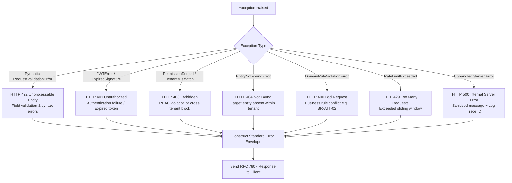

# APMS Request Lifecycle & Middleware Architecture

> **Status:** Authoritative | **Last Updated:** 2026-11-16 | **Source:** Extracted from APMS documentation

---

## 1. Architectural Overview

APMS is structured as a high-throughput, asynchronous modular monolith built on **Python 3.12+**, **FastAPI**, **SQLAlchemy 2.0 (async)**, and **PostgreSQL 16+**. Every HTTP request traverses a deterministic, defense-in-depth pipeline that enforces TLS termination, IP rate limiting, tenant context resolution, cryptographic JWT authentication, database Row-Level Security (RLS) session binding, and strict Pydantic v2 validation before invoking domain logic.

---

## 2. Complete Request Lifecycle Flowchart

The following diagram details the end-to-end journey of an HTTP request from external clients through Nginx, the ordered FastAPI middleware chain, core layered application components, PostgreSQL RLS persistence, and asynchronous task dispatch.

```mermaid
flowchart TD
    subgraph ClientLayer["1. Client Layer"]
        Client["Web SPA / Mobile App / Biometric Edge Agent"]
    end

    subgraph GatewayLayer["2. Gateway & Edge (Nginx)"]
        NGX_TLS["TLS 1.3 Termination<br/>(HTTPS / WSS)"]
        NGX_RATE["Nginx Edge Rate Limiting<br/>(limit_req zone: 100 req/s/IP)"]
        NGX_PROXY["Reverse Proxy & Header Injection<br/>(X-Forwarded-For, X-Real-IP)"]
    end

    subgraph MiddlewareStack["3. FastAPI Middleware Stack (Ordered Execution)"]
        MW_CORS["1. CORSMiddleware<br/>(Origin check, preflight OPTIONS)"]
        MW_REQ_ID["2. RequestIDMiddleware<br/>(Inject / Propagate X-Request-ID)"]
        MW_TENANT["3. TenantResolutionMiddleware<br/>(Extract Host subdomain / X-Tenant-Code)"]
        MW_JWT["4. JWTAuthenticationMiddleware<br/>(Validate Bearer token & Redis Blacklist)"]
        MW_RLS["5. RLSContextMiddleware<br/>(Bind tenant_id to asyncio ContextVar)"]
        MW_RATE["6. DynamicRateLimiterMiddleware<br/>(Redis sliding window per Tenant/User)"]
    end

    subgraph AppLayers["4. Modular Monolith Application Core"]
        ROUTER["FastAPI Router / Route Handler<br/>(Pydantic v2 Input Validation & RBAC Guard)"]
        SERVICE["Domain Service Layer<br/>(Attendance Engine / Payroll Wizard / Leave Ledger)"]
        REPO["Repository Layer<br/>(SQLAlchemy Async Queries & Model Mapping)"]
    end

    subgraph DataPersistence["5. Persistence & Multi-Tenant Database Layer"]
        SA_SESSION["SQLAlchemy 2.0 Async Session<br/>(Connection Checkout from Pool)"]
        SET_LOCAL["SET LOCAL app.current_tenant_id = :tenant_id<br/>(Transaction-scoped session binding)"]
        PG_RLS[("PostgreSQL 16+ Engine<br/>FORCE ROW LEVEL SECURITY<br/>(Append-only tables & partitions)")]
    end

    subgraph AsyncQueue["6. Asynchronous Background Dispatch"]
        REDIS_BROKER[("Redis 7+ Broker")]
        CELERY_WORKER["Celery / ARQ Worker<br/>(Punch pairing, Pay run, PDF payslips)"]
    end

    subgraph ResponseFlow["7. Outbound Response & Serialization"]
        SCHEMA_OUT["Pydantic v2 Response Model<br/>(Standard Envelope: success, data, meta)"]
        JSON_RESP["JSON Response Body + Audit Logs"]
    end

    %% Inbound Path
    Client -->|HTTPS Request| NGX_TLS
    NGX_TLS --> NGX_RATE
    NGX_RATE --> NGX_PROXY
    NGX_PROXY -->|HTTP / Unix Socket| MW_CORS
    MW_CORS --> MW_REQ_ID
    MW_REQ_ID --> MW_TENANT
    MW_TENANT --> MW_JWT
    MW_JWT --> MW_RLS
    MW_RLS --> MW_RATE
    MW_RATE --> ROUTER

    %% Core Path
    ROUTER -->|Validated DTO| SERVICE
    SERVICE -->|Domain Operations| REPO
    REPO -->|Query / Mutate| SA_SESSION
    SA_SESSION -->|Execute on checkout| SET_LOCAL
    SET_LOCAL -->|Enforced Query| PG_RLS
    PG_RLS -->|Filtered Rows| SA_SESSION

    %% Async Dispatch
    SERVICE -.->|Heavy Task / Webhook| REDIS_BROKER
    REDIS_BROKER -.->|Consume Job| CELERY_WORKER

    %% Outbound Path
    SA_SESSION --> REPO
    REPO --> SERVICE
    SERVICE --> ROUTER
    ROUTER --> SCHEMA_OUT
    SCHEMA_OUT --> JSON_RESP
    JSON_RESP -->|HTTP 200 OK| Client

    %% Error Handling Connections
    ROUTER -.->|Validation Failed (422)| ERR_422["RFC 7807 Error Envelope"]
    MW_JWT -.->|Invalid/Expired Token (401)| ERR_401["RFC 7807 Error Envelope"]
    ROUTER -.->|Unauthorized Role (403)| ERR_403["RFC 7807 Error Envelope"]
    SERVICE -.->|Entity Missing (404)| ERR_404["RFC 7807 Error Envelope"]
    SERVICE -.->|Invariant Failure (400)| ERR_400["RFC 7807 Error Envelope"]
    AppLayers -.->|Unhandled Crash (500)| ERR_500["RFC 7807 Error Envelope"]
    ERR_422 & ERR_401 & ERR_403 & ERR_404 & ERR_400 & ERR_500 -.-> Client

    classDef client fill:#3b82f6,color:#fff,stroke:#1d4ed8;
    classDef edge fill:#0284c7,color:#fff,stroke:#0369a1;
    classDef middleware fill:#6366f1,color:#fff,stroke:#4338ca;
    classDef app fill:#059669,color:#fff,stroke:#047857;
    classDef db fill:#0f766e,color:#fff,stroke:#115e59;
    classDef async fill:#d97706,color:#fff,stroke:#b45309;
    classDef err fill:#b91c1c,color:#fff,stroke:#991b1b;

    class Client client;
    class NGX_TLS,NGX_RATE,NGX_PROXY edge;
    class MW_CORS,MW_REQ_ID,MW_TENANT,MW_JWT,MW_RLS,MW_RATE middleware;
    class ROUTER,SERVICE,REPO app;
    class SA_SESSION,SET_LOCAL,PG_RLS db;
    class REDIS_BROKER,CELERY_WORKER async;
    class ERR_422,ERR_401,ERR_403,ERR_404,ERR_400,ERR_500 err;
```

---

## 3. The FastAPI Middleware Pipeline (Order of Execution)

Middleware execution order in Starlette/FastAPI is critical. Inbound requests pass through middlewares in the order they are wrapped (top-to-bottom); outbound responses pass in reverse order (bottom-to-top).

```
Incoming Request
   │
   ▼
┌────────────────────────────────────────────────────────┐
│ 1. CORSMiddleware                                      │
├────────────────────────────────────────────────────────┤
│ 2. RequestIDMiddleware                                 │
├────────────────────────────────────────────────────────┤
│ 3. TenantResolutionMiddleware                          │
├────────────────────────────────────────────────────────┤
│ 4. JWTAuthenticationMiddleware                         │
├────────────────────────────────────────────────────────┤
│ 5. RLSContextMiddleware (ContextVar binding)           │
├────────────────────────────────────────────────────────┤
│ 6. DynamicRateLimiterMiddleware (Redis Token Bucket)   │
└────────────────────────────────────────────────────────┘
   │
   ▼
Route Handler & Dependency Injection
```

### 3.1 Step-by-Step Middleware Responsibilities

1. **`CORSMiddleware`**:
   - Inspects `Origin` and `Access-Control-Request-Method` headers.
   - For `OPTIONS` preflight requests, returns allowed headers, methods, and credentials immediately without passing down the chain.
   - Protects against cross-origin resource access.

2. **`RequestIDMiddleware`**:
   - Checks for incoming `X-Request-ID` header; if absent, generates a high-entropy UUIDv7 (`req_01j7b9k4...`).
   - Injects the request ID into Python's `contextvars` context for unified logging across services and database queries.
   - Attaches `X-Request-ID` to all outbound HTTP response headers.

3. **`TenantResolutionMiddleware`**:
   - Identifies the calling tenant boundary via subdomain resolution (e.g. `acme.apms.cloud` $\rightarrow$ `acme`) or `X-Tenant-Code` header (for mobile/edge agent APIs).
   - Validates tenant existence and subscription state against Redis cache.

4. **`JWTAuthenticationMiddleware`**:
   - Reads `Authorization: Bearer <token>`.
   - Validates token signature (RS256/EdDSA) and `exp` timestamp.
   - Performs instant check against Redis token blacklist (`blacklist:{jti}`).
   - Cross-checks token claim `tid` against resolved tenant identity from Step 3. Discrepancies immediately abort with `403 Forbidden`.

5. **`RLSContextMiddleware`**:
   - Stores the verified `tenant_id` into a thread-safe / coroutine-safe `asyncio.ContextVar[UUID]`.
   - Ensures any database session spawned during this request cycle has access to the tenant scope.

6. **`DynamicRateLimiterMiddleware`**:
   - Enforces Redis-backed sliding window rate limits:
     - Edge punch ingestion: 10,000 req/min per tenant.
     - General CRUD: 120 req/min per user.
     - Sensitive auth/crypto endpoints: 10 req/min per IP.
   - If limits are exceeded, halts the request with HTTP `429 Too Many Requests` and `Retry-After` header.

---

## 4. Application Layer Breakdown

### 4.1 Route Handlers & Dependency Injection
- FastAPI route functions declare dependencies via `Depends()`:
  - `get_current_user`: Returns authenticated `UserContext` (`user_id`, `tenant_id`, `role`).
  - `require_permission(Resource, Action)`: Enforces RBAC permissions.
  - `get_db_session`: Yields a transactional SQLAlchemy async session.
- Request payload is validated using **Pydantic v2**:
  - Rejects unknown attributes, invalid datatypes, malformed timestamps, or regex violations with `422 Unprocessable Entity`.

### 4.2 Service Layer (Domain Logic)
- Encapsulates pure business logic independent of transport protocols.
- Interacts with domain engines:
  - **Attendance Pairing Engine**: Evaluates session windows, applies multi-session gap exclusion (`N65`), and assigns daily rollup status (`N66a`).
  - **Leave Engine**: Enforces double-entry ledger checks and sandwich rules (`LVE-04`).
  - **Payroll Engine**: Orchestrates 10-step wizard transitions and statutory calculations (`STA-01..05`).
- Produces immutable JSON explanation traces (`ATT-11`, `ADR-14`) for every calculated result.

### 4.3 Repository & SQLAlchemy 2.0 Async Persistence
- Database sessions use asyncpg driver:
  ```python
  async def get_db_session() -> AsyncGenerator[AsyncSession, None]:
      async with async_session_factory() as session:
          tenant_id = current_tenant_ctx.get()
          # Non-negotiable RLS binding
          await session.execute(
              text("SET LOCAL app.current_tenant_id = :tenant_id"),
              {"tenant_id": str(tenant_id)}
          )
          yield session
  ```
- **PostgreSQL Native RLS**: Enforces `FORCE ROW LEVEL SECURITY` on all tenant-scoped tables (`employees`, `attendance_record`, `leave_transaction`, `pay_run`). Even raw SQL queries cannot leak cross-tenant rows.

---

## 5. Response Path & Serialization

1. **Entity to Schema Mapping**: Repositories return ORM or raw SQL mapped entities. The service transforms domain entities into Pydantic response models (`response_model=BaseResponse[T]`).
2. **Envelope Standardization**:
   ```json
   {
     "success": true,
     "data": {
       "id": "018f3a5b-9a8c-7000-8b01-234567890abc",
       "attendanceDate": "2026-11-16",
       "status": "PRESENT",
       "workedMinutes": 480
     },
     "meta": {
       "timestamp": "2026-11-16T10:52:00Z",
       "requestId": "req_01j7b9k4m1n2"
     }
   }
   ```
3. **Outbound Headers**: Middleware adds security headers (`X-Content-Type-Options: nosniff`, `X-Frame-Options: DENY`, `Content-Security-Policy`) and echoes `X-Request-ID`.

---

## 6. Error Handling Architecture (RFC 7807)

APMS standardizes all error responses using RFC 7807 Problem Details. An application-wide exception handler intercepts exceptions and maps them to appropriate HTTP status codes:



### Standard Error Schema Example
```json
{
  "success": false,
  "error": {
    "code": "BUSINESS_RULE_VIOLATION",
    "message": "The punch timestamp falls within an excluded mid-shift break interval.",
    "details": [
      {
        "field": "punch_time",
        "issue": "Interval 12:00 to 16:00 is configured as non-working gap (N65)"
      }
    ]
  },
  "meta": {
    "timestamp": "2026-11-16T10:52:01Z",
    "requestId": "req_01j7b9k4m1n3"
  }
}
```

---

## 7. Background Task Dispatch & Idempotency

### 7.1 Idempotency Key Handling (`Idempotency-Key`)
- Mutating endpoints (`POST /api/v1/pay-runs/{id}/execute`, `POST /api/v1/punches/bulk`) require an `Idempotency-Key: <UUID>` header.
- The middleware checks Redis for `idempotency:{tenant_id}:{key}`:
  - **In Progress**: Returns `409 Conflict` (Operation already processing).
  - **Completed**: Returns the cached response payload immediately without re-executing domain actions.
  - **New**: Locks the key with a 120-second TTL and permits execution.

### 7.2 Celery / Redis Asynchronous Offloading
Heavy operations are never executed synchronously in the HTTP request loop:
- **Biometric Punch Ingestion**: Written to append-only `raw_envelope`, then Celery worker dispatches chronological pairing and daily rollup.
- **Monthly Pay Run Wizard**: Steps 3–8 (attendance sync, statutory calculations, net pay resolution) are executed as idempotent Celery tasks reporting progress via Redis pub/sub.
- **Server-Side PDF Payslips (`PSL-01`)**: Headless Chromium / WeasyPrint processes run in isolated worker containers, uploading signed PDFs to S3/MinIO and emitting download URLs.
- **Outbound Webhooks (`INT-02`)**: Dispatched asynchronously with exponential backoff retries and HMAC-SHA256 signature headers.
