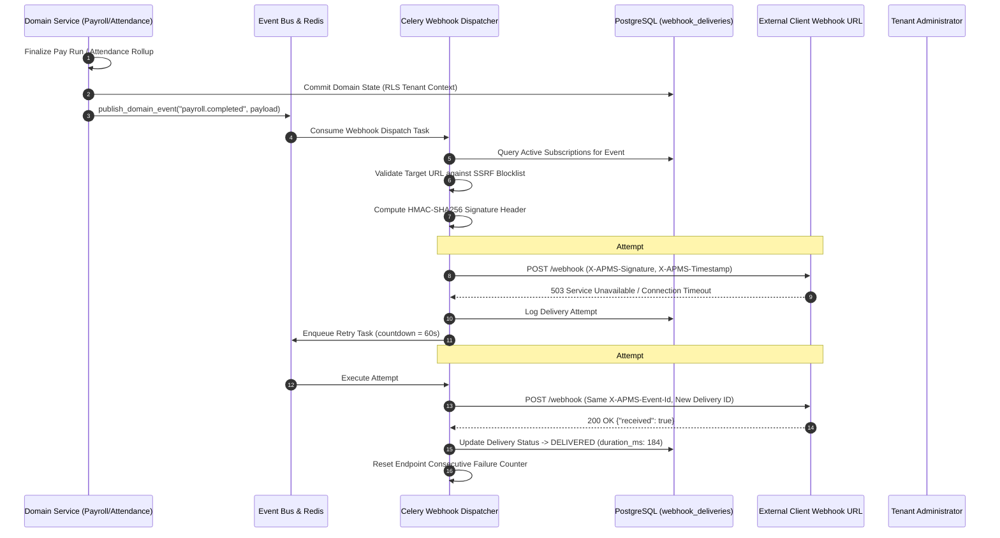

# APMS Outbound Webhook Event Architecture & Delivery Specifications

> **Status:** Authoritative | **Last Updated:** 2026-11-16 | **Module:** M18 (Workflows & Integrations) | **Author:** integrations-webhooks specialist

---

## 1. Executive Summary & Design Principles

The **APMS Outbound Webhook Delivery Engine** provides guaranteed, event-driven integration between the APMS multi-tenant core platform and external subscriber systems (such as corporate ERPs, custom HR portals, chatops systems, and IT automation tools).

The architecture is built on five core engineering invariants:
1. **At-Least-Once Delivery**: Every domain event registered by an active subscription is guaranteed to be dispatched, with stateful retry tracking across transient network or client outages.
2. **Cryptographic Non-Repudiation**: Payloads are signed using **HMAC-SHA256** with pre-shared secrets, protecting client endpoints against spoofing, payload tampering, and replay attacks.
3. **Strict Tenant Isolation**: Webhook endpoints and event dispatches are strictly scoped to the originating tenant context via PostgreSQL Row-Level Security (RLS). Cross-tenant delivery is architecturally impossible.
4. **Anti-SSRF Perimeter Protection**: Aggressive outbound URL inspection and IP filtering prevent Server-Side Request Forgery (SSRF) against internal cluster services, loopback interfaces, or cloud metadata endpoints (`169.254.169.254`).
5. **Decoupled Asynchronous Execution**: Webhook dispatch is completely detached from the core FastAPI HTTP request lifecycle via Redis message queues and dedicated Celery worker pools.

---

## 2. End-to-End Delivery Architecture Flowchart

```mermaid
flowchart TD
    subgraph CoreApplication["1. APMS Core Domain Layer"]
        DOMAIN_ACTION["FastAPI Domain Action<br/>(e.g. Lock Pay Run, Finalize Attendance)"]
        TRANSACTION["PostgreSQL Transaction Commit<br/>(RLS Context app.current_tenant_id)"]
        EVENT_DISPATCH["Domain Event Publisher<br/>(publish_domain_event)"]
        
        DOMAIN_ACTION --> TRANSACTION --> EVENT_DISPATCH
    end

    subgraph MessageBroker["2. Redis & Task Broker"]
        REDIS_STREAM[("Redis Event Stream<br/>(stream:tenant_events)")]
        CELERY_QUEUE[("Celery Task Queue<br/>(queue: webhooks_outbound)")]
        
        EVENT_DISPATCH --> REDIS_STREAM --> CELERY_QUEUE
    end

    subgraph WebhookWorker["3. Celery Webhook Dispatcher Worker"]
        MATCHER["Subscription Matcher & Filter<br/>(Active Webhook Endpoints)"]
        SSRF_GUARD["Anti-SSRF Defense Filter<br/>(DNS Resolution & IP Blocklist)"]
        SIGNER["HMAC-SHA256 Payload Signer<br/>(Secret + Timestamp + Body)"]
        HTTP_CLIENT["Asynchronous HTTP Client<br/>(httpx, TLS 1.3, 10s Timeout)"]
        
        CELERY_QUEUE --> MATCHER
        MATCHER --> SSRF_GUARD
        SSRF_GUARD --> SIGNER
        SIGNER --> HTTP_CLIENT
    end

    subgraph SubscriberPerimeter["4. External Subscriber Destination"]
        EXT_ENDPOINT["Client HTTPS Webhook Endpoint<br/>(https://erp.client.com/webhook)"]
        SIG_VERIFY["Client Signature Verification<br/>(X-APMS-Signature & Timestamp)"]
        RESP_CODE{"HTTP Status<br/>2xx Success?"}
        
        HTTP_CLIENT -->|POST Webhook Request| EXT_ENDPOINT
        EXT_ENDPOINT --> SIG_VERIFY --> RESP_CODE
    end

    subgraph DeliveryPersistence["5. Persistence & Reliability Engine"]
        RESP_CODE -->|Yes (200-299)| LOG_SUCCESS["Record Success<br/>status = DELIVERED"]
        RESP_CODE -->|No (4xx/5xx/Timeout)| RETRY_ENGINE["Exponential Backoff Engine<br/>(1m, 5m, 30m, 2h, 24h)"]
        
        RETRY_ENGINE -->|Attempts < 5| RESCHEDULE["Schedule Celery Retry<br/>countdown = backoff_seconds"]
        RETRY_ENGINE -->|Attempts = 5 Failed| DLQ["Dead Letter Queue (DLQ)<br/>status = DEAD_LETTER"]
        
        RESCHEDULE --> CELERY_QUEUE
        DLQ --> CIRCUIT_BREAKER["Circuit Breaker Evaluation<br/>(10 consecutive failures)"]
        DLQ --> NOTIFY_ADMIN["Tenant Admin Failure Notification<br/>(In-App Banner + Email)"]
        
        DB_DELIVERIES[("webhook_deliveries<br/>(Append-Only Log)")]
        LOG_SUCCESS --> DB_DELIVERIES
        DLQ --> DB_DELIVERIES
    end
```

---

## 3. End-to-End Sequence Diagram

The following sequence diagram illustrates the lifecycle of a domain event triggering an outbound webhook, handling an initial failure, executing an exponential backoff retry, and final delivery confirmation.



---

## 4. Supported Domain Event Types & JSON Schemas

APMS dispatches strongly typed JSON payloads structured inside a universal event envelope.

### 4.1 Domain Event Catalog

| Event Name | Domain Module | Trigger Condition | Critical Data Entities |
| :--- | :--- | :--- | :--- |
| `attendance.finalized` | M10 | Nightly daily attendance rollup finalized for a branch/date. | Date, Branch ID, Total Present, Total Absent, Overtime Hours. |
| `attendance.anomaly_detected` | M09 / M10 | Severe biometric anomaly, mismatched punches, or unexcused gap. | Employee ID, Anomaly Code, Shift ID, Raw Punches. |
| `leave.requested` | M12 | Employee submits new leave application via ESS. | Request ID, Employee ID, Leave Type, Days, Session Targets. |
| `leave.approved` | M12 | Supervisor approves leave; double-entry ledger updated. | Request ID, Approver ID, Ledger Transaction UUIDs. |
| `leave.rejected` | M12 | Supervisor or HR rejects leave application. | Request ID, Approver ID, Rejection Reason. |
| `payroll.pay_run_locked` | M14 | Pay run calculation validated, locked, and frozen. | Pay Run ID, Period (YYYY-MM), Headcount, Total Gross, Total Net. |
| `payroll.disbursement_completed`| M14 | Bank disbursement batch files generated and approved. | Batch ID, Bank Name, Total Payout Amount, File SHA-256. |
| `employee.onboarded` | M04 | New employee master record confirmed and activated. | Employee ID, Department, Designation, Joining Date. |
| `employee.terminated` | M04 | Employee separation processed; DPDP retention initiated. | Employee ID, Relieving Date, Reason Code. |
| `device.offline` | M16 | Hardware terminal or Edge Agent missed 3 heartbeat cycles. | Device Serial Number, Location, Last Heartbeat Timestamp. |

---

### 4.2 Standard Universal Webhook Envelope

All outgoing webhooks share the following canonical JSON schema:

```json
{
  "id": "evt_01j7b9k4x8y9z0123456789abc",
  "event": "payroll.pay_run_locked",
  "api_version": "2026-11-01",
  "created_at": "2026-11-16T14:30:00.000Z",
  "tenant_id": "018f3a5b-9a8c-7000-8b01-234567890abc",
  "trace_id": "trc_9ca085bf-1732-4665-af98-39828d0c1566",
  "data": {
    "pay_run_id": "018f3a5b-9a8c-7000-8b01-998877665544",
    "payroll_period": "2026-10",
    "start_date": "2026-10-01",
    "end_date": "2026-10-31",
    "total_employees": 450,
    "currency": "INR",
    "totals": {
      "gross_earnings": 2500000.00,
      "total_deductions": 351000.00,
      "net_pay": 2149000.00,
      "employer_statutory_overhead": 188500.00
    },
    "statutory_summary": {
      "epf_employee_remitted": 312500.00,
      "esi_employee_remitted": 32000.00,
      "professional_tax": 45000.00,
      "tds_withheld": 150000.00
    },
    "locked_by": {
      "user_id": "018f3a5b-9a8c-7000-8b01-112233445566",
      "name": "Arun Verma (HR Admin)"
    }
  }
}
```

---

## 5. Cryptographic Signing & Non-Repudiation (HMAC-SHA256)

Every outbound webhook request includes cryptographic headers enabling the receiving server to verify the authenticity, integrity, and recency of the payload.

### 5.1 Outbound HTTP Headers

| Header Name | Value / Format | Purpose |
| :--- | :--- | :--- |
| `X-APMS-Signature` | `t=1794753000,v1=a5c9f3e1b7...` | Comma-separated signature header containing timestamp (`t`) and HMAC-SHA256 hex digest (`v1`). |
| `X-APMS-Timestamp` | `1794753000` | Unix epoch timestamp (seconds) when signature was computed. |
| `X-APMS-Event-Id` | `evt_01j7b9k4x8y9...` | Unique domain event UUID. Unchanging across all retries of this event. |
| `X-APMS-Delivery-Id` | `dlv_01j7b9m2k3l4...` | Unique attempt UUID. Regenerated on every distinct HTTP transmission. |
| `User-Agent` | `APMS-Webhook-Dispatcher/2.0` | Identifies APMS delivery client. |
| `Content-Type` | `application/json; charset=utf-8`| Standard JSON encoding. |

---

### 5.2 Signature Generation Algorithm

1. Retrieve the tenant-endpoint pre-shared secret key ($K$), stored with AES-256-GCM envelope encryption in `webhook_endpoints.secret`.
2. Capture the current integer Unix timestamp ($T$).
3. Prepare the raw UTF-8 string payload ($P$).
4. Construct the signature pre-hash string:
   $$\text{CanonicalString} = T + "." + P$$
5. Compute the HMAC using the SHA-256 hash function:
   $$\text{Digest} = \text{HMAC-SHA256}(K, \text{CanonicalString})$$
6. Construct the header:
   $$\text{X-APMS-Signature} = \text{"t="} + T + \text{",v1="} + \text{Digest.hex()}$$

---

### 5.3 Client Verification Code Examples

#### Python (FastAPI / Flask Receiver)

```python
import hmac
import hashlib
import time
from fastapi import Request, HTTPException

WEBHOOK_SECRET = "whsec_9876543210abcdef9876543210abcdef"
MAX_TIMESTAMP_TOLERANCE_SECONDS = 300  # 5 minutes

async def verify_apms_webhook(request: Request):
    sig_header = request.headers.get("X-APMS-Signature")
    if not sig_header:
        raise HTTPException(status_code=401, detail="Missing X-APMS-Signature header")

    # Parse 't=...,v1=...'
    parts = dict(item.split("=") for item in sig_header.split(","))
    timestamp = parts.get("t")
    signature = parts.get("v1")

    if not timestamp or not signature:
        raise HTTPException(status_code=401, detail="Malformed signature header")

    # Replay attack prevention: assert timestamp is within 300 seconds
    current_time = int(time.time())
    if abs(current_time - int(timestamp)) > MAX_TIMESTAMP_TOLERANCE_SECONDS:
        raise HTTPException(status_code=401, detail="Signature timestamp expired (replay attack defense)")

    # Read raw body bytes
    raw_body = await request.body()
    canonical_string = f"{timestamp}.".encode("utf-8") + raw_body

    # Compute expected HMAC-SHA256
    expected_sig = hmac.new(
        WEBHOOK_SECRET.encode("utf-8"),
        canonical_string,
        hashlib.sha256
    ).hexdigest()

    # Constant-time comparison
    if not hmac.compare_digest(expected_sig, signature):
        raise HTTPException(status_code=401, detail="Invalid HMAC-SHA256 signature")

    return True
```

#### Node.js / Express Receiver

```javascript
const crypto = require('crypto');

function verifyApmsSignature(req, res, next) {
    const sigHeader = req.headers['x-apms-signature'];
    if (!sigHeader) return res.status(401).send('Missing X-APMS-Signature header');

    const elements = sigHeader.split(',').reduce((acc, curr) => {
        const [k, v] = curr.split('=');
        acc[k] = v;
        return acc;
    }, {});

    const timestamp = elements['t'];
    const signature = elements['v1'];

    // 5-minute replay defense
    const now = Math.floor(Date.now() / 1000);
    if (Math.abs(now - parseInt(timestamp, 10)) > 300) {
        return res.status(401).send('Webhook timestamp outside acceptable tolerance window');
    }

    // req.rawBody must contain unparsed raw buffer
    const canonicalPayload = `${timestamp}.${req.rawBody.toString('utf8')}`;
    const expectedSig = crypto
        .createHmac('sha256', process.env.WEBHOOK_SECRET)
        .update(canonicalPayload)
        .digest('hex');

    if (!crypto.timingSafeEqual(Buffer.from(signature), Buffer.from(expectedSig))) {
        return res.status(401).send('Invalid signature');
    }

    next();
}
```

---

## 6. HTTP Client Execution & Response Validation Rules

The outbound HTTP dispatcher is configured with strict network timeouts and response validation:

- **Client Stack**: Python `httpx.AsyncClient` with HTTP/2 and TLS 1.3 support.
- **Connection Timeout**: $5.0\text{ seconds}$.
- **Read / Write Timeout**: $10.0\text{ seconds}$.
- **Max Response Body Capture**: Truncated at first $512\text{ bytes}$ for diagnostic logging to conserve storage.
- **Redirects Handling**: Strict `follow_redirects=False`. Any HTTP `301`, `302`, `307`, or `308` status code is treated as an immediate delivery failure to prevent SSRF redirection bypasses.
- **Status Evaluation**:
  - `200` to `299`: **Success**. Marked `DELIVERED`. Consecutive failure counter reset to 0.
  - `410 Gone`: **Terminal Client Error**. Webhook endpoint is automatically deactivated (`is_active = FALSE`). No further retries attempted.
  - `400`, `401`, `403`, `404`, `429`, `500`, `502`, `503`, `504` or Network Drop: **Eligible for Exponential Backoff Retry**.

---

## 7. Retry Policy, Exponential Backoff & Dead Letter Queue (DLQ)

When an initial webhook delivery attempt fails, APMS enqueues the event into an exponential backoff schedule spanning approximately 26.5 hours across 5 automated retry attempts.

### 7.1 Tiered Exponential Backoff Schedule

| Attempt # | Delay Window | Nominal Wait | Wait with Random Jitter ($\pm 10\%$) | Cumulative Time Elapsed |
| :---: | :---: | :---: | :---: | :---: |
| **Attempt 1** | Immediate | 0 seconds | Immediate dispatch | 0 seconds |
| **Attempt 2** | 1 Minute | 60 seconds | $54\text{s} - 66\text{s}$ | $\sim 1\text{ minute}$ |
| **Attempt 3** | 5 Minutes | 300 seconds | $270\text{s} - 330\text{s}$ | $\sim 6\text{ minutes}$ |
| **Attempt 4** | 30 Minutes | 1,800 seconds | $1,620\text{s} - 1,980\text{s}$ | $\sim 36\text{ minutes}$ |
| **Attempt 5** | 2 Hours | 7,200 seconds | $6,480\text{s} - 7,920\text{s}$ | $\sim 2.6\text{ hours}$ |
| **Attempt 6** | 24 Hours | 86,400 seconds | $77,760\text{s} - 95,040\text{s}$ | $\sim 26.6\text{ hours}$ |

> [!TIP]
> **Full Jitter Formula**: The exact retry countdown is computed as:
> $$\text{countdown} = \text{base\_delay} \times (1 + \text{secrets.choice}([-0.10, +0.10]))$$
> This jitter prevents synchronization storms across external client servers recovering from major outages.

---

### 7.2 Dead Letter Queue (DLQ) & Circuit Breaker Logic

If all 6 delivery attempts (initial + 5 retries) fail, the delivery lifecycle transitions to terminal states:

1. **Dead Letter Queue (DLQ)**:
   - The delivery record is marked `DEAD_LETTER`.
   - The complete original event payload, failure history, and final response headers are copied to `webhook_dead_letter_events`.
2. **Circuit Breaker Trip**:
   - Each endpoint tracks `consecutive_failure_count`.
   - If an endpoint incurs **10 consecutive dead-lettered events**, the circuit breaker trips.
   - Endpoint status changes from `ACTIVE` to `DISABLED_DEGRADED`.
   - Further event dispatches to this URL are halted immediately to protect worker queue capacity.
3. **Tenant Admin Notification**:
   - An urgent in-app banner is raised in the APMS Administrative Console.
   - An automated transactional email is sent to all registered `TENANT_ADMIN` users with failure diagnosis details.
4. **Manual Replay Capability**:
   - Once the client fixes their infrastructure, tenant admins can click **"Test & Replay"** in the UI (`POST /api/v1/webhooks/deliveries/{id}/replay`), which triggers a fresh Celery task to redeliver the archived payload.

---

## 8. Anti-SSRF (Server-Side Request Forgery) Defense Architecture

Allowing multi-tenant administrators to register arbitrary webhook URLs introduces high-risk SSRF exposure. APMS enforces a rigorous three-stage defense-in-depth perimeter:

### 8.1 URL Scheme & Protocol Restrictions
- Only `https://` schemes are accepted. Plain `http://` registration is rejected by the Pydantic validator with error code `INSECURE_WEBHOOK_PROTOCOL`.
- Explicit port restrictions: Only standard HTTPS ports `443` and `8443` are permitted. Custom internal ports (e.g. `:8080`, `:5432`, `:6379`) are rejected.

### 8.2 Private IP & Cloud Metadata Blocklist
Before executing an outbound socket connection, the dispatcher resolves the target domain's IP addresses and evaluates them against an un-bypassable CIDR blocklist:

```python
import ipaddress
import socket

BLOCKED_CIDR_NETWORKS = [
    ipaddress.ip_network("0.0.0.0/8"),          # Current network
    ipaddress.ip_network("10.0.0.0/8"),         # RFC 1918 Private class A
    ipaddress.ip_network("100.64.0.0/10"),      # Carrier-grade NAT
    ipaddress.ip_network("127.0.0.0/8"),        # Loopback
    ipaddress.ip_network("169.254.0.0/16"),     # Link-local & AWS/GCP Metadata
    ipaddress.ip_network("172.16.0.0/12"),      # RFC 1918 Private class B
    ipaddress.ip_network("192.0.0.0/24"),       # IETF Protocol Assignments
    ipaddress.ip_network("192.168.0.0/16"),     # RFC 1918 Private class C
    ipaddress.ip_network("198.18.0.0/15"),      # Network benchmark tests
    ipaddress.ip_network("224.0.0.0/4"),        # Multicast
    ipaddress.ip_network("240.0.0.0/4"),        # Reserved
    ipaddress.ip_network("::1/128"),            # IPv6 Loopback
    ipaddress.ip_network("fc00::/7"),           # IPv6 Unique Local Address
    ipaddress.ip_network("fe80::/10"),          # IPv6 Link-Local
]

def assert_safe_webhook_ip(hostname: str):
    addr_info = socket.getaddrinfo(hostname, 443, proto=socket.IPPROTO_TCP)
    for family, socktype, proto, canonname, sockaddr in addr_info:
        ip = ipaddress.ip_address(sockaddr[0])
        for blocked_net in BLOCKED_CIDR_NETWORKS:
            if ip in blocked_net:
                raise ValueError(f"SSRF violation: Hostname {hostname} resolves to prohibited IP {ip}")
```

### 8.3 DNS Rebinding Mitigation
To prevent DNS rebinding (where a domain returns a public IP during registration but switches to `169.254.169.254` during dispatch), the IP resolution check is executed directly inside the Celery worker immediately before establishing the TLS socket.

---

## 9. Persistence Schema & Audit Logging

The webhook subsystem persists state across three primary PostgreSQL tables, all strictly protected by Row-Level Security:

### 9.1 Database Tables Specification

```sql
-- 1. Webhook Endpoints
CREATE TABLE webhook_endpoints (
    id UUID PRIMARY KEY DEFAULT gen_random_uuid(),
    tenant_id UUID NOT NULL,
    url VARCHAR(2048) NOT NULL,
    secret_encrypted BYTEA NOT NULL, -- AES-256-GCM encrypted HMAC secret
    description VARCHAR(255),
    subscribed_events TEXT[] NOT NULL, -- e.g. ARRAY['payroll.pay_run_locked', 'attendance.finalized']
    is_active BOOLEAN NOT NULL DEFAULT TRUE,
    consecutive_failure_count INT NOT NULL DEFAULT 0,
    created_at TIMESTAMPTZ NOT NULL DEFAULT CURRENT_TIMESTAMP,
    updated_at TIMESTAMPTZ NOT NULL DEFAULT CURRENT_TIMESTAMP,
    CONSTRAINT fk_webhook_tenant FOREIGN KEY (tenant_id) REFERENCES tenants(id) ON DELETE CASCADE
);

ALTER TABLE webhook_endpoints ENABLE ROW LEVEL SECURITY;
ALTER TABLE webhook_endpoints FORCE ROW LEVEL SECURITY;

CREATE POLICY tenant_isolation_webhook_endpoints ON webhook_endpoints
    FOR ALL USING (tenant_id = NULLIF(current_setting('app.current_tenant_id', true), '')::uuid);

-- 2. Webhook Deliveries (Append-Only Log)
CREATE TABLE webhook_deliveries (
    id UUID PRIMARY KEY DEFAULT gen_random_uuid(),
    tenant_id UUID NOT NULL,
    endpoint_id UUID NOT NULL REFERENCES webhook_endpoints(id) ON DELETE CASCADE,
    event_id VARCHAR(64) NOT NULL,
    event_type VARCHAR(128) NOT NULL,
    payload JSONB NOT NULL,
    attempt_number INT NOT NULL DEFAULT 1,
    status VARCHAR(32) NOT NULL, -- 'PENDING', 'DELIVERED', 'FAILED', 'DEAD_LETTER'
    response_status_code INT,
    response_body_snippet TEXT,
    execution_duration_ms INT,
    next_retry_at TIMESTAMPTZ,
    error_message TEXT,
    created_at TIMESTAMPTZ NOT NULL DEFAULT CURRENT_TIMESTAMP
);

ALTER TABLE webhook_deliveries ENABLE ROW LEVEL SECURITY;
ALTER TABLE webhook_deliveries FORCE ROW LEVEL SECURITY;

CREATE POLICY tenant_isolation_webhook_deliveries ON webhook_deliveries
    FOR ALL USING (tenant_id = NULLIF(current_setting('app.current_tenant_id', true), '')::uuid);

CREATE INDEX idx_webhook_deliveries_retry ON webhook_deliveries (status, next_retry_at) 
    WHERE status = 'FAILED';
```
