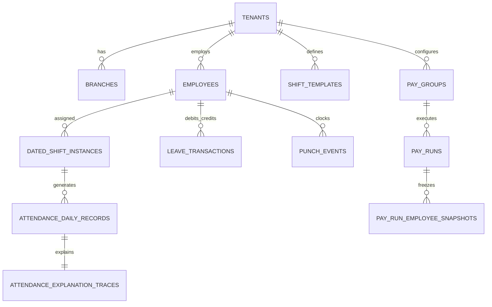

# APMS Database Architecture & Schema Design

## 1. Multi-Tenant Relational Foundation

APMS uses **PostgreSQL 16+** with a shared-database, shared-schema architecture. Multi-tenancy isolation is enforced at the database kernel level using **Row-Level Security (RLS)**.

### 1.1 RLS Enforcement Pattern
Every tenant-scoped table contains a non-nullable `tenant_id UUID` column and an explicit PostgreSQL RLS policy:

```sql
-- Enable RLS on every tenant table
ALTER TABLE employees ENABLE ROW LEVEL SECURITY;
ALTER TABLE employees FORCE ROW LEVEL SECURITY;

-- Tenant Isolation Policy
CREATE POLICY tenant_isolation_policy ON employees
    FOR ALL
    USING (tenant_id = current_setting('app.current_tenant_id', true)::uuid)
    WITH CHECK (tenant_id = current_setting('app.current_tenant_id', true)::uuid);
```

### 1.2 Composite Foreign Keys
To guarantee referential integrity and eliminate cross-tenant foreign key references, all foreign keys MUST include `tenant_id`:

```sql
-- Composite Unique Constraint on Parent
ALTER TABLE dated_shift_instances 
    ADD CONSTRAINT uq_dated_shift_instances_id_tenant 
    UNIQUE (tenant_id, id);

-- Composite Foreign Key on Child
ALTER TABLE attendance_daily_records 
    ADD CONSTRAINT fk_attendance_shift_instance
    FOREIGN KEY (tenant_id, shift_instance_id) 
    REFERENCES dated_shift_instances(tenant_id, id);
```

---

## 2. Declarative Table Partitioning

The high-volume biometric punch ingestion tables (`raw_envelope` and `punch_event`) grow at millions of rows per year per tenant. These tables employ **monthly declarative range partitioning** on `received_at` / `punch_time`.

```sql
CREATE TABLE raw_envelope (
    id UUID NOT NULL DEFAULT gen_random_uuid(),
    tenant_id UUID NOT NULL,
    device_id UUID,
    raw_payload JSONB NOT NULL,
    payload_hash VARCHAR(64) NOT NULL,
    received_at TIMESTAMPTZ NOT NULL DEFAULT clock_timestamp(),
    PRIMARY KEY (received_at, tenant_id, id)
) PARTITION BY RANGE (received_at);

-- Monthly Partition Example
CREATE TABLE raw_envelope_2026_11 PARTITION OF raw_envelope
    FOR VALUES FROM ('2026-11-01 00:00:00+00') TO ('2026-12-01 00:00:00+00');
```

---

## 3. Core Domain Entity ER Diagram



---

## 4. Key Table Specifications

### 4.1 Attendance Daily Record & Explanation Trace
```sql
CREATE TABLE attendance_daily_records (
    id UUID PRIMARY KEY DEFAULT gen_random_uuid(),
    tenant_id UUID NOT NULL,
    employee_id UUID NOT NULL,
    attendance_date DATE NOT NULL,
    shift_instance_id UUID,
    status VARCHAR(30) NOT NULL, -- PRESENT, HALF_DAY, ABSENT, ON_LEAVE, WEEKLY_OFF, HOLIDAY, NEEDS_REVIEW
    worked_minutes INT NOT NULL DEFAULT 0,
    scheduled_minutes INT NOT NULL DEFAULT 0,
    late_in_minutes INT NOT NULL DEFAULT 0,
    early_exit_minutes INT NOT NULL DEFAULT 0,
    overtime_minutes INT NOT NULL DEFAULT 0,
    is_regularized BOOLEAN NOT NULL DEFAULT FALSE,
    is_locked BOOLEAN NOT NULL DEFAULT FALSE,
    updated_at TIMESTAMPTZ NOT NULL DEFAULT clock_timestamp(),
    CONSTRAINT uq_emp_attendance_date UNIQUE (tenant_id, employee_id, attendance_date)
);

CREATE TABLE attendance_explanation_traces (
    id UUID PRIMARY KEY DEFAULT gen_random_uuid(),
    tenant_id UUID NOT NULL,
    attendance_record_id UUID NOT NULL,
    trace_payload JSONB NOT NULL, -- Exact inputs, session windows, paired punches, policy bands, rollup math
    created_at TIMESTAMPTZ NOT NULL DEFAULT clock_timestamp(),
    CONSTRAINT fk_trace_attendance_record FOREIGN KEY (attendance_record_id) REFERENCES attendance_daily_records(id) ON DELETE CASCADE
);
```

### 4.2 Double-Entry Leave Ledger
```sql
CREATE TABLE leave_transactions (
    id UUID PRIMARY KEY DEFAULT gen_random_uuid(),
    tenant_id UUID NOT NULL,
    employee_id UUID NOT NULL,
    leave_type_id UUID NOT NULL,
    transaction_type VARCHAR(20) NOT NULL, -- ACCRUAL, APPLICATION, CANCELLATION, ENCASHMENT, LAPSE
    days NUMERIC(4, 2) NOT NULL, -- Positive for credits, negative for debits
    running_balance NUMERIC(5, 2) NOT NULL,
    reference_id UUID, -- Links to leave_request_id or pay_run_id
    notes TEXT,
    created_at TIMESTAMPTZ NOT NULL DEFAULT clock_timestamp()
);
```

### 4.3 Immutable Pay Run Snapshot
```sql
CREATE TABLE pay_run_employee_snapshots (
    id UUID PRIMARY KEY DEFAULT gen_random_uuid(),
    tenant_id UUID NOT NULL,
    pay_run_id UUID NOT NULL,
    employee_id UUID NOT NULL,
    gross_earnings NUMERIC(12, 2) NOT NULL,
    total_deductions NUMERIC(12, 2) NOT NULL,
    net_payable NUMERIC(12, 2) NOT NULL,
    lop_days NUMERIC(4, 2) NOT NULL,
    paid_days NUMERIC(4, 2) NOT NULL,
    earnings_breakdown JSONB NOT NULL, -- Base, HRA, Allowances, Incentives
    deductions_breakdown JSONB NOT NULL, -- EPF, ESI, PT, TDS, Advances
    statutory_inputs JSONB NOT NULL, -- Version of slabs, ceilings, employee opt-in flags
    payslip_pdf_url TEXT,
    created_at TIMESTAMPTZ NOT NULL DEFAULT clock_timestamp(),
    CONSTRAINT uq_payrun_emp UNIQUE (tenant_id, pay_run_id, employee_id)
);
```

