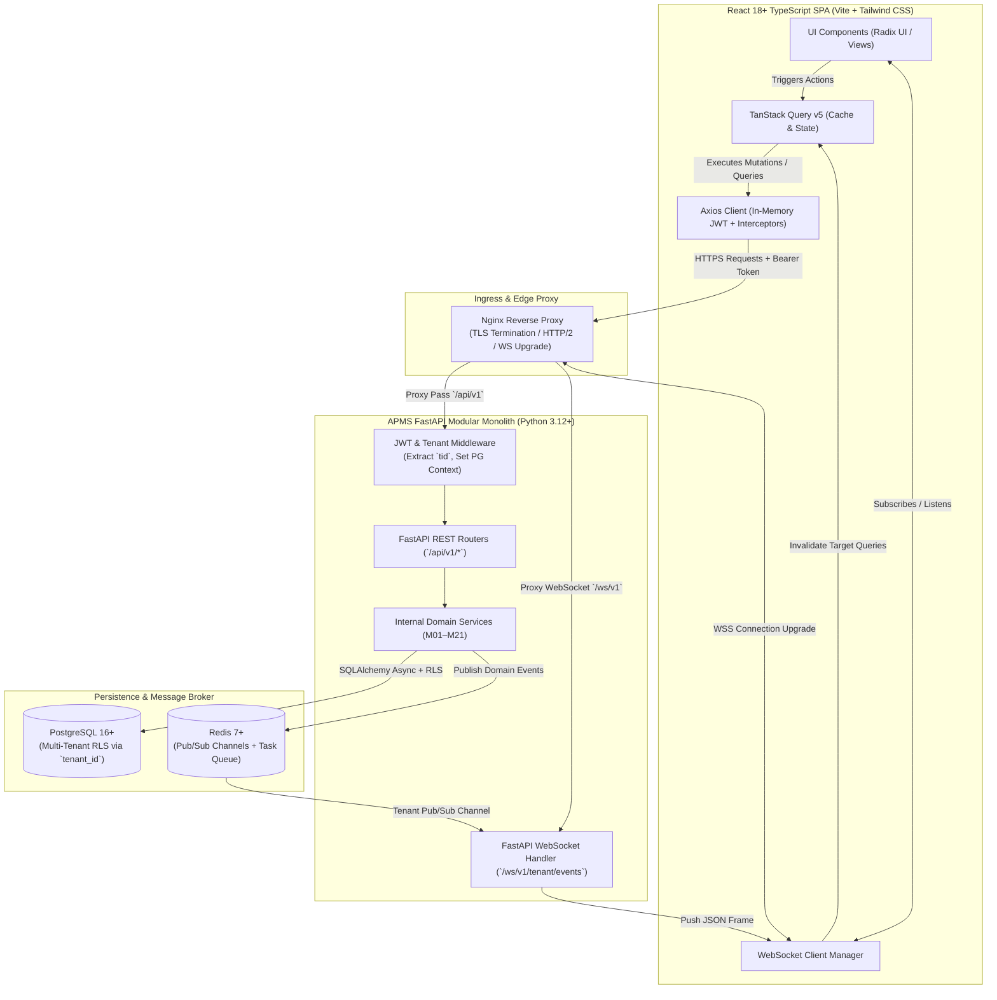
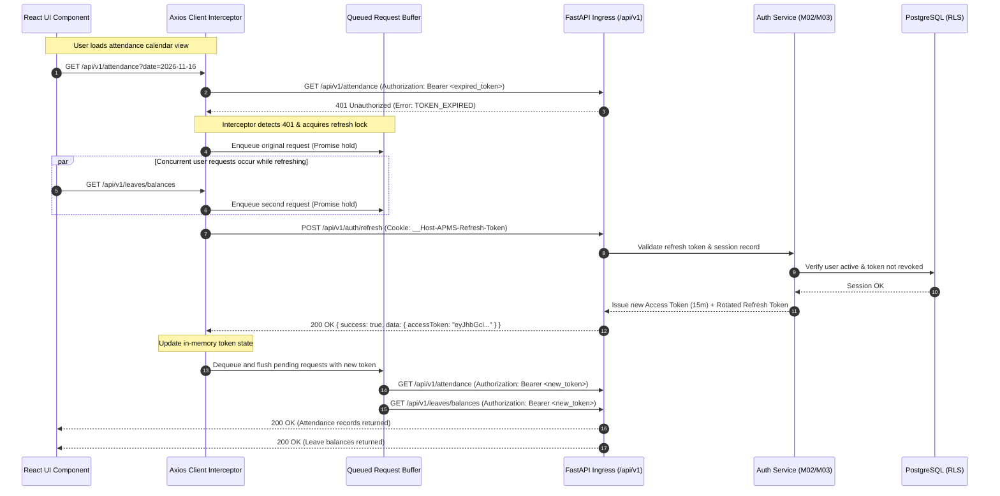
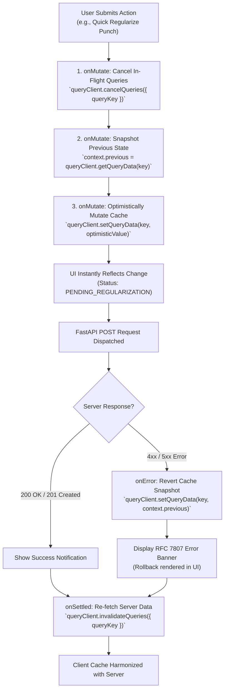
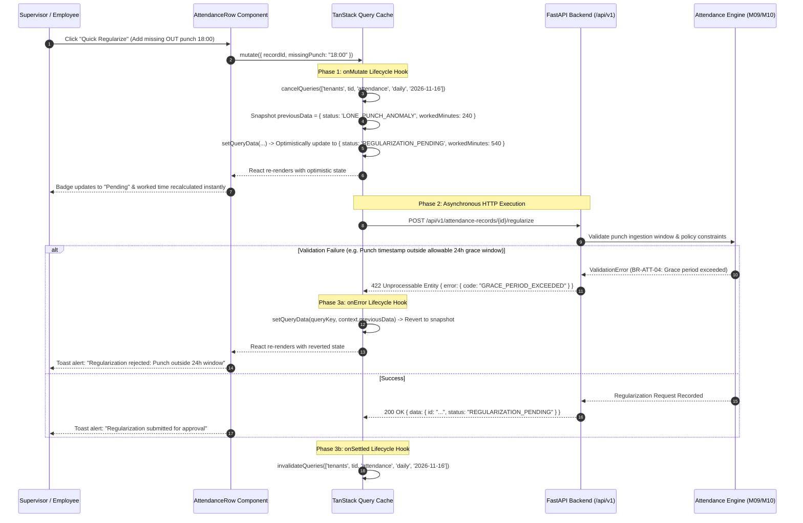
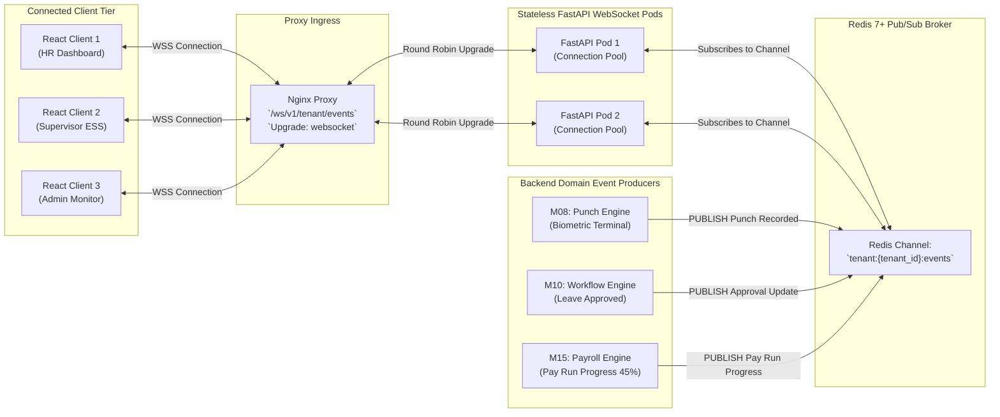
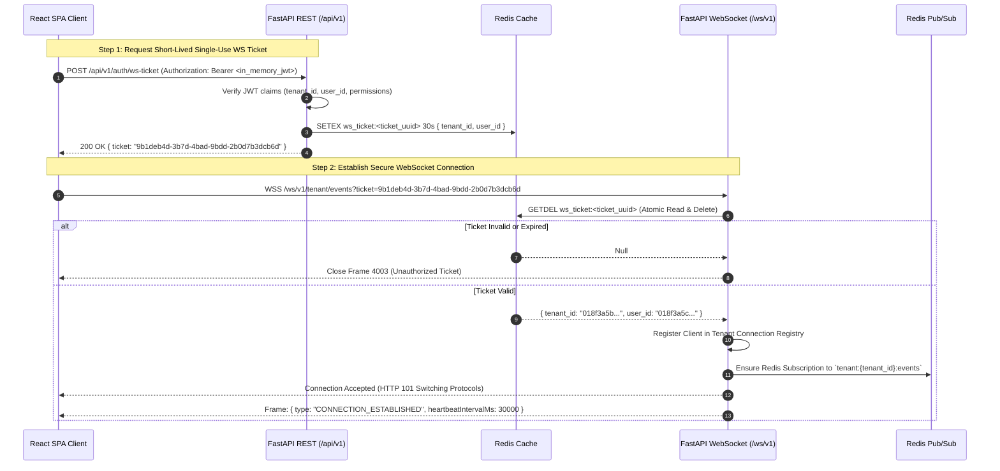

# APMS — Frontend-to-Backend Communication & Real-Time Architecture

> **Status:** Authoritative | **Last Updated:** 2026-11-16 | **Component:** Web SPA, API Gateway, Real-Time Push  
> **Source Documents:** `SYSTEM_ARCHITECTURE.md`, `API_DESIGN.md`, `SECURITY_ARCHITECTURE.md`, `MODULES_AND_FEATURES.md`, `ADR-01`, `ADR-03`, `ADR-10`

---

## 1. Architectural Overview

APMS implements a decoupled, high-performance communication architecture connecting the React 18+ TypeScript Single Page Application (SPA) with the Python 3.12+ FastAPI Modular Monolith backend. The system enforces strict multi-tenant boundary isolation, in-memory credential storage, deterministic cache invalidation, optimistic mutation lifecycles, and real-time bidirectional push notifications.



---

## 2. JWT Authentication & Silent Session Refresh

Security invariants dictate that credentials must be protected against both Cross-Site Scripting (XSS) and Cross-Site Request Forgery (CSRF). 

### 2.1 Credential Storage & Token Lifecycle
1. **Short-Lived Access Token (15 Minutes)**:
   - Stored **strictly in JavaScript runtime memory** (React state / closure variable).
   - **Never** persisted to `localStorage`, `sessionStorage`, or unencrypted cookies.
   - Encodes standard JWT claims: `sub` (User ID), `tid` (Tenant ID), `roles` (RBAC roles), `perms` (Fine-grained permissions), `exp` (Unix expiration).
2. **Long-Lived Refresh Token (7 Days)**:
   - Stored in a secure, server-issued HTTP-only cookie (`__Host-APMS-Refresh-Token`).
   - Cookie attributes: `HttpOnly; Secure; SameSite=Strict; Path=/api/v1/auth; Domain=apms.tenant.domain`.
   - Inaccessible to browser JavaScript, completely eliminating token theft via XSS.
3. **Tenant Context Enforcement**:
   - Every authenticated request presents the Bearer access token.
   - FastAPI extracts `tid` from claims and initializes PostgreSQL session configuration:
     ```sql
     SET LOCAL app.current_tenant_id = '018f3a5b-9a8c-7000-8b01-234567890abc';
     ```

### 2.2 Silent Refresh & Request Interceptor Sequence

When an access token expires mid-session, the frontend Axios HTTP client catches the `401 Unauthorized` response, buffers pending concurrent requests in a subscriber queue, executes a single silent refresh request using the HTTP-only cookie, updates the in-memory access token, and transparently replays the queued requests.



### 2.3 Frontend Axios Interceptor Implementation Contract

```typescript
// src/api/httpClient.ts
import axios, { AxiosError, InternalAxiosRequestConfig } from 'axios';

let inMemoryAccessToken: string | null = null;
let isRefreshing = false;
let failedQueue: Array<{
  resolve: (token: string) => void;
  reject: (error: unknown) => void;
}> = [];

export const setAccessToken = (token: string | null) => {
  inMemoryAccessToken = token;
};

export const getAccessToken = () => inMemoryAccessToken;

const processQueue = (error: unknown, token: string | null = null) => {
  failedQueue.forEach((promise) => {
    if (token) {
      promise.resolve(token);
    } else {
      promise.reject(error);
    }
  });
  failedQueue = [];
};

export const apiClient = axios.create({
  baseURL: '/api/v1',
  withCredentials: true, // Mandatory for sending HTTP-only refresh cookies
  headers: {
    'Content-Type': 'application/json',
  },
});

apiClient.interceptors.request.use((config: InternalAxiosRequestConfig) => {
  if (inMemoryAccessToken && !config.headers.Authorization) {
    config.headers.Authorization = `Bearer ${inMemoryAccessToken}`;
  }
  return config;
});

apiClient.interceptors.response.use(
  (response) => response,
  async (error: AxiosError) => {
    const originalRequest = error.config as InternalAxiosRequestConfig & { _retry?: boolean };

    if (error.response?.status === 401 && !originalRequest._retry) {
      if (originalRequest.url === '/auth/refresh') {
        // Refresh token failed or expired -> force logout
        setAccessToken(null);
        window.location.href = '/login?session_expired=1';
        return Promise.reject(error);
      }

      if (isRefreshing) {
        return new Promise((resolve, reject) => {
          failedQueue.push({
            resolve: (token: string) => {
              originalRequest.headers.Authorization = `Bearer ${token}`;
              resolve(apiClient(originalRequest));
            },
            reject: (err) => reject(err),
          });
        });
      }

      originalRequest._retry = true;
      isRefreshing = true;

      try {
        const { data } = await apiClient.post<{ data: { accessToken: string } }>('/auth/refresh');
        const newToken = data.data.accessToken;
        setAccessToken(newToken);
        processQueue(null, newToken);
        originalRequest.headers.Authorization = `Bearer ${newToken}`;
        return apiClient(originalRequest);
      } catch (refreshError) {
        processQueue(refreshError, null);
        setAccessToken(null);
        window.location.href = '/login?session_expired=1';
        return Promise.reject(refreshError);
      } finally {
        isRefreshing = false;
      }
    }

    return Promise.reject(error);
  }
);
```

---

## 3. TanStack Query (React Query v5) Caching Strategy

APMS mandates a strictly typed, hierarchical query key taxonomy. Query keys uniquely segregate data across tenants, entities, and scopes, preventing cache cross-contamination and facilitating precise query invalidation.

### 3.1 Hierarchical Cache Key Taxonomy

All query keys follow the canonical pattern:
```
['tenants', tenantId, domain, scope, ...parameters]
```

| Domain | Query Key Tuple Structure | Description | Stale Time | Garbage Collection (`gcTime`) |
| :--- | :--- | :--- | :--- | :--- |
| **Attendance Rollup** | `['tenants', tenantId, 'attendance', 'daily', date]` | Daily employee attendance summary, pairings, traces | 30 seconds | 5 minutes |
| **Monthly Calendar** | `['tenants', tenantId, 'attendance', 'calendar', year, month]` | Month grid for employee calendar view | 2 minutes | 15 minutes |
| **Punch Events** | `['tenants', tenantId, 'punches', employeeId, date]` | Chronological punch pairings for single employee | 15 seconds | 5 minutes |
| **Leave Balances** | `['tenants', tenantId, 'leave', 'balances', employeeId]` | Double-entry ledger balance summary | 1 minute | 10 minutes |
| **Leave Requests** | `['tenants', tenantId, 'leave', 'requests', { status, page }]` | Active leave applications pending review | 30 seconds | 5 minutes |
| **Shift Instances** | `['tenants', tenantId, 'shifts', 'roster', branchId, startDate, endDate]` | Materialized dated shift instances | 5 minutes | 30 minutes |
| **Pay Runs** | `['tenants', tenantId, 'payroll', 'pay-runs', payPeriodId]` | Current pay run status and calculation wizard state | 10 seconds | 10 minutes |
| **Device Telemetry**| `['tenants', tenantId, 'devices', 'telemetry', branchId]` | Terminal heartbeat, sync lag, clock drift | 15 seconds | 2 minutes |

### 3.2 Query Client Factory & Global Invariants

```typescript
// src/api/queryClient.ts
import { QueryClient } from '@tanstack/react-query';

export const queryClient = new QueryClient({
  defaultOptions: {
    queries: {
      staleTime: 1000 * 30, // 30 seconds default freshness
      gcTime: 1000 * 60 * 10, // 10 minutes garbage collection
      retry: (failureCount, error: any) => {
        // Never retry 4xx client errors (400, 401, 403, 404, 422)
        const status = error?.response?.status;
        if (status && status >= 400 && status < 500) {
          return false;
        }
        return failureCount < 3; // Retry network drops or 5xx up to 3 times
      },
      refetchOnWindowFocus: false, // Prevent jarring refetches on tab switch
      refetchOnReconnect: true,   // Synchronize immediately upon network recovery
    },
    mutations: {
      retry: false, // Mutations never auto-retry to prevent accidental double-writes
    },
  },
});
```

---

## 4. Optimistic UI Updates & Rollback Architecture

For high-frequency operational workforce workflows (punch miss regularizations, leave applications, supervisor shift overrides), APMS executes **Optimistic UI Updates**. The UI state reflects the desired change immediately, while a background mutation communicates with FastAPI. If the server rejects the mutation (e.g., validation failure, policy block), the frontend rolls back to the exact previous state snapshot.

### 4.1 Mutation Lifecycle (The 3-Phase Contract)



### 4.2 Sequence Diagram: Optimistic Regularization with Rollback on Error



### 4.3 Concrete Implementation: `useRegularizePunch` Hook

```typescript
// src/features/attendance/hooks/useRegularizePunch.ts
import { useMutation, useQueryClient } from '@tanstack/react-query';
import { apiClient } from '../../../api/httpClient';
import { useAuthStore } from '../../../store/authStore';

interface RegularizePayload {
  recordId: string;
  date: string;
  requestedTime: string;
  reason: string;
}

interface DailyAttendanceRecord {
  id: string;
  date: string;
  status: 'PRESENT' | 'ABSENT' | 'HALF_DAY' | 'LONE_PUNCH_ANOMALY' | 'REGULARIZATION_PENDING';
  workedMinutes: number;
}

export const useRegularizePunch = (date: string) => {
  const queryClient = useQueryClient();
  const tenantId = useAuthStore((state) => state.tenantId);
  const queryKey = ['tenants', tenantId, 'attendance', 'daily', date];

  return useMutation({
    mutationFn: async (payload: RegularizePayload) => {
      const { data } = await apiClient.post(
        `/attendance-records/${payload.recordId}/regularize`,
        payload,
        {
          headers: {
            'Idempotency-Key': crypto.randomUUID(),
          },
        }
      );
      return data;
    },
    // Step 1: Snapshot and Optimistically Mutate
    onMutate: async (newRegularization) => {
      await queryClient.cancelQueries({ queryKey });

      const previousRecords = queryClient.getQueryData<DailyAttendanceRecord[]>(queryKey);

      if (previousRecords) {
        queryClient.setQueryData<DailyAttendanceRecord[]>(
          queryKey,
          previousRecords.map((record) =>
            record.id === newRegularization.recordId
              ? {
                  ...record,
                  status: 'REGULARIZATION_PENDING',
                }
              : record
          )
        );
      }

      return { previousRecords };
    },
    // Step 2: Rollback on Error
    onError: (err, newRegularization, context) => {
      if (context?.previousRecords) {
        queryClient.setQueryData(queryKey, context.previousRecords);
      }
    },
    // Step 3: Always Invalidate to Sync Authoritative Server State
    onSettled: () => {
      queryClient.invalidateQueries({ queryKey });
    },
  });
};
```

---

## 5. WebSocket Real-Time Architecture (FastAPI + Redis Pub/Sub)

To support instant notification of biometric clock-ins, live muster roll dashboard adjustments, supervisor approval routing, and long-running pay run progress bars, APMS features an asynchronous WebSocket infrastructure powered by Redis Pub/Sub.



### 5.1 Nginx Ingress Reverse Proxy Configuration

Nginx acts as the edge SSL termination and WebSocket protocol upgrade gateway:

```nginx
# /etc/nginx/conf.d/apms_websocket.conf
map $http_upgrade $connection_upgrade {
    default upgrade;
    ''      close;
}

upstream fastapi_websocket_backend {
    server 127.0.0.1:8001;
    server 127.0.0.1:8002;
    keepalive 64;
}

server {
    listen 443 ssl http2;
    server_name *.apms.com;

    # SSL certificates omitted for brevity...

    location /ws/v1/tenant/events {
        proxy_pass http://fastapi_websocket_backend;
        proxy_http_version 1.1;
        proxy_set_header Upgrade $http_upgrade;
        proxy_set_header Connection $connection_upgrade;
        proxy_set_header Host $host;
        proxy_set_header X-Real-IP $remote_addr;
        proxy_set_header X-Forwarded-For $proxy_add_x_forwarded_for;
        proxy_set_header X-Forwarded-Proto $scheme;

        # WebSocket timeouts
        proxy_read_timeout 3600s;
        proxy_send_timeout 3600s;
    }
}
```

### 5.2 Connection Handshake & Authentication

Because native browser WebSocket APIs do not support custom `Authorization: Bearer <token>` headers, APMS implements a **Single-Use WebSocket Ticket Exchange Protocol**:



### 5.3 Heartbeat Ping/Pong & Auto-Reconnect Architecture

1. **Heartbeat Protocol**:
   - Every 30 seconds, the frontend client dispatches a lightweight JSON frame: `{"type": "PING"}`.
   - The FastAPI server responds immediately with: `{"type": "PONG", "serverTime": 1731772800}`.
   - If the client misses 2 consecutive PONG frames (60 seconds elapsed), it marks the connection `DEAD`, terminates the socket, and initiates exponential backoff reconnection.
2. **Reconnection Strategy with Jitter**:
   - Delay formula:
     $$\text{Delay}(n) = \min(30000, 1000 \times 2^n) + \text{random\_jitter}(0, 1000)\text{ ms}$$
   - Prevents the "Thundering Herd" problem when an edge proxy or Redis cluster restarts.

---

## 6. Real-Time Alert Event Types & Payloads

Every event broadcasted over the tenant WebSocket channel adheres to the standard schema:
```json
{
  "eventId": "evt_01j7b9k4x8",
  "eventType": "BIOMETRIC_PUNCH_RECORDED",
  "tenantId": "018f3a5b-9a8c-7000-8b01-234567890abc",
  "timestamp": "2026-11-16T14:32:00Z",
  "payload": {},
  "targetAudience": {
    "roles": ["HR_OPERATIONS", "SHIFT_SUPERVISOR"],
    "userIds": ["usr_01j7b9k5"]
  }
}
```

### 6.1 Core Event Catalog

#### 1. `BIOMETRIC_PUNCH_RECORDED` (Module 08/09)
Emitted when a physical terminal or mobile clock-in is normalized and paired.
```json
{
  "eventType": "BIOMETRIC_PUNCH_RECORDED",
  "payload": {
    "employeeId": "emp_01j7b9a1",
    "employeeCode": "EMP-1042",
    "employeeName": "Rajesh Kumar",
    "punchTime": "2026-11-16T08:58:22+05:30",
    "punchType": "CHECK_IN",
    "terminalId": "BIO-GATE-01",
    "status": "ON_TIME",
    "branchId": "brn_mumbai_01"
  }
}
```

#### 2. `LEAVE_REQUEST_STATUS_CHANGED` (Module 10/11)
Emitted when a supervisor or workflow engine acts upon a leave application.
```json
{
  "eventType": "LEAVE_REQUEST_STATUS_CHANGED",
  "payload": {
    "requestId": "req_lve_01j7b9",
    "employeeId": "emp_01j7b9a1",
    "leaveType": "CASUAL_LEAVE",
    "dates": ["2026-11-20", "2026-11-21"],
    "daysCount": 2.0,
    "status": "APPROVED",
    "actionedBy": "usr_mgr_02",
    "comment": "Approved as per roster coverage."
  }
}
```

#### 3. `PAY_RUN_STEP_PROGRESS` (Module 15)
Emitted during the 10-step payroll execution wizard to render live progress bars in the HR console.
```json
{
  "eventType": "PAY_RUN_STEP_PROGRESS",
  "payload": {
    "payRunId": "prun_2026_11",
    "currentStepIndex": 5,
    "stepName": "STATUTORY_DEDUCTIONS_COMPUTATION",
    "processedEmployees": 3420,
    "totalEmployees": 4000,
    "progressPercent": 85.5,
    "estimatedRemainingSeconds": 12
  }
}
```

#### 4. `DEVICE_TELEMETRY_ALERT` (Module 16)
Emitted when hardware biometric sync lag or NTP clock drift exceeds safety thresholds.
```json
{
  "eventType": "DEVICE_TELEMETRY_ALERT",
  "payload": {
    "deviceId": "dev_zkteco_plant2",
    "deviceSerial": "ZK-9842104",
    "alertType": "CLOCK_DRIFT_EXCEEDED",
    "driftSeconds": 412,
    "thresholdSeconds": 300,
    "severity": "CRITICAL",
    "message": "Hardware clock is 6.8 minutes out of synchronization with APMS server NTP."
  }
}
```

---

## 7. WebSocket-to-TanStack Query Invalidation Bridge

Rather than having the UI manage complex mutable socket message state trees, APMS employs the **Event-to-Invalidate Pattern**: incoming WebSocket events trigger surgical cache invalidations in TanStack Query. This ensures the frontend UI re-fetches authoritative data via REST without duplication of business logic.

```typescript
// src/realtime/useWebSocketBridge.ts
import { useEffect } from 'react';
import { useQueryClient } from '@tanstack/react-query';
import { useAuthStore } from '../store/authStore';

export const useWebSocketBridge = () => {
  const queryClient = useQueryClient();
  const { tenantId, user } = useAuthStore();

  useEffect(() => {
    if (!tenantId) return;

    let socket: WebSocket | null = null;
    let heartbeatTimer: NodeJS.Timeout;

    const connect = async () => {
      // 1. Acquire single-use ticket
      const res = await fetch('/api/v1/auth/ws-ticket', { credentials: 'include' });
      const { ticket } = await res.json();

      const protocol = window.location.protocol === 'https:' ? 'wss:' : 'ws:';
      socket = new WebSocket(`${protocol}//${window.location.host}/ws/v1/tenant/events?ticket=${ticket}`);

      socket.onopen = () => {
        heartbeatTimer = setInterval(() => {
          if (socket?.readyState === WebSocket.OPEN) {
            socket.send(JSON.stringify({ type: 'PING' }));
          }
        }, 30000);
      };

      socket.onmessage = (event) => {
        const message = JSON.parse(event.data);

        switch (message.eventType) {
          case 'BIOMETRIC_PUNCH_RECORDED': {
            const today = new Date().toISOString().split('T')[0];
            // Invalidate today's attendance rollup and muster roll
            queryClient.invalidateQueries({
              queryKey: ['tenants', tenantId, 'attendance', 'daily', today],
            });
            queryClient.invalidateQueries({
              queryKey: ['tenants', tenantId, 'punches', message.payload.employeeId, today],
            });
            break;
          }

          case 'LEAVE_REQUEST_STATUS_CHANGED': {
            // Invalidate pending leave approvals and user leave balances
            queryClient.invalidateQueries({
              queryKey: ['tenants', tenantId, 'leave', 'requests'],
            });
            queryClient.invalidateQueries({
              queryKey: ['tenants', tenantId, 'leave', 'balances', message.payload.employeeId],
            });
            break;
          }

          case 'PAY_RUN_STEP_PROGRESS': {
            // Actively update cached progress state directly without network re-fetch
            queryClient.setQueryData(
              ['tenants', tenantId, 'payroll', 'pay-runs', message.payload.payRunId, 'progress'],
              message.payload
            );
            break;
          }

          case 'DEVICE_TELEMETRY_ALERT': {
            queryClient.invalidateQueries({
              queryKey: ['tenants', tenantId, 'devices', 'telemetry'],
            });
            break;
          }

          default:
            break;
        }
      };

      socket.onclose = () => {
        clearInterval(heartbeatTimer);
        // Exponential backoff reconnect logic handled here...
      };
    };

    connect();

    return () => {
      clearInterval(heartbeatTimer);
      socket?.close();
    };
  }, [tenantId, user?.id, queryClient]);
};
```

---

## 8. Network Resilience, Idempotency & Offline Handling

Workforce operational actions must remain resilient against spotty factory Wi-Fi and mobile connectivity drops.

### 8.1 Idempotency Key Protocol
All state-mutating requests (`POST`, `PUT`, `PATCH`, `DELETE`) generated by the frontend include a UUIDv4 header:
```http
Idempotency-Key: e678fa42-4f16-4dc4-839e-d52ef75e3a09
```
FastAPI intercepts this header via middleware:
1. Computes `idempotency_hash = sha256(tenant_id + user_id + idempotency_key + request_path)`.
2. Checks Redis:
   - If key exists with status `PROCESSING`: Returns `409 Conflict` (Concurrent duplicate request).
   - If key exists with status `COMPLETED`: Returns cached HTTP response payload immediately without re-executing business logic.
   - If key does not exist: Sets key with `EX 86400` (24h TTL) and proceeds with request execution.

### 8.2 TanStack Query Offline Manager Integration

```typescript
// src/api/offlineManager.ts
import { onlineManager } from '@tanstack/react-query';

// Synchronize browser online/offline status with query client
window.addEventListener('online', () => {
  onlineManager.setOnline(true);
});

window.addEventListener('offline', () => {
  onlineManager.setOnline(false);
});
```
When offline:
- Outgoing queries are paused automatically and queued.
- The UI renders an amber status badge: *"Offline — Changes will synchronize when connection restores"*.
- Upon reconnection, `onlineManager` triggers automatic re-evaluation and flushes cached background queries.

---

## 9. Architectural Verification & Compliance Checklist

| Architecture Invariant | Verification Mechanism | Status |
| :--- | :--- | :--- |
| **Zero Token Persistence in Storage** | Code review and security scan verifies `localStorage.getItem('token')` is non-existent. | ✅ Compliant |
| **Silent Refresh under XSS Protection** | Refresh token is confined to `HttpOnly; SameSite=Strict` cookie path `/api/v1/auth`. | ✅ Compliant |
| **Tenant Cache Segregation** | All TanStack Query keys are prefixed with `['tenants', tenantId, ...]`. | ✅ Compliant |
| **Optimistic State Snapshotting** | Mutations snapshot previous state before setting cache and revert in `onError`. | ✅ Compliant |
| **WebSocket Authentication Guard** | Single-use ticket exchange with 30-second TTL prevents query param credential logging. | ✅ Compliant |
| **Idempotency Guardrails** | Mutating actions carry unique `Idempotency-Key` headers stored in Redis for 24h. | ✅ Compliant |
| **WebSocket Connection Recovery** | Exponential backoff with random jitter prevents thundering herd on backend restarts. | ✅ Compliant |
