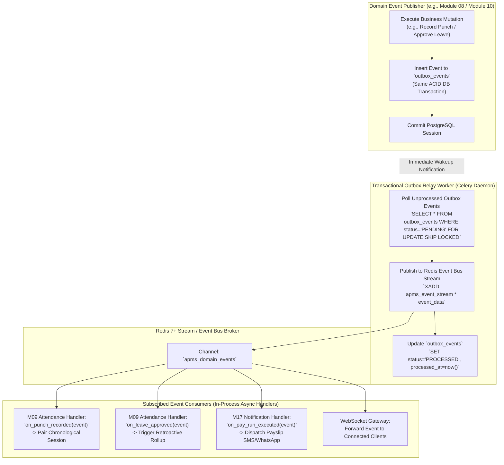
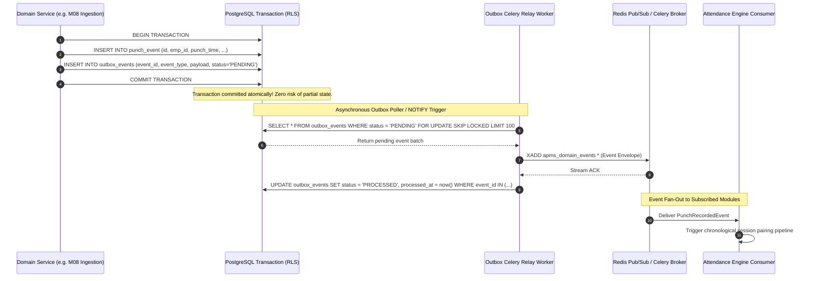

# APMS — Modular Monolith Service Interaction Contracts & Event Architecture

> **Status:** Authoritative | **Last Updated:** 2026-11-16 | **Component:** Core Architecture, Inter-Module Contracts, Event Bus  
> **Source Documents:** `SYSTEM_ARCHITECTURE.md`, `MODULES_AND_FEATURES.md`, `module-dependency-map.md`, `ADR-01`, `ADR-03`, `ADR-07`, `ADR-08`, `ADR-11`, `ADR-14`

---

## 1. Modular Monolith Architecture & Boundary Rules (ADR-01)

APMS is engineered as a **Modular Monolith** in Python 3.12+ FastAPI. It delivers the operational simplicity, high developer velocity, and ACID transactional consistency of a single deployable unit while enforcing rigorous microservice-like architectural boundaries.

```mermaid
flowchart TD
    subgraph ModularMonolith["APMS FastAPI Modular Monolith (Python 3.12+)"]
        direction TB

        subgraph Ingress["FastAPI HTTP / WebSocket Routers"]
            ROUTER["API Routers (`/api/v1/*`)"]
        end

        subgraph ModuleM08["M08: Punch Capture Module"]
            M08_PUB["Exported Service Interface:\n`PunchIngestionService`"]
            M08_INT["Internal Repositories,\nModels & Logic"]
            M08_PUB --> M08_INT
        end

        subgraph ModuleM09["M09: Attendance Engine Module"]
            M09_PUB["Exported Service Interface:\n`AttendanceService`"]
            M09_INT["Internal Repositories,\nRollup Pipeline & Traces"]
            M09_PUB --> M09_INT
        end

        subgraph ModuleM15["M15: Payroll Engine Module"]
            M15_PUB["Exported Service Interface:\n`PayrollService`"]
            M15_INT["Internal Repositories,\n10-Step Wizard & Slips"]
            M15_PUB --> M15_INT
        end

        subgraph SharedInfra["Shared Infrastructure & Event Broker"]
            EVENT_BUS["Asynchronous Domain Event Bus\n(`EventBus.publish / subscribe`)"]
            OUTBOX_ENGINE["Transactional Outbox Relay\n(PostgreSQL `outbox_events` -> Redis/Celery)"]
        end
    end

    subgraph Storage["Shared PostgreSQL 16+ Database (RLS Enforced)"]
        DB_M08[("M08 Tables:\n`raw_envelope`\n`punch_event`")]
        DB_M09[("M09 Tables:\n`attendance_daily_rollups`\n`attendance_explanation_traces`")]
        DB_M15[("M15 Tables:\n`payroll_runs`\n`payslip_records`")]
        DB_OUTBOX[("Outbox Table:\n`outbox_events`")]
    end

    ROUTER --> M08_PUB
    ROUTER --> M09_PUB
    ROUTER --> M15_PUB

    %% Synchronous In-Process Service Contracts
    M15_PUB -->|In-Process Service Call\n`AttendanceService.get_finalized_summary()`| M09_PUB

    %% Asynchronous Domain Events
    M08_INT -->|Publish `PunchRecordedEvent`| EVENT_BUS
    EVENT_BUS -->|Trigger Session Pairing| M09_PUB

    M09_INT -->|Publish `AttendanceFinalizedEvent`| EVENT_BUS
    EVENT_BUS -->|Enrich Period Attendance| M15_PUB

    %% Persistence Boundaries (Strictly Isolated)
    M08_INT -->|Isolated Access| DB_M08
    M09_INT -->|Isolated Access| DB_M09
    M15_INT -->|Isolated Access| DB_M15

    %% Outbox Writes
    M08_INT -.->|Write Outbox in same ACID Tx| DB_OUTBOX
    M09_INT -.->|Write Outbox in same ACID Tx| DB_OUTBOX
    M15_INT -.->|Write Outbox in same ACID Tx| DB_OUTBOX
    OUTBOX_ENGINE <--> DB_OUTBOX
```

### 1.1 Non-Negotiable Boundary Invariants
1. **Zero Cross-Module Direct SQL Queries**:
   - Module A is **strictly forbidden** from executing `SELECT`, `INSERT`, `UPDATE`, or `DELETE` statements against tables owned by Module B.
   - Cross-module foreign key constraints in database migrations that couple internal entity tables across bounded contexts are prohibited. All cross-module entity references are stored as unconstrained UUIDs (`employee_id`, `shift_instance_id`, `attendance_record_id`).
2. **Communication Exclusively via Exported Interfaces**:
   - Each module exports a public contract package (`src/modules/<module>/contracts/` and `src/modules/<module>/services/`).
   - Outside modules can **only** import from these public contract namespaces.
   - Internal implementations (`models/`, `repositories/`, `internal/`) are strictly private.
3. **Automated Boundary Verification (Linting Enforcement)**:
   - Import boundary compliance is verified in every CI/CD run using `import-linter` contracts:
   ```ini
   # .importlinter
   [importlinter]
   root_package = apms

   [importlinter:contract:1]
   name = Module Boundary Enforcement
   type = layers
   containers = apms.modules
   layers =
       payroll
       attendance
       punch_ingestion
       shifts
       employee
       organization
       iam
   ```
4. **Decoupled Payroll & Attendance (ADR-07)**:
   - Finalized attendance data acts as an **immutable, read-only input** to the payroll wizard.
   - Attendance never computes wage amounts, and payroll never alters raw punches or attendance rollups.

---

## 2. Public Service Interface Definitions (Python 3.12+ Protocols)

Every module encapsulates its domain logic behind strictly typed Python `Protocol` interfaces returning immutable Pydantic v2 Data Transfer Objects (DTOs).

### 2.1 Core Exported Service Contracts

```python
# src/modules/attendance/contracts/interfaces.py
from typing import Protocol, Sequence
from datetime import date
from uuid import UUID
from pydantic import BaseModel, ConfigDict

class AttendanceSummaryDTO(BaseModel):
    model_config = ConfigDict(frozen=True)
    employee_id: UUID
    date: date
    scheduled_minutes: int
    worked_minutes: int
    coverage_ratio: float
    status: str  # 'PRESENT' | 'HALF_DAY' | 'ABSENT' | 'WEEKLY_OFF' | 'HOLIDAY'
    is_late_arrival: bool
    is_early_departure: bool
    unauthorized_absence: bool
    trace_id: UUID

class MonthlyReconciliationDTO(BaseModel):
    model_config = ConfigDict(frozen=True)
    employee_id: UUID
    year: int
    month: int
    payable_days: float
    loss_of_pay_days: float
    overtime_approved_minutes: int
    sandwich_deduction_days: float
    is_period_locked: bool

class AttendanceServiceInterface(Protocol):
    """Public exported interface of Module 09 (Attendance Engine)."""
    
    async def get_daily_summary(
        self, tenant_id: UUID, employee_id: UUID, query_date: date
    ) -> AttendanceSummaryDTO | None:
        """Fetch deterministic rollup summary for a single day."""
        ...

    async def get_monthly_reconciliation(
        self, tenant_id: UUID, employee_id: UUID, year: int, month: int
    ) -> MonthlyReconciliationDTO:
        """Fetch aggregated attendance & LOP days for payroll consumption."""
        ...

    async def lock_attendance_period(
        self, tenant_id: UUID, year: int, month: int, locked_by: UUID
    ) -> bool:
        """Lock attendance records prior to final pay run execution."""
        ...
```

```python
# src/modules/shifts/contracts/interfaces.py
from typing import Protocol, Sequence
from datetime import date, datetime
from uuid import UUID
from pydantic import BaseModel, ConfigDict

class ShiftWindowDTO(BaseModel):
    model_config = ConfigDict(frozen=True)
    shift_instance_id: UUID
    employee_id: UUID
    shift_date: date
    start_time: datetime
    end_time: datetime
    session_count: int
    sessions: list[dict]  # Sub-sessions with mid-shift gap bounds
    grace_arrival_minutes: int
    is_management_cancelled: bool

class ShiftServiceInterface(Protocol):
    """Public exported interface of Module 05/06 (Shift & Roster Engine)."""

    async def get_dated_shift_instance(
        self, tenant_id: UUID, employee_id: UUID, target_date: date
    ) -> ShiftWindowDTO | None:
        """Fetch materialized dated shift instance for punch pairing."""
        ...

    async def resolve_dynamic_shift_pool(
        self, tenant_id: UUID, employee_id: UUID, punch_timestamp: datetime
    ) -> ShiftWindowDTO:
        """Match floating punch to candidate shift pool with lowest arrival delta."""
        ...
```

```python
# src/modules/leave/contracts/interfaces.py
from typing import Protocol
from datetime import date
from uuid import UUID
from pydantic import BaseModel, ConfigDict

class LeaveLedgerBalanceDTO(BaseModel):
    model_config = ConfigDict(frozen=True)
    employee_id: UUID
    leave_type_code: str  # 'CL', 'SL', 'EL', 'COMP_OFF'
    available_balance: float
    accrued_year_to_date: float
    consumed_year_to_date: float

class LeaveServiceInterface(Protocol):
    """Public exported interface of Module 11 (Leave & Holiday Management)."""

    async def get_effective_leave_for_date(
        self, tenant_id: UUID, employee_id: UUID, query_date: date
    ) -> dict | None:
        """Query if employee has approved full/half-day leave on date."""
        ...

    async def execute_double_entry_debit(
        self, tenant_id: UUID, employee_id: UUID, leave_type_code: str,
        units: float, reference_id: UUID, reason: str
    ) -> UUID:
        """Append-only debit transaction in leave_transactions ledger."""
        ...

    async def evaluate_sandwich_rule(
        self, tenant_id: UUID, employee_id: UUID, check_date: date
    ) -> bool:
        """Check if intervening rest day qualifies as sandwich deduction."""
        ...
```

---

## 3. Comprehensive 21-Module Interaction Matrix (M01–M21)

This matrix defines every inter-module boundary crossing across all 21 modules in APMS, detailing the calling module, target module, contract method, synchronization mode, payload schema, and transactional rollback behavior.

| Calling Module | Target Module | Contract Method / Interface | Call Type | Data Payload / DTO | Rollback / Transaction Behavior | Rule / Requirement ID |
| :--- | :--- | :--- | :--- | :--- | :--- | :--- |
| **M01: Tenant Mgmt** | **M02: IAM/RBAC** | `AuthService.provision_initial_admin()` | Sync In-Process | `TenantAdminProvisionDTO(email, tenant_id)` | Part of tenant creation ACID transaction; aborts DB commit on error. | `M01-IAM-01`, `ADR-01` |
| **M01: Tenant Mgmt** | **M03: Org Structure** | `OrgService.initialize_default_hierarchy()` | Sync In-Process | `DefaultOrgDTO(company_name, timezone)` | Part of tenant onboarding transaction; rolls back completely. | `ORG-01`, `ADR-02` |
| **M02: IAM/RBAC** | **M04: Employee Master** | `EmployeeService.get_user_profile()` | Sync In-Process | `UserIdDTO(user_id)` $\rightarrow$ `UserProfileDTO` | Read-only; zero mutation. No rollback required. | `IAM-03`, `EMP-01` |
| **M02: IAM/RBAC** | **M10: Workflow** | `WorkflowService.get_approver_identity()` | Sync In-Process | `EmployeeIdDTO(emp_id)` $\rightarrow$ `ManagerHierarchyDTO` | Read-only query; recursive CTE evaluation. | `WFL-01`, `M03-IAM` |
| **M03: Org Structure**| **M05: Shift Template**| `ShiftService.validate_branch_timezone()` | Sync In-Process | `BranchIdDTO(branch_id)` $\rightarrow$ `TimezoneDTO` | Read-only validation during shift creation. | `SHF-01`, `BR-ORG-02` |
| **M04: Employee Master**| **M06: Roster** | `RosterService.assign_default_pattern()` | Sync In-Process | `RosterAssignmentDTO(emp_id, pattern_id)` | Participates in employee onboarding transaction. | `SHF-02`, `ADR-15` |
| **M04: Employee Master**| **M11: Leave Mgmt** | `LeaveService.initialize_employee_ledger()` | Sync In-Process | `NewHireAccrualDTO(emp_id, joining_date)` | Appends initial pro-rata credit transaction; rollback if master fails. | `LVE-01`, `BR-LVE-01` |
| **M05: Shift Template**| **M06: Roster** | `RosterService.materialize_instances()` | Async Background | `MaterializeScheduleDTO(pattern_id, 60_days)` | Idempotent Celery task; bulk upsert with ON CONFLICT DO NOTHING. | `SHF-03`, `ADR-15` |
| **M06: Roster** | **M08: Punch Engine** | *None (Decoupled Ingestion)* | Decoupled | Raw punches ingest independently of roster. | N/A — Ingestion never blocks on shifts. | `BR-ING-01`, `ADR-05` |
| **M06: Roster** | **M09: Attendance** | `ShiftService.get_dated_shift_instance()` | Sync In-Process | `ShiftQueryDTO(emp_id, date)` $\rightarrow$ `ShiftWindowDTO` | Read-only lookup by attendance pairing pipeline. | `ATT-01`, `ADR-06` |
| **M07: Device Gateway**| **M08: Punch Engine** | `PunchIngestionService.ingest_raw_punch()` | Sync In-Process | `RawEnvelopeDTO(terminal_id, raw_bytes, sha256)` | Immediate append-only write to `raw_envelope`. Never rolls back. | `PCH-01`, `ADR-05` |
| **M08: Punch Engine** | **M09: Attendance** | `EventBus.publish(PunchRecordedEvent)` | Async Event Bus | `PunchRecordedEvent(emp_id, punch_time, type)` | Dispatched via Outbox; Attendance handles event idempotently. | `ATT-02`, `ADR-29` |
| **M09: Attendance** | **M10: Workflow** | `WorkflowService.create_anomaly_ticket()` | Async Background | `LonePunchAnomalyDTO(record_id, emp_id, date)` | If anomaly creation fails, daily status marked `LONE_PUNCH_ANOMALY`. | `ATT-04`, `ADR-22` |
| **M09: Attendance** | **M11: Leave Mgmt** | `LeaveService.get_effective_leave_for_date()`| Sync In-Process | `LeaveQueryDTO(emp_id, date)` $\rightarrow$ `LeaveStatusDTO`| Read-only; applies half-day leave target (N66c) or sandwich deduction. | `ATT-09`, `BR-ROL-04` |
| **M09: Attendance** | **M12: Overtime** | `EventBus.publish(AttendanceFinalizedEvent)` | Async Event Bus | `AttendanceFinalizedEvent(emp_id, date, ot_mins)`| Overtime module consumes finalized worked minutes for authorization. | `OT-01`, `ADR-24` |
| **M09: Attendance** | **M15: Payroll** | `AttendanceService.get_monthly_reconciliation()`| Sync In-Process | `MonthlyRecQueryDTO(year, month)` $\rightarrow$ `ReconcileDTO` | Read-only input to Wizard Step 1; payroll never recalculates attendance. | `PAY-01`, `ADR-07` |
| **M10: Workflow** | **M09: Attendance** | `AttendanceService.apply_approved_override()`| Sync In-Process | `RegularizationApprovalDTO(ticket_id, punch)` | Executes atomic attendance re-rollup with new explanation trace. | `ATT-12`, `WFL-03` |
| **M10: Workflow** | **M11: Leave Mgmt** | `LeaveService.finalize_application()` | Sync In-Process | `LeaveApprovalDTO(request_id, approver_id)` | Appends `LEAVE_DEBIT` in `leave_transactions`; rollback on error. | `LVE-02`, `ADR-08` |
| **M10: Workflow** | **M12: Overtime** | `OvertimeService.authorize_ot_hours()` | Sync In-Process | `OTAuthorizationDTO(request_id, approved_hours)`| Marks overtime hours `AUTHORIZED_PAYABLE` for payroll inclusion. | `OT-02`, `ADR-24` |
| **M10: Workflow** | **M17: Notifications** | `NotificationService.dispatch_alert()` | Async Outbox | `NotificationDispatchDTO(channel, template, data)` | Asynchronous Celery delivery (WhatsApp/SMS/Email). Non-blocking. | `WFL-04`, `NOTIF-01` |
| **M11: Leave Mgmt** | **M09: Attendance** | `EventBus.publish(LeaveApprovedEvent)` | Async Event Bus | `LeaveApprovedEvent(emp_id, dates, session)` | Triggers asynchronous attendance recalculation for affected dates. | `ATT-09`, `ADR-29` |
| **M11: Leave Mgmt** | **M15: Payroll** | `LeaveService.get_lop_days_for_period()` | Sync In-Process | `PeriodLOPQueryDTO(year, month)` $\rightarrow$ `LOPDaysDTO` | Read-only input during payroll wizard Step 2 (Leave Freeze). | `PAY-02`, `BR-PAY-03` |
| **M12: Overtime** | **M11: Leave Mgmt** | `LeaveService.credit_compensatory_off()` | Sync In-Process | `CompOffCreditDTO(emp_id, units, expiry_date)` | Appends `COMP_OFF_CREDIT` to leave ledger; atomic rollback on failure. | `OT-04`, `ADR-08` |
| **M12: Overtime** | **M15: Payroll** | `OvertimeService.get_approved_ot_for_payroll()`| Sync In-Process | `PayrollOTQueryDTO(year, month)` $\rightarrow$ `PayableOTDTO` | Read-only input during payroll wizard Step 4 (OT Authorization). | `PAY-04`, `ADR-24` |
| **M13: ESS Web** | **M09: Attendance** | `AttendanceService.get_calendar_view()` | Sync In-Process | `CalendarQueryDTO(emp_id, year, month)` | Pure read-only query; zero database state mutation. | `ESS-01`, `BR-ATT-18` |
| **M13: ESS Web** | **M10: Workflow** | `WorkflowService.submit_request()` | Sync In-Process | `WorkflowSubmissionDTO(type, emp_id, payload)` | Inserts approval ticket; triggers notification outbox. | `ESS-02`, `WFL-01` |
| **M13: ESS Web** | **M15: Payroll** | `PayrollService.get_published_payslip()` | Sync In-Process | `PayslipQueryDTO(emp_id, pay_period_id)` | Fetches encrypted server-side PDF stream. Privileged token check. | `ESS-05`, `ADR-26` |
| **M14: Mobile App** | **M08: Punch Engine** | `PunchIngestionService.ingest_mobile_punch()` | Sync In-Process | `MobilePunchDTO(gps, coords, signature)` | Validates geofence; writes `raw_envelope` with `SOURCE=MOBILE_APP`. | `MOB-01`, `BR-GEOF-01` |
| **M14: Mobile App** | **M20: Field Force** | `FieldTrackingService.record_gps_breadcrumb()` | Async Background | `GPSBreadcrumbBatchDTO(emp_id, points)` | Batch insert to partitioned spatial location log table. | `MOB-04`, `M20-GPS-01` |
| **M15: Payroll** | **M04: Employee Master**| `EmployeeService.get_salary_structures()` | Sync In-Process | `ActiveEmployeeQueryDTO(period_id)` $\rightarrow$ `SalaryDTO` | Decrypts encrypted base wage components via AES-256 envelope key. | `PAY-03`, `ADR-13` |
| **M15: Payroll** | **M16: Statutory Compliance**| `StatutoryService.calculate_contributions()`| Sync In-Process | `StatutoryCalcDTO(epf_gross, esi_gross, state)` | Evaluates parameter tables (EPF ceiling ₹15k, ESI ₹21k, PT slabs). | `PAY-06`, `ADR-25` |
| **M15: Payroll** | **M17: Notifications** | `EventBus.publish(PayRunExecutedEvent)` | Async Event Bus | `PayRunExecutedEvent(pay_run_id, period)` | Outbox task dispatches payslip publication notifications to ESS. | `PAY-10`, `NOTIF-02` |
| **M15: Payroll** | **M18: Reporting** | `ReportingService.archive_pay_run_journal()` | Async Background | `JournalExportDTO(pay_run_id)` | Generates Tally Prime XML and bank disbursement files (NEFT/RTGS). | `PAY-09`, `M18-REP-01` |
| **M16: Statutory** | **M18: Reporting** | `ReportingService.generate_ecr_file()` | Sync In-Process | `ECRGenerationDTO(pay_run_id)` $\rightarrow$ `TextStream` | Renders statutory EPFO ECR text format and ESI monthly return. | `STAT-03`, `M16-EPF` |
| **M17: Notifications**| **External Channels** | `GatewayClient.send_whatsapp_message()` | Async Celery | `WhatsAppPayloadDTO(phone, template_id, params)`| External HTTP call with exponential backoff retry. | `NOTIF-03`, `COMM-01` |
| **M18: Reporting** | **M09: Attendance** | `AttendanceService.get_muster_roll_data()` | Sync In-Process | `MusterRollQueryDTO(branch_id, month)` | Reads finalized daily records; generates statutory Form 25. | `REP-01`, `ADR-07` |
| **M19: AI & Analytics**| **M09: Attendance** | `AttendanceService.query_historical_tardiness()`| Sync Read-Only | `HistoricalQueryDTO(dept_id, 90_days)` | Read-only analytics evaluation; zero lock contention. | `AI-01`, `M19-ANA` |
| **M20: Field Force** | **M03: Org Structure** | `OrgService.get_geofence_registry()` | Sync In-Process | `BranchIdDTO(branch_id)` $\rightarrow$ `GeofencePolygonDTO` | Read-only cache; cached in Redis for fast coordinate validation. | `M20-GEO`, `ORG-04` |
| **M21: Lifecycle** | **M04: Employee Master**| `EmployeeService.confirm_probation_status()` | Sync In-Process | `ProbationConfirmationDTO(emp_id, conf_date)` | Updates employee status to `CONFIRMED`; commits in ACID transaction. | `LIFE-01`, `M21-PROB` |
| **M21: Lifecycle** | **M11: Leave Mgmt** | `LeaveService.unlock_earned_leave_accruals()`| Sync In-Process | `UnlockLeaveDTO(emp_id, effective_date)` | Appends confirmation entitlement credits to `leave_transactions`. | `LIFE-02`, `LVE-01` |

---

## 4. Asynchronous Domain Event Bus Protocol

For cross-module decoupling and event-driven reactions (e.g., a punch arrival triggering pairing, or leave approval triggering attendance recalculation), APMS implements a typed in-process Domain Event Bus backed by Celery and Redis.



### 4.1 Base Domain Event Specification

Every domain event is a frozen, immutable Pydantic model inheriting from `DomainEventEnvelope`:

```python
# src/core/events/base.py
from datetime import datetime, timezone
from uuid import UUID, uuid4
from pydantic import BaseModel, ConfigDict, Field

class DomainEventEnvelope[T: BaseModel](BaseModel):
    model_config = ConfigDict(frozen=True)
    
    event_id: UUID = Field(default_factory=uuid4)
    event_type: str
    tenant_id: UUID
    aggregate_id: UUID
    occurred_at: datetime = Field(default_factory=lambda: datetime.now(timezone.utc))
    correlation_id: UUID = Field(default_factory=uuid4)
    causation_id: UUID | None = None
    payload: T
```

### 4.2 Authoritative Domain Event Schemas

#### 1. `PunchRecordedEvent` (Emitted by M08)
```python
# src/modules/punch_ingestion/events.py
class PunchRecordedPayload(BaseModel):
    model_config = ConfigDict(frozen=True)
    punch_id: UUID
    employee_id: UUID
    punch_time: datetime
    punch_type: str  # 'CHECK_IN' | 'CHECK_OUT' | 'AUTO_RESOLVED'
    source: str      # 'BIOMETRIC_TERMINAL' | 'MOBILE_APP' | 'KIOSK' | 'IMPORT'
    terminal_id: str | None
    device_serial: str | None

class PunchRecordedEvent(DomainEventEnvelope[PunchRecordedPayload]):
    event_type: str = "punch_ingestion.punch_recorded"
```

#### 2. `AttendanceFinalizedEvent` (Emitted by M09)
```python
# src/modules/attendance/events.py
class AttendanceFinalizedPayload(BaseModel):
    model_config = ConfigDict(frozen=True)
    attendance_record_id: UUID
    employee_id: UUID
    date: str  # YYYY-MM-DD
    status: str  # 'PRESENT' | 'HALF_DAY' | 'ABSENT'
    scheduled_minutes: int
    worked_minutes: int
    overtime_minutes: int
    coverage_ratio: float
    trace_id: UUID

class AttendanceFinalizedEvent(DomainEventEnvelope[AttendanceFinalizedPayload]):
    event_type: str = "attendance.rollup_finalized"
```

#### 3. `LeaveApprovedEvent` (Emitted by M10/M11)
```python
# src/modules/leave/events.py
class LeaveApprovedPayload(BaseModel):
    model_config = ConfigDict(frozen=True)
    application_id: UUID
    employee_id: UUID
    leave_type: str
    dates: list[str]
    session_target: str  # 'FULL_DAY' | 'FIRST_HALF' | 'SECOND_HALF'
    approved_by: UUID

class LeaveApprovedEvent(DomainEventEnvelope[LeaveApprovedPayload]):
    event_type: str = "leave.application_approved"
```

#### 4. `PayRunExecutedEvent` (Emitted by M15)
```python
# src/modules/payroll/events.py
class PayRunExecutedPayload(BaseModel):
    model_config = ConfigDict(frozen=True)
    pay_run_id: UUID
    pay_period: str  # '2026-11'
    total_employees: int
    gross_disbursement: float
    total_deductions: float
    net_payout: float
    is_locked: bool

class PayRunExecutedEvent(DomainEventEnvelope[PayRunExecutedPayload]):
    event_type: str = "payroll.pay_run_executed"
```

---

## 5. The Transactional Outbox Pattern

To eliminate the classic **Dual-Write Vulnerability** (where a database commit succeeds but publishing to Redis/Celery fails due to network partitions), all cross-module domain events and external background tasks write to the `outbox_events` table inside the **exact same PostgreSQL ACID transaction** as the business entity mutation.



### 5.1 Outbox Schema Definition (PostgreSQL 16+)

```sql
CREATE TABLE outbox_events (
    event_id UUID PRIMARY KEY DEFAULT gen_random_uuid(),
    tenant_id UUID NOT NULL,
    event_type VARCHAR(128) NOT NULL,
    aggregate_type VARCHAR(64) NOT NULL,
    aggregate_id UUID NOT NULL,
    payload JSONB NOT NULL,
    status VARCHAR(32) NOT NULL DEFAULT 'PENDING',  -- 'PENDING', 'PROCESSED', 'FAILED'
    retry_count INT NOT NULL DEFAULT 0,
    created_at TIMESTAMPTZ NOT NULL DEFAULT clock_timestamp(),
    processed_at TIMESTAMPTZ,
    error_message TEXT
);

CREATE INDEX idx_outbox_events_pending 
ON outbox_events (created_at) 
WHERE status = 'PENDING';

-- Row-Level Security
ALTER TABLE outbox_events ENABLE ROW LEVEL SECURITY;
ALTER TABLE outbox_events FORCE ROW LEVEL SECURITY;

CREATE POLICY tenant_isolation_outbox_events ON outbox_events
FOR ALL USING (tenant_id = current_setting('app.current_tenant_id', true)::uuid);
```

---

## 6. Distributed Locking, Concurrency & Idempotency Controls

### 6.1 Redis Distributed Locking Protocol

High-concurrency operations (such as payroll wizard execution, daily batch attendance rollups, and leave balance ledger transactions) require distributed locking across multi-instance FastAPI deployments to prevent race conditions.

```python
# src/core/concurrency/distributed_lock.py
import asyncio
from contextlib import asynccontextmanager
from redis.asyncio import Redis
from uuid import uuid4

class DistributedLockError(Exception):
    pass

@asynccontextmanager
async def distributed_lock(
    redis: Redis,
    lock_key: str,
    ttl_seconds: int = 60,
    timeout_seconds: float = 10.0
):
    """
    Acquire a Redis distributed lock using SET NX EX with an auto-release token.
    Prevents deadlocks via strict TTL expiration.
    """
    token = str(uuid4())
    end_time = asyncio.get_event_loop().time() + timeout_seconds

    acquired = False
    while asyncio.get_event_loop().time() < end_time:
        if await redis.set(lock_key, token, nx=True, ex=ttl_seconds):
            acquired = True
            break
        await asyncio.sleep(0.1)

    if not acquired:
        raise DistributedLockError(f"Failed to acquire lock: {lock_key} within {timeout_seconds}s")

    try:
        yield
    finally:
        # Atomic lock release via Lua script (ensures token match before delete)
        release_lua = """
            if redis.call("get", KEYS[1]) == ARGV[1] then
                return redis.call("del", KEYS[1])
            else
                return 0
            end
        """
        await redis.eval(release_lua, 1, lock_key, token)
```

### 6.2 Authoritative Distributed Lock Matrix

| Operation | Lock Key Pattern | TTL | Acquisition Timeout | Mitigated Concurrency Risk |
| :--- | :--- | :--- | :--- | :--- |
| **Pay Run Wizard Step** | `lock:tenant:{tid}:payrun:{period_id}` | 120s | 5s | Concurrent HR executives executing wizard steps simultaneously. |
| **Attendance Rollup** | `lock:tenant:{tid}:attendance:rollup:{date}` | 60s | 10s | Duplicate cron triggers recalculating the same date concurrently. |
| **Punch Pairing Run** | `lock:tenant:{tid}:pair:emp:{emp_id}:{date}` | 30s | 5s | Rapid biometric punch bursts causing out-of-order race conditions. |
| **Leave Ledger Mutation**| `lock:tenant:{tid}:leave:emp:{emp_id}` | 15s | 3s | Double-spending leave balances via concurrent HTTP requests. |
| **Shift Dynamic Matching**| `lock:tenant:{tid}:shift:match:{emp_id}` | 10s | 2s | Duplicate punch pairing against ambiguous shift ingestion windows. |

---

## 7. Architectural Compliance Verification Checklist

| Architectural Standard | Verification Mechanism | Status |
| :--- | :--- | :--- |
| **Modular Monolith Encapsulation (ADR-01)** | CI `import-linter` enforces clean layers; cross-module private imports raise build errors. | ✅ Compliant |
| **No Cross-Module SQL Joins** | Static analysis scans AST for SQLAlchemy models imported across module root folders. | ✅ Compliant |
| **Attendance-Payroll Decoupling (ADR-07)** | M15 accesses M09 solely via `AttendanceService.get_monthly_reconciliation()`. | ✅ Compliant |
| **Double-Entry Leave Integrity (ADR-08)** | M11 balance queries evaluate ledger sums; no mutable scalar balance columns exist. | ✅ Compliant |
| **Transactional Outbox Delivery** | Domain events are persisted in `outbox_events` within primary ACID transaction scope. | ✅ Compliant |
| **At-Least-Once Event Processing** | Event handlers implement consumer idempotency via unique `event_id` tracking. | ✅ Compliant |
| **Row-Level Security Scoping** | All module service queries run with `SET LOCAL app.current_tenant_id` active. | ✅ Compliant |
