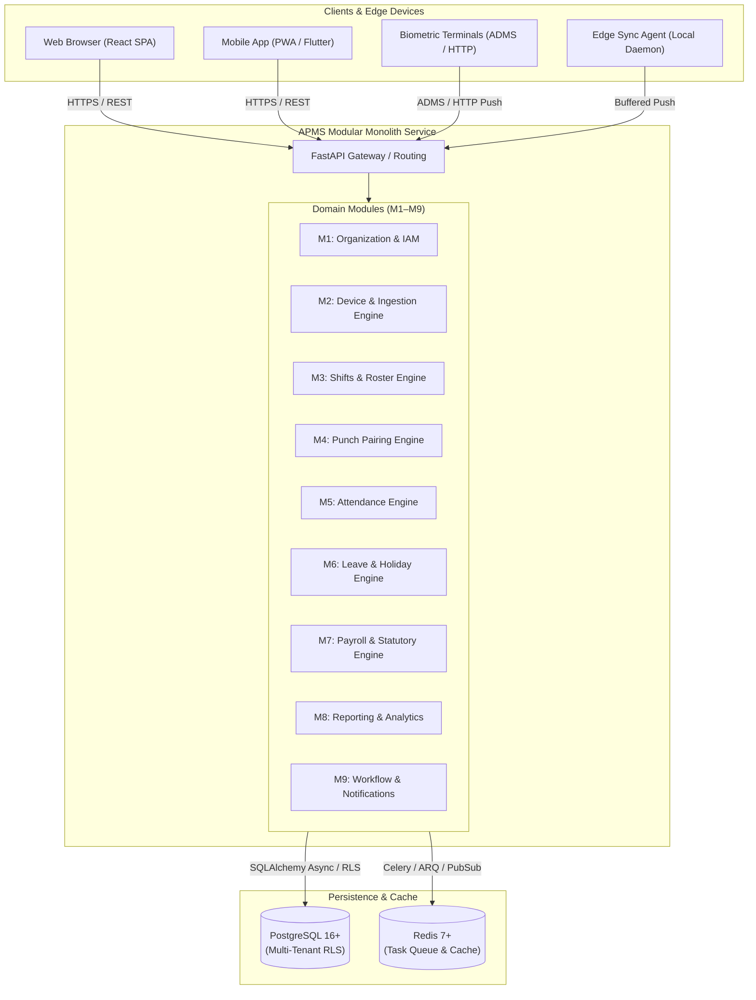

# APMS System Architecture & Component Design

## 1. Architectural Style: Modular Monolith

APMS is structured as a **Modular Monolith**. It delivers the operational simplicity, transactional consistency, and developer velocity of a single deployable service while maintaining strict architectural boundaries and module encapsulation.

---

## 2. Deployment Topologies

APMS supports two deployment topologies using the identical codebase:

### 2.1 Combined Topology (Profile XS / S)
- **Target**: Deployments serving 1 to 50 tenants (< 10,000 active employees).
- **Architecture**: Single Docker container running FastAPI web server, background task worker, and scheduler. Backed by managed PostgreSQL and Redis instances.
- **Resource Footprint**: Minimal (2 vCPU, 4GB RAM).

### 2.2 Split Topology (Profile M / L / Enterprise)
- **Target**: High-scale enterprise deployments (> 50 tenants, > 50,000 active employees, high biometric throughput).
- **Architecture**:
  - `apms-api`: Stateless HTTP API nodes auto-scaled behind load balancers.
  - `apms-ingest`: Dedicated endpoints handling high-throughput device biometric pushes.
  - `apms-worker-calc`: Asynchronous workers executing punch pairing, shift instantiation, and attendance rollups.
  - `apms-worker-payroll`: Dedicated workers executing heavy monthly payroll calculations and PDF generation.
  - `apms-beat`: Scheduler dispatching recurring cron jobs (daily rollups, statutory reminders).

---

## 3. Module Boundaries & Interaction Contracts

Modules interact exclusively through internal service interfaces, Pydantic schemas, and in-memory or Redis-backed domain events. Direct cross-module SQL joins bypassing the service layer are strictly prohibited.

| Module | Core Responsibility | Inbound Dependencies | Outbound Events Emitted |
| :--- | :--- | :--- | :--- |
| **M1: IAM & Org** | Multi-tenancy, Users, Roles, Employees, Branches | None (Foundation) | `employee.created`, `tenant.provisioned` |
| **M2: Ingestion** | Hardware protocols, raw punches, deduplication | M1 | `punch.ingested`, `device.offline` |
| **M3: Shifts & Roster** | Master shifts, rotation patterns, dated instances | M1 | `shift.instantiated`, `shift.modified` |
| **M4: Pairing Engine** | Session matching, out-of-order punches, bounds | M2, M3 | `punches.paired`, `anomaly.detected` |
| **M5: Attendance Engine** | Daily rollup, qualification, explanation trace | M3, M4, M6 | `attendance.finalized`, `attendance.recalculated` |
| **M6: Leave & Holidays** | Double-entry balance ledgers, sandwich rules | M1 | `leave.approved`, `leave.debited` |
| **M7: Payroll Engine** | 10-step wizard, statutory deductions, payslips | M1, M5, M6 | `payroll.locked`, `payslips.published` |
| **M8: Reporting** | Muster rolls, statutory returns, Tally XML | M1, M5, M7 | `report.generated` |
| **M9: Workflows** | Approval chains, SLA escalation, notifications | M1 | `workflow.approved`, `workflow.escalated` |

---

## 4. Invariant Enforcement Mechanisms

1. **Tenant Isolation**: PostgreSQL connection pooling sets session context (`SET LOCAL app.current_tenant_id = :tenant_id`) on checkout. Tables enforce `WHERE tenant_id = current_setting('app.current_tenant_id', true)::uuid`.
2. **Immutable Audit Ledgers**: `raw_envelope`, `punch_event`, `attendance_explanation_trace`, and `leave_transaction` lack `UPDATE` and `DELETE` application pathways.
3. **Decoupled Payroll Pipeline**: Attendance finalized summaries are published as immutable inputs to Payroll. Payroll never recalculates or alters raw attendance punches.

