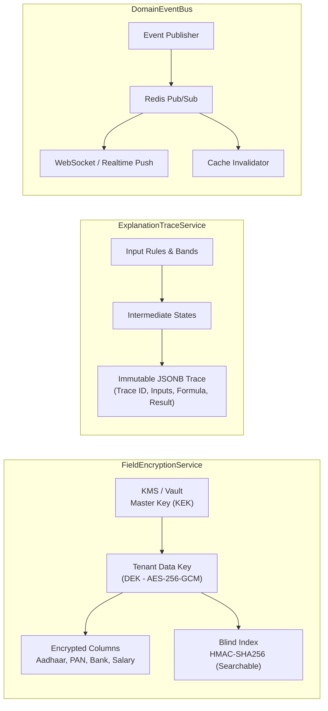
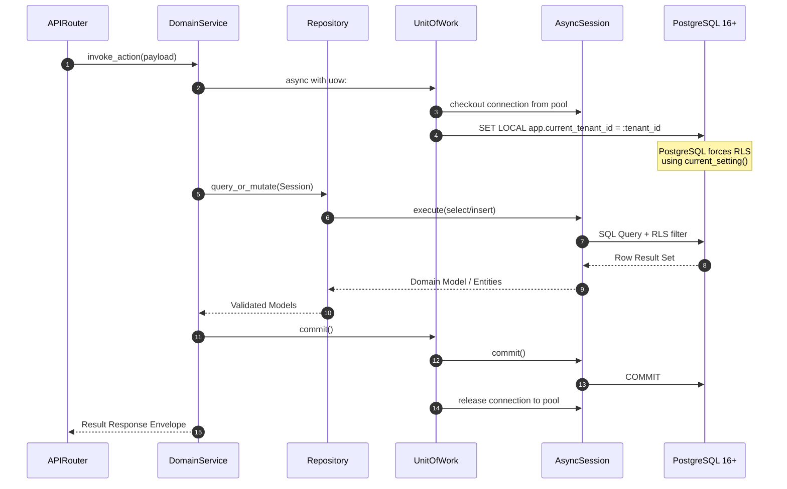
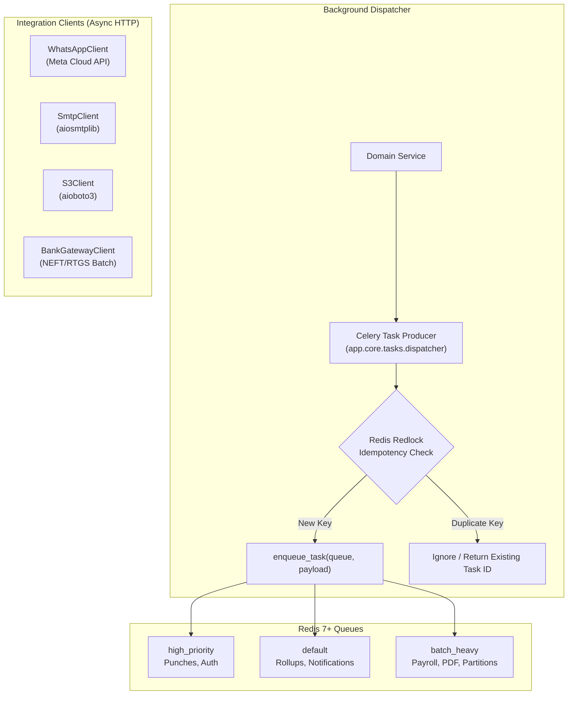
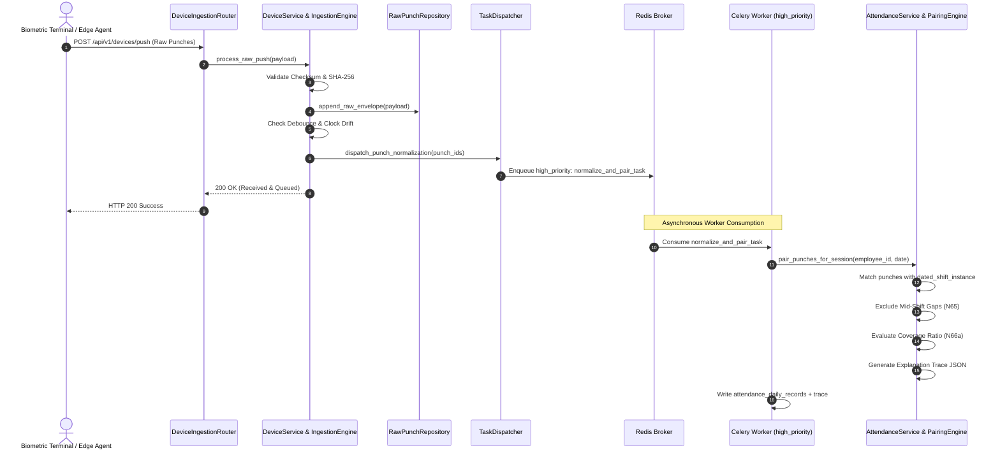
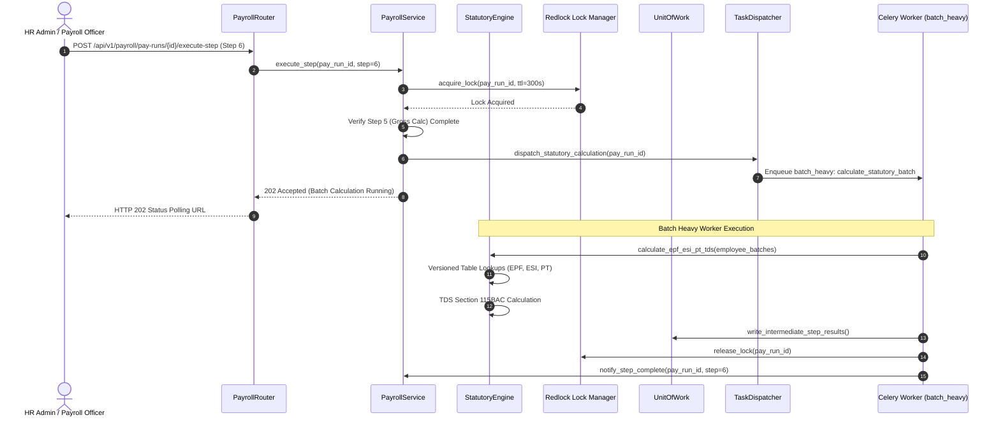

# APMS — C4 Level 3: Component Architecture Diagram (FastAPI Backend)

> **Status:** Authoritative | **Last Updated:** 2026-11-16 | **Source:** Derived from SYSTEM_ARCHITECTURE.md, container-architecture.md, REQUEST_LIFECYCLE.md, DECISION_REGISTER.md

---

## 1. Overview & Purpose

This document specifies the **C4 Level 3: Component Diagram** for the **FastAPI Backend Container** (`apms-api` / `apms-app`). APMS is engineered as a **Modular Monolith** in **Python 3.12+**, leveraging **FastAPI**, **Pydantic v2**, and **SQLAlchemy 2.0 (async)**.

The FastAPI backend encapsulates all 21 APMS business modules into a unified deployable unit. It maintains strict internal encapsulation: modules communicate through explicit domain service interfaces and typed schemas rather than direct cross-module database foreign key mutations.

This document details:
1. The structural boundaries and internal components of the FastAPI container.
2. The ordered HTTP request pipeline from middleware to database persistence.
3. Domain services, their responsibilities, and dependency flows.
4. The persistence abstraction layer with PostgreSQL 16+ Row-Level Security (RLS).
5. Integration clients interfacing with external communication, banking, and cloud storage systems.
6. The asynchronous Celery task dispatcher bridge.

---

## 2. C4 Level 3 Component Diagram

```mermaid
flowchart TD
    %% ─── Styling Definitions ──────────────────────────────────────────
    classDef client fill:#f5f5f5,stroke:#9e9e9e,stroke-width:2px,color:#212121;
    classDef gateway fill:#e1f5fe,stroke:#0288d1,stroke-width:2px,color:#01579b;
    classDef middleware fill:#ede7f6,stroke:#7e57c2,stroke-width:2px,color:#311b92;
    classDef router fill:#e8f5e9,stroke:#43a047,stroke-width:2px,color:#1b5e20;
    classDef service fill:#fff8e1,stroke:#ffa000,stroke-width:2px,color:#e65100;
    classDef persistence fill:#efebe9,stroke:#8d6e63,stroke-width:2px,color:#3e2723;
    classDef task fill:#fce4ec,stroke:#d81b60,stroke-width:2px,color:#880e4f;
    classDef ext fill:#eceff1,stroke:#607d8b,stroke-width:2px,color:#263238;

    %% ─── External Entry Points ───────────────────────────────────────
    subgraph Inbound["Inbound Ingress (from Nginx)"]
        NGX["Nginx Reverse Proxy<br/>TLS Termination & Rate Limiting"]:::gateway
    end

    %% ─── FastAPI Backend Container Boundary ───────────────────────────
    subgraph BACKEND["FastAPI Backend Container (Modular Monolith)"]
        
        %% Middleware Stack
        subgraph MIDDLEWARE["Security & Context Middleware Stack"]
            direction TB
            MW_CORS["CORSMiddleware<br/>Origins & Preflight"]:::middleware
            MW_REQ["RequestIDMiddleware<br/>Correlation ID (X-Request-ID)"]:::middleware
            MW_TENANT["TenantResolutionMiddleware<br/>Subdomain / Header Extraction"]:::middleware
            MW_AUTH["JWTAuthenticationMiddleware<br/>RS256 Validation & Blacklist Check"]:::middleware
            MW_RLS["RLSContextMiddleware<br/>ContextVar Binding (tenant_id)"]:::middleware
            MW_RATE["DynamicRateLimiterMiddleware<br/>Redis Sliding Window Limiter"]:::middleware

            MW_CORS --> MW_REQ --> MW_TENANT --> MW_AUTH --> MW_RLS --> MW_RATE
        end

        %% Routing Layer
        subgraph ROUTERS["APIRouter Layer (FastAPI v1 Endpoints)"]
            direction TB
            R_AUTH["AuthRouter<br/>/api/v1/auth"]:::router
            R_ORG["OrgRouter<br/>/api/v1/orgs, /branches"]:::router
            R_EMP["EmployeeRouter<br/>/api/v1/employees"]:::router
            R_SHF["ShiftRouter<br/>/api/v1/shifts, /rosters"]:::router
            R_ING["DeviceIngestionRouter<br/>/api/v1/devices, /punches"]:::router
            R_ATT["AttendanceRouter<br/>/api/v1/attendance"]:::router
            R_LVE["LeaveRouter<br/>/api/v1/leave, /holidays"]:::router
            R_PAY["PayrollRouter<br/>/api/v1/payroll, /pay-runs"]:::router
            R_WF["WorkflowRouter<br/>/api/v1/workflows, /requests"]:::router
            R_REP["ReportRouter<br/>/api/v1/reports, /exports"]:::router
        end

        %% Dependency Injection & Security Guards
        subgraph DI["FastAPI Dependency Injection"]
            SEC_CTX["Security Context Provider<br/>get_current_user()<br/>get_current_tenant()<br/>has_role(Role)"]:::middleware
            DB_DEP["Async DB Session Provider<br/>get_async_db_session()<br/>Contextual RLS Injection"]:::middleware
        end

        %% Domain Services Layer
        subgraph SERVICES["Domain Services Layer (Business Logic Core)"]
            direction TB
            SVC_IAM["IAMService<br/>User lifecycle, RBAC, tokens"]:::service
            SVC_ORG["OrgService<br/>Tenants, branches, departments"]:::service
            SVC_EMP["EmployeeService<br/>Profiles, salary structure mapping"]:::service
            SVC_SHF["ShiftService & RosterEngine<br/>Templates, dated instances, rotations"]:::service
            SVC_DEV["DeviceService & IngestionEngine<br/>Terminal ADMS, Edge sync, deduplication"]:::service
            SVC_ATT["AttendanceService & PairingEngine<br/>Chronological pairing, N65 gaps, N66a rollup"]:::service
            SVC_LVE["LeaveService & LedgerEngine<br/>Double-entry balances, sandwich rules"]:::service
            SVC_PAY["PayrollService & StatutoryEngine<br/>10-step wizard, EPF/ESI/PT/TDS, snapshots"]:::service
            SVC_WF["WorkflowService & EscalationEngine<br/>Approval DAGs, SLA timer evaluation"]:::service
            SVC_REP["ReportService & ExportEngine<br/>Muster rolls, Tally Prime XML, Form 24Q"]:::service
        end

        %% Cross-Cutting Engine Components
        subgraph CROSS_CUTTING["Cross-Cutting Engine Components"]
            CRYPTO["FieldEncryptionService<br/>Envelope AES-256 (PAN, Aadhaar, Bank)"]:::service
            AUDIT["ExplanationTraceService<br/>Deterministic JSON trace writer"]:::service
            BUS["DomainEventBus<br/>In-memory & Redis Pub/Sub events"]:::service
        end

        %% Persistence & Repository Layer
        subgraph REPOSITORIES["Persistence & Repository Layer"]
            direction TB
            UOW["UnitOfWork (Async Context Manager)"]:::persistence
            REPO_RAW["RawPunchRepository<br/>Append-only raw_envelope"]:::persistence
            REPO_PCH["PunchEventRepository<br/>Partitioned punch_event"]:::persistence
            REPO_ATT["AttendanceRepository<br/>Rollup ledger & traces"]:::persistence
            REPO_SHF["ShiftRepository<br/>Templates & dated instances"]:::persistence
            REPO_LVE["LeaveRepository<br/>Append-only transactions"]:::persistence
            REPO_PAY["PayrollRepository<br/>Pay runs & employee snapshots"]:::persistence
            REPO_EMP["EmployeeRepository<br/>Encrypted profiles & structures"]:::persistence
        end

        %% Database Session & Engine
        subgraph DB_ENGINE["SQLAlchemy 2.0 Async Session Core"]
            SA_ENGINE["create_async_engine (asyncpg)<br/>Connection Pooler (20 pool, 10 overflow)"]:::persistence
            SESSION["AsyncSession<br/>Per-request unit of work"]:::persistence
            RLS_HOOK["Connection Checkout Hook<br/>SET LOCAL app.current_tenant_id = :tid"]:::persistence
            
            SA_ENGINE --> SESSION
            SESSION --> RLS_HOOK
        end

        %% Task Dispatcher
        subgraph TASK_DISPATCHER["Background Task Dispatcher"]
            CELERY_PROD["Celery Task Producer<br/>celery_app.send_task()"]:::task
            LOCK_MGR["Redlock Distributed Lock Manager<br/>Idempotency Key Verifier"]:::task
        end

        %% External Integration Clients
        subgraph INTEGRATION_CLIENTS["External Integration Clients (Async HTTP / SDK)"]
            CLI_WA["WhatsAppClient<br/>Official Cloud API (BSP)"]:::ext
            CLI_MAIL["SmtpClient<br/>Async aiosmtplib (TLS)"]:::ext
            CLI_SMS["SmsClient<br/>Transactional SMS Gateway"]:::ext
            CLI_S3["S3Client / MinIOClient<br/>aioboto3 (Presigned URLs, PDF storage)"]:::ext
            CLI_BANK["BankGatewayClient<br/>NEFT/RTGS batch formatting"]:::ext
            CLI_ERP["ErpSyncClient<br/>Tally Prime XML & Zoho Books API"]:::ext
        end
    end

    %% ─── Persistence & External Infrastructure ────────────────────────
    subgraph INFRASTRUCTURE["Storage, Cache & Broker Infrastructure"]
        PG[("PostgreSQL 16+<br/>RLS Multi-Tenancy<br/>Partitioned tables")]:::persistence
        REDIS[("Redis 7+<br/>Task Broker, Redlock, Cache")]:::task
        MINIO[("MinIO / AWS S3<br/>Object Storage (PDFs, Docs)")]:::ext
    end

    %% ─── External Downstream Systems ──────────────────────────────────
    subgraph EXTERNAL_SYSTEMS["External Service Providers"]
        EXT_WA["WhatsApp BSP"]:::ext
        EXT_SMTP["SMTP Server"]:::ext
        EXT_SMS["SMS Gateway"]:::ext
        EXT_BANK["Bank Disbursement Portal"]:::ext
        EXT_ERP["Tally Prime / Zoho ERP"]:::ext
    end

    %% ─── Connections & Interactions ───────────────────────────────────
    NGX -->|"HTTP/REST proxy :8000"| MW_CORS
    MW_RATE -->|"Dispatches request"| ROUTERS

    %% Router to DI
    ROUTERS -.->|"Resolves"| DI
    DI -->|"Provides Tenant & Claims"| SEC_CTX
    DI -->|"Provides AsyncSession"| DB_DEP

    %% Router to Services
    R_AUTH --> SVC_IAM
    R_ORG --> SVC_ORG
    R_EMP --> SVC_EMP
    R_SHF --> SVC_SHF
    R_ING --> SVC_DEV
    R_ATT --> SVC_ATT
    R_LVE --> SVC_LVE
    R_PAY --> SVC_PAY
    R_WF --> SVC_WF
    R_REP --> SVC_REP

    %% Services to Cross-Cutting
    SVC_EMP --> CRYPTO
    SVC_PAY --> CRYPTO
    SVC_ATT --> AUDIT
    SVC_PAY --> AUDIT
    SERVICES --> BUS

    %% Services to Repositories via UOW
    SVC_DEV --> REPO_RAW
    SVC_DEV --> REPO_PCH
    SVC_ATT --> REPO_PCH
    SVC_ATT --> REPO_ATT
    SVC_ATT --> REPO_SHF
    SVC_SHF --> REPO_SHF
    SVC_LVE --> REPO_LVE
    SVC_PAY --> REPO_PAY
    SVC_PAY --> REPO_ATT
    SVC_PAY --> REPO_LVE
    SVC_EMP --> REPO_EMP
    SERVICES --> UOW

    %% Repositories to SQLAlchemy Session
    REPOSITORIES --> SESSION
    RLS_HOOK -->|"TCP :5432 (SET LOCAL)"| PG

    %% Services to Task Dispatcher
    SVC_DEV --> CELERY_PROD
    SVC_ATT --> CELERY_PROD
    SVC_PAY --> CELERY_PROD
    SVC_WF --> CELERY_PROD
    SVC_REP --> CELERY_PROD
    CELERY_PROD --> LOCK_MGR
    LOCK_MGR -->|"Lock acquire/release :6379"| REDIS
    CELERY_PROD -->|"Enqueue high_priority / default / batch_heavy"| REDIS

    %% Services to Integration Clients
    SVC_WF --> CLI_WA
    SVC_WF --> CLI_MAIL
    SVC_WF --> CLI_SMS
    SVC_PAY --> CLI_S3
    SVC_PAY --> CLI_BANK
    SVC_REP --> CLI_ERP
    SVC_REP --> CLI_S3

    %% Integration Clients to External
    CLI_WA --> EXT_WA
    CLI_MAIL --> EXT_SMTP
    CLI_SMS --> EXT_SMS
    CLI_S3 --> MINIO
    CLI_BANK --> EXT_BANK
    CLI_ERP --> EXT_ERP
```



---

## 3. Component Breakdown & Responsibilities

### 3.1 Inbound Security & Context Middleware Stack

Execution order is deterministic and non-bypassable. Every request entering FastAPI passes through this pipeline:

| Middleware | Python Path | Invariant Enforced | Responsibility |
| :--- | :--- | :--- | :--- |
| **CORSMiddleware** | `app.middleware.cors` | Security | Evaluates origin against tenant whitelist; handles pre-flight `OPTIONS`. |
| **RequestIDMiddleware** | `app.middleware.request_id` | Auditability | Extracts or generates UUIDv7 `X-Request-ID` and sets it in `request.state.request_id`. |
| **TenantResolutionMiddleware** | `app.middleware.tenant` | Multi-Tenancy | Extracts tenant identifier from custom subdomain (`{tenant}.apms.domain`) or `X-Tenant-Code` header; caches metadata in Redis. |
| **JWTAuthenticationMiddleware** | `app.middleware.auth` | Zero-Trust | Decodes RS256 Bearer JWT, validates signature against tenant public keys, checks Redis token revocation blacklist, extracts `sub`, `tid`, and `roles`. |
| **RLSContextMiddleware** | `app.middleware.rls` | Data Isolation | Injects validated `tenant_id` into Python `contextvars.ContextVar`. Ensures all downstream asynchronous tasks inherit tenant isolation. |
| **DynamicRateLimiterMiddleware** | `app.middleware.rate_limit` | Availability | Redis sliding window rate limiter: enforces 100 req/min per user and 2,000 req/min per tenant. Emits HTTP 429 upon threshold breach. |

---

### 3.2 APIRouter Layer

Each APIRouter encapsulates an APMS domain module's REST endpoints under `/api/v1`:

| Router Component | File Path | Base Route | Key Operations & Handlers |
| :--- | :--- | :--- | :--- |
| **AuthRouter** | `app.api.v1.auth` | `/api/v1/auth` | User login (`POST /login`), token refresh (`POST /refresh`), logout (`POST /revoke`), MFA verification. |
| **OrgRouter** | `app.api.v1.org` | `/api/v1/orgs` | Organization profile, branch creation, department hierarchy, geofence definitions. |
| **EmployeeRouter** | `app.api.v1.employees` | `/api/v1/employees` | Employee lifecycle CRUD, encrypted PII handling, salary template assignment. |
| **ShiftRouter** | `app.api.v1.shifts` | `/api/v1/shifts` | Shift templates, rotational roster generators, dated shift instance overrides (`N67`). |
| **DeviceIngestionRouter** | `app.api.v1.devices` | `/api/v1/devices` | Biometric push endpoint (ADMS/HTTP), Edge agent batch upload, heartbeat receiver. |
| **AttendanceRouter** | `app.api.v1.attendance` | `/api/v1/attendance` | Daily attendance query, regularization request, audit trace inspector, recalculation trigger. |
| **LeaveRouter** | `app.api.v1.leave` | `/api/v1/leave` | Leave balance query (derived from ledger), leave application, approval, sandwich rule preview. |
| **PayrollRouter** | `app.api.v1.payroll` | `/api/v1/payroll` | Guided 10-step pay run wizard execution, pre-run audit, pay run lock, payslip fetch. |
| **WorkflowRouter** | `app.api.v1.workflows` | `/api/v1/workflows` | Approval inbox, multi-tier delegation, step approve/reject, SLA escalation queries. |
| **ReportRouter** | `app.api.v1.reports` | `/api/v1/reports` | Muster roll generation, statutory returns (EPF ECR, ESI), Tally Prime XML export. |

---

### 3.3 Domain Services Layer

The core application logic is implemented in stateless domain services:

#### 1. AttendanceService & PairingEngine (`app.services.attendance`)
- **Punch Pairing**: Matches chronologically ordered punches within shift session windows $[T_{start, j} - W_{pre}, T_{end, j} + W_{post}]$.
- **Multi-Session Gap Handling (N65)**: Excludes intervals between scheduled sessions from worked duration and overtime.
- **Rollup Calculation (N66a)**: Computes coverage ratio $R = \sum \text{WorkedDuration} / \sum \text{ScheduledDuration}$ and maps to `PRESENT`, `HALF_DAY`, or `ABSENT`.
- **Session Qualification (N66b)**: Assesses minimum presence threshold $\mu \times \text{ScheduledDuration}$ independently per session.
- **Trace Persistence**: Generates deterministic JSON explanation trace for every daily rollup.

#### 2. PayrollService & StatutoryEngine (`app.services.payroll`)
- **10-Step Wizard Coordinator**: Enforces finite-state transitions from attendance reconciliation to payslip release.
- **Statutory Computation**:
  - **EPF**: Computes 12% employee share and 12% employer split (8.33% EPS capped at ₹15,000 ceiling, 3.67% EPF) according to versioned database rates (`ADR-25`).
  - **ESI**: Enforces ₹21,000 monthly gross threshold; calculates 0.75% employee and 3.25% employer contributions.
  - **Professional Tax (PT)**: Evaluates state-specific wage slabs, handling bi-annual or February adjustments.
  - **TDS**: Estimates annual projected taxable liability under Section 115BAC (New Regime) and Old Regime.
- **Immutable Snapshot Lock**: Freezes pay runs in `pay_run_employee_snapshots` with JSON calculation traces.

#### 3. ShiftService & RosterEngine (`app.services.shifts`)
- **Pattern Expansion**: Materializes recurring weekly/monthly patterns into concrete `dated_shift_instances` up to 60 days ahead.
- **Ad-Hoc Same-Day Overrides (N67)**: Evaluates supervisor direct overrides or employee change requests, dynamically repointing pairing logic.
- **Multi-Day Continuous Duty Handlers**: Handles 24h, 36h, and 48h emergency hospital or industrial shifts, attributing worked duration to the start calendar date (`ADR-15`, `BR-ATT-15`).

#### 4. LeaveService & LedgerEngine (`app.services.leave`)
- **Double-Entry Balance Verification**: Sums append-only `leave_transactions` to calculate available balances; prevents negative balances.
- **Sandwich Rule Engine**: Detects whether weekends or statutory holidays enclosed by leave days must be converted to paid leave or Loss of Pay (LOP).
- **Session-Targeted Leave (N66c)**: Deducts half-day leaves explicitly from Session 1 or Session 2, cooperating with the Attendance pairing engine.

#### 5. DeviceService & IngestionEngine (`app.services.devices`)
- **Raw Envelope Logging**: Appends incoming payloads to `raw_envelope` alongside calculated `sha256` payload hashes (`ADR-05`).
- **Debounce & Drift Gate**: Flags punches within 60s as `DUPLICATE_IGNORED` and verifies hardware clock drift against NTP ($\pm 5\text{ minutes}$).
- **Normalization**: Translates proprietary terminal payloads (ZKTeco ADMS, Time Office) into standard `punch_event` records.

#### 6. WorkflowService & EscalationEngine (`app.services.workflows`)
- **Approval State Machine**: Coordinates multi-level approval hierarchies based on organization structure and departmental matrices.
- **Auto-Approval within Quotas (Q6)**: Automatically grants WFH or standard permissions if quota limits are not exceeded.
- **SLA Escalation**: Detects pending approvals exceeding configured timeouts (e.g., 48 hours) and escalates to secondary managers.

#### 7. ReportService & ExportEngine (`app.services.reports`)
- **Muster Roll Generator**: Compiles Form 25 / Form 28 statutory attendance registers.
- **Statutory Return Exporters**: Generates electronic Challan-cum-Return (ECR) text files for EPFO, ESI monthly contribution sheets, and Form 24Q TDS files.
- **Accounting ERP Bridges**: Generates compliant Tally Prime XML journal vouchers and Zoho Books payloads.

---

### 3.4 Cross-Cutting Engine Components



1. **FieldEncryptionService (`app.core.security.encryption`)**:
   - Implements envelope encryption for sensitive employee data (`ADR-13`).
   - Uses Master Key (KMS / HashiCorp Vault) to encrypt tenant-specific Data Encryption Keys (DEKs).
   - Encrypts Aadhaar, PAN, bank account numbers, and salary amounts using AES-256-GCM.
   - Generates blind HMAC-SHA256 hashes to permit deterministic database searches on encrypted fields without decrypting whole tables.

2. **ExplanationTraceService (`app.core.audit.trace`)**:
   - Persists immutable JSON explanation traces for every attendance rollup calculation and payroll pay run (`ADR-14`).
   - Captures policy bands applied, grace minutes consumed, gap exclusions evaluated, and exact statutory deduction parameters.

3. **DomainEventBus (`app.core.events`)**:
   - Emits asynchronous domain events (e.g., `punch.ingested`, `attendance.finalized`, `payroll.locked`).
   - Distributes events across modular boundaries and notifies Redis Pub/Sub for frontend UI updates.

---

### 3.5 Persistence & Data Access Layer

APMS uses SQLAlchemy 2.0 async with PostgreSQL 16+. Architectural invariants strictly govern data access:



- **Row-Level Security Enforcement**: The connection checkout hook immediately executes:
  ```sql
  SET LOCAL app.current_tenant_id = '<current_tenant_uuid>';
  ```
- **Declarative Partitioning**: Repositories for `raw_envelope`, `punch_event`, and `attendance_daily_records` query partitioned tables seamlessly via date-bounded ranges.
- **Append-Only Repositories**: `RawPunchRepository` and `LeaveTransactionRepository` expose only `insert` and `select` methods; `update` and `delete` primitives are intentionally omitted.

---

### 3.6 Background Task Dispatcher & Integration Clients



- **Task Dispatcher (`app.core.tasks.dispatcher`)**:
  - Encapsulates Celery `send_task` calls.
  - Verifies idempotency keys in Redis (`Redlock`) prior to dispatch to prevent duplicate background jobs.
  - Routes tasks to dedicated queues (`high_priority`, `default`, `batch_heavy`) based on throughput characteristics and latency SLAs.
- **Integration Clients (`app.integrations.*`)**:
  - **WhatsAppClient**: Asynchronously dispatches transactional notifications via Meta Cloud API / BSP.
  - **SmtpClient**: Asynchronously transmits payslips and approval requests with TLS encryption.
  - **S3Client**: Streams encrypted PDF payslips and CSV export files to MinIO / AWS S3 using presigned URLs.
  - **BankGatewayClient**: Formats and signs NEFT/RTGS disbursement files for institutional bank clearinghouse integration.

---

## 4. Component Interaction Sequences

### 4.1 Biometric Punch Ingestion & Pairing Flow



---

### 4.2 10-Step Pay Run Wizard Step Execution Flow



---

## 5. Architectural Quality Attributes & Invariants

1. **Strict Multi-Tenant Isolation**: RLS is mandatory on all tenant-bound tables. The FastAPI middleware enforces context injection on every incoming request.
2. **Immutable Audit Ledgers**: Raw punches, leave ledger mutations, and explanation traces are append-only.
3. **Statutory Parameterization**: All statutory thresholds (EPF ₹15,000 ceiling, ESI ₹21,000 ceiling, PT slabs) are pulled dynamically from versioned database tables, never hardcoded in service logic.
4. **Resilient Decoupling**: Attendance calculations and payroll pay runs are executed strictly via asynchronous background workers to guarantee that HTTP request-response latency remains sub-100ms for web clients.
5. **Deterministic Auditability**: Every calculation produces a fully reproducible explanation trace containing all input parameters, intermediate evaluations, and the resulting classification.
