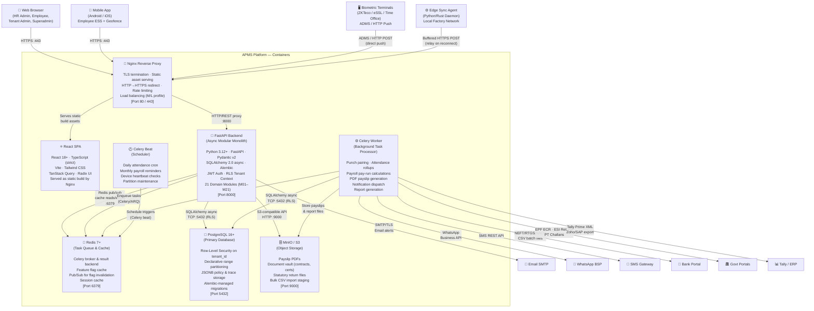

# APMS — C4 Level 2: Container Architecture Diagram

> **Status:** Authoritative | **Last Updated:** 2026-11-16 | **Source:** Derived from SYSTEM_ARCHITECTURE.md, DEPLOYMENT.md, DECISION_REGISTER.md

---

## 1. Overview

APMS is a **Modular Monolith** deployed as a set of well-defined containers. All containers share the same application codebase; deployment profiles control which processes are co-located (XS/S) versus split into independent scaled services (M/L/Enterprise).

---

## 2. Container Architecture Diagram (C4 Level 2)



---

## 3. Container Descriptions

| Container | Technology | Responsibility |
|:---|:---|:---|
| **Nginx Reverse Proxy** | Nginx 1.25+ | TLS termination, static asset serving, HTTP→API proxy, rate limiting, load balancing in M/L profile |
| **React SPA** | React 18+, TypeScript, Vite, Tailwind CSS, TanStack Query, Radix UI | All web UIs: HR console, Employee ESS, Admin dashboard, Device management |
| **FastAPI Backend** | Python 3.12+, FastAPI, Pydantic v2, SQLAlchemy 2.0 async | REST API gateway, all 21 domain modules, JWT auth, RLS tenant-context injection, OpenAPI spec |
| **Celery Worker** | Celery + Redis broker | Async punch pairing, attendance rollups, payroll calculations, PDF generation, notification dispatch |
| **Celery Beat** | Celery Beat scheduler | Cron-driven daily attendance rollups, monthly payroll reminders, device heartbeat checks, partition maintenance |
| **Redis 7+** | Redis | Celery broker & result backend, feature flag pub/sub invalidation cache, session cache |
| **PostgreSQL 16+** | PostgreSQL 16+ | Primary persistence — RLS multi-tenancy, declarative partitioning, JSONB traces, Alembic migrations |
| **MinIO / S3** | MinIO (self-hosted) or AWS S3 | Encrypted payslip PDFs, document vault, statutory return files, bulk import staging |

---

## 4. Inter-Container Communication Protocols

| From | To | Protocol | Notes |
|:---|:---|:---|:---|
| Browser / Mobile | Nginx | HTTPS :443 | TLS 1.2+ enforced |
| Biometric Terminal | Nginx | HTTP POST (ADMS) | APMS ADMS push endpoint |
| Edge Sync Agent | Nginx | HTTPS POST | Buffered batch relay |
| Nginx | React SPA | Static file serve | Pre-built Vite bundle |
| Nginx | FastAPI Backend | HTTP reverse proxy :8000 | X-Forwarded-For preserved |
| FastAPI Backend | PostgreSQL | SQLAlchemy async TCP :5432 | Per-request `SET LOCAL app.current_tenant_id` RLS |
| FastAPI Backend | Redis | Redis protocol :6379 | Cache reads/writes, task enqueue |
| FastAPI Backend | MinIO | S3-compatible HTTP :9000 | Signed URL generation, file retrieval |
| FastAPI Backend | Redis | Celery task enqueue | Async task submission |
| Celery Worker | Redis | Celery broker dequeue | Task consumption |
| Celery Worker | PostgreSQL | SQLAlchemy async TCP :5432 | RLS-enforced reads/writes |
| Celery Worker | MinIO | S3-compatible HTTP :9000 | Payslip/report upload |
| Celery Beat | Redis | Celery beat schedule | Cron trigger dispatch |

---

## 5. Deployment Profiles

### 5.1 Profile XS / S — Docker Compose (Single Box)

**Target**: < 50 tenants, < 10,000 active employees  
**Infrastructure**: 2 vCPU, 4 GB RAM minimum

```
┌─────────────────── Single Docker Compose Host ─────────────────────┐
│                                                                     │
│  ┌────────────┐  ┌──────────────────┐  ┌──────────────────┐       │
│  │   Nginx    │  │  FastAPI Backend  │  │  Celery Worker   │       │
│  │  :80/:443  │  │  apms-app :8000   │  │  apms-worker     │       │
│  └────────────┘  └──────────────────┘  └──────────────────┘       │
│                                                                     │
│  ┌──────────────────┐  ┌──────────────┐  ┌──────────────────┐     │
│  │  PostgreSQL 16+  │  │   Redis 7+   │  │  MinIO Object    │     │
│  │  postgres :5432  │  │  redis :6379 │  │  Store :9000     │     │
│  └──────────────────┘  └──────────────┘  └──────────────────┘     │
│                                                                     │
└─────────────────────────────────────────────────────────────────────┘
```

All services co-located on a single host via `docker compose`. Celery Beat runs as a secondary command inside `apms-worker`.

---

### 5.2 Profile M / L / Enterprise — Kubernetes

**Target**: > 50 tenants, > 50,000 active employees, high biometric throughput  
**Infrastructure**: Multi-node Kubernetes cluster with HPA autoscaling

```
┌──────────────── Kubernetes Cluster ──────────────────────────────────┐
│                                                                       │
│  Ingress (Nginx Ingress Controller)                                   │
│       │                                                               │
│       ├─► apms-api  (Deployment, HPA)    ← Stateless HTTP nodes      │
│       │                                                               │
│       └─► apms-ingest  (Deployment, HPA) ← High-throughput device    │
│                                             biometric ingestion       │
│                                                                       │
│  apms-worker-calc   (Deployment, HPA)    ← Punch pairing, rollups    │
│  apms-worker-payroll (Deployment)        ← Heavy payroll & PDF gen   │
│  apms-beat          (Deployment, 1 rep)  ← Cron scheduler            │
│                                                                       │
│  ┌────────────────────────────────────────────────────────────────┐  │
│  │  Managed Services (External or StatefulSet)                    │  │
│  │  PostgreSQL 16+  │  Redis Cluster 7+  │  MinIO / AWS S3        │  │
│  └────────────────────────────────────────────────────────────────┘  │
│                                                                       │
└───────────────────────────────────────────────────────────────────────┘
```

| Workload | Description |
|:---|:---|
| `apms-api` | Stateless REST API pods, auto-scaled behind Kubernetes HPA |
| `apms-ingest` | Dedicated biometric ingestion endpoints — handles 10,000 punches/min bursts |
| `apms-worker-calc` | Async workers for punch pairing, shift instantiation, attendance rollups |
| `apms-worker-payroll` | Dedicated heavy payroll computation and PDF payslip generation |
| `apms-beat` | Single-replica Celery Beat scheduler; protected by distributed lock |
