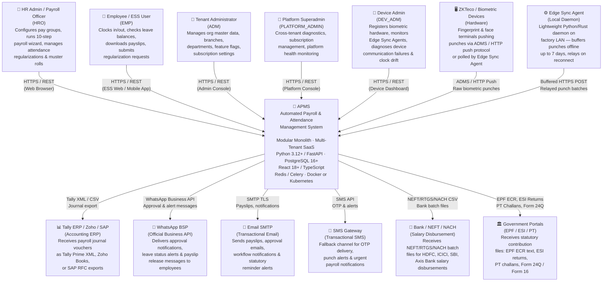

# APMS — C4 Level 1: System Context Diagram

> **Status:** Authoritative | **Last Updated:** 2026-11-16 | **Source:** Derived from SYSTEM_ARCHITECTURE.md, PRD.md, MODULES_AND_FEATURES.md

---

## 1. Purpose

APMS (Automated Payroll & Attendance Management System) is an enterprise-grade, multi-tenant B2B SaaS platform that unifies workforce scheduling, multi-source biometric attendance pairing, double-entry leave ledgers, and 100% compliant statutory payroll execution (India-first: EPF, ESI, PT, TDS).

The system eliminates error-prone manual spreadsheets, solves complex scheduling anomalies (overnight shifts, 24h/36h/48h duties, split sessions, rotating rosters), enforces an uncompromised audit trail, and guarantees statutory compliance down to the exact paisa (±₹0.00).

---

## 2. System Context Diagram (C4 Level 1)

---

## 3. Actors

| Actor | Role Code | Primary Responsibilities |
|:---|:---|:---|
| **HR Admin / Payroll Officer** | `HRO` | Configures pay groups, executes 10-step payroll wizard, manages muster rolls, handles attendance regularizations, generates statutory returns |
| **Employee** | `EMP` | Clocks in/out (mobile/biometric), checks attendance calendar, applies for leave, downloads payslips, requests punch regularizations |
| **Tenant Administrator** | `ADM` | Manages org structure (branches, departments), user roles, feature flags, subscription settings, security policies |
| **Platform Superadmin** | `PLATFORM_ADMIN` | Cross-tenant diagnostics, subscription management, platform health, audited impersonation |
| **Device Admin** | `DEV_ADM` | Registers biometric hardware, configures Edge Sync Agents, monitors device heartbeat and clock drift |

---

## 4. External Systems

| System | Category | Integration Direction | Protocol |
|:---|:---|:---|:---|
| **ZKTeco / Biometric Devices** | Hardware | Inbound → APMS | ADMS push / HTTP POST |
| **Edge Sync Agent** | Local Daemon | Inbound → APMS | Buffered HTTPS POST |
| **Tally ERP / Zoho / SAP** | Accounting ERP | APMS → Outbound | Tally Prime XML, CSV |
| **WhatsApp BSP** | Messaging | APMS → Outbound | WhatsApp Business API |
| **Email SMTP** | Messaging | APMS → Outbound | SMTP/TLS |
| **SMS Gateway** | Messaging | APMS → Outbound | SMS REST API |
| **Bank (NEFT/RTGS/NACH)** | Financial | APMS → Outbound | Batch CSV file upload |
| **Government Portals (EPF/ESI/PT)** | Statutory | APMS → Outbound | EPF ECR, ESI XML, PT Challan |

---

## 5. Key Non-Functional Characteristics

| NFR | Requirement |
|:---|:---|
| **Multi-Tenancy** | Zero cross-tenant leakage via PostgreSQL 16+ Row-Level Security on `tenant_id` |
| **Ingestion Throughput** | 10,000 raw punches/minute, <200ms response latency |
| **Availability** | 99.9% uptime; Edge Agent offline buffer up to 7 days |
| **Audit Trail** | Immutable JSON explanation trace on every attendance rollup and payroll run |
| **Statutory Compliance** | EPF, ESI, PT, TDS; DPDP Act 2023; 8-year retention |
| **Cost Ceiling** | ≤ ₹80 per active employee per month total infrastructure cost |
