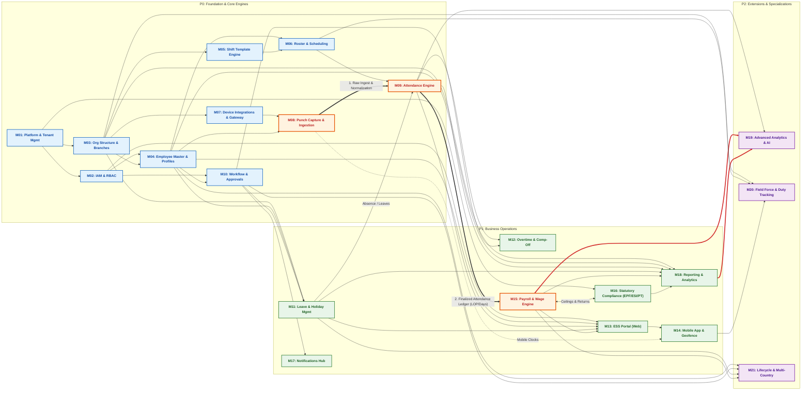

# APMS — 21-Module Directed Dependency Graph & Architecture Map

> **Status:** Authoritative | **Last Updated:** 2026-11-16 | **Source:** Derived from PRD.md, MODULES_AND_FEATURES.md, SYSTEM_ARCHITECTURE.md

---

## 1. Executive Summary

APMS is structured as a **Modular Monolith** containing **21 discrete domain modules** organized into three implementation tiers:
- **P0: Foundation & Core Processing Engines (M01–M10)** — Multi-tenancy, identity, organizational modeling, shift scheduling, punch ingestion, attendance calculation, and workflow orchestration.
- **P1: Business Operations (M11–M18)** — Leave ledgers, overtime authorizations, self-service portals, statutory payroll computation, communications, and reporting.
- **P2: Extensions & Specializations (M19–M21)** — Predictive analytics, mobile field workforce tracking, multi-country rules, and lifecycle automation.

Modules communicate strictly via typed service interfaces, domain events, and Pydantic schemas. Direct cross-module SQL joins that bypass service boundaries are strictly prohibited.

---

## 2. Directed Module Dependency Graph (Flowchart LR)

---

## 3. The Punch-to-Payroll Critical Path

The red bold connector sequence (**M08 $\Longrightarrow$ M09 $\Longrightarrow$ M15**) represents the authoritative core data pipeline of APMS:

$$\mathbf{M08\ (Punch\ Capture)} \xrightarrow[\text{Normalized Punches}]{\text{Step 1}} \mathbf{M09\ (Attendance\ Engine)} \xrightarrow[\text{Finalized Ledger / LOP}]{\text{Step 2}} \mathbf{M15\ (Payroll\ Engine)}$$

### Critical Path Guarantees
1. **Immutable Ingestion (`M08`)**: All physical and digital clock events are written append-only to `raw_envelope` with a SHA-256 payload hash, debounced (60s), and normalized into `punch_event`.
2. **Session-Aware Attendance (`M09`)**: Pairs punches against `dated_shift_instance` (from `M06`), excludes non-working mid-shift gaps (N65), applies duration ratio thresholds (N66a), evaluates sandwich rules with `M11`, and logs an immutable JSON explanation trace.
3. **Decoupled Payroll Consumption (`M15`)**: The payroll wizard reads finalized attendance totals and Loss of Pay (LOP) days as strictly read-only inputs. Payroll never mutates punches, and attendance never calculates wage amounts.
4. **Closed Period Locking**: Locked pay periods cannot be altered. Retroactive punch adjustments or backdated leave approvals trigger automated **Arrears Adjustments** in the next open pay cycle.

---

## 4. Module Dependency Reference Table

| Module ID | Module Name | Tier | Depends On (Inbound) | Depended On By (Outbound) | Core Architectural Responsibility |
|:---|:---|:---|:---|:---|:---|
| **M01** | Platform & Tenant Mgmt | **P0** | *None (Root)* | M02, M03, M16 | Multi-tenant provisioning, database cell placement, subscriptions, MAU quotas, tenant lifecycle. |
| **M02** | IAM & RBAC | **P0** | M01 | M04, M10, M13 | User identities, JWT tokens, TOTP MFA, granular roles (`ADM`, `HRO`, `EMP`, `DEV_ADM`). |
| **M03** | Org Structure & Branches | **P0** | M01 | M04, M05, M07, M11, M18, M20 | Legal entities, physical branches, departments, cost centers, branch local timezones, geofences. |
| **M04** | Employee Master & Profiles | **P0** | M01, M02, M03 | M06, M08, M10, M11, M13, M18, M21 | Universal profile schema, AES-256 encrypted PII (Aadhaar, PAN, Bank), document vault. |
| **M05** | Shift Template Engine | **P0** | M01, M03 | M06 | Fixed, flexible, overnight, split sessions, 24h/36h/48h duties, grace periods, penalty bands. |
| **M06** | Roster & Scheduling | **P0** | M04, M05 | M09, M20 | Recurring roster cycles, materialized `dated_shift_instance`, ad-hoc overrides, shift swaps. |
| **M07** | Device Integrations & Gateway | **P0** | M01, M03 | M08 | ADMS push, Time Office HTTP, eSSL SDK, Edge Sync Agent telemetry, clock drift detection. |
| **M08** | **Punch Capture & Ingestion** | **P0** | M04, M07 | **M09 (Critical Path)**, M14 | Append-only raw punch ingestion, SHA-256 deduplication debounce (60s), out-of-order triggers. |
| **M09** | **Attendance Engine** | **P0** | M06, **M08**, M11 | **M15 (Critical Path)**, M12, M13, M18, M19 | 7-step pairing pipeline, mid-shift gap exclusion (N65), daily rollup status, JSON explanation trace. |
| **M10** | Workflow & Approvals | **P0** | M02, M04 | M11, M12, M17, M21 | 1-to-N tier approval chains, SLA escalation, out-of-office delegation, auto-approval quotas. |
| **M11** | Leave & Holiday Mgmt | **P1** | M03, M04, M10 | M09, M13, M15, M18, M21 | Double-entry append-only `leave_transactions`, sandwich rule engine, session-targeted half leave. |
| **M12** | Overtime & Comp-Off | **P1** | M09, M10 | M15 | Pre/post-shift OT approvals, Factories Act multipliers (1.5x, 2.0x), quarterly caps, comp-off credits. |
| **M13** | ESS Portal (Web) | **P1** | M02, M04, M09, M11, M15 | M14 | Web self-service: attendance calendar, punch miss requests, leave applications, PDF payslips. |
| **M14** | Mobile App & Geofence | **P1** | M02, M04, M08, M13 | M20 | Native Android/iOS client, offline punch queue with HMAC replay guard, geofence clock-in. |
| **M15** | **Payroll & Wage Engine** | **P1** | M04, **M09**, M11, M12, M16 | M13, M18, M19, M21 | 10-step wizard, LOP deduction, salary components, bank batch files (NEFT/NACH), payslip generation. |
| **M16** | Statutory Compliance | **P1** | M01, M15 | M15, M18 | Versioned statutory tables: EPF (₹15,000 ceiling + ECR), ESI (₹21,000 gross), PT slabs, TDS Form 16/24Q. |
| **M17** | Notifications Hub | **P1** | M01, M10 | External Channels | Official WhatsApp Business API, transactional SMS, branded SMTP email, mobile push alerts. |
| **M18** | Reporting & Analytics | **P1** | M03, M04, M09, M11, M15, M16 | M19 | Statutory Muster Roll (Form 25), executive dashboards, Tally Prime XML, Zoho Books, SAP exports. |
| **M19** | Advanced Analytics & AI | **P2** | M09, M15, M18 | Executive UI | Attrition risk analysis, overtime cost forecasting, predictive tardiness, anomaly detection. |
| **M20** | Field Force & Duty Tracking | **P2** | M03, M06, M08, M14 | M18 | 4-tier field tracking model (Level 1 punch GPS to Level 4 duty route), PumpOps forecourt module. |
| **M21** | Lifecycle & Multi-Country | **P2** | M04, M10, M11, M15 | M04, M15 | Probation-to-confirmation pipeline, LOP probation extension, contract renewal workflows, appraisals. |

---

## 5. Architectural Guardrails & Invariants

1. **Layered Separation (3-Way Model)**:
   - Feature availability governed by **M02** (Feature Flags).
   - Behavioral customization governed by **M06** (Tenant Policies).
   - Execution authorization governed by **M02 / M03** (Granular RBAC).
2. **Immutable Persistence**:
   - `raw_envelope` (M08), `punch_event` (M08), `leave_transactions` (M11), and `attendance_explanation_traces` (M09) have no update or delete pathways.
3. **Decoupled Attendance and Payroll**:
   - M09 calculates time worked and attendance qualification.
   - M15 calculates compensation and statutory deductions.
   - M15 never alters M08/M09 records, and M09 never calculates rupee values.
4. **Tenant Isolation**:
   - Every module execution operates within PostgreSQL 16+ Row-Level Security scoped by `SET LOCAL app.current_tenant_id`.
