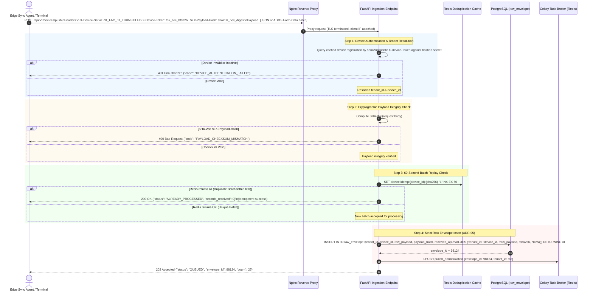
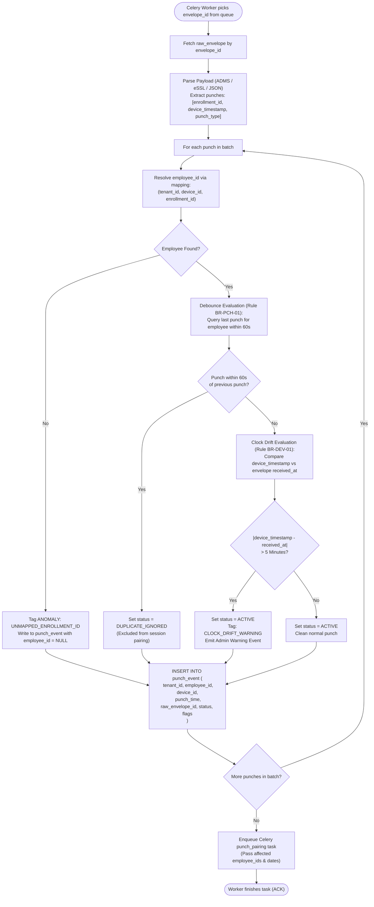
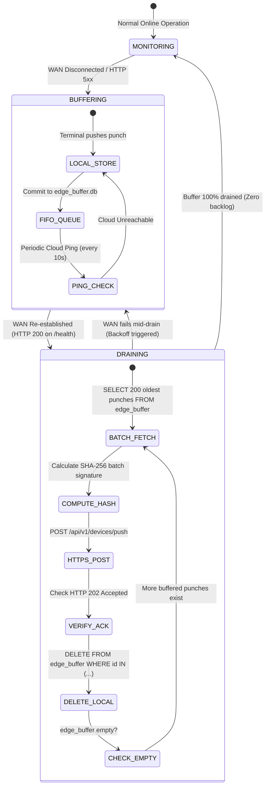
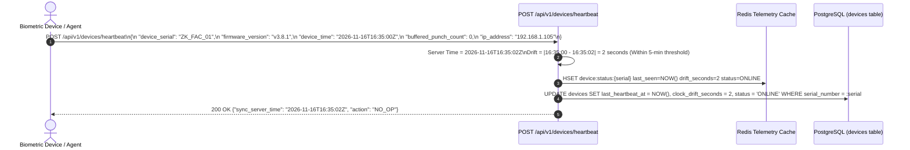

# APMS High-Throughput Device Ingestion Stream Architecture

> **Status:** Authoritative | **Last Updated:** 2026-11-16 | **Source:** Extracted from APMS documentation

---

## 1. Executive Summary & Architectural Invariants

Biometric time and attendance data is the primary operational input to the entire APMS payroll and workforce management lifecycle. In high-density industrial deployments (e.g., manufacturing plants with shift changes involving 5,000+ factory workers punching in within a 15-minute window), the biometric hardware ingestion stream experiences massive traffic bursts.

Furthermore, physical hardware terminals frequently operate on unreliable branch networks or air-gapped factory local area networks (LANs). 

To ensure **zero punch loss**, **sub-second ingestion acknowledgement (< 200ms)**, and **cryptographic audit integrity**, the APMS Ingestion Stream is engineered around four non-negotiable architectural invariants:

1. **Strict Raw Immutability (`ADR-05`, `BR-ING-01`)**: All incoming payloads from biometric hardware, edge agents, mobile apps, or API imports are recorded byte-for-byte in the `raw_envelope` table. Deletion and in-place updates are strictly forbidden by database trigger and RLS constraints.
2. **Asynchronous Ingestion Decoupling**: The synchronous HTTP request boundary terminates immediately upon persisting the raw envelope. Payload parsing, deduplication, employee resolution, and session pairing execute completely asynchronously in background Celery queues.
3. **Declarative Partitioning (`ADR-28`)**: Both `raw_envelope` and `punch_event` tables are declaratively range-partitioned by calendar month (`PARTITION BY RANGE (received_at)` and `punch_time`), guaranteeing constant-time indexing and frictionless 12-month data retention lifecycle management.
4. **Air-Gapped Edge Resilience (`ADR-12`, `PCH-04`)**: The on-premises Edge Sync Agent buffers punches locally in an embedded SQLite database (7-day offline capacity) and drains queues systematically with exponential backoff upon WAN restoration.

---

## 2. End-to-End High-Throughput Ingestion Architecture

```mermaid
flowchart TD
    subgraph EdgeTier["Physical Edge Tier (Factory / Branch LAN)"]
        direction TB
        ZK["ZKTeco ADMS Devices\n(Direct HTTP Post)"]
        ET["eTimeOffice Cloud / Local\n(HTTP Poll)"]
        USB["Legacy RS485 / USB Scanners\n(Serial SDK)"]
        
        subgraph LocalAgent["APMS Edge Sync Agent (Local Windows / Linux Daemon)"]
            ADAPT["Hardware Protocol Adapters"]
            SQLITE[("Local Embedded SQLite Buffer\n[edge_buffer.db - WAL Mode]\n(7-Day Offline Retention)")]
            CIRCUIT["Circuit Breaker & FIFO Dispatcher"]
            HEARTBEAT_GEN["Heartbeat Generator\n(60s Telemetry Pings)"]
        end
    end

    subgraph NetworkBoundary["Network Boundary & WAN Ingress"]
        FIREWALL["Local Firewall\n(Outbound Port 443 Only)"]
        NGINX["Nginx Cloud Reverse Proxy\n• TLS 1.3 Termination\n• Rate Limiting (100 req/s/device)\n• Connection Pooling"]
    end

    subgraph APMSCloudIngress["APMS Cloud Ingestion Service (FastAPI)"]
        INGEST_API["POST /api/v1/devices/push\n(Synchronous Fast-Path < 50ms)"]
        AUTH_VAL["Device Token & Checksum Validator\n(HMAC / SHA-256 Signature)"]
        IDEMP_CACHE["Redis Short-Lived Cache\n(60s Deduplication Hash)"]
    end

    subgraph PersistenceLayer["Storage Layer (PostgreSQL 16+)"]
        RAW_TABLE[("raw_envelope\n(Append-Only / Partitioned by Month)")]
        PUNCH_STREAM[("punch_event\n(Normalized Event Stream / Partitioned)")]
    end

    subgraph AsyncPipeline["Asynchronous Processing Engine (Celery + Redis)"]
        CELERY_REDIS[("Redis Message Broker\nQueue: punch_normalization")]
        NORM_WORKER["Normalization Celery Worker"]
        DEBOUNCE_EVAL{"Debounce Check\n(< 60s window)"}
        DRIFT_EVAL{"Clock Drift Check\n(|Device - Server| > 5 min)"}
        PAIRING_QUEUE[("Redis Message Broker\nQueue: punch_pairing")]
    end

    %% Edge Connections
    ZK --> ADAPT
    ET --> ADAPT
    USB --> ADAPT
    ADAPT -->|Immediate Write| SQLITE
    SQLITE --> CIRCUIT
    CIRCUIT -->|HTTPS POST| FIREWALL
    HEARTBEAT_GEN -->|Heartbeat| CIRCUIT
    FIREWALL -->|WAN / Internet| NGINX

    %% Cloud Ingress
    NGINX --> INGEST_API
    INGEST_API --> AUTH_VAL
    AUTH_VAL <--> IDEMP_CACHE
    AUTH_VAL -->|Direct INSERT| RAW_TABLE
    INGEST_API -->>|202 Accepted| NGINX

    %% Async Transition
    RAW_TABLE -.->|Enqueue Event ID| CELERY_REDIS
    CELERY_REDIS --> NORM_WORKER
    NORM_WORKER --> DEBOUNCE_EVAL
    DEBOUNCE_EVAL -->|Duplicate| DISCARD_LOG["Mark DUPLICATE_IGNORED"]
    DEBOUNCE_EVAL -->|Unique| DRIFT_EVAL
    DRIFT_EVAL -->|Drift > 5m| DRIFT_ALERT["Tag CLOCK_DRIFT_WARNING\nEmit Admin Alert"]
    DRIFT_EVAL -->|Valid / Tagged| PUNCH_STREAM
    PUNCH_STREAM --> PAIRING_QUEUE
```

---

## 3. Ingestion Protocol & Device Authentication Flow

Hardware biometric devices push batches of punch records over HTTP/HTTPS. The Edge Sync Agent or direct ADMS terminals authenticate using cryptographic headers:



---

## 4. Normalization & Celery Worker Processing Pipeline

Once stored in `raw_envelope`, the background worker in queue `punch_normalization` normalizes the raw biometric records into clean, session-pairable `punch_event` records.



---

## 5. Database Schema & Declarative Partitioning Strategy

### 5.1 `raw_envelope` Partitioned DDL
```sql
-- Master Ingestion Table: Declarative Range Partitioning by Month
CREATE TABLE raw_envelope (
    id BIGSERIAL,
    tenant_id UUID NOT NULL,
    device_id UUID NOT NULL,
    raw_payload TEXT NOT NULL,
    payload_hash VARCHAR(64) NOT NULL,
    received_at TIMESTAMPTZ NOT NULL DEFAULT NOW(),
    processed_at TIMESTAMPTZ,
    status VARCHAR(32) NOT NULL DEFAULT 'PENDING',
    error_message TEXT,
    CONSTRAINT pk_raw_envelope PRIMARY KEY (received_at, id)
) PARTITION BY RANGE (received_at);

-- Example Monthly Partitions
CREATE TABLE raw_envelope_y2026m11 PARTITION OF raw_envelope
    FOR VALUES FROM ('2026-11-01 00:00:00+00') TO ('2026-12-01 00:00:00+00');

CREATE TABLE raw_envelope_y2026m12 PARTITION OF raw_envelope
    FOR VALUES FROM ('2026-12-01 00:00:00+00') TO ('2027-01-01 00:00:00+00');

-- Indexes
CREATE INDEX idx_raw_env_tenant_status ON raw_envelope (tenant_id, status, received_at);
CREATE INDEX idx_raw_env_hash ON raw_envelope (tenant_id, payload_hash, received_at);

-- Enforce Multi-Tenant Row Level Security
ALTER TABLE raw_envelope ENABLE ROW LEVEL SECURITY;
ALTER TABLE raw_envelope FORCE ROW LEVEL SECURITY;

CREATE POLICY raw_envelope_tenant_isolation ON raw_envelope
    FOR ALL
    USING (tenant_id = NULLIF(current_setting('app.current_tenant_id', true), '')::uuid);
```

### 5.2 `punch_event` Partitioned DDL
```sql
-- Normalized Punch Stream Table: Declarative Range Partitioning by Month
CREATE TABLE punch_event (
    id BIGSERIAL,
    tenant_id UUID NOT NULL,
    employee_id UUID,                     -- NULL if unmapped biometric enrollment ID
    device_id UUID NOT NULL,
    raw_envelope_id BIGINT NOT NULL,
    punch_time TIMESTAMPTZ NOT NULL,       -- Hardware terminal timestamp
    received_at TIMESTAMPTZ NOT NULL DEFAULT NOW(),
    direction VARCHAR(16) NOT NULL DEFAULT 'AUTO', -- CHECK_IN, CHECK_OUT, BREAK_OUT, BREAK_IN, AUTO
    verification_type VARCHAR(32) NOT NULL DEFAULT 'FINGERPRINT', -- FACE, FINGERPRINT, RFID, PIN
    status VARCHAR(32) NOT NULL DEFAULT 'ACTIVE', -- ACTIVE, DUPLICATE_IGNORED, ANOMALOUS, SUPERSEDED
    flags JSONB NOT NULL DEFAULT '{}'::jsonb,      -- {"clock_drift_warning": true, "unmapped_device": false}
    created_at TIMESTAMPTZ NOT NULL DEFAULT NOW(),
    CONSTRAINT pk_punch_event PRIMARY KEY (punch_time, id)
) PARTITION BY RANGE (punch_time);

-- Example Monthly Partitions
CREATE TABLE punch_event_y2026m11 PARTITION OF punch_event
    FOR VALUES FROM ('2026-11-01 00:00:00+00') TO ('2026-12-01 00:00:00+00');

CREATE TABLE punch_event_y2026m12 PARTITION OF punch_event
    FOR VALUES FROM ('2026-12-01 00:00:00+00') TO ('2027-01-01 00:00:00+00');

-- Composite Performance Indexes
CREATE INDEX idx_punch_event_pairing ON punch_event (tenant_id, employee_id, punch_time, status);
CREATE INDEX idx_punch_event_device ON punch_event (device_id, punch_time);

-- Multi-Tenant Row Level Security
ALTER TABLE punch_event ENABLE ROW LEVEL SECURITY;
ALTER TABLE punch_event FORCE ROW LEVEL SECURITY;

CREATE POLICY punch_event_tenant_isolation ON punch_event
    FOR ALL
    USING (tenant_id = NULLIF(current_setting('app.current_tenant_id', true), '')::uuid);
```

---

## 6. Edge Sync Agent Catch-Up & Reconnection Protocol

When a plant or remote branch experiences an internet blackout:
1. **Local Buffering**: All hardware punches continue to be captured by the Edge Sync Agent and committed immediately to the local embedded SQLite database running in **WAL (Write-Ahead Logging)** mode.
2. **Offline Capacity**: Sized to hold > 1,000,000 punch events (exceeding 7 consecutive days of full factory operations without internet).
3. **WAN Reconnection Trigger**: When internet connectivity returns, the Edge Agent activates its FIFO Drainage Controller:



### Rate Limiting & Backoff Constraints:
- **Maximum Batch Size**: 200 punches per HTTPS POST payload.
- **Throttling Delay**: 100ms pacing between consecutive batch dispatches to prevent overwhelming the cloud ingress API.
- **Circuit Breaker**: On HTTP 429 (Too Many Requests) or 503 (Service Unavailable), backoff exponentially ($2s, 4s, 8s, 16s, \dots \text{max } 120s$) with full jitter.

---

## 7. Device Heartbeat, Clock Drift & Telemetry Stream

Under requirement **`DEV-02`** and **`BR-DEV-01`**, hardware health and time synchronization are monitored continuously:



### Clock Drift Threshold Enforcement (`BR-DEV-01`):
- If $\Delta T = |\text{device\_time} - \text{server\_time}| > 300\text{ seconds}$ (5 minutes):
  1. The API responds with an NTP synchronization directive: `{"action": "SYNC_CLOCK", "correct_time": "..."}`.
  2. Future punches arriving from this device are tagged with `flags: {"clock_drift_warning": true}` in `punch_event`.
  3. A high-priority operational alert is triggered for the Device Administrator in the APMS monitoring console.

---

## 8. Failure Modes & Operational Resilience

| Failure Scenario | Impact | System Defensive Control |
| :--- | :--- | :--- |
| **Complete WAN Outage at Factory Site** | Devices unable to reach cloud API | Edge Sync Agent buffers punches locally in SQLite WAL storage for up to 7 days. Zero punch loss. |
| **Ingestion API DDoS / Surge** | Ingress endpoint flooded with 50,000 req/sec | Nginx connection rate limiting (`limit_req_zone`) throttles abusive IPs; Celery decouples HTTP ACK from processing. |
| **Database Disk Out of Space** | PostgreSQL unable to accept writes | Health checks fail fast; Edge Sync Agent circuit breaker opens, holding records in local SQLite until DB alert clears. |
| **Corrupt / Malformed Punch Payload** | Invalid characters or truncated bytes | Raw payload is preserved in `raw_envelope` with `status = 'CORRUPT_PAYLOAD'`; pipeline continues for valid records. |
| **Biometric Clock Desynchronization** | Terminal battery dies; year resets to 2000 | `BR-DEV-01` flag detects $> 5\text{ min}$ discrepancy; punches quarantined under `CLOCK_DRIFT_WARNING` for admin audit. |
| **Rapid Double Punching by Employee** | Worker scans finger twice in 5 seconds | `BR-PCH-01` Debounce Rule marks second punch as `DUPLICATE_IGNORED`, preserving pairing accuracy. |
