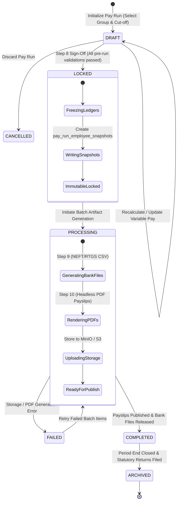

# APMS End-to-End Master Data Flow: Punch to Payslip

> **Status:** Authoritative | **Last Updated:** 2026-11-16 | **Source:** Extracted from APMS documentation

---

## 1. Executive Summary & Guiding Architectural Invariants

The **APMS (Automated Payroll & Attendance Management System)** data flow connects physical edge biometric interactions to statutory compliance deductions and multi-channel payslip delivery.

Every stage of this master pipeline is governed by six non-negotiable architectural invariants:

1. **Raw Punch Immutability (`ADR-05`)**: Incoming biometric logs are recorded append-only in `raw_envelope`. Deletions, overwrites, and in-place updates are strictly forbidden.
2. **Attendance Decoupled from Payroll (`ADR-07`)**: The finalized daily attendance ledger (`attendance_daily_records`) serves as a read-only input to payroll. Payroll calculations never alter raw punches or attendance statuses.
3. **Multi-Session Gap Exclusion (`ADR-16`, `N65`)**: In multi-session and split shifts, non-working intervals between scheduled sessions are excluded from worked duration and overtime computations.
4. **Deterministic Explanation Tracing (`ADR-14`)**: Every daily attendance rollup and payroll pay run generates an immutable JSON explanation trace capturing all input parameters, policy bands, and calculation formulas.
5. **Double-Entry Leave Accounting (`ADR-08`)**: Leave balances are computed dynamically from append-only transaction ledgers (`leave_transactions`), never stored as mutable scalar numbers.
6. **Statutory Parameterization (`ADR-25`)**: Statutory ceilings (EPF ₹15,000, ESI ₹21,000) and PT state slabs reside in versioned database tables, never hardcoded in source code.

---

## 2. End-to-End Master Data Flow Diagram

```mermaid
flowchart TD
    %% Stage 1: Hardware Ingestion
    subgraph Stage1["Stage 1: Biometric Hardware & Ingestion"]
        BIO_DEV["Physical Biometric Terminals\n(ZKTeco ADMS / eTimeOffice / eSSL)"]
        EDGE_AGENT["On-Premises Edge Sync Agent\n(Local SQLite 7-day Buffer)"]
        API_INGEST["FastAPI Push Endpoint\nPOST /api/v1/devices/push\n(Auth & SHA-256 Digest)"]
        RAW_DB[("raw_envelope\n(Append-Only / Partitioned Table)")]

        BIO_DEV -->|HTTP ADMS Push| EDGE_AGENT
        EDGE_AGENT -->|HTTPS / TLS 1.3 Relay| API_INGEST
        BIO_DEV -.->|Direct Cloud Push| API_INGEST
        API_INGEST -->|Idempotent Insert| RAW_DB
    end

    %% Stage 2: Normalization
    subgraph Stage2["Stage 2: Event Normalization & Deduplication"]
        NORM_WORKER["Normalization Worker\n(Celery Queue: punch_normalization)"]
        DEBOUNCE_CHECK{"Debounce Check\n(< 60s duplicate?)"}
        DRIFT_CHECK{"Clock Drift Check\n(|Server - Device| > 5 min?)"}
        PUNCH_DB[("punch_event\n(Normalized Stream / Partitioned)")]
        DRIFT_ALERT["Clock Drift Alarm\n(DEV-02 Maintenance Alert)"]

        RAW_DB --> NORM_WORKER
        NORM_WORKER --> DEBOUNCE_CHECK
        DEBOUNCE_CHECK -->|Duplicate| IGNORE_PUNCH["Flag DUPLICATE_IGNORED\n(Discard from pairing)"]
        DEBOUNCE_CHECK -->|Unique| DRIFT_CHECK
        DRIFT_CHECK -->|Drift Exceeded| DRIFT_ALERT
        DRIFT_CHECK -->|Normal / Flagged| PUNCH_DB
    end

    %% Stage 3: Attendance Engine
    subgraph Stage3["Stage 3: Attendance Engine (7-Step Pipeline)"]
        ATT_WORKER["Attendance Worker\n(Celery Queue: punch_pairing)"]
        SHIFT_RES["Step 3 & 4: Shift & Session Resolution\n(dated_shift_instance + Overrides N67)"]
        PAIR_ENG["Session Window Pairing\n(Chronological First-IN / Last-OUT)"]
        POLICY_EVAL["Step 5: Policy Evaluation\n(Grace, Late Marks, N65 Gap Exclusion,\nN66b Min-Presence, N66a Rollup Ratio)"]
        ANOMALY_CHECK{"Anomaly Detected?\n(Lone Punch Q4 / Overlap)"}
        EXCEPTION_QUEUE["Step 6: Human Exception Queue\n(ESS Regularization / Supervisor Review)"]
        ATT_DAILY_DB[("attendance_daily_records\n(PRESENT / HALF_DAY / ABSENT)")]
        ATT_TRACE_DB[("attendance_explanation_traces\n(Immutable JSON Explanation Trace)")]

        PUNCH_DB --> ATT_WORKER
        ATT_WORKER --> SHIFT_RES
        SHIFT_RES --> PAIR_ENG
        PAIR_ENG --> POLICY_EVAL
        POLICY_EVAL --> ANOMALY_CHECK
        ANOMALY_CHECK -->|Yes| EXCEPTION_QUEUE
        EXCEPTION_QUEUE -->|Approved / Overridden| ATT_DAILY_DB
        ANOMALY_CHECK -->|No| ATT_DAILY_DB
        POLICY_EVAL --> ATT_TRACE_DB
    end

    %% Stage 4: Time-Off & Overtime Integration
    subgraph Stage4["Stage 4: Time-Off & Overtime Reconciliation"]
        LEAVE_ENGINE["Leave & Holiday Engine\n(Double-entry leave_transactions)"]
        SANDWICH_CHECK["Sandwich Rule Evaluation\n(BR-LVE-02: Intervening Offs -> LOP)"]
        WFH_CHECK["WFH Quota Auto-Approval\n(Rule Q6 / BR-WFH-01)"]
        SESSION_LEAVE["Session-Targeted Leave\n(Rule N66c: First/Second Half)"]
        OT_ENGINE["Overtime Candidate Aggregator\n(Worked Minutes > Scheduled Max)"]
        OT_AUTH{"Overtime Authorized?\n(Rule N20 / BR-OTC-01)"}
        FINAL_ATT["Finalized Attendance Summary\n(Read-Only Snapshot: Worked Days, LOP, OT)"]

        ATT_DAILY_DB --> LEAVE_ENGINE
        LEAVE_ENGINE --> SANDWICH_CHECK
        LEAVE_ENGINE --> WFH_CHECK
        LEAVE_ENGINE --> SESSION_LEAVE
        ATT_DAILY_DB --> OT_ENGINE
        OT_ENGINE --> OT_AUTH
        OT_AUTH -->|Supervisor Approved| APPROVED_OT["Approved OT Hours"]
        OT_AUTH -->|Rejected / Pending| REJECTED_OT["OT Discarded / Held"]
        
        SANDWICH_CHECK --> FINAL_ATT
        SESSION_LEAVE --> FINAL_ATT
        APPROVED_OT --> FINAL_ATT
    end

    %% Stage 5: Payroll Engine
    subgraph Stage5["Stage 5: Payroll Engine (Guided 10-Step Wizard)"]
        PAY_WIZARD["10-Step Pay Run Wizard Controller\n(Finite State Machine)"]
        WIZ_PRE["Steps 1-4: Reconciliation & Freezing\n(Lock Attendance, Freeze Leaves, Variable Pay, OT)"]
        WIZ_GROSS["Step 5: Gross Earnings Computation\n(Base, HRA, Allowances pro-rated for LOP)"]
        WIZ_STAT["Step 6: Statutory Deductions\n(EPF 12%, ESI 0.75%, PT slabs, TDS Sec 115BAC)"]
        WIZ_AUDIT{"Step 7: Pre-Payroll Audit\n(Variance > 20% or Negative Pay?)"}
        AUDIT_ALARM["Audit Anomaly Flag\n(Manual HR Sign-off Required)"]
        PAY_LOCK["Step 8: Final Lock & Snapshot Creation\n(Transitions to LOCKED status)"]
        SNAPSHOT_DB[("pay_run_employee_snapshots\n(Immutable JSON Breakdown + Demographic Hash)")]

        FINAL_ATT -->|Read-Only Input| PAY_WIZARD
        PAY_WIZARD --> WIZ_PRE
        WIZ_PRE --> WIZ_GROSS
        WIZ_GROSS --> WIZ_STAT
        WIZ_STAT --> WIZ_AUDIT
        WIZ_AUDIT -->|Variance Alarm| AUDIT_ALARM
        AUDIT_ALARM -->|Resolved| PAY_LOCK
        WIZ_AUDIT -->|Clean Validation| PAY_LOCK
        PAY_LOCK --> SNAPSHOT_DB
    end

    %% Stage 6: Artifact Generation & Delivery
    subgraph Stage6["Stage 6: Artifact Generation & Multi-Channel Delivery"]
        BANK_EXPORT["Step 9: Bank Disbursement Files\n(NEFT / RTGS CSV File Generation)"]
        PDF_GEN["Step 10: Headless PDF Generator\n(Server-side Chromium / Weasyprint)"]
        MINIO_S3[("Object Storage (MinIO / S3)\n[Secure AES Password Protected PDFs]")]
        ESS_PORTAL["React ESS Portal\n(Employee Self-Service Download)"]
        WHATSAPP_BSP["WhatsApp BSP Integration\n(Automated PDF Payslip Push)"]
        TALLY_XML["Tally ERP / Prime Export\n(Journal Voucher XML - INT-01)"]

        SNAPSHOT_DB --> BANK_EXPORT
        SNAPSHOT_DB --> PDF_GEN
        SNAPSHOT_DB --> TALLY_XML
        PDF_GEN --> MINIO_S3
        MINIO_S3 --> ESS_PORTAL
        MINIO_S3 --> WHATSAPP_BSP
    end
```

---

## 3. Detailed Data Pipeline Stages

### Stage 1: Biometric Hardware & Ingestion (`DEV-01`, `PCH-01`, `ADR-05`)
- **Ingress Sources**: Physical hardware terminals (ZKTeco ADMS, eSSL, eTimeOffice), mobile geofenced punches, CSV bulk imports.
- **Protocol Termination**: The On-Premises Edge Sync Agent receives push/pull signals locally and buffers them in an embedded SQLite database (`edge_buffer.db`, 7-day durability).
- **Cloud Ingestion Endpoint**: `POST /api/v1/devices/push`
  - Validates `X-Device-Serial` and secret `X-Device-Token`.
  - Verifies body integrity: `sha256(request_body) == X-Payload-Hash`.
- **Target Table**: `raw_envelope` (partitioned monthly by `received_at`, append-only).
  - Schema: `(id, tenant_id, device_id, raw_payload, payload_hash, received_at)`
  - Prohibits SQL `UPDATE` and `DELETE` at schema level.

---

### Stage 2: Normalization & Deduplication (`PCH-02`, `PCH-03`)
- **Asynchronous Normalizer**: Celery worker picks up raw records.
- **Idempotency Debounce**: Re-punches for the same employee within 60 seconds are marked `DUPLICATE_IGNORED` to prevent double-swipes.
- **Hardware Clock Drift Check**: Compares device local timestamp against cloud server time. Discrepancies $> \pm 5\text{ minutes}$ trigger a `CLOCK_DRIFT_WARNING` and telemetry ticket (`DEV-02`).
- **Target Table**: `punch_event` (partitioned monthly by `punch_time`).
  - Schema: `(id, tenant_id, raw_envelope_id, employee_id, device_id, punch_time, punch_time_local, punch_state, is_flagged)`

---

### Stage 3: The 7-Step Attendance Engine Pipeline (`M4`, `M5`, `ATT-01` to `ATT-18`)

| Pipeline Step | Step Name | Computational Logic & Policy Evaluation | State & Storage Impact |
| :--- | :--- | :--- | :--- |
| **Step 1** | Raw Punch Ingestion | Cryptographic digest check, tenant resolution, append to `raw_envelope`. | `raw_envelope` appended. |
| **Step 2** | Event Normalization | Timestamp UTC normalization, 60s debounce, clock drift verification. | `punch_event` stream generated. |
| **Step 3** | Session Window Pairing | Chronological matching against session windows: $[T_{start} - W_{pre}, T_{end} + W_{post}]$. First punch $\rightarrow$ IN; Last punch $\rightarrow$ OUT. | Intermediate punch pairs materialized. |
| **Step 4** | Shift Resolution | Resolves dated schedule: Supervisor Override (`N67`) $\rightarrow$ Approved Swap $\rightarrow$ Master Roster Pattern $\rightarrow$ Dynamic Template Match. | Binds punch pairs to `dated_shift_instances`. |
| **Step 5** | Policy Evaluation | Evaluates arrival grace, late mark penalty counters, **N65 mid-shift gap exclusions**, **N66b session minimum-presence**, and **N66a duration ratio rollup** ($R$). | Calculates daily coverage ratio $R$; derives status (`PRESENT`, `HALF_DAY`, `ABSENT`). |
| **Step 6** | Human Exception Queue | Flags anomalies: `LONE_PUNCH_ANOMALY` (`Q4`), overlapping shifts, out-of-bounds punches. Enqueues for HR/Manager ESS regularization. | Populates HR Exception Queue. |
| **Step 7** | Period Lock & Audit Trace | Generates immutable JSON explanation trace. Locks daily record; routes retro changes as arrears to the next pay cycle. | Writes `attendance_daily_records` & `attendance_explanation_traces`. |

---

### Stage 4: Time-Off, Leave & Overtime Reconciliation (`M6`, `LVE-01` to `LVE-06`, `N20`)
1. **Double-Entry Leave Ledger (`ADR-08`)**:
   - Balances are derived from `SELECT SUM(days) FROM leave_transactions WHERE employee_id = :id`.
2. **Session-Targeted Leave (`N66c`, `BR-ROL-04`)**:
   - Half-day leave applications specify `FIRST_HALF` or `SECOND_HALF`.
   - The non-targeted session must be worked. If completed, day credit = 0.5 worked + 0.5 leave = 1.0 paid day.
3. **Sandwich Rule Engine (`BR-LVE-02`)**:
   - Evaluates whether non-working days (Weekly-Off or Public Holiday) are sandwiched between unapproved absences (`ABSENT` or `UNPAID_LEAVE`). If detected, intervening off days are converted to Loss of Pay (`LOP`).
4. **Overtime Authorization (`N20`, `BR-OTC-01`)**:
   - Overtime candidate hours computed during daily pairing **must receive explicit supervisor approval**.
   - Unapproved extra hours are stripped and never credited to payroll.

---

### Stage 5: Guided 10-Step Payroll Engine (`M7`, `PAY-01` to `PAY-05`, `STA-01` to `STA-05`)

```mermaid
flowchart LR
    S0["0: Select Period"] --> S1["1: Reconcile Attendance"]
    S1 --> S2["2: Freeze Leaves & LOP"]
    S2 --> S3["3: Variable Pay / Advances"]
    S3 --> S4["4: Authorize OT (N20)"]
    S4 --> S5["5: Gross Pay Computation"]
    S5 --> S6["6: Statutory Engine\n(EPF/ESI/PT/TDS)"]
    S6 --> S7["7: Pre-Payroll Variance Audit"]
    S7 --> S8["8: Final Lock & Snapshot"]
    S8 --> S9["9: Bank Disbursement Files"]
    S9 --> S10["10: PDF Payslip Publishing"]
```

- **Statutory Computation Slabs (`ADR-25`)**:
  - **EPF (`STA-01`)**: $12\%$ employee deduction on $\min(\text{Gross PF Wages}, ₹15,000)$. Employer split: $8.33\%$ EPS (capped at ₹1,250) + $3.67\%$ EPF + admin charges.
  - **ESI (`STA-02`)**: Applicable if Gross $\le ₹21,000$. Employee: $0.75\%$, Employer: $3.25\%$.
  - **Professional Tax (`STA-03`)**: State-specific slab tables (e.g. Karnataka ₹200/month, Maharashtra ₹200/month with ₹300 in February).
  - **TDS Income Tax (`STA-04`)**: Annual projection under Section 115BAC (New Tax Regime) or Old Regime with declared exemptions $\div 12$.
- **Pre-Payroll Audit (Step 7)**:
  - Halts automated run if employee net pay deviates $> 20\%$ against prior month or if net pay is negative.
- **Immutable Snapshot (`ADR-09`, `pay_run_employee_snapshots`)**:
  - Writes permanent JSON breakdown of every component, demographic data hash, and statutory slab versions.

---

### Stage 6: Artifact Generation & Delivery (`ADR-26`, `PSL-01`, `INT-01`)
1. **Server-Side PDF Generation**:
   - Headless renderer generates password-protected PDF (e.g. Password: First 4 letters of name + DOB DDMM).
   - Artifact saved directly to MinIO / S3 private bucket.
2. **Multi-Channel Distribution**:
   - Stored URL linked to Employee Self-Service (ESS) React portal.
   - Dispatch webhook to WhatsApp Business Solution Provider (BSP) for direct PDF delivery.
3. **ERP Accounting Integration (`INT-01`)**:
   - Generates Tally ERP / Prime XML Journal Voucher debiting Salary Expense and crediting Bank, PF, ESI, and TDS payable ledgers.

---

## 4. Pay Run Lifecycle State Machine

The pay run operates as a deterministic finite-state machine with guarded transitions:

### State Definitions & Guards

| State | Mutability | Permitted Operations | Entry Guard / Prerequisite |
| :--- | :--- | :--- | :--- |
| **`DRAFT`** | Mutable | Edit variable allowances, adjust loan deductions, re-run simulations. | Attendance records finalized for the period; no open un-regularized punches. |
| **`LOCKED`** | Immutable | Read-only inspection; generates `pay_run_employee_snapshots`. | HR Admin and Payroll Officer digital sign-off on pre-payroll audit report. |
| **`PROCESSING`** | System Only | Background Celery workers generate PDF payslips and bank payment files. | State must be `LOCKED`; task idempotency key generated. |
| **`FAILED`** | System Only | Automated retry of failed PDF renders or S3 uploads. | Exception thrown in worker pipeline; alerts sent to on-call admin. |
| **`COMPLETED`** | Read-Only | Download payslips via ESS; trigger WhatsApp notifications; export Tally XML. | 100% of employee snapshots have valid PDF URLs and bank rows generated. |
| **`ARCHIVED`** | Read-Only | Long-term compliance retention (DPDP Act / PF statutory audit). | Bank payment confirmed and monthly PF/ESI returns filed. |
| **`CANCELLED`** | Terminal | Purged or flagged void; unfreezes attendance and leave reservations. | Permitted only from `DRAFT` state before `LOCKED` transition. |

---

## 5. Anomaly Resolution & Exception Matrix

| Failure / Exception Path | Stage | Detection Mechanism | Automated System Action | Human Resolution Pathway |
| :--- | :--- | :--- | :--- | :--- |
| **Duplicate Punch** | Stage 1 & 2 | SHA-256 payload hash match or debounce $< 60\text{s}$. | Discards second punch as `DUPLICATE_IGNORED`. | None required (Transparent to user). |
| **Hardware Clock Drift** | Stage 2 | Server time vs device punch time delta $> 5\text{ mins}$. | Flags punch `CLOCK_DRIFT_WARNING`; logs telemetry. | IT hardware team re-syncs device NTP clock (`DEV-02`). |
| **Single Punch (`Q4`)** | Stage 3 | IN without OUT, or OUT without IN at shift boundary. | Tags day `LONE_PUNCH_ANOMALY`; holds status in `NEEDS_REVIEW`. | Employee submits ESS regularization; Manager approves or system defaults to LOP / Half-Day. |
| **Multi-Session Gap Punch** | Stage 3 | Punch detected during non-working gap interval (`N65`). | Logs informational event; excludes from worked hours. | Shift supervisor may convert gap to authorized duty if required. |
| **Negative Net Pay** | Stage 5 | Deductions (statutory + advances) exceed gross earnings. | Triggers hard stop at Step 7 Pre-Payroll Audit. | Payroll officer reduces non-statutory advance deductions. |
| **Retroactive Shift Change** | Stage 7 | Supervisor adjusts shift after attendance period locked. | Historical ledger untouched; generates **Arrears Adjustment**. | Difference calculated and paid out in next open pay run cycle. |
