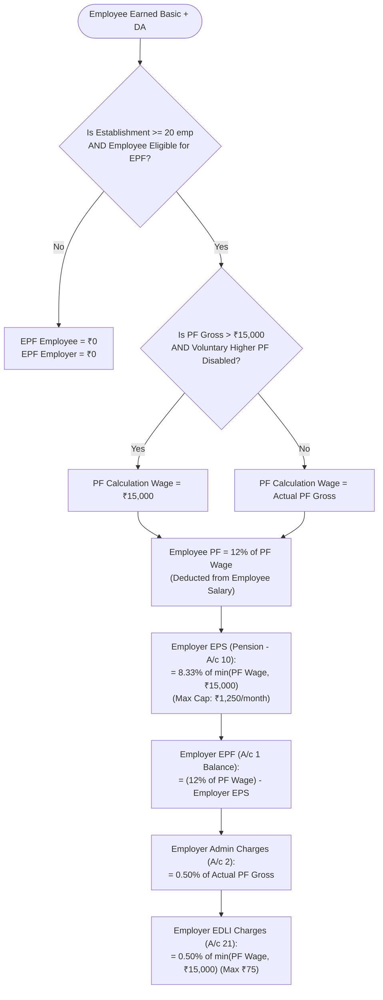
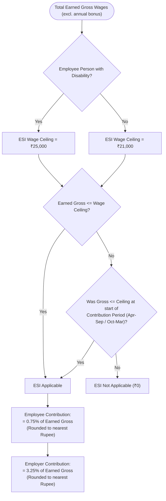
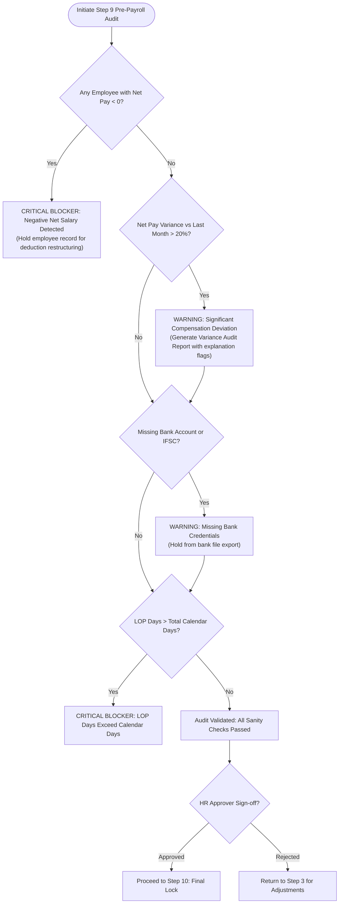

# APMS 10-Step Statutory Payroll Calculation Pipeline

> **Status:** Authoritative | **Last Updated:** 2026-11-16 | **Source:** Extracted from APMS documentation

---

## 1. Executive Summary & Guiding Architectural Invariants

The APMS Payroll & Statutory Engine manages compensation computation, statutory tax deductions, and disbursement artifact generation for multi-entity enterprise operations in India.

Because payroll affects legal statutory liability, employee compensation trust, and direct financial disbursements, the calculation pipeline is engineered under five inviolable architectural invariants:

1. **Deterministic Finite State Machine (`ADR-09`)**: Pay runs operate as an irreversible 10-step wizard. Transition from one step to the next requires prerequisite ledger freeze validations.
2. **Attendance Decoupled from Payroll (`ADR-07`, `BR-ATT-18`)**: Payroll consumes finalized daily attendance summaries as strictly read-only inputs. Payroll never modifies raw punches, pairings, or daily attendance statuses.
3. **Statutory Parameterization (`ADR-25`, `BR-STA-01` to `STA-04`)**: All EPF ceilings (₹15,000), ESI thresholds (₹21,000), PT state slabs, and TDS tax brackets reside in versioned, effective-dated database tables. Zero statutory percentages or rupee thresholds are hardcoded in application code.
4. **Immutable Post-Lock Snapshotting (`ADR-14`, `ADR-26`)**: Upon locking (Step 10), the complete calculation state, salary structure breakdown, demographic profile, and rule version tags are saved as an immutable JSON snapshot. Historical payslips are rendered directly from snapshots without re-evaluating business logic.
5. **Strict Cycle Lock & Next-Cycle Arrears Routing (`BR-PAY-12`)**: Once a pay run is locked, historical records are sealed. Retroactive attendance regularizations, late-arriving punches, or salary revisions are automatically routed to the next open pay cycle as arrears adjustments.

---

## 2. Complete 10-Step Pay Run Wizard Flowchart

```mermaid
flowchart TD
    START(["Start Pay Run (Select Pay Group & Period)"]) --> S1["Step 1: Attendance Freeze & Muster Reconciliation\n• Verify attendance_daily_records for period\n• Apply fallback for lone punches (BR-ATT-04: LOP/Half-Day)\n• Lock attendance ledger for pay period"]

    S1 --> S2["Step 2: Leave Settlement & Holiday Sandwich Evaluation\n• Query append-only leave_transactions\n• Evaluate Sandwich Rule (BR-LVE-02: Intervening Offs -> LOP)\n• Compute final Loss of Pay (LOP) Days"]

    S2 --> S3["Step 3: Variable Pay & Ad-Hoc Adjustments\n• Ingest ad-hoc bonuses, commissions & incentives\n• Pull Supervisor-Approved Overtime (N20 / BR-OTC-01)\n• Apply loan EMIs, salary advances & prior cycle arrears (BR-PAY-12)"]

    S3 --> S4["Step 4: Base Pro-Rata Gross Salary Computation\n• Daily Wage Rate = Monthly Fixed Component / Days in Month\n• Pro-rate fixed earnings for LOP days & mid-month joining\n• Earned Gross = Earned Base + Variable Earnings"]

    S4 --> S5["Step 5: EPF Calculation (BR-STA-01)\n• PF Gross = Basic + DA + Retaining\n• Apply ₹15,000 statutory wage ceiling (or full Basic)\n• Employee EPF (12%), Employer EPS (8.33% max ₹1250),\n  Employer EPF (diff), EDLI (0.5%), Admin (0.5%)"]

    S5 --> S6["Step 6: ESI Calculation (BR-STA-02)\n• Check ₹21,000 Gross Wage Ceiling (& Contribution Period Rule)\n• Employee Contribution: 0.75% of Gross\n• Employer Contribution: 3.25% of Gross"]

    S6 --> S7["Step 7: Professional Tax Calculation (BR-STA-03)\n• State-specific slab lookup (statutory_pt_slabs)\n• Apply Maharashtra Feb adjustment (₹300) / State rules\n• Deduct monthly PT"]

    S7 --> S8["Step 8: TDS Income Tax Calculation (BR-STA-04)\n• Project annualized income\n• Default: Section 115BAC (New Regime) + Sec 87A rebate\n• Alternate: Old Regime (Sec 80C, 80D, HRA Sec 10(13A))\n• Monthly TDS = Remaining Projected Tax / Remaining Months"]

    S8 --> S9["Step 9: Net Pay Settlement & Pre-Payroll Audit\n• Net Pay = Earned Gross - (EPF + ESI + PT + TDS + Variable Ded)\n• Run Anomaly Audits: Negative Pay? Variance > 20% vs Prior Month?\n• Require HR Maker-Checker Sign-off"]

    S9 --> S10["Step 10: Final Lock, Snapshots & Artifact Generation\n• Transition State: DRAFT -> LOCKED (BR-PAY-12)\n• Persist pay_run_employee_snapshots (Immutable JSON trace)\n• Generate NEFT/RTGS Bank Disbursement CSV\n• Generate Tally ERP Journal Voucher XML (INT-01)\n• Render Password-Protected PDF Payslips (ADR-26)"]

    S10 --> FINISH(["Pay Run Complete & Disbursed"])
```



---

## 3. Indian Statutory Deduction Flowcharts

### 3.1 Employees' Provident Fund (EPF) Engine (`BR-STA-01`)



### 3.2 Employees' State Insurance (ESI) Engine (`BR-STA-02`)



### 3.3 Professional Tax (PT) & State Slab Engine (`BR-STA-03`)

```mermaid
flowchart TD
    PT_IN(["Employee Work State & Earned Gross"]) --> STATE_ROUTER{"Branch Work State?"}
    
    STATE_ROUTER -->|Maharashtra| MH_SLAB{"Gross Salary Slab"}
    MH_SLAB -->|<= ₹7,500 (Men) / <= ₹25,000 (Women)| MH_0["PT = ₹0"]
    MH_SLAB -->|₹7,501 to ₹10,000| MH_175["PT = ₹175 / month"]
    MH_SLAB -->|> ₹10,000| MH_MONTH{"Is Current Month February?"}
    MH_MONTH -->|No (March to January)| MH_200["PT = ₹200 / month"]
    MH_MONTH -->|Yes (February)| MH_300["PT = ₹300 in Feb\n(To reach statutory ₹2,500 annual cap)"]

    STATE_ROUTER -->|Karnataka| KA_SLAB{"Gross Salary Slab"}
    KA_SLAB -->|<= ₹15,000| KA_0["PT = ₹0"]
    KA_SLAB -->|> ₹15,000| KA_200["PT = ₹200 / month"]

    STATE_ROUTER -->|Telangana / Andhra Pradesh| TS_SLAB{"Gross Salary Slab"}
    TS_SLAB -->|<= ₹15,000| TS_0["PT = ₹0"]
    TS_SLAB -->|₹15,001 to ₹20,000| TS_150["PT = ₹150 / month"]
    TS_SLAB -->|> ₹20,000| TS_200["PT = ₹200 / month"]

    STATE_ROUTER -->|State with No PT| NO_PT["PT = ₹0 (e.g., Delhi, Haryana, Rajasthan)"]
```

### 3.4 TDS Income Tax Engine (Section 192 - `BR-STA-04`)

```mermaid
flowchart TD
    TDS_IN(["Projected Annual Gross Income"]) --> REGIME_CHECK{"Employee Declared Tax Regime?"}
    
    %% New Regime (Default)
    REGIME_CHECK -->|Default: Section 115BAC (New Regime)| NEW_REGIME["Apply Section 115BAC Slabs:\n• ₹0 to ₹3,00,000: Nil\n• ₹3,00,001 to ₹6,00,000: 5%\n• ₹6,00,001 to ₹9,00,000: 10%\n• ₹9,00,001 to ₹12,00,000: 15%\n• ₹12,00,001 to ₹15,00,000: 20%\n• > ₹15,00,000: 30%\nStandard Deduction: ₹75,000 (FY 2024-25+)"]
    NEW_REGIME --> SEC_87A{"Net Taxable Income <= ₹7,00,000?"}
    SEC_87A -->|Yes| REBATE_87A["Rebate under Section 87A:\nTax Liability = ₹0"]
    SEC_87A -->|No| GROSS_TAX_NEW["Compute Net Tax + 4% Health & Education Cess"]

    %% Old Regime
    REGIME_CHECK -->|Opted: Old Tax Regime| OLD_REGIME["Deduct Exemptions:\n• Standard Deduction: ₹50,000\n• Section 80C (EPF, PPF, LIC): up to ₹1,50,000\n• Section 80D (Health Insurance): up to ₹25,000/₹50,000\n• Section 24(b) (Home Loan Interest): up to ₹2,00,000\n• HRA Exemption (Section 10(13A))"]
    OLD_REGIME --> OLD_SLABS["Apply Old Tax Slabs:\n• ₹0 to ₹2,50,000: Nil\n• ₹2,50,001 to ₹5,00,000: 5%\n• ₹5,00,001 to ₹10,00,000: 20%\n• > ₹10,00,000: 30%\n+ 4% Health & Education Cess"]

    REBATE_87A --> TDS_SPREAD
    GROSS_TAX_NEW --> TDS_SPREAD
    OLD_SLABS --> TDS_SPREAD

    TDS_SPREAD["Calculate Monthly TDS Deduction:\nRemaining Annual Tax = Annual Tax - TDS Deducted in Previous Months\nMonthly TDS = Remaining Annual Tax / Remaining Months in FY"]
```

---

## 4. Detailed 10-Step Operational Wizard Specification

### Step 1: Attendance Freeze & Muster Reconciliation
- **Objective**: Reconcile all daily punch pairs and rollups for the selected pay cycle $[D_{start}, D_{end}]$.
- **Pre-flight Checks**:
  1. Identify un-paired lone punches. Under **`BR-ATT-04`** and **`ADR-22`**, if an employee has not regularized a lone punch before cut-off, apply tenant fallback policy:
     - Policy Option A: Record treated as `HALF_DAY` (0.5 credit).
     - Policy Option B: Record treated as `ABSENT` (Loss of Pay).
  2. Read-only freeze of `attendance_daily_records`.
- **Output Ledger**: Count of Worked Days, Paid Holidays ($HOL$), Weekly Offs ($WO$), and Unpaid Days.

### Step 2: Leave Settlement & Holiday Sandwich Evaluation
- **Objective**: Determine payable vs unpaid non-working days.
- **Sandwich Rule Engine (`BR-LVE-02`)**:
  - Scans for employees absent on both Friday before and Monday after a Weekly Off.
  - If Sandwich Rule is active, converts the Saturday/Sunday into **Leave** or **Loss of Pay (LOP)**.
- **Double-Entry Ledger Integration (`ADR-08`)**:
  - Validates that approved leaves have corresponding debit records in `leave_transactions`.
  - If leave balance is insufficient, unpaid days are classified as $LOP$.
- **Formula**:
  $$\text{Total Payable Days} = \text{Calendar Days} - LOP$$

### Step 3: Variable Pay & Ad-Hoc Adjustments
- **Objective**: Ingest variable earnings, manager-approved overtime, and loan/advance recoveries.
- **Overtime Authorization Filter (`N20`, `BR-OTC-01`)**:
  - Raw extra hours logged by biometrics are queried.
  - Only rows with `supervisor_approval_status = 'APPROVED'` are converted to payable OT hours.
  - Unapproved hours are rejected and archived as `UNAUTHORIZED_EXTRA_TIME`.
- **Ad-Hoc Inputs**: Performance bonuses, incentive commissions, travel reimbursements.
- **Arrears Handling (`BR-PAY-12`)**: Ingests automated arrears adjustments generated from past cycles.

### Step 4: Base Pro-Rata Gross Salary Computation
- **Objective**: Calculate base earned salary based on attendance and LOP days.
- **Daily Wage Rate Formula (`BR-PAY-01`)**:
  $$\text{Daily Wage Rate} = \frac{\text{Monthly Fixed Component}}{\text{Days in Month } (M)}$$
  *(Where $M \in \{28, 29, 30, 31\}$ or fixed $26/30$ per pay group configuration).*
- **Component Pro-Rata Evaluation**:
  $$\text{Earned Component}_i = \text{Fixed Component}_i \times \left( \frac{M - LOP}{M} \right)$$
- **Earned Gross Total**:
  $$\text{Earned Gross} = \sum_{i} \text{Earned Component}_i + \text{Approved OT Pay} + \text{Variable Bonuses}$$

### Step 5: EPF (Employees' Provident Fund) Calculation
- **PF Gross**: $\text{Earned Basic} + \text{Earned Dearness Allowance (DA)}$.
- **Statutory Limits**:
  - If $\text{PF Gross} > ₹15,000$ and voluntary higher PF is not elected: $\text{PF Wage} = ₹15,000$.
  - Employee Contribution: $12\% \times \text{PF Wage}$.
  - Employer EPS (Pension A/c 10): $8.33\% \times \min(\text{PF Wage}, ₹15,000)$ (Max ₹1,250).
  - Employer EPF (A/c 1): $(12\% \times \text{PF Wage}) - \text{Employer EPS}$.
  - EDLI (A/c 21): $0.50\% \times \min(\text{PF Wage}, ₹15,000)$ (Max ₹75).
  - EPF Admin Charges (A/c 2): $0.50\% \times \text{PF Gross}$.

### Step 6: ESI (Employees' State Insurance) Calculation
- **Applicability**: Employees with Earned Gross Wages $\le ₹21,000$ (or ₹25,000 for disability).
- **Contribution Rates**:
  - Employee Contribution: $0.75\% \times \text{Earned Gross}$.
  - Employer Contribution: $3.25\% \times \text{Earned Gross}$.
- **Half-Paisa Rounding**: Statutory deductions are rounded half-up to the nearest rupee ($\text{round}(x)$).

### Step 7: Professional Tax (PT) Calculation
- **Lookup Engine**: Queries `statutory_pt_slabs` table filtered by `tenant_id`, `state_code`, and `salary_range`.
- **February Cap Guard**: In states with annual caps (e.g., Maharashtra ₹2,500), automatically deducts ₹300 in February when ₹200 was deducted in March through January.

### Step 8: TDS (Income Tax Section 192) Calculation
- **Annual Projection Model**:
  $$\text{Projected Annual Gross} = \text{YTD Earned Gross} + (\text{Current Earned Gross} \times \text{Remaining Months})$$
- Evaluates tax brackets under default Section 115BAC or verified Old Regime declaration.
- Deducts tax credits and previous months' TDS to yield current month's payroll deduction.

### Step 9: Net Pay Settlement & Pre-Payroll Audit
- **Net Salary Computation**:
  $$\text{Net Pay} = \text{Earned Gross} - (\text{EPF} + \text{ESI} + \text{PT} + \text{TDS} + \text{Loan EMI} + \text{Advances})$$
- **Automated Pre-Payroll Anomaly Checks**:
  1. **Negative Net Pay**: Flagged as a critical blocker (`CRITICAL_ANOMALY`).
  2. **Net Pay Variance > 20%**: Compared against previous month's snapshot. If deviation $> 20\%$, flagged for supervisor explanation.
  3. **Zero Basic Salary / Missing Bank Details**: Flags un-payable employee records.
- **Maker-Checker Protocol**: HR Executive submits pay run for review; Payroll Manager approves.

### Step 10: Final Lock, Snapshot Creation, Journal Voucher & Artifact Generation
- **State Transition**: Pay run transitions to `LOCKED`.
- **Immutable JSON Snapshot**: Persisted into `pay_run_employee_snapshots`.
- **Artifacts Generated**:
  1. **Bank Disbursement CSV**: Formatted for HDFC, ICICI, SBI, or Kotak NEFT/RTGS batch upload.
  2. **Tally ERP Journal Voucher XML (`INT-01`)**: Exports double-entry accounting records:
     - Debit: Salary Expense A/c
     - Credit: Bank Disbursement A/c
     - Credit: PF Payable A/c (Employee + Employer)
     - Credit: ESI Payable A/c (Employee + Employer)
     - Credit: PT Payable A/c
     - Credit: TDS Payable A/c
  3. **Server-Side Cryptographic PDF Payslips (`ADR-26`)**: Rendered via headless Chromium, protected by AES-128 PDF password (format: first 4 characters of employee name in caps + date of birth `DDMM`).

---

## 5. Immutable Pay Run Snapshot Schema (`ADR-14`, `ADR-26`)

```sql
CREATE TABLE pay_run_employee_snapshots (
    id UUID PRIMARY KEY DEFAULT gen_random_uuid(),
    tenant_id UUID NOT NULL,
    pay_run_id UUID NOT NULL REFERENCES pay_runs(id),
    employee_id UUID NOT NULL REFERENCES employees(id),
    
    -- Attendance Rollup Frozen Values
    calendar_days INTEGER NOT NULL,
    worked_days NUMERIC(4,1) NOT NULL,
    lop_days NUMERIC(4,1) NOT NULL,
    overtime_hours NUMERIC(6,2) NOT NULL DEFAULT 0.0,

    -- Financial Totals
    fixed_gross NUMERIC(12,2) NOT NULL,
    earned_gross NUMERIC(12,2) NOT NULL,
    total_statutory_deductions NUMERIC(12,2) NOT NULL,
    total_variable_deductions NUMERIC(12,2) NOT NULL,
    net_pay NUMERIC(12,2) NOT NULL,

    -- Immutable Granular JSON Explanations (Deterministic Audit Trace)
    earnings_breakdown JSONB NOT NULL,    -- {"basic": 25000.0, "hra": 10000.0, "ot_pay": 1500.0}
    deductions_breakdown JSONB NOT NULL,  -- {"epf_ee": 1800.0, "esi_ee": 0.0, "pt": 200.0, "tds": 2500.0}
    employer_statutory JSONB NOT NULL,    -- {"epf_er_eps": 1250.0, "epf_er_diff": 550.0, "esi_er": 0.0}
    statutory_versions JSONB NOT NULL,    -- {"epf_rule_ver": "2026.1", "pt_slab_ver": "MH_2026"}

    -- Demographic Snapshot at time of payment (Cryptographically Sealed)
    demographic_snapshot JSONB NOT NULL,  -- {"designation": "Sr Engineer", "pan_masked": "XXXXX1234F", "uan": "100912345678"}

    created_at TIMESTAMPTZ NOT NULL DEFAULT NOW(),
    CONSTRAINT unq_pay_run_employee UNIQUE (pay_run_id, employee_id)
);

ALTER TABLE pay_run_employee_snapshots ENABLE ROW LEVEL SECURITY;
ALTER TABLE pay_run_employee_snapshots FORCE ROW LEVEL SECURITY;

CREATE POLICY pay_run_snapshot_tenant_isolation ON pay_run_employee_snapshots
    FOR ALL
    USING (tenant_id = NULLIF(current_setting('app.current_tenant_id', true), '')::uuid);
```

---

## 6. Pre-Payroll Audit & Variance Reconciliation



---

## 7. Mathematical Formulas & Precision Rules Summary

| Component | Authoritative Formula | Rounding Rule | Minimum / Maximum Ceilings |
| :--- | :--- | :--- | :--- |
| **Daily Wage Rate** | $\text{Fixed Component} / M$ | Exact Paisa (`NUMERIC(12,4)`) | None |
| **Earned Basic** | $\text{Basic} \times ((M - LOP) / M)$ | Nearest Paisa (`₹0.01`) | Cannot be negative |
| **EPF Employee** | $12\% \times \min(\text{Basic} + \text{DA}, ₹15,000)$ | Nearest Rupee (`round(x)`) | Max ₹1,800/mo (unless higher PF opted) |
| **EPF Employer EPS** | $8.33\% \times \min(\text{Basic} + \text{DA}, ₹15,000)$ | Nearest Rupee | Capped at statutory ₹1,250/mo |
| **EPF Employer EPF**| $(12\% \times \text{PF Wage}) - \text{Employer EPS}$ | Nearest Rupee | Balance of 12% |
| **ESI Employee** | $0.75\% \times \text{Earned Gross}$ | Rounded Up to nearest ₹1.00 | ₹0 if Gross $> ₹21,000$ |
| **ESI Employer** | $3.25\% \times \text{Earned Gross}$ | Rounded Up to nearest ₹1.00 | ₹0 if Gross $> ₹21,000$ |
| **PT (Maharashtra)** | Slab lookup: ₹175 or ₹200 (₹300 in Feb) | Exact Slab Amount | Max annual statutory cap: ₹2,500 |
| **TDS (Monthly)** | $\text{Remaining Projected Tax} / \text{Remaining Months}$ | Nearest Rupee | ₹0 if Net Taxable Income $\le ₹7,00,000$ (Sec 87A) |
