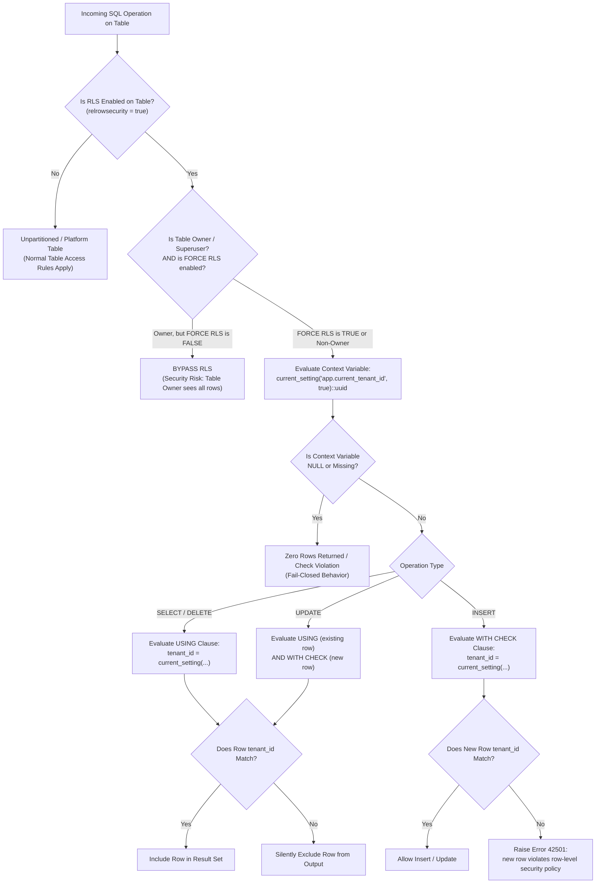

# APMS Multi-Tenant Isolation & Row-Level Security Architecture

> **Status:** Authoritative | **Last Updated:** 2026-11-16 | **Source:** Extracted from APMS documentation

---

## 1. Architectural Overview & Threat Model

APMS (**Automated Payroll & Attendance Management System**) operates under a shared-database, shared-schema multi-tenant architecture on **PostgreSQL 16+**. Because financial ledgers, biometric clocking logs, and statutory payroll figures across multiple competing organizations reside within the same physical relational database, tenant boundary enforcement is the system's most critical non-negotiable invariant (`PLT-01`, `SEC-01`).

### Core Isolation Principles
1. **Kernel-Enforced Isolation**: Multi-tenancy is enforced natively by the PostgreSQL query planner and execution engine via **Row-Level Security (RLS)**, completely independent of application-level SQL `WHERE` clauses.
2. **Fail-Closed Default**: If an incoming request fails to supply a verified tenant identity, or if the database session context variable is unset, the query planner evaluates `current_setting('app.current_tenant_id', true)` to `NULL`, resulting in zero accessible rows.
3. **No Superuser / Owner Bypasses**: Through `FORCE ROW LEVEL SECURITY`, even queries executed by the application pool user (table owner) are strictly filtered.
4. **Composite Foreign Keys**: All child references include `tenant_id` to prevent cross-tenant entity linkage at the database schema level.

---

## 2. End-to-End Request Lifecycle & Isolation Sequence

The following sequence diagram illustrates the lifecycle of an authenticated API request, detailing token decoding, context variable injection via `SET LOCAL`, and PostgreSQL kernel policy filtering.

```mermaid
sequenceDiagram
    autonumber
    actor Client as Client / Mobile App / Edge Agent
    participant Gateway as API Gateway (Nginx / Cloudflare)
    participant Middleware as FastAPI Tenant Middleware
    participant Pool as SQLAlchemy Async Engine (Pool)
    participant Postgres as PostgreSQL Engine (RLS)
    participant Tables as Tenant Table (e.g., employees)

    Client->>Gateway: HTTPS Request + Authorization: Bearer <JWT>
    Gateway->>Middleware: Forward Request (SSL Terminated, TLS 1.3)
    
    activate Middleware
    Note over Middleware: 1. Decode & Verify JWT Signature (RS256)<br/>2. Extract claims: sub (user_id), tenant_id, role
    
    alt Token Invalid or Missing tenant_id
        Middleware-->>Client: 401 Unauthorized / 403 Forbidden
    else Token Valid
        Middleware->>Pool: Acquire Database Connection from Pool
        activate Pool
        Pool-->>Middleware: Async Connection Session Checked Out
        
        Middleware->>Postgres: BEGIN TRANSACTION;<br/>SET LOCAL app.current_tenant_id = '018f3a5b-9a8c...';
        activate Postgres
        Note over Postgres: Session-scoped config variable set strictly<br/>for duration of current transaction (SET LOCAL)
        
        Middleware->>Postgres: Execute Query: SELECT * FROM employees;
        Note over Postgres: RLS Policy Activated:<br/>WHERE tenant_id = current_setting('app.current_tenant_id')::uuid
        
        Postgres->>Tables: Filtered Table Scan / Index Scan
        Tables-->>Postgres: Rows matching current_tenant_id only
        Postgres-->>Middleware: Query Result Set (Zero cross-tenant bleed)
        
        Middleware->>Postgres: COMMIT TRANSACTION;
        deactivate Postgres
        Note over Postgres: app.current_tenant_id is discarded on COMMIT/ROLLBACK
        
        Pool-->>Pool: Return Clean Connection to Pool
        deactivate Pool
        
        Middleware-->>Client: 200 OK + Filtered JSON Response
    end
    deactivate Middleware
```

---

## 3. RLS Policy Enforcement Decision Flow

When any SQL statement (`SELECT`, `INSERT`, `UPDATE`, `DELETE`) targets a tenant-scoped table, the PostgreSQL query optimizer injects policy filters directly into the execution plan according to the decision tree below:



---

## 4. The `FORCE ROW LEVEL SECURITY` Pattern

### 4.1 Why `ENABLE ROW LEVEL SECURITY` Alone is Insufficient
In PostgreSQL, executing `ALTER TABLE <table> ENABLE ROW LEVEL SECURITY;` activates policy enforcement for ordinary database roles. However, **the owner of the table and PostgreSQL superusers bypass RLS by default**.

In standard cloud microservice deployments, the application connects to PostgreSQL using a dedicated application user (e.g. `apms_app_user`), which is typically the migration runner and owner of the schema tables. If `FORCE ROW LEVEL SECURITY` is omitted:
- Any query run by `apms_app_user` completely ignores all RLS policies.
- A bug in application code omitting `WHERE tenant_id = :id` would dump data across **all tenants**, causing catastrophic cross-tenant data leakage.

### 4.2 The Mandatory Dual-Statement Invariant
Every tenant-scoped table in APMS must be guarded by both statements:

```sql
-- Step 1: Enable RLS for standard non-owner roles
ALTER TABLE employees ENABLE ROW LEVEL SECURITY;

-- Step 2: Enforce RLS EVEN FOR THE TABLE OWNER (Non-Negotiable)
ALTER TABLE employees FORCE ROW LEVEL SECURITY;
```

With `FORCE ROW LEVEL SECURITY`, PostgreSQL mandates that all queries initiated by the table owner must strictly pass the table's security policies.

---

## 5. Concrete SQL Implementation & DDL Patterns

### 5.1 Standard Tenant Policy Definition
For every tenant-scoped table, APMS applies a unified policy covering `SELECT`, `INSERT`, `UPDATE`, and `DELETE`:

```sql
CREATE POLICY tenant_isolation_policy ON employees
    FOR ALL
    USING (
        tenant_id = NULLIF(current_setting('app.current_tenant_id', true), '')::uuid
    )
    WITH CHECK (
        tenant_id = NULLIF(current_setting('app.current_tenant_id', true), '')::uuid
    );
```

- **`USING` clause**: Filters incoming rows for `SELECT`, `UPDATE`, and `DELETE`.
- **`WITH CHECK` clause**: Validates written rows for `INSERT` and `UPDATE`. Prevents a tenant from writing or modifying a row to belong to another tenant.
- **`NULLIF(..., '')` + `true`**: Prevents runtime PostgreSQL exceptions if the session variable has not been initialized; safely returns `NULL`, resulting in zero rows.

### 5.2 Composite Foreign Keys for Referential Integrity
To prevent cross-tenant referencing (e.g., Tenant A assigning a shift instance belonging to Tenant B), every foreign key constraint across tenant entities must include `tenant_id`:

```sql
-- 1. Ensure composite unique constraint on parent table
ALTER TABLE dated_shift_instances 
    ADD CONSTRAINT uq_dated_shift_instances_id_tenant 
    UNIQUE (tenant_id, id);

-- 2. Foreign key on child table enforces matching tenant_id
ALTER TABLE attendance_daily_records 
    ADD CONSTRAINT fk_attendance_shift_instance
    FOREIGN KEY (tenant_id, shift_instance_id) 
    REFERENCES dated_shift_instances(tenant_id, id)
    ON DELETE RESTRICT;
```

### 5.3 Declarative Partitioning & RLS Compatibility
High-volume punch tables (`raw_envelope`, `punch_event`) utilize monthly declarative range partitioning (`PCH-01`, `ADR-28`). In PostgreSQL 16+:
- RLS policies defined on the parent partitioned table are automatically inherited by all child partition tables.
- RLS must still be enabled and forced on the parent partitioned table:

```sql
-- Partitioned Parent Table
CREATE TABLE punch_events (
    id UUID NOT NULL DEFAULT gen_random_uuid(),
    tenant_id UUID NOT NULL,
    employee_id UUID NOT NULL,
    punch_time TIMESTAMPTZ NOT NULL,
    punch_time_local TIMESTAMPTZ NOT NULL,
    source VARCHAR(50) NOT NULL,
    PRIMARY KEY (punch_time, tenant_id, id)
) PARTITION BY RANGE (punch_time);

-- Enable & Force RLS on Parent Table
ALTER TABLE punch_events ENABLE ROW LEVEL SECURITY;
ALTER TABLE punch_events FORCE ROW LEVEL SECURITY;

CREATE POLICY tenant_isolation_policy ON punch_events
    FOR ALL
    USING (tenant_id = NULLIF(current_setting('app.current_tenant_id', true), '')::uuid)
    WITH CHECK (tenant_id = NULLIF(current_setting('app.current_tenant_id', true), '')::uuid);
```

---

## 6. Cross-Tenant Attack Vectors & Defense-in-Depth

APMS implements multi-layered defensive controls to mitigate known multi-tenant vulnerability patterns:

| Attack Vector | Threat Scenario | APMS Defense Implementation |
| :--- | :--- | :--- |
| **Insecure Direct Object Reference (IDOR)** | Attacker in Tenant A modifies API URL parameter from their employee UUID to an employee UUID of Tenant B: `/api/v1/employees/018f...B`. | **PostgreSQL RLS Filtering**: The query `SELECT * FROM employees WHERE id = :id` is rewritten by RLS to `WHERE id = :id AND tenant_id = 'Tenant_A'`. PostgreSQL returns 0 rows, resulting in a clean `404 Not Found`. |
| **Connection Pool Context Bleed** | An async worker processes Request 1 for Tenant A, sets session variable, completes, and returns the pooled connection without resetting it. Request 2 for Tenant B reuses the connection without setting `app.current_tenant_id`. | **`SET LOCAL` Scoping**: APMS strictly issues `SET LOCAL app.current_tenant_id = :id` inside an active transaction (`BEGIN ... COMMIT`). In PostgreSQL, `SET LOCAL` is automatically dropped upon transaction termination, guaranteeing zero state retention across pooled connections. |
| **Foreign Key Cross-Tenant Hijacking** | Tenant A attempts to link their employee to a high-earning salary structure or shift template created by Tenant B by passing Tenant B's template UUID. | **Composite Foreign Keys**: The foreign key requires `(tenant_id, salary_structure_id)`. Because Tenant A's `tenant_id` does not match Tenant B's `tenant_id` on the parent table, PostgreSQL throws a foreign key violation (`23503`). |
| **SQL Injection (SQLi) Filter Bypass** | Attacker injects `' OR 1=1 --` into an application search parameter, attempting to dump all tenant records. | **Optimizer-Level Policy Injection**: RLS wraps the entire application predicate in an enforced conjunction: `(tenant_id = current_setting(...)) AND ((user_input) OR 1=1)`. Even if the application logic collapses to true, rows from other tenants fail the outer RLS predicate. |
| **Database Dump / Disk Exposure** | Unauthorized actor acquires raw PostgreSQL WAL logs, filesystem backup, or read-replica snapshot. | **Field-Level AES-256 Envelope Encryption (`SEC-02`)**: PAN, Aadhaar, Bank Details, and Salary CTC figures are encrypted at rest with tenant-specific Data Encryption Keys (DEKs). A raw database dump yields only un-decryptable ciphertexts. |

---

## 7. Automated Verification & CI/CD Testing Strategy

To guarantee that no schema update or migration weakens tenant boundaries, APMS enforces automated RLS leak tests in the CI pipeline (`PLT-05`):

```python
# tests/security/test_rls_isolation.py
import pytest
from uuid import uuid4
from sqlalchemy import text

@pytest.mark.asyncio
async def test_cross_tenant_isolation(db_session):
    tenant_a = uuid4()
    tenant_b = uuid4()

    # Step 1: Create Employee in Tenant A
    async with db_session.begin():
        await db_session.execute(text("SET LOCAL app.current_tenant_id = :t"), {"t": str(tenant_a)})
        result = await db_session.execute(
            text("""
                INSERT INTO employees (tenant_id, employee_code, full_name, date_of_joining, employment_type)
                VALUES (:tenant_id, 'EMP001', 'Alice Tenant A', '2026-01-01', 'FULL_TIME')
                RETURNING id;
            """),
            {"tenant_id": str(tenant_a)}
        )
        emp_a_id = result.scalar_one()

    # Step 2: Switch Context to Tenant B and Attempt to Access Tenant A's Employee
    async with db_session.begin():
        await db_session.execute(text("SET LOCAL app.current_tenant_id = :t"), {"t": str(tenant_b)})
        
        # Test SELECT Leakage
        leak_query = await db_session.execute(
            text("SELECT * FROM employees WHERE id = :id"),
            {"id": emp_a_id}
        )
        assert leak_query.first() is None, "CRITICAL SECURITY ERROR: Cross-tenant SELECT leaked record!"

        # Test UPDATE Hijacking
        update_leak = await db_session.execute(
            text("UPDATE employees SET full_name = 'Hacked' WHERE id = :id"),
            {"id": emp_a_id}
        )
        assert update_leak.rowcount == 0, "CRITICAL SECURITY ERROR: Cross-tenant UPDATE modified record!"

        # Test DELETE Hijacking
        delete_leak = await db_session.execute(
            text("DELETE FROM employees WHERE id = :id"),
            {"id": emp_a_id}
        )
        assert delete_leak.rowcount == 0, "CRITICAL SECURITY ERROR: Cross-tenant DELETE removed record!"
```

Any pull request that creates a tenant-scoped table without `ENABLE ROW LEVEL SECURITY`, `FORCE ROW LEVEL SECURITY`, and an accompanying isolation test is automatically blocked from merging.
