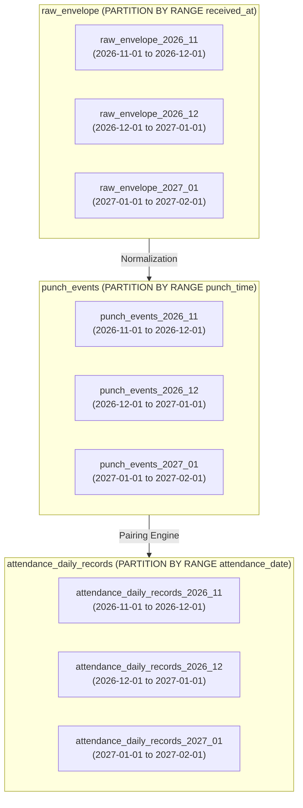
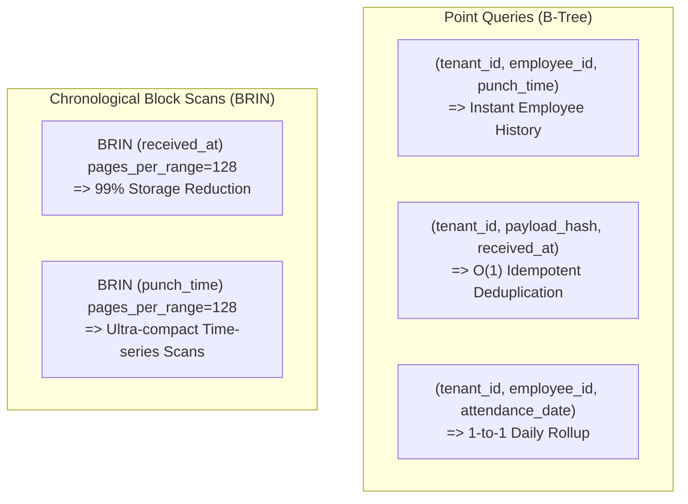
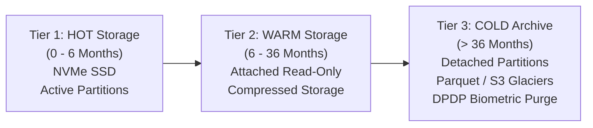

# APMS Database Architecture — Partitioning, Indexing & Retention Strategy

> **Status:** Authoritative | **Last Updated:** 2026-11-16 | **Source:** Extracted from APMS documentation (`DATABASE_DESIGN.md`, `schema.dbml`, `SECURITY_ARCHITECTURE.md`, `REQUIREMENTS_CATALOG.md`, Indian DPDP Act 2023)

---

## 1. Executive Summary & Storage Engineering Goals

As an enterprise multi-tenant SaaS platform, APMS ingests millions of biometric punch signals, scheduled shift instances, and daily attendance records monthly across hundreds of tenant organizations. Without an aggressive database partitioning and indexing architecture, high-volume tables face severe index bloat, degrading query performance, slow autovacuum freezes, and massive storage costs.

This document establishes the authoritative specifications for:
1. **Declarative Monthly Range Partitioning**: Enforced on PostgreSQL 16+ for `raw_envelope`, `punch_events`, and `attendance_daily_records`.
2. **Automated Partition Lifecycle Management**: Cron-driven pre-creation (2 months forward window) using native SQL procedures and Celery schedulers.
3. **Dual-Layer Indexing Strategy**: Highly selective tenant-prefixed B-Tree indexes for operational point queries alongside ultra-compact **BRIN (Block Range Index)** indexes for chronological scans (yielding $> 95\%$ index storage reduction).
4. **Hardware Idempotency & Deduplication Indexes**: Hardware debounce protection, SHA-256 raw payload hashing, and composite uniqueness constraints.
5. **Data Lifecycle & DPDP Act 2023 Compliance**: Tiered storage (Hot $\rightarrow$ Warm $\rightarrow$ Cold), zero-downtime non-blocking partition detachment (`DETACH PARTITION CONCURRENTLY`), and statutory 3-year biometric retention management.

---

## 2. PostgreSQL 16+ Declarative Partitioning Architecture

PostgreSQL 16 declarative table partitioning is used for all append-heavy time-series tables. Partitioning keys are selected based on the chronological axis of the entity.



### 2.1 Partition Key Selection & Composite Primary Keys

In PostgreSQL 16, **every primary key and unique constraint on a partitioned table must include the partition key column**. APMS structures composite primary keys to guarantee global uniqueness while complying with PostgreSQL storage kernel rules:

| Table | Partition Key | Frequency | Composite Primary Key |
| :--- | :--- | :--- | :--- |
| `raw_envelope` | `received_at` (TIMESTAMPTZ) | Monthly | `PRIMARY KEY (received_at, tenant_id, id)` |
| `punch_events` | `punch_time` (TIMESTAMPTZ) | Monthly | `PRIMARY KEY (punch_time, tenant_id, id)` |
| `attendance_daily_records` | `attendance_date` (DATE) | Monthly | `PRIMARY KEY (attendance_date, tenant_id, id)` |

### 2.2 Declarative Table DDL Specifications

```sql
-- 1. RAW ENVELOPE (Immutable Hardware Ingestion)
CREATE TABLE raw_envelope (
    id UUID NOT NULL DEFAULT gen_random_uuid(),
    tenant_id UUID NOT NULL,
    device_id UUID,
    raw_payload JSONB NOT NULL,
    payload_hash VARCHAR(64) NOT NULL,
    source VARCHAR(30) NOT NULL,
    received_at TIMESTAMPTZ NOT NULL DEFAULT clock_timestamp(),
    PRIMARY KEY (received_at, tenant_id, id)
) PARTITION BY RANGE (received_at);

-- 2. PUNCH EVENTS (Normalized Punch Stream)
CREATE TABLE punch_events (
    id UUID NOT NULL DEFAULT gen_random_uuid(),
    tenant_id UUID NOT NULL,
    employee_id UUID NOT NULL,
    device_id UUID,
    raw_envelope_id UUID NOT NULL,
    punch_time TIMESTAMPTZ NOT NULL,
    punch_time_local TIMESTAMPTZ NOT NULL,
    source VARCHAR(30) NOT NULL,
    flag VARCHAR(30) NOT NULL DEFAULT 'NORMAL',
    gps_latitude NUMERIC(10, 7),
    gps_longitude NUMERIC(10, 7),
    is_geofence_valid BOOLEAN,
    created_at TIMESTAMPTZ NOT NULL DEFAULT clock_timestamp(),
    PRIMARY KEY (punch_time, tenant_id, id)
) PARTITION BY RANGE (punch_time);

-- 3. ATTENDANCE DAILY RECORDS (Daily Rollup Ledger)
CREATE TABLE attendance_daily_records (
    id UUID NOT NULL DEFAULT gen_random_uuid(),
    tenant_id UUID NOT NULL,
    employee_id UUID NOT NULL,
    attendance_date DATE NOT NULL,
    shift_instance_id UUID,
    status VARCHAR(30) NOT NULL,
    worked_minutes INT NOT NULL DEFAULT 0,
    scheduled_minutes INT NOT NULL DEFAULT 0,
    late_in_minutes INT NOT NULL DEFAULT 0,
    early_exit_minutes INT NOT NULL DEFAULT 0,
    overtime_minutes INT NOT NULL DEFAULT 0,
    is_regularized BOOLEAN NOT NULL DEFAULT FALSE,
    is_locked BOOLEAN NOT NULL DEFAULT FALSE,
    updated_at TIMESTAMPTZ NOT NULL DEFAULT clock_timestamp(),
    PRIMARY KEY (attendance_date, tenant_id, id)
) PARTITION BY RANGE (attendance_date);
```

### 2.3 Row-Level Security on Partitioned Tables

PostgreSQL 16 applies RLS policies defined on parent partitioned tables down to all child partitions automatically. However, `FORCE ROW LEVEL SECURITY` must be set explicitly on both parent and children:

```sql
ALTER TABLE raw_envelope ENABLE ROW LEVEL SECURITY;
ALTER TABLE raw_envelope FORCE ROW LEVEL SECURITY;
CREATE POLICY raw_envelope_isolation ON raw_envelope
    FOR ALL
    USING (tenant_id = current_setting('app.current_tenant_id', true)::uuid)
    WITH CHECK (tenant_id = current_setting('app.current_tenant_id', true)::uuid);

ALTER TABLE punch_events ENABLE ROW LEVEL SECURITY;
ALTER TABLE punch_events FORCE ROW LEVEL SECURITY;
CREATE POLICY punch_events_isolation ON punch_events
    FOR ALL
    USING (tenant_id = current_setting('app.current_tenant_id', true)::uuid)
    WITH CHECK (tenant_id = current_setting('app.current_tenant_id', true)::uuid);

ALTER TABLE attendance_daily_records ENABLE ROW LEVEL SECURITY;
ALTER TABLE attendance_daily_records FORCE ROW LEVEL SECURITY;
CREATE POLICY attendance_daily_isolation ON attendance_daily_records
    FOR ALL
    USING (tenant_id = current_setting('app.current_tenant_id', true)::uuid)
    WITH CHECK (tenant_id = current_setting('app.current_tenant_id', true)::uuid);
```

---

## 3. Automated Partition Lifecycle Management

An ingestion pipeline must **never fail due to a missing partition**. APMS maintains an active **N+2 Forward Rolling Window**, ensuring that partitions for the next 2 full calendar months are created well in advance.

### 3.1 Native PostgreSQL Partition Maintenance Procedure

```sql
CREATE OR REPLACE PROCEDURE create_monthly_partitions_for_table(
    p_parent_table TEXT,
    p_months_ahead INT DEFAULT 2
)
LANGUAGE plpgsql
AS $$
DECLARE
    v_target_date DATE;
    v_start_date DATE;
    v_end_date DATE;
    v_part_name TEXT;
    v_sql TEXT;
    i INT;
BEGIN
    FOR i IN 0..p_months_ahead LOOP
        v_target_date := (date_trunc('month', clock_timestamp()) + (i || ' month')::interval)::date;
        v_start_date  := v_target_date;
        v_end_date    := (v_target_date + '1 month'::interval)::date;
        v_part_name   := p_parent_table || '_' || to_char(v_start_date, 'YYYY_MM');

        v_sql := format(
            'CREATE TABLE IF NOT EXISTS %I PARTITION OF %I FOR VALUES FROM (%L) TO (%L);',
            v_part_name,
            p_parent_table,
            v_start_date,
            v_end_date
        );
        EXECUTE v_sql;

        -- Ensure FORCE RLS on child partition
        EXECUTE format('ALTER TABLE %I FORCE ROW LEVEL SECURITY;', v_part_name);
    END LOOP;
END;
$$;
```

### 3.2 Automated Celery / ARQ Cron Job (Python 3.12+)

A periodic background job runs on the 1st and 15th of every month:

```python
# app/workers/tasks/partition_maintenance.py
import structlog
from sqlalchemy import text
from app.core.database import async_engine

logger = structlog.get_logger(__name__)

async def maintain_database_partitions() -> None:
    """Pre-creates partitions 2 months ahead for all time-series tables."""
    tables = ["raw_envelope", "punch_events", "attendance_daily_records"]
    async with async_engine.begin() as conn:
        for tbl in tables:
            logger.info("Executing partition pre-creation", table=tbl)
            await conn.execute(
                text("CALL create_monthly_partitions_for_table(:table, 2);"),
                {"table": tbl}
            )
    logger.info("Partition maintenance completed successfully.")
```

---

## 4. Comprehensive Indexing Strategy

APMS combines targeted **B-Tree indexes** for transactional point lookups with **BRIN (Block Range Index)** indexes for append-only chronological queries.



### 4.1 B-Tree Index Rules
1. **Tenant ID Must Lead**: Every B-Tree index on a tenant-scoped table must include `tenant_id` as the leading column, or as part of a composite key matching RLS query patterns.
2. **Selective Cardinality First**: Multi-column indexes order columns by descending selectivity: `(tenant_id, employee_id, timestamp)` rather than `(tenant_id, timestamp, employee_id)`.
3. **Covering Indexes (`INCLUDE`)**: Frequently accessed queries use covering indexes to enable Index-Only Scans:
   ```sql
   CREATE INDEX idx_punch_events_lookup 
   ON punch_events (tenant_id, employee_id, punch_time) 
   INCLUDE (flag, source);
   ```

### 4.2 BRIN (Block Range Index) Architecture

For append-only tables where rows are inserted in near-perfect chronological order (`received_at`, `punch_time`), B-Tree indexes grow to tens of gigabytes. **BRIN indexes summarize block ranges (default 128 disk pages)**, storing only the minimum and maximum values per block.

#### Storage Comparison on 10,000,000 Punch Rows:
| Index Type | Target Column | Storage Footprint | Lookup Performance |
| :--- | :--- | :--- | :--- |
| **B-Tree** | `punch_time` | $\approx 220\text{ MB}$ | High ($O(\log N)$) |
| **BRIN** | `punch_time` (`pages_per_range=128`) | $\mathbf{\approx 128\text{ KB}}$ (**99.9% smaller**) | Excellent for range filters |

```sql
-- BRIN index on raw_envelope timestamp
CREATE INDEX idx_raw_envelope_received_brin
ON raw_envelope USING BRIN (received_at)
WITH (pages_per_range = 128);

-- BRIN index on punch_events timestamp
CREATE INDEX idx_punch_events_punch_time_brin
ON punch_events USING BRIN (punch_time)
WITH (pages_per_range = 128);
```

### 4.3 Idempotency & Hardware Deduplication Indexes

Biometric devices often push duplicate punches due to hardware retry loops, flaky network reconnects, or user double-swiping. APMS employs three distinct deduplication layers:

#### Layer 1: Raw Envelope SHA-256 Hash Index (PCH-03)
The SHA-256 hash is computed over `(tenant_id || device_id || raw_payload)`:
```sql
CREATE UNIQUE INDEX uq_raw_envelope_hash
ON raw_envelope (tenant_id, payload_hash, received_at);
```
An incoming payload with an identical hash within the current month partition is discarded as duplicate immediately at ingestion.

#### Layer 2: Biometric Terminal Debounce Index (PCH-03)
Punches for the same employee within the debounce window (default: 60 seconds) are flagged `DUPLICATE_IGNORED`:
```sql
CREATE INDEX idx_punch_events_debounce
ON punch_events (tenant_id, employee_id, punch_time);
```

#### Layer 3: Daily Attendance Uniqueness (N66a)
Guarantees that each employee has exactly one consolidated daily record per calendar date:
```sql
CREATE UNIQUE INDEX uq_emp_attendance_date
ON attendance_daily_records (tenant_id, employee_id, attendance_date);
```

---

## 5. Complete Database Index Catalog (All 30 Tables)

| # | Table Name | Index Name | Index Type | Columns | Constraint Type |
| :--- | :--- | :--- | :--- | :--- | :--- |
| 1 | `tenants` | `pk_tenants` | B-tree | `(id)` | PRIMARY KEY |
| 1 | `tenants` | `uq_tenants_subdomain` | B-tree | `(subdomain)` | UNIQUE |
| 2 | `branches` | `pk_branches` | B-tree | `(id)` | PRIMARY KEY |
| 2 | `branches` | `uq_branches_code` | B-tree | `(tenant_id, code)` | UNIQUE |
| 3 | `departments` | `pk_departments` | B-tree | `(id)` | PRIMARY KEY |
| 3 | `departments` | `uq_departments_code` | B-tree | `(tenant_id, branch_id, code)` | UNIQUE |
| 4 | `users` | `pk_users` | B-tree | `(id)` | PRIMARY KEY |
| 4 | `users` | `uq_users_email` | B-tree | `(email)` | UNIQUE |
| 5 | `employees` | `pk_employees` | B-tree | `(id)` | PRIMARY KEY |
| 5 | `employees` | `uq_employees_code` | B-tree | `(tenant_id, employee_code)` | UNIQUE |
| 5 | `employees` | `uq_employees_user` | B-tree | `(tenant_id, user_id)` | UNIQUE |
| 6 | `pay_groups` | `pk_pay_groups` | B-tree | `(id)` | PRIMARY KEY |
| 6 | `pay_groups` | `uq_pay_groups_name` | B-tree | `(tenant_id, name)` | UNIQUE |
| 7 | `employee_pay_group_assignments` | `pk_emp_pay_group` | B-tree | `(id)` | PRIMARY KEY |
| 7 | `employee_pay_group_assignments` | `uq_emp_paygroup_eff` | B-tree | `(tenant_id, employee_id, effective_from)` | UNIQUE |
| 8 | `devices` | `pk_devices` | B-tree | `(id)` | PRIMARY KEY |
| 8 | `devices` | `uq_devices_serial` | B-tree | `(tenant_id, serial_number)` | UNIQUE |
| 9 | `employee_device_mappings` | `pk_emp_dev_map` | B-tree | `(id)` | PRIMARY KEY |
| 9 | `employee_device_mappings` | `uq_emp_dev_mapping` | B-tree | `(tenant_id, device_id, device_user_id)` | UNIQUE |
| 10 | `raw_envelope` | `pk_raw_envelope` | B-tree | `(received_at, tenant_id, id)` | PRIMARY KEY |
| 10 | `raw_envelope` | `uq_raw_envelope_hash` | B-tree | `(tenant_id, payload_hash, received_at)` | UNIQUE |
| 10 | `raw_envelope` | `idx_raw_env_brin` | BRIN | `(received_at)` | PERFORMANCE |
| 11 | `punch_events` | `pk_punch_events` | B-tree | `(punch_time, tenant_id, id)` | PRIMARY KEY |
| 11 | `punch_events` | `idx_punch_emp_time` | B-tree | `(tenant_id, employee_id, punch_time)` | PERFORMANCE |
| 11 | `punch_events` | `idx_punch_time_brin`| BRIN | `(punch_time)` | PERFORMANCE |
| 12 | `shift_templates` | `pk_shift_templates`| B-tree | `(id)` | PRIMARY KEY |
| 12 | `shift_templates` | `uq_shift_code` | B-tree | `(tenant_id, code)` | UNIQUE |
| 13 | `shift_pools` | `pk_shift_pools` | B-tree | `(id)` | PRIMARY KEY |
| 13 | `shift_pools` | `uq_shift_pools_name`| B-tree | `(tenant_id, name)` | UNIQUE |
| 14 | `roster_patterns` | `pk_roster_patterns`| B-tree | `(id)` | PRIMARY KEY |
| 14 | `roster_patterns` | `uq_roster_name` | B-tree | `(tenant_id, name)` | UNIQUE |
| 15 | `dated_shift_instances` | `pk_dated_shifts` | B-tree | `(id)` | PRIMARY KEY |
| 15 | `dated_shift_instances` | `uq_shift_emp_date` | B-tree | `(tenant_id, employee_id, shift_date)` | UNIQUE |
| 15 | `dated_shift_instances` | `uq_dated_shifts_composite` | B-tree | `(tenant_id, id)` | UNIQUE (FK Target) |
| 16 | `attendance_daily_records` | `pk_attendance_daily` | B-tree | `(attendance_date, tenant_id, id)` | PRIMARY KEY |
| 16 | `attendance_daily_records` | `uq_emp_att_date` | B-tree | `(tenant_id, employee_id, attendance_date)` | UNIQUE |
| 17 | `attendance_explanation_traces` | `pk_att_traces` | B-tree | `(id)` | PRIMARY KEY |
| 17 | `attendance_explanation_traces` | `idx_att_trace_rec` | B-tree | `(tenant_id, attendance_record_id)` | PERFORMANCE |
| 18 | `attendance_regularization_requests` | `pk_att_reg` | B-tree | `(id)` | PRIMARY KEY |
| 18 | `attendance_regularization_requests` | `idx_att_reg_emp` | B-tree | `(tenant_id, employee_id, attendance_date)` | PERFORMANCE |
| 19 | `holiday_calendars` | `pk_holiday_cal` | B-tree | `(id)` | PRIMARY KEY |
| 19 | `holiday_calendars` | `uq_hol_cal_branch` | B-tree | `(tenant_id, branch_id, fiscal_year)` | UNIQUE |
| 20 | `holiday_entries` | `pk_holiday_entries` | B-tree | `(id)` | PRIMARY KEY |
| 20 | `holiday_entries` | `uq_hol_date` | B-tree | `(tenant_id, holiday_calendar_id, holiday_date)` | UNIQUE |
| 21 | `leave_types` | `pk_leave_types` | B-tree | `(id)` | PRIMARY KEY |
| 21 | `leave_types` | `uq_leave_types_code`| B-tree | `(tenant_id, code)` | UNIQUE |
| 22 | `leave_requests` | `pk_leave_requests` | B-tree | `(id)` | PRIMARY KEY |
| 22 | `leave_requests` | `idx_leave_req_emp` | B-tree | `(tenant_id, employee_id, start_date)` | PERFORMANCE |
| 23 | `leave_transactions` | `pk_leave_txns` | B-tree | `(id)` | PRIMARY KEY |
| 23 | `leave_transactions` | `idx_leave_txn_ledger`| B-tree | `(tenant_id, employee_id, leave_type_id, created_at)` | PERFORMANCE |
| 24 | `pay_runs` | `pk_pay_runs` | B-tree | `(id)` | PRIMARY KEY |
| 24 | `pay_runs` | `uq_pay_run_period` | B-tree | `(tenant_id, pay_group_id, period_start, period_end)` | UNIQUE |
| 25 | `pay_run_employee_snapshots` | `pk_pay_snapshots` | B-tree | `(id)` | PRIMARY KEY |
| 25 | `pay_run_employee_snapshots` | `uq_payrun_emp` | B-tree | `(tenant_id, pay_run_id, employee_id)` | UNIQUE |
| 26 | `statutory_parameter_versions` | `pk_stat_versions` | B-tree | `(id)` | PRIMARY KEY |
| 26 | `statutory_parameter_versions` | `uq_stat_param` | B-tree | `(parameter_type, state_code, effective_from)` | UNIQUE |
| 27 | `audit_logs` | `pk_audit_logs` | B-tree | `(id)` | PRIMARY KEY |
| 27 | `audit_logs` | `idx_audit_entity` | B-tree | `(tenant_id, entity_type, entity_id, created_at)` | PERFORMANCE |
| 27 | `audit_logs` | `idx_audit_user` | B-tree | `(tenant_id, user_id, created_at)` | PERFORMANCE |
| 28 | `salary_structures` | `pk_salary_struct` | B-tree | `(id)` | PRIMARY KEY |
| 28 | `salary_structures` | `uq_sal_struct_name` | B-tree | `(tenant_id, name)` | UNIQUE |
| 29 | `employee_salary_assignments` | `pk_emp_salary` | B-tree | `(id)` | PRIMARY KEY |
| 29 | `employee_salary_assignments` | `uq_emp_sal_eff` | B-tree | `(tenant_id, employee_id, effective_from)` | UNIQUE |
| 30 | `overtime_requests` | `pk_overtime_req` | B-tree | `(id)` | PRIMARY KEY |
| 30 | `overtime_requests` | `idx_ot_req_emp` | B-tree | `(tenant_id, employee_id, attendance_date)` | PERFORMANCE |

---

## 6. Data Retention, Archival & DPDP Act 2023 Compliance

APMS enforces a **3-Tier Storage Lifecycle** balancing active query performance, statutory audit retention, and data privacy mandates under India's **Digital Personal Data Protection (DPDP) Act 2023**.



### 6.1 Tiered Storage Lifecycle

1. **Tier 1 — Hot Active Storage (0 to 6 Months)**:
   - Partitions remain fully attached and indexed with read/write access.
   - Hosted on high-IOPS NVMe storage volumes.
   - Immediate query response times ($< 50\text{ ms}$).
2. **Tier 2 — Warm Operational Storage (6 to 36 Months)**:
   - Historical partitions remain attached in PostgreSQL but are marked read-only.
   - Tables are re-clustered or compressed to reclaim disk space.
   - Serves annual statutory reporting, labor commissioner audits, and YTD tax reconciliations.
3. **Tier 3 — Cold Archival & Detachment (> 36 Months)**:
   - Partitions older than 36 months are safely detached without table locking.
   - Partition data is exported to columnar **Apache Parquet** format and archived to encrypted Amazon S3 / MinIO cold vaults.

### 6.2 Zero-Downtime Partition Detachment (`DETACH PARTITION CONCURRENTLY`)

Standard `ALTER TABLE ... DETACH PARTITION` acquires an `ACCESS EXCLUSIVE` lock on the parent table, blocking all live employee punch ingestion. APMS strictly utilizes PostgreSQL 16's non-blocking concurrent detachment:

```sql
-- Step 1: Detach partition without acquiring exclusive lock on parent table
ALTER TABLE raw_envelope 
    DETACH PARTITION raw_envelope_2023_10 CONCURRENTLY;

-- Step 2: Export detached table to Parquet/S3 via background worker
-- (Executed via pg_dump, copy to parquet, or MinIO s3 sync)

-- Step 3: Drop detached standalone table once archival verification passes
DROP TABLE raw_envelope_2023_10;
```

### 6.3 DPDP Act 2023 Biometric Purge Protocol (PRV-01)

Under Section 8(7) of India's DPDP Act 2023:
> *"A Data Fiduciary must cease to retain personal data, or remove the means by which personal data can be associated with Data Principals, as soon as it is reasonable to assume that the specified purpose is no longer being served."*

#### Biometric Payload Retention Mandate:
- Raw device biometric signals (`raw_envelope.raw_payload`) must not be retained indefinitely.
- Upon employee separation or explicit biometric consent revocation:
  1. A background privacy task scrubs raw biometric envelopes associated with `employee_device_mappings` older than 90 days post-exit.
  2. Normalized punch logs (`punch_events`) are retained for 3 years (statutory requirement under the Minimum Wages Act and Payment of Wages Act), but are anonymized by stripping device hardware tokens and IP addresses.
  3. Payroll snapshots (`pay_run_employee_snapshots`) and audit logs (`audit_logs`) are retained for **8 years** to satisfy the mandatory retention requirements under the Income Tax Act 1961 (Section 44AA) and EPF & MP Act 1952.
