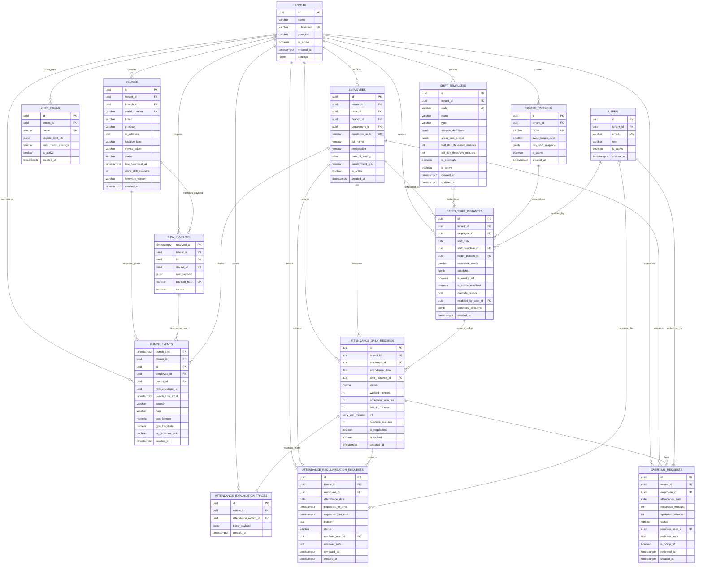
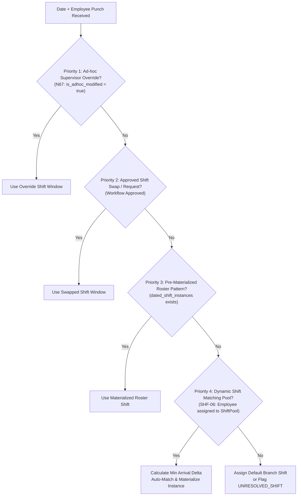

# APMS Database ERD — Shifts, Rosters & Attendance Engine

> **Status:** Authoritative | **Last Updated:** 2026-11-16 | **Source:** Extracted from APMS documentation (`DATABASE_DESIGN.md`, `schema.dbml`, M03 Shifts SPEC, M09/M10 Attendance SPEC, `REQUIREMENTS_CATALOG.md`)

---

## 1. Executive Summary & Domain Scope

The **Shifts, Rosters & Attendance Engine** forms the operational backbone of APMS. It manages the full lifecycle of workforce scheduling and physical attendance verification:
1. **Shift & Roster Modeling**: Reusable shift templates (`shift_templates`), dynamic matching pools (`shift_pools`), cyclical rotation schedules (`roster_patterns`), and materialized daily instances (`dated_shift_instances`).
2. **Immutable Raw Ingestion**: High-throughput device payloads (`raw_envelope`) and normalized punch streams (`punch_events`) with monthly declarative range partitioning.
3. **Deterministic Attendance Rollup**: Session-aware punch pairing, daily ledger calculation (`attendance_daily_records`), and immutable JSON explanation traces (`attendance_explanation_traces`).
4. **Exception Regularization**: Punch-miss correction workflows (`attendance_regularization_requests`) and authorized overtime tracking (`overtime_requests`).

This document provides the authoritative Mermaid Entity-Relationship Diagram (ERD), exact table definitions, composite tenant key patterns, multi-session gap modeling (N65), dynamic shift matching algorithms (SHF-06), and ad-hoc same-day override flows (N67).

---

## 2. Complete Attendance & Shift Entity-Relationship Diagram

The following Mermaid ERD visualizes all 12 core tables in the Attendance & Scheduling domain, including platform root entities (`tenants`, `employees`, `devices`, `users`) that establish foreign key lineage.



---

## 3. Entity Specifications & Schema Catalog

### 3.1 `shift_templates`
Reusable shift template master definitions.
- **Primary Key**: `id UUID`
- **Tenant Key**: `tenant_id UUID` (Indexed)
- **Unique Constraint**: `uq_shift_templates_code (tenant_id, code)`
- **Key Columns**:
  - `code VARCHAR(30)`: Business identifier (e.g. `GEN_09_18`, `NIGHT_22_06`, `SPLIT_REST`).
  - `name VARCHAR(200)`: Human-readable shift name.
  - `type shift_type_enum`: `FIXED_STANDARD`, `OVERNIGHT`, `MULTI_SESSION`, `FLEXIBLE_WINDOW`, `CONTINUOUS_MULTI_DAY`, `DYNAMIC_POOL`.
  - `session_definitions JSONB`: Array of structured session bounds with minimum presence requirements.
  - `grace_and_breaks JSONB`: Arrival/departure grace windows and scheduled breaks.
  - `half_day_threshold_minutes INT`: Minimum worked minutes required to qualify for half-day credit.
  - `full_day_threshold_minutes INT`: Minimum worked minutes required to qualify for full-day credit.
  - `is_overnight BOOLEAN`: Flags whether the shift crosses 00:00 UTC/Local midnight.

### 3.2 `shift_pools`
Candidate shift pools for dynamic punch-matching (SHF-06).
- **Primary Key**: `id UUID`
- **Tenant Key**: `tenant_id UUID`
- **Unique Constraint**: `uq_shift_pools_name (tenant_id, name)`
- **Key Columns**:
  - `name VARCHAR(200)`: Name of pool (e.g. `PLANT_3_ROTATION_POOL`).
  - `eligible_shift_ids UUID[]` / `JSONB`: List of `shift_templates.id` records available for dynamic auto-matching.
  - `auto_match_strategy VARCHAR(50)`: Strategy identifier (`MIN_ARRIVAL_DELTA`, `WINDOW_OVERLAP_MAX`).

### 3.3 `roster_patterns`
Cyclical rotation patterns applied to work groups or employees (ROS-01, ROS-02).
- **Primary Key**: `id UUID`
- **Tenant Key**: `tenant_id UUID`
- **Key Columns**:
  - `name VARCHAR(200)`: Pattern name (e.g. `6-1_ROTATING_SHIFT`, `2W_DAY_2W_NIGHT`).
  - `cycle_length_days SMALLINT`: Pattern repeat cycle (e.g. 7, 14, 28, 42).
  - `day_shift_mapping JSONB`: Ordered sequence mapping day offset `0..N-1` to `shift_template_id` or `NULL` (Weekly Off).

### 3.4 `dated_shift_instances`
Concrete, materialized daily shift instance per employee per date (ROS-03, N67).
- **Primary Key**: `id UUID`
- **Tenant Key**: `tenant_id UUID`
- **Composite Unique Constraints**:
  - `uq_shift_instance_emp_date (tenant_id, employee_id, shift_date)`: Guarantees exactly one concrete schedule per employee per calendar date.
  - `uq_dated_shift_instances_id_tenant (tenant_id, id)`: Composite target for foreign keys from `attendance_daily_records`.
- **Key Columns**:
  - `shift_date DATE`: Target calendar date of shift assignment.
  - `resolution_mode VARCHAR(50)`: How the shift was assigned (`ROSTER_PATTERN`, `AUTO_DYNAMIC_MATCH`, `ADHOC_OVERRIDE`, `SHIFT_SWAP`, `MANUAL`).
  - `sessions JSONB`: Frozen snapshot of session boundaries, grace, and thresholds at materialization time (ADR-15).
  - `is_adhoc_modified BOOLEAN`: True if modified after initial materialization (N67).
  - `override_reason TEXT`: Mandatory audit trail explanation when modified.
  - `modified_by_user_id UUID`: Supervisor identity executing the change.
  - `cancelled_sessions JSONB`: Session indices cancelled by employer (`CANCELLED_PAID`, N66d).

### 3.5 `raw_envelope` (Append-Only & Declaratively Partitioned)
Immutable hardware and edge payload ingestion table (PCH-01, ADR-04).
- **Composite Primary Key**: `(received_at, tenant_id, id)`
- **Partition Scheme**: `PARTITION BY RANGE (received_at)` (Monthly).
- **Unique Constraint**: `uq_raw_envelope_hash (tenant_id, payload_hash, received_at)`.
- **Invariants**: Append-only. No `UPDATE` or `DELETE` grants issued to application roles.

### 3.6 `punch_events` (Declaratively Partitioned)
Normalized chronological punch event stream (PCH-02).
- **Composite Primary Key**: `(punch_time, tenant_id, id)`
- **Partition Scheme**: `PARTITION BY RANGE (punch_time)` (Monthly).
- **Foreign Keys**:
  - `employee_id -> employees(id)`
  - `device_id -> devices(id)`
  - `raw_envelope_id UUID` (Logical link to raw envelope; cross-partition FK omitted for performance).
- **Key Columns**:
  - `punch_time TIMESTAMPTZ`: Standardized UTC timestamp (Partition key).
  - `punch_time_local TIMESTAMPTZ`: Tenant branch timezone adjusted timestamp.
  - `flag punch_flag_enum`: `NORMAL`, `DUPLICATE_IGNORED`, `CLOCK_DRIFT_WARNING`, `LONE_PUNCH_ANOMALY`, `UNRESOLVED_SHIFT`.
  - `gps_latitude / gps_longitude NUMERIC(10,7)`: Mobile GPS coordinates.
  - `is_geofence_valid BOOLEAN`: Geofence validation status.

### 3.7 `attendance_daily_records`
Daily employee attendance rollup ledger (ATT-07, N66a). Read-only input to payroll.
- **Primary Key**: `id UUID`
- **Tenant Key**: `tenant_id UUID`
- **Composite Unique Constraint**: `uq_emp_attendance_date (tenant_id, employee_id, attendance_date)`.
- **Composite Foreign Key**: `(tenant_id, shift_instance_id) REFERENCES dated_shift_instances(tenant_id, id)`.
- **Key Columns**:
  - `status attendance_status_enum`: `PRESENT`, `HALF_DAY`, `ABSENT`, `ON_LEAVE`, `WEEKLY_OFF`, `HOLIDAY`, `NEEDS_REVIEW`, `POST_DUTY_REST`, `CANCELLED_PAID`.
  - `worked_minutes INT`: Net worked minutes within scheduled sessions (excluding gaps and breaks).
  - `scheduled_minutes INT`: Total scheduled duration of valid sessions.
  - `late_in_minutes INT`: Cumulative late arrival minutes past grace.
  - `early_exit_minutes INT`: Cumulative early departure minutes before session end.
  - `overtime_minutes INT`: Approved overtime minutes (N20).
  - `is_locked BOOLEAN`: Flipped to `true` during Pay Run Step 1 (Payroll Freeze); prevents further background recalculation.

### 3.8 `attendance_explanation_traces`
Immutable mathematical explanation trace for every daily rollup calculation (ATT-11).
- **Primary Key**: `id UUID`
- **Tenant Key**: `tenant_id UUID`
- **Foreign Key**: `attendance_record_id REFERENCES attendance_daily_records(id) ON DELETE CASCADE`.
- **Key Column**: `trace_payload JSONB`: Captures exact input punches, pairing decisions, multi-session gap exclusions, penalty deductions, and rollup score $R$.

### 3.9 `attendance_regularization_requests`
Workflow requests for punch-miss regularizations and anomaly resolutions (ATT-10, WFL-01).
- **Primary Key**: `id UUID`
- **Tenant Key**: `tenant_id UUID`
- **Key Columns**: `attendance_date`, `requested_in_time`, `requested_out_time`, `reason`, `status (approval_status_enum)`, `reviewer_user_id`.

### 3.10 `overtime_requests`
Explicit pre- and post-authorization for worked overtime (N20, OTC-01).
- **Primary Key**: `id UUID`
- **Tenant Key**: `tenant_id UUID`
- **Key Columns**: `attendance_date`, `requested_minutes`, `approved_minutes`, `is_comp_off`, `status`.

---

## 4. Composite Foreign Key Architecture & Tenant Isolation

To prevent cross-tenant data corruption and enforce strict database kernel-level isolation, all foreign keys between tenant-scoped entities must include `tenant_id`.

### 4.1 Vulnerability of Single-Column Foreign Keys
In a standard multi-tenant PostgreSQL schema, a foreign key defined as:
```sql
-- DANGEROUS: Single-column FK allows cross-tenant reference
ALTER TABLE attendance_daily_records 
    ADD CONSTRAINT fk_shift_instance 
    FOREIGN KEY (shift_instance_id) REFERENCES dated_shift_instances(id);
```
allows an update or insert in Tenant A to inadvertently reference a `dated_shift_instances` record belonging to Tenant B if IDs are manipulated or leaked, completely bypassing application logic.

### 4.2 Composite Foreign Key Solution
APMS enforces composite uniqueness on the parent and composite foreign key constraints on the child:

```sql
-- Step 1: Ensure parent table exposes composite unique constraint
ALTER TABLE dated_shift_instances
    ADD CONSTRAINT uq_dated_shift_instances_id_tenant
    UNIQUE (tenant_id, id);

-- Step 2: Enforce composite foreign key on child table
ALTER TABLE attendance_daily_records
    ADD CONSTRAINT fk_attendance_shift_instance_composite
    FOREIGN KEY (tenant_id, shift_instance_id)
    REFERENCES dated_shift_instances(tenant_id, id)
    ON DELETE RESTRICT;
```

This guarantees that:
1. `attendance_daily_records.tenant_id` must match `dated_shift_instances.tenant_id` identically.
2. PostgreSQL will abort any transaction attempting to associate an attendance rollup with a shift instance belonging to another tenant.
3. Database indices on `(tenant_id, id)` accelerate foreign key checks and align directly with RLS filter clauses.

---

## 5. Multi-Session Modeling & The Non-Negotiable Gap Exclusion Rule (N65)

Split shifts and multi-session work patterns (e.g., hospitality, transport, catering) are modeled using structured JSONB sessions. 

### 5.1 Structure of `session_definitions` JSONB
Stored in `shift_templates.session_definitions` and snapshotted into `dated_shift_instances.sessions`:

```json
[
  {
    "session_index": 1,
    "name": "Morning Service",
    "start_time": "08:00:00",
    "end_time": "12:00:00",
    "scheduled_duration_minutes": 240,
    "min_presence_pct": 75,
    "grace_arrival_minutes": 15,
    "grace_exit_minutes": 10
  },
  {
    "session_index": 2,
    "name": "Evening Service",
    "start_time": "16:00:00",
    "end_time": "20:00:00",
    "scheduled_duration_minutes": 240,
    "min_presence_pct": 75,
    "grace_arrival_minutes": 15,
    "grace_exit_minutes": 10
  }
]
```

### 5.2 Mandatory Boundary Punches & Gap Exclusion (N65 / BR-ATT-02)
- **The Gap (12:00 to 16:00)**: The interval between Session 1 `end_time` and Session 2 `start_time` is defined as an excluded idle window.
- **Rule**: Even if an employee remains physically on premises, swipes their card, or stays logged in, **zero worked minutes or overtime minutes may accrue during the inter-session gap**.
- **Boundary Invariant**:
  - Session 1 requires an IN punch (pairing window 07:30–08:30) and an OUT punch (pairing window 11:45–12:30).
  - Session 2 requires an IN punch (pairing window 15:30–16:30) and an OUT punch (pairing window 19:45–20:30).
  - A single punch spanning across the gap without boundary punches (e.g. IN at 08:00, OUT at 20:00) does **not** count 12 hours of continuous work. The pairing engine clips worked duration strictly to $[08:00, 12:00] + [16:00, 20:00] = 8\text{ hours}$, logging an anomaly flag `INTER_SESSION_UNPAIRED_GAP`.

### 5.3 Cancelled Sessions (`CANCELLED_PAID`, N66d)
If an employer shuts down a planned session (e.g. kitchen renovation during lunch):
- The session is recorded in `dated_shift_instances.cancelled_sessions = [1]`.
- Salaried full-time staff receive full paid credit (`CANCELLED_PAID`) for Session 1 scheduled minutes, while Session 2 requires normal worked punches.

---

## 6. Complex Scheduling Lifecycle & Resolution Modes

APMS resolves an employee's concrete shift for any given calendar date using a deterministic 5-level hierarchy:



### 6.1 Ad-Hoc Same-Day Modifications (N67 / BR-ROL-06)
- **Direct Supervisor Override**: Supervisor modifies shift times on the fly via `/api/v1/shifts/instances/{id}/override`.
- **System Action**:
  1. Updates `dated_shift_instances` with new timings.
  2. Sets `is_adhoc_modified = true`, records `modified_by_user_id` and `override_reason`.
  3. Publishes `shift.instance.updated` event to Redis.
  4. The attendance engine invalidates existing pairings for that date, unlinks existing punches, and re-computes `attendance_daily_records` and `attendance_explanation_traces`.

### 6.2 Auto-Shift Allocation & Dynamic Matching (SHF-06)
Designed for manufacturing plants, security detachments, and hospitals where staff rotate across three shifts (e.g. Morning 06:00–14:00, Evening 14:00–22:00, Night 22:00–06:00) without fixed individual schedules:
1. When the initial punch $P_{in}$ arrives, the engine queries the employee's `shift_pools`.
2. For each candidate template $S_i \in \text{eligible_shift_ids}$:
   $$\Delta_i = |P_{in} - T_{start, i}|$$
   Candidate condition: $T_{start, i} - 60\text{ min} \le P_{in} \le T_{start, i} + 120\text{ min}$.
3. The candidate with $\min(\Delta_i)$ is selected ($S^*$).
4. The engine materializes a new `dated_shift_instances` row with `resolution_mode = 'AUTO_DYNAMIC_MATCH'` and links the punch stream.

### 6.3 Overnight Shifts (SHF-02)
- For shifts crossing midnight (e.g. 22:00 to 06:00 next day):
  - Invariant: **Attributed strictly to the shift start calendar date**.
  - All worked hours, night shift allowances, and daily rollup statuses belong to Date $D$, even though the OUT punch occurs on Date $D+1$.
  - The dated shift instance for Date $D+1$ remains free to receive a distinct shift or scheduled rest.

### 6.4 Continuous Multi-Day Duties (Q5)
- In specialized medical or industrial environments where duties span 24h, 36h, or 48h:
  - All worked duration is anchored to the shift start date.
  - The following calendar day(s) are automatically assigned `status = 'POST_DUTY_REST'` with full paid day credit, preventing false absence marks.

---

## 7. Deterministic Audit Traceability (`attendance_explanation_traces`)

Every daily attendance calculation persists an immutable JSON explanation trace. This eliminates black-box calculation disputes and provides 100% legal auditability.

### 7.1 Explanation Trace JSON Schema
```json
{
  "trace_version": "1.0",
  "calculation_timestamp": "2026-11-16T18:05:22.104Z",
  "tenant_id": "018d3b50-1000-7000-8000-000000000001",
  "employee_id": "018d3b50-2000-7000-8000-000000000002",
  "attendance_date": "2026-11-16",
  "shift_resolution": {
    "shift_instance_id": "018d3b50-3000-7000-8000-000000000003",
    "shift_code": "SPLIT_08_20",
    "resolution_mode": "ROSTER_PATTERN",
    "is_adhoc_modified": false
  },
  "session_evaluations": [
    {
      "session_index": 1,
      "scheduled_window": ["2026-11-16T08:00:00+05:30", "2026-11-16T12:00:00+05:30"],
      "paired_punches": {
        "in_punch_id": "018d3b50-4000-7000-8000-000000000004",
        "in_time": "2026-11-16T08:04:12+05:30",
        "out_punch_id": "018d3b50-4000-7000-8000-000000000005",
        "out_time": "2026-11-16T12:01:05+05:30"
      },
      "late_in_minutes": 0,
      "early_exit_minutes": 0,
      "worked_minutes": 236,
      "scheduled_minutes": 240,
      "min_presence_met": true
    },
    {
      "session_index": 2,
      "scheduled_window": ["2026-11-16T16:00:00+05:30", "2026-11-16T20:00:00+05:30"],
      "paired_punches": {
        "in_punch_id": "018d3b50-4000-7000-8000-000000000006",
        "in_time": "2026-11-16T16:18:22+05:30",
        "out_punch_id": "018d3b50-4000-7000-8000-000000000007",
        "out_time": "2026-11-16T20:00:10+05:30"
      },
      "late_in_minutes": 3,
      "early_exit_minutes": 0,
      "worked_minutes": 221,
      "scheduled_minutes": 240,
      "min_presence_met": true
    }
  ],
  "gap_exclusions": [
    {
      "gap_window": ["2026-11-16T12:00:00+05:30", "2026-11-16T16:00:00+05:30"],
      "excluded_duration_minutes": 240,
      "punches_detected_in_gap": 0,
      "worked_minutes_accrued": 0
    }
  ],
  "rollup_math": {
    "total_worked_minutes": 457,
    "total_scheduled_minutes": 480,
    "coverage_ratio_R": 0.952,
    "threshold_full_day_ratio": 0.85,
    "threshold_half_day_ratio": 0.50,
    "final_status": "PRESENT",
    "late_counter_incremented": false
  }
}
```

---

## 8. Summary Table of Foreign Key Constraints

| Parent Table | Parent Key | Child Table | Child Foreign Key | Cascade Action | Purpose |
| :--- | :--- | :--- | :--- | :--- | :--- |
| `tenants` | `(id)` | `shift_templates` | `(tenant_id)` | RESTRICT | Tenant scoping |
| `tenants` | `(id)` | `shift_pools` | `(tenant_id)` | RESTRICT | Tenant scoping |
| `tenants` | `(id)` | `roster_patterns` | `(tenant_id)` | RESTRICT | Tenant scoping |
| `tenants` | `(id)` | `dated_shift_instances` | `(tenant_id)` | RESTRICT | Tenant scoping |
| `employees` | `(id)` | `dated_shift_instances` | `(employee_id)` | CASCADE | Employee schedule link |
| `shift_templates` | `(id)` | `dated_shift_instances` | `(shift_template_id)` | SET NULL | Schedule template lineage |
| `roster_patterns` | `(id)` | `dated_shift_instances` | `(roster_pattern_id)` | SET NULL | Roster rotation link |
| `users` | `(id)` | `dated_shift_instances` | `(modified_by_user_id)` | SET NULL | N67 Supervisor override audit |
| `devices` | `(id)` | `raw_envelope` | `(device_id)` | SET NULL | Device payload source |
| `devices` | `(id)` | `punch_events` | `(device_id)` | SET NULL | Punch hardware terminal |
| `employees` | `(id)` | `punch_events` | `(employee_id)` | RESTRICT | Employee punch attribution |
| `dated_shift_instances` | **`(tenant_id, id)`** | `attendance_daily_records` | **`(tenant_id, shift_instance_id)`** | RESTRICT | **Composite tenant schedule binding** |
| `employees` | `(id)` | `attendance_daily_records` | `(employee_id)` | RESTRICT | Daily rollup attribution |
| `attendance_daily_records` | `(id)` | `attendance_explanation_traces` | `(attendance_record_id)` | CASCADE | 1-to-1 deterministic trace |
| `employees` | `(id)` | `attendance_regularization_requests` | `(employee_id)` | CASCADE | Punch regularization request |
| `users` | `(id)` | `attendance_regularization_requests` | `(reviewer_user_id)` | SET NULL | Approval workflow reviewer |
| `employees` | `(id)` | `overtime_requests` | `(employee_id)` | CASCADE | Overtime approval link |
| `users` | `(id)` | `overtime_requests` | `(reviewer_user_id)` | SET NULL | Overtime reviewer |
