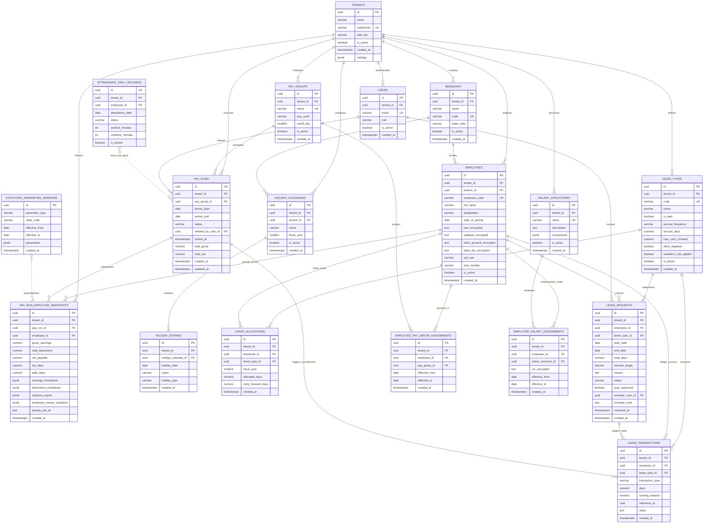
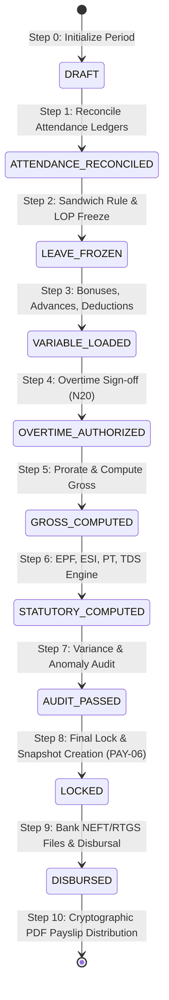
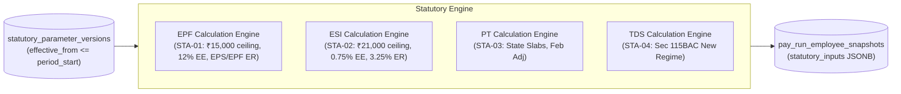
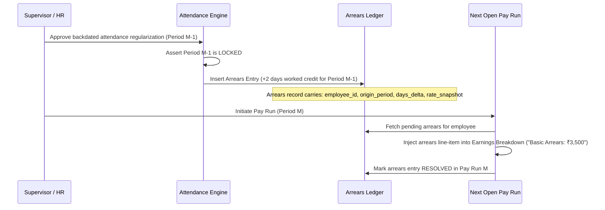

# APMS Database ERD — Leave Ledger & Statutory Payroll Engine

> **Status:** Authoritative | **Last Updated:** 2026-11-16 | **Source:** Extracted from APMS documentation (`DATABASE_DESIGN.md`, `schema.dbml`, M06 Leave SPEC, M07 Payroll SPEC, `REQUIREMENTS_CATALOG.md`, `BUSINESS_RULES.md`)

---

## 1. Executive Summary & Domain Scope

The **Leave Ledger & Statutory Payroll Engine** provides institutional-grade precision, compliance, and auditability for employee entitlements and compensation. It enforces two non-negotiable architectural invariants:
1. **Immutable Double-Entry Leave Ledger (ADR-08)**: Leave balances are strictly derived from append-only ledger entries in `leave_transactions`. Mutable scalar balance counters are prohibited, eliminating concurrency anomalies, balance drift, and audit ambiguity.
2. **Attendance Decoupling & Immutable Payroll Snapshots (ADR-07, ADR-09, PAY-06)**: The attendance daily ledger acts strictly as a read-only input to the payroll calculation pipeline. Once Step 8 of the Guided 10-Step Pay Run Wizard locks a pay run, immutable snapshots (`pay_run_employee_snapshots`) capture earnings, deductions, statutory version parameters, and demographic master data permanently. Retroactive adjustments never alter locked historical runs; they flow through an arrears pipeline into the next open pay cycle.

This document details the complete Mermaid ERD, table structures, double-entry ledger query patterns, the 10-step wizard state machine, Indian statutory parameter tables (EPF, ESI, PT, TDS Section 115BAC), and cryptographic payslip architecture.

---

## 2. Complete Leave & Payroll Entity-Relationship Diagram

The following Mermaid ERD visualizes all tables in the Leave and Statutory Payroll domain, including organizational anchors (`tenants`, `branches`, `employees`, `users`) and the read-only attendance interface.



---

## 3. Entity Specifications & Key Constraints

### 3.1 `leave_types`
Master catalog of leave classifications (LVE-02).
- **Primary Key**: `id UUID`
- **Tenant Key**: `tenant_id UUID`
- **Unique Constraint**: `uq_leave_types_code (tenant_id, code)`
- **Key Columns**:
  - `code VARCHAR(20)`: Business code (`AL`, `CL`, `SL`, `ML`, `PL`, `COMP_OFF`, `LOP`, `WFH`).
  - `is_paid BOOLEAN`: Whether leave hours convert to paid attendance.
  - `accrual_frequency VARCHAR(20)`: `MONTHLY`, `ANNUAL`, `QUARTERLY`, or `NULL` (ad-hoc grant).
  - `accrual_days NUMERIC(4,2)`: Units credited per period (e.g. 1.75 days/month for AL).
  - `max_carry_forward NUMERIC(4,2)`: Year-end ceiling for carryover to next fiscal year.
  - `allow_negative BOOLEAN`: If false, balance cannot drop below 0.00 (LVE-06).
  - `sandwich_rule_applies BOOLEAN`: Flags whether intervening weekends/holidays convert to leave (BR-LVE-02).

### 3.2 `leave_allocations`
Annual or fiscal-year entitlement quotas configured per employee per leave type (LVE-01).
- **Primary Key**: `id UUID`
- **Tenant Key**: `tenant_id UUID`
- **Unique Constraint**: `uq_leave_alloc_emp_type_year (tenant_id, employee_id, leave_type_id, fiscal_year)`
- **Key Columns**:
  - `fiscal_year SMALLINT`: e.g. 2026.
  - `allocated_days NUMERIC(4,2)`: Annual base entitlement.
  - `carry_forward_days NUMERIC(4,2)`: Balance rolled over from previous fiscal period.

### 3.3 `leave_requests`
Workflow applications for planned time-off (LVE-01, WFL-01).
- **Primary Key**: `id UUID`
- **Tenant Key**: `tenant_id UUID`
- **Key Columns**:
  - `start_date / end_date DATE`: Application duration bounds.
  - `total_days NUMERIC(4,2)`: Net leave days requested (e.g. 0.50, 1.00, 3.00).
  - `session_target VARCHAR(20)`: For half-day leave (`FIRST_HALF`, `SECOND_HALF`, `FULL_DAY`, N66c).
  - `status approval_status_enum`: `PENDING`, `APPROVED`, `REJECTED`, `CANCELLED`, `AUTO_APPROVED` (Q6).
  - `auto_approved BOOLEAN`: Flipped to true for WFH requests within monthly quota.

### 3.4 `leave_transactions` (Append-Only Double-Entry Ledger)
Financial-grade double-entry transaction record for every balance mutation (ADR-08).
- **Primary Key**: `id UUID`
- **Tenant Key**: `tenant_id UUID`
- **Composite Index**: `idx_leave_txn_emp_type_time (tenant_id, employee_id, leave_type_id, created_at)`
- **Invariants**: Append-only. No `UPDATE` or `DELETE` statements allowed.
- **Key Columns**:
  - `transaction_type leave_transaction_type_enum`: `ACCRUAL`, `APPLICATION`, `CANCELLATION`, `ENCASHMENT`, `LAPSE`, `MANUAL_ADJUSTMENT`.
  - `days NUMERIC(4,2)`: Signed increment/decrement (`+1.75`, `-1.00`, `-0.50`).
  - `running_balance NUMERIC(5,2)`: Derived balance snapshot immediately following transaction execution.
  - `reference_id UUID`: Foreign key pointer to `leave_requests.id`, `pay_runs.id`, or audit adjustment.

### 3.5 `pay_groups`
Defines compensation cycles and cut-off calendars (PAY-04, EMP-03).
- **Primary Key**: `id UUID`
- **Tenant Key**: `tenant_id UUID`
- **Unique Constraint**: `uq_pay_groups_name (tenant_id, name)`
- **Key Columns**:
  - `pay_cycle VARCHAR(20)`: `CALENDAR_MONTH` (1st to end-of-month) or `CUSTOM_CUTOFF` (e.g. 26th to 25th, N18).
  - `cutoff_day SMALLINT`: Date offset for custom cut-off.

### 3.6 `salary_structures`
Formula blueprints defining earnings components, deduction rules, and statutory baselines (PAY-02).
- **Primary Key**: `id UUID`
- **Tenant Key**: `tenant_id UUID`
- **Key Column**:
  - `components JSONB`: Structured list of components:
    ```json
    [
      {"code": "BASIC", "name": "Basic Salary", "type": "EARNING", "formula": "CTC * 0.50", "is_statutory": true},
      {"code": "HRA", "name": "House Rent Allowance", "type": "EARNING", "formula": "BASIC * 0.50", "is_statutory": false},
      {"code": "SPECIAL", "name": "Special Allowance", "type": "EARNING", "formula": "CTC - BASIC - HRA", "is_statutory": false},
      {"code": "EPF_EE", "name": "Employee PF", "type": "DEDUCTION", "formula": "MIN(BASIC, 15000) * 0.12", "is_statutory": true}
    ]
    ```

### 3.7 `employee_salary_assignments`
Effective-dated mapping connecting an employee to a salary structure and encrypted annual CTC (EMP-02, SEC-02, LFC-05).
- **Primary Key**: `id UUID`
- **Tenant Key**: `tenant_id UUID`
- **Composite Unique**: `uq_emp_sal_effective (tenant_id, employee_id, effective_from)`
- **Key Columns**:
  - `ctc_encrypted TEXT`: AES-256-GCM encrypted annual CTC amount.
  - `effective_from / effective_to DATE`: Historical validity window (`effective_to IS NULL` represents active profile).

### 3.8 `pay_runs`
Finite-state machine orchestrating the Guided 10-Step Pay Run Wizard (PAY-01, PAY-06).
- **Primary Key**: `id UUID`
- **Tenant Key**: `tenant_id UUID`
- **Composite Unique**: `uq_pay_run_period (tenant_id, pay_group_id, period_start, period_end)`
- **Key Columns**:
  - `status pay_run_status_enum`:
    `DRAFT` $\rightarrow$ `ATTENDANCE_RECONCILED` $\rightarrow$ `LEAVE_FROZEN` $\rightarrow$ `VARIABLE_LOADED` $\rightarrow$ `OVERTIME_AUTHORIZED` $\rightarrow$ `GROSS_COMPUTED` $\rightarrow$ `STATUTORY_COMPUTED` $\rightarrow$ `AUDIT_PASSED` $\rightarrow$ `LOCKED` $\rightarrow$ `DISBURSED`.
  - `locked_at TIMESTAMPTZ`: Timestamp when transition to `LOCKED` permanently froze the pay run.
  - `total_gross / total_net NUMERIC(15,2)`: Rollup totals computed at Step 5 and Step 6.

### 3.9 `pay_run_employee_snapshots` (Immutable Post-Lock Snapshot)
Permanent financial snapshot generated per employee during Step 8 (PAY-06, PSL-03).
- **Primary Key**: `id UUID`
- **Tenant Key**: `tenant_id UUID`
- **Composite Unique**: `uq_payrun_emp (tenant_id, pay_run_id, employee_id)`
- **Invariants**: 100% immutable once created. Retroactive changes never alter this table.
- **Key Columns**:
  - `gross_earnings, total_deductions, net_payable NUMERIC(12,2)`
  - `lop_days, paid_days NUMERIC(4,2)`
  - `earnings_breakdown JSONB`: Line-item breakdown of every earning component.
  - `deductions_breakdown JSONB`: Line-item breakdown of statutory and voluntary deductions.
  - `statutory_inputs JSONB`: Exact snapshot of statutory parameters and rates applied.
  - `employee_master_snapshot JSONB`: Immutable copy of employee name, designation, PAN, bank account, and UAN.
  - `payslip_pdf_url TEXT`: Signed object store URL of compiled PDF.

### 3.10 `statutory_parameter_versions`
Platform-level versioned statutory compliance tables (ADR-25, STA-01..STA-05).
- **Primary Key**: `id UUID`
- **Tenant Key**: `NULL` (Platform-wide catalog).
- **Composite Unique**: `uq_statutory_param_version (parameter_type, state_code, effective_from)`
- **Key Columns**:
  - `parameter_type VARCHAR(20)`: `EPF`, `ESI`, `PT`, `TDS`, `LWF`.
  - `state_code VARCHAR(5)`: ISO 3166-2 state code for state-level taxes (`IN-MH`, `IN-KA`, etc.).
  - `parameters JSONB`: Ceilings, wage definitions, contribution rates, exemption slabs.

---

## 4. Immutable Double-Entry Leave Ledger Architecture (ADR-08)

### 4.1 Rationale: Prohibiting Mutable Balance Columns
Conventional HRMS systems store a mutable integer or decimal column such as `employees.casual_leave_balance = 8.5`. This introduces severe operational flaws:
1. **Concurrency Race Conditions**: Two concurrent leave requests can read the same balance and over-allocate leaves.
2. **Loss of Auditability**: An admin cannot prove whether a balance changed due to an accrual, an HR override, a cancellation, or a silent corruption bug.
3. **Complex Retroactive Corrections**: Reversing a mistakenly approved leave requires manually incrementing a scalar number, leaving no legal audit trail.

### 4.2 Append-Only Transaction Model
Under ADR-08, balance mutations are strictly recorded as immutable rows in `leave_transactions`. The current balance is derived deterministically:

```sql
-- Authoritative Current Balance Query
SELECT 
    leave_type_id,
    COALESCE(SUM(days), 0.00) AS current_balance
FROM leave_transactions
WHERE tenant_id = :tenant_id 
  AND employee_id = :employee_id
  AND leave_type_id = :leave_type_id
GROUP BY leave_type_id;
```

### 4.3 Atomic Application & Negative Balance Protection (BR-LVE-03, LVE-06)
When a leave request is approved, the system executes an atomic transaction with balance verification:

```sql
BEGIN;

-- 1. Lock the latest ledger row for this employee and leave type to prevent race conditions
SELECT running_balance 
FROM leave_transactions
WHERE tenant_id = :tenant_id 
  AND employee_id = :employee_id 
  AND leave_type_id = :leave_type_id
ORDER BY created_at DESC 
LIMIT 1 
FOR UPDATE;

-- 2. Verify that (running_balance - :requested_days >= 0) OR (leave_types.allow_negative = true)
-- If check fails, rollback immediately:
-- RAISE EXCEPTION 'Insufficient leave balance';

-- 3. Insert append-only transaction
INSERT INTO leave_transactions (
    id, tenant_id, employee_id, leave_type_id,
    transaction_type, days, running_balance,
    reference_id, notes, created_at
) VALUES (
    gen_random_uuid(), :tenant_id, :employee_id, :leave_type_id,
    'APPLICATION', -:requested_days, (:latest_balance - :requested_days),
    :leave_request_id, 'Approved leave request', clock_timestamp()
);

COMMIT;
```

### 4.4 The Sandwich Rule Engine (`BR-LVE-02`)
The Sandwich Rule converts non-working days (Weekly Offs and Public Holidays) into paid leave or Loss of Pay (LOP) when an employee is absent on both adjoining workdays:

```text
Condition:
  [Workday immediately preceding Weekend/Holiday == ABSENT or UNAPPROVED_LEAVE]
  AND
  [Workday immediately following Weekend/Holiday == ABSENT or UNAPPROVED_LEAVE]

Result:
  The intervening Weekend/Holiday days are converted to LEAVE (or LOP).
  A transaction of type 'APPLICATION' or 'MANUAL_ADJUSTMENT' is appended for the intervening days.
```

### 4.5 Session-Targeted Half-Day Leave (`N66c`)
- Half-day applications require `session_target = 'FIRST_HALF'` or `'SECOND_HALF'`.
- On a scheduled split-shift or standard shift:
  - The targeted session receives an approved leave debit (-0.50 days).
  - The non-targeted session must be physically worked. If completed, daily status is rolled up as `PRESENT` with 0.50 worked credit and 0.50 leave credit.

---

## 5. The Guided 10-Step Pay Run Wizard & State Machine

The payroll engine transitions through a strict, irreversible finite-state machine (FSM). Each step executes mandatory validations before unlocking the next stage:



### 5.1 Step-by-Step Validation Invariants
1. **Step 1 (Attendance Reconciled)**: Checks that all employee days have finalized records in `attendance_daily_records`. Single-punch anomalies (`Q4`) and pending regularizations must be resolved or explicitly skipped with audit reasons.
2. **Step 2 (Leave Frozen)**: Evaluates Sandwich Rules across the cutoff period. Locks leave transactions for the month; further backdated leave applications for this period are rejected. Computes exact `lop_days`.
3. **Step 3 (Variable Loaded)**: Ingests one-time bonuses, commission, travel reimbursements, and salary advance deductions.
4. **Step 4 (Overtime Authorized)**: Pulls only approved overtime minutes from `overtime_requests` (`status = 'APPROVED'`, N20). Unapproved overtime minutes are rejected from payroll computation.
5. **Step 5 (Gross Computed)**: Evaluates `salary_structures.components`. Prorates base earnings:
   $$\text{Earned Basic} = \text{Fixed Basic} \times \frac{\text{Paid Days}}{\text{Calendar Days in Month}}$$
6. **Step 6 (Statutory Computed)**: Pulls active statutory parameters from `statutory_parameter_versions` and applies Indian labor compliance formulas.
7. **Step 7 (Pre-Payroll Audit)**: Automatically checks variance:
   - Identifies any employee whose net salary varies by $> 20\%$ against prior month.
   - Asserts zero negative net pay.
   - Flags missing statutory IDs (PAN, UAN, ESIC) when earnings cross thresholds.
8. **Step 8 (Final Lock & Snapshot Creation)**: Transitions status to `LOCKED`. **Creates immutable rows in `pay_run_employee_snapshots`**. Attendance records for the period are updated to `is_locked = true`.
9. **Step 9 (Disbursal Export)**: Generates bank-format CSV/TXT files (HDFC, ICICI, SBI NEFT/RTGS formats).
10. **Step 10 (Payslip Publishing)**: Compiles encrypted PDFs with password protection and publishes to ESS portal.

---

## 6. Indian Statutory Compliance Architecture (ADR-25, STA-01..STA-05)

Statutory rates, wage ceilings, and tax slabs are **never hardcoded in source code**. They are dynamically resolved from `statutory_parameter_versions` based on `pay_runs.period_start`.



### 6.1 Employees' Provident Fund (EPF — STA-01)
- **Statutory Wage Ceiling**: ₹15,000 / month.
- **Employee Contribution**: $12\%$ of PF Gross (capped at ₹1,800/month if opt-in restricted, or on actual basic if voluntary).
- **Employer Contribution Breakdown**:
  - Employee Pension Scheme (EPS): $8.33\%$ (capped at ₹1,250/month).
  - Employer EPF: $3.67\%$ (Balance of 12% minus EPS).
  - EDLI (Admin / Deposit Linked Insurance): $0.50\%$.
  - EPF Admin Charges: $0.50\%$.

### 6.2 Employees' State Insurance (ESIC — STA-02)
- **Gross Wage Eligibility Threshold**: ₹21,000 / month (₹25,000 for employees with disability).
- **Employee Contribution**: $0.75\%$ of Gross Wages.
- **Employer Contribution**: $3.25\%$ of Gross Wages.
- **Rule**: If gross wage exceeds ₹21,000 in any month following the start of a contribution period (April–September or October–March), ESI continues to be deducted until the end of that statutory contribution period.

### 6.3 Professional Tax (PT — STA-03)
- Governed by state-specific monthly slabs using employee's branch `branches.state_code`.
- Example — Maharashtra (`IN-MH`):
  - Gross Salary $\le ₹7,500$: Nil (Men), Nil (Women).
  - Gross Salary $₹7,501 - ₹10,000$: ₹175/month.
  - Gross Salary $> ₹10,000$: ₹200/month (March to January), ₹300 in February.
- Example — Karnataka (`IN-KA`):
  - Gross Salary $< ₹25,000$: Nil.
  - Gross Salary $\ge ₹25,000$: ₹200/month.

### 6.4 Income Tax Withholding (TDS — STA-04)
- Default Regime: **Section 115BAC (New Tax Regime)** unless employee submits a formal Old Regime declaration.
- Engine projects annual gross earnings based on current salary profile and YTD earnings, calculates applicable tax under the chosen slab, applies standard deduction (₹75,000 for FY 2024-25 / 2025-26), and deducts $\frac{1}{N}$ tax monthly.

---

## 7. Arrears & Retrospective Adjustments Architecture

Because locked pay runs and historical attendance ledgers are strictly immutable, retrospective changes (e.g. an approved punch regularization for last month, an increment backdated 3 months, or a late LOP deduction) follow an **Arrears Forwarding Pattern**:



1. Historical pay runs and historical attendance records remain untouched.
2. The arrears calculation captures the wage rate in effect during the origin period.
3. Arrears line items appear as separate, transparent additions on the current period payslip, satisfying statutory transparency requirements.

---

## 8. Cryptographic Payslip & Document Integrity (ADR-26, PSL-01)

Upon completion of Step 10:
1. **Server-Side Generation**: A headless Chromium/Weasyprint worker renders the payslip from the snapshot JSONB.
2. **Password Encryption**: The resulting PDF is encrypted using the standard Indian enterprise formula:
   $$\text{Password} = \text{UPPER}(\text{First 4 Letters of Name}) + \text{DDMM of Date of Birth}$$
3. **Cryptographic Checksum**: The SHA-256 hash of the generated PDF is computed and stored alongside the object store URL (`pay_run_employee_snapshots.payslip_pdf_url`). Any tampering with the stored artifact will result in an immediate hash mismatch.

---

## 9. Summary Table of Foreign Key Constraints

| Parent Table | Parent Key | Child Table | Child Foreign Key | Cascade Action | Purpose |
| :--- | :--- | :--- | :--- | :--- | :--- |
| `tenants` | `(id)` | `branches` | `(tenant_id)` | RESTRICT | Tenant scoping |
| `tenants` | `(id)` | `employees` | `(tenant_id)` | RESTRICT | Tenant scoping |
| `tenants` | `(id)` | `leave_types` | `(tenant_id)` | RESTRICT | Tenant scoping |
| `tenants` | `(id)` | `holiday_calendars` | `(tenant_id)` | RESTRICT | Tenant scoping |
| `branches` | `(id)` | `holiday_calendars` | `(branch_id)` | RESTRICT | Branch holiday scoping |
| `holiday_calendars` | `(id)` | `holiday_entries` | `(holiday_calendar_id)` | CASCADE | Holiday entry parent link |
| `employees` | `(id)` | `leave_allocations` | `(employee_id)` | CASCADE | Employee leave quota |
| `leave_types` | `(id)` | `leave_allocations` | `(leave_type_id)` | RESTRICT | Allocation type |
| `employees` | `(id)` | `leave_requests` | `(employee_id)` | CASCADE | Employee leave application |
| `leave_types` | `(id)` | `leave_requests` | `(leave_type_id)` | RESTRICT | Requested leave type |
| `users` | `(id)` | `leave_requests` | `(reviewer_user_id)` | SET NULL | Approver user identity |
| `employees` | `(id)` | `leave_transactions` | `(employee_id)` | RESTRICT | Append-only ledger account |
| `leave_types` | `(id)` | `leave_transactions` | `(leave_type_id)` | RESTRICT | Transaction leave category |
| `tenants` | `(id)` | `pay_groups` | `(tenant_id)` | RESTRICT | Tenant scoping |
| `employees` | `(id)` | `employee_pay_group_assignments` | `(employee_id)` | CASCADE | Employee pay group membership |
| `pay_groups` | `(id)` | `employee_pay_group_assignments` | `(pay_group_id)` | RESTRICT | Assigned pay group |
| `tenants` | `(id)` | `salary_structures` | `(tenant_id)` | RESTRICT | Tenant scoping |
| `employees` | `(id)` | `employee_salary_assignments` | `(employee_id)` | CASCADE | Employee compensation profile |
| `salary_structures` | `(id)` | `employee_salary_assignments` | `(salary_structure_id)` | RESTRICT | Salary structure blueprint |
| `pay_groups` | `(id)` | `pay_runs` | `(pay_group_id)` | RESTRICT | Pay group execution header |
| `users` | `(id)` | `pay_runs` | `(initiated_by_user_id)` | RESTRICT | Payroll officer identity |
| `pay_runs` | `(id)` | `pay_run_employee_snapshots` | `(pay_run_id)` | RESTRICT | Parent pay run header |
| `employees` | `(id)` | `pay_run_employee_snapshots` | `(employee_id)` | RESTRICT | Snapshotted employee |
