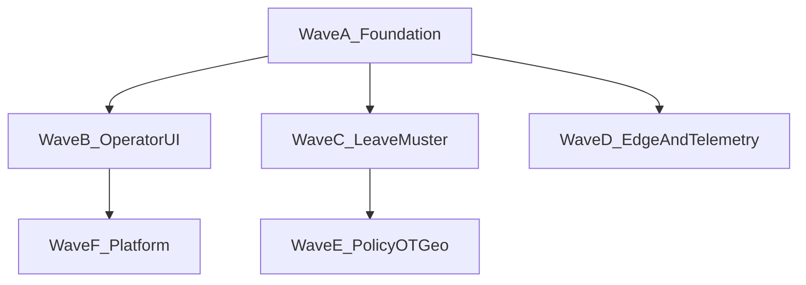

# Attendance MVP implementation plan

Engineering sequence only. Product truth stays in [`CONTEXT.md`](../../CONTEXT.md). Payroll, payslips, and statutory wage math stay in V2. This plan does not confirm any `OPEN` decision.

`main` already contains IAM, org, employees, shifts, roster, punch ingest, and the attendance engine, including the merged hardcore suite (`#30`). The open product issues and the four gaps from the `main` audit land in the waves below. A later wave does not start until the previous wave's gate is green.

## Dependency order

## Wave A — this branch

Unblocks every later issue. No salary math.

| Item | Source | Delivered here |
| :--- | :--- | :--- |
| Explanation traces survive a daily-row delete | ATT-09 | `fk_attendance_trace_record` becomes `ON DELETE RESTRICT` |
| Ingest keeps the punch when rollup fails | ATT-10, NFR no punch drop | Failure row, not a swallowed exception |
| Shift-cutoff rollup | New M10 worker | Due-instance selection plus a tenant runner |
| Biometric consent ledger and PII unmask audit | SEC-01, SEC-03 | Append-only `consent_events` and `pii_access_audits` |
| Employee calendar and today's punches | New M15 | `GET /api/v1/ess/calendar` and `GET /api/v1/ess/today` |
| Missing-punch correction | [#26](https://github.com/lmsoftwaresolutions/apms/issues/26) | Request, approve, append a `REGULARIZATION` punch, recalc |
| Edge buffer | CAP-02 | SQLite queue with a 7-day retention sweep. Device TCP polling is Wave D |

Gate: new unit tests pass without Postgres. RLS, grant, and HTTP tests run in CI.

## Wave B — operator UI

Depends on Wave A APIs.

| Order | Issue | Depends on |
| :--- | :--- | :--- |
| 1 | [#33](https://github.com/lmsoftwaresolutions/apms/issues/33) AppShell | existing auth |
| 2 | [#34](https://github.com/lmsoftwaresolutions/apms/issues/34) Employee UI | Wave A unmask audit before any reveal action |
| 3 | [#35](https://github.com/lmsoftwaresolutions/apms/issues/35) Shift templates | M07 API on `main` |
| 4 | [#36](https://github.com/lmsoftwaresolutions/apms/issues/36) Roster calendar | M08 API on `main` |
| 5 | [#37](https://github.com/lmsoftwaresolutions/apms/issues/37) Punch stream | M09 API on `main` |
| 6 | [#38](https://github.com/lmsoftwaresolutions/apms/issues/38) Daily rollup and trace | M10 API on `main` |

## Wave C — leave and muster

Depends on Wave A attendance statuses.

| Order | Issue | Note |
| :--- | :--- | :--- |
| 1 | [#27](https://github.com/lmsoftwaresolutions/apms/issues/27) Leave ledger and holidays | Append-only `leave_transactions`. Session half-day is ATT-06 |
| 2 | [#28](https://github.com/lmsoftwaresolutions/apms/issues/28) Muster | Consumes attendance and leave. No wage columns |

## Wave D — factory capture

| Order | Issue | Note |
| :--- | :--- | :--- |
| 1 | Edge Sync Agent daemon | Uses the Wave A buffer. Polls TCP 4370. Uploads through ingest. Templates stay on the device |
| 2 | [#29](https://github.com/lmsoftwaresolutions/apms/issues/29) Heartbeat monitor | Cloud side of the agent. Does not replace the daemon |

## Wave E — policy, overtime hours, geofence

| Order | Issue | Note |
| :--- | :--- | :--- |
| 1 | [#25](https://github.com/lmsoftwaresolutions/apms/issues/25) Policy master | Effective rules. OT multiplier stays a tenant policy value, not a code constant |
| 2 | [#31](https://github.com/lmsoftwaresolutions/apms/issues/31) OT approval and comp-off | Hours and approval only. Wage multiplication is V2 |
| 3 | [#32](https://github.com/lmsoftwaresolutions/apms/issues/32) Geofence | Emits a punch. Does not calculate attendance itself |

## Wave F — platform

Can run beside Wave B after Wave A. Does not block the paid day.

| Issue | Note |
| :--- | :--- |
| [#23](https://github.com/lmsoftwaresolutions/apms/issues/23) Tenant provisioning | Plans and lifecycle. Billing figures stay out of attendance math |
| [#24](https://github.com/lmsoftwaresolutions/apms/issues/24) Feature flags | Thin toggles. Do not block Waves B–D on a full flag product |

## Still out of this sequence

- V2 payroll, PF, ESI, PT, TDS, payslips, bank files.
- WhatsApp, SSO, and analytics beyond the muster.
- Student attendance, hospital 24/36 calendars, and field tracking until the plant muster path is in daily use.
- SEC-05 device-template deletion on exit, which belongs with the Wave D agent because the cloud does not store templates.
- Stale [#1](https://github.com/lmsoftwaresolutions/apms/issues/1) and [#7](https://github.com/lmsoftwaresolutions/apms/issues/7). Departments shipped in migration `004`.

## Invariants for every wave

1. Set `app.current_tenant_id` and keep fail-closed RLS on every new tenant table.
2. `raw_envelope`, `punch_event`, `consent_events`, `pii_access_audits`, and explanation traces are insert-only for `apms_app`.
3. Adapters and the edge agent emit punches. They do not pair or roll up.
4. A regularization approval appends a punch. It does not update an existing punch.
5. Statutory ceilings and OT wage multipliers are not hardcoded.
