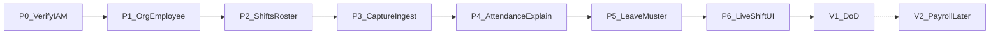

# V1 development plan

Planning only. Product truth stays in [`CONTEXT.md`](../../CONTEXT.md). This file sequences engineering work. Do not start a later phase until the previous phase gate is green.

**Horizon:** V1 explainable paid day and muster (`CONTEXT.md` §10). Payroll is V2. Internal name remains **APMS**. External framing stays in [`PRODUCT.md`](../../PRODUCT.md).

**First UI job:** a shift supervisor sees who is in and who is late on this shift, then corrects today's roster or punches.

**Code already present:** tenant IAM and branch CRUD (`backend/`, `frontend/`, `docker-compose.yml`). Treat it as P0 evidence, not as the finished product.

## Success

- RLS fail-closed between tenants.
- Every route checks a permission key (`ADR-31`).
- Append-only punches; attendance math never lives in adapters; payroll never mutates punches.
- Each daily result stores an explanation trace.
- Supervisor live board is the first product screen after the data exists.

## Phase sequence

| Phase | Outcome | Gate |
| :--- | :--- | :--- |
| P0 Verify | Compose, Postgres, RLS, and the branch/IAM matrix run | Two tenants cannot read each other; supervisor cannot delete a branch or edit roles |
| P1 Org and employee | Departments, employees, tenant display name and logo | `org.*` and `employee.*` keys enforced |
| P2 Shifts and roster | Dated shift instances and same-day N67 edits | Supervisor can fix today's roster |
| P3 Capture | Adapter SPI, append-only envelopes, CSV plus one OEM path | No punch dropped or rewritten |
| P4 Attendance | Pairing, N65/N66, traces, single-punch review | Recalc is deterministic and explained |
| P5 Leave and muster | Leave ledger and site muster export | Export has status, hours, overtime hours, reason; no salary math |
| P6 Live shift UI | Supervisor board: in, late, missing | Task finishes in under a minute on seeded data |
| V1 DoD | CONTEXT MVP list | RLS, no punch drops, deterministic recalc, trace per day, alternate punch path, consent/notice logged |

Each phase: confirm the spec links, implement, wire permission keys, test, then run locally. V2 payroll starts only after V1 DoD.

## Risks

| Risk | Mitigation |
| :--- | :--- |
| `schema.dbml` still has `user_role_enum` | Follow ADR-31; revise the draft schema in P0 notes, not by silent dual checks |
| V1 scope in CONTEXT is wide | Build order in `MODULE_BUILD_ORDER.md` is the engineering cut; do not start payroll |
| No Docker on some developer machines | P0 gate is "tests ran on Postgres", not "docs claim they ran" |
| Brand rename mid-build | Keep APMS in code until a trademark ADR |

## Open (do not mark CONFIRMED here)

- MFA timing (`SEC-04` is Should).
- Whether platform `SUPER_ADMIN` has a UI in V1 (seed and migrate stay operator-only until decided).
- Legal product name versus APMS.

## Links

- Architecture: [`SYSTEM_ARCHITECTURE.md`](SYSTEM_ARCHITECTURE.md)
- Access control: [`IAM_RBAC.md`](IAM_RBAC.md)
- Module order: [`MODULE_BUILD_ORDER.md`](MODULE_BUILD_ORDER.md)
- Diagrams: [`diagrams.md`](diagrams.md)
- Decision: [`ADR-31`](../decisions/adr/ADR-31-permission-keyed-rbac.md)
