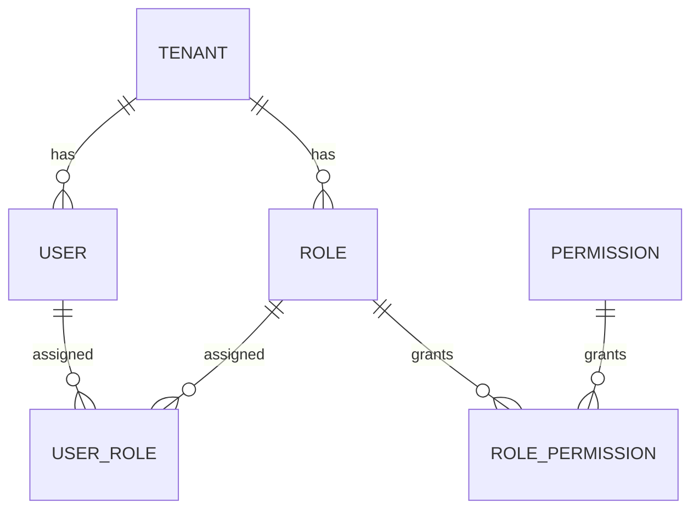

# Dynamic IAM and RBAC

Access control for V1. Decision record: [`ADR-31`](../decisions/adr/ADR-31-permission-keyed-rbac.md).

## Core Principles

- **Dynamic Roles**: Roles are fully dynamic and defined per-tenant. Tenant Admins can create custom roles with tailored permission bundles at any time without code changes or restarts.
- **Granular Permissions Vocabulary**: The platform defines an atomic permission vocabulary using `{module}.{resource}.{action}`. Actions are strictly `create`, `read`, `update`, `delete`.
- **Role as a Permission Bundle**: A role is a tenant-scoped collection of permission keys chosen from the platform catalog.
- **Multi-Role Union Evaluation**: A user may be assigned multiple roles (e.g. `SUPERVISOR` + custom `SHIFT_LEAD`). Effective user permissions are the mathematical union of all assigned role bundles.
- **Enforcement on Every Route**: Every API route enforces `require_permission` with the exact required key. Lacking a key results in a `403 Forbidden`.
- **RLS Boundary**: PostgreSQL Row-Level Security (`app.current_tenant_id`) guarantees that role definitions and assignments in Tenant A can never grant access to Tenant B.
- **System vs. Custom Roles**:
  - **System Roles (`is_system = true`)**: Pre-seeded per tenant (`TENANT_ADMIN`, `SUPERVISOR`, `EMPLOYEE`). Protected against deletion.
  - **Custom Dynamic Roles (`is_system = false`)**: Created, modified, and deleted dynamically by Tenant Admins. Cannot be deleted while actively assigned to users.
- **Platform Superuser**: Migrations and system-level administration are out-of-band and not tenant roles in the tenant UI.

## Tenant Admin Role Management Workflow

Tenant Admins manage access through a dedicated **Roles & Permissions** console:
1. **Browse Permissions Vocabulary**: View the catalog of available permissions across modules (`org`, `employee`, `shift`, `roster`, `capture`, `attendance`, `leave`, `muster`), detailing their module, resource, action, and human-readable purpose.
2. **Create Custom Role**: Click **+ Add Custom Role**, specify a code and human-readable name/description, and select the specific permission keys granted.
3. **Edit / Fine-Tune Permissions**: Modify granted keys on custom roles or update role descriptions as operational needs change.
4. **Assign to Users**: Assign one or more roles to tenant users.
5. **Delete Custom Roles**: Delete retired custom roles once all user assignments are unlinked.

## Implemented API Endpoints

These exist in `backend/app/api/v1/endpoints/iam.py` and enforce idempotency:

| Method | Endpoint | Required Permission | Description |
| :--- | :--- | :--- | :--- |
| `GET` | `/api/v1/permissions` | `iam.role.read` | Browse platform permission vocabulary |
| `GET` | `/api/v1/roles` | `iam.role.read` | List tenant roles with granted permission keys |
| `POST` | `/api/v1/roles` | `iam.role.create` | Create a new dynamic custom role |
| `PATCH` | `/api/v1/roles/{role_id}` | `iam.role.update` | Rename a role or replace its permission keys |
| `DELETE` | `/api/v1/roles/{role_id}` | `iam.role.delete` | Delete a custom role (`is_system=false` only) |
| `POST` | `/api/v1/users/{user_id}/roles` | `iam.assignment.create` | Assign a role to a user |
| `DELETE` | `/api/v1/users/{user_id}/roles/{role_id}` | `iam.assignment.delete` | Remove a role from a user |

## Implemented keys

These exist in `backend/alembic/versions/001_iam_branches.py`.

| Key | Meaning |
| :--- | :--- |
| `iam.role.create` `read` `update` `delete` | Role records and their key sets |
| `iam.assignment.create` `read` `delete` | Attach or remove a role on a user |
| `org.branch.create` `read` `update` `delete` | Branches |
| `org.tenant.read` `update` | Tenant display name and logo |

## V1 catalog to add when the module ships

Seed the keys in the phase that adds the API. Do not check a key that has no route.

| Module | Resources | Phase |
| :--- | :--- | :--- |
| `org` | `department` | P1 |
| `employee` | `employee` | P1 |
| `shift` | `pattern`, `instance` | P2 |
| `roster` | `assignment`, `override` | P2 |
| `capture` | `device`, `punch` | P3 (`punch` create is adapter/ingest; human delete is forbidden) |
| `attendance` | `day`, `exception` | P4 |
| `leave` | `request`, `ledger` | P5 (`ledger` is read plus system postings, not free-form delete) |
| `muster` | `export` | P5 (`read` and `create` for an export run) |

`capture.punch` has no `update` or `delete` for application roles. Corrections append a new event and recalculate (`CONTEXT.md` invariants).

## Seed bundles

| Role code | V1 intent |
| :--- | :--- |
| `TENANT_ADMIN` | All keys granted for modules that are switched on |
| `SUPERVISOR` | Floor: `org.branch.read`, `org.branch.update`; later `shift.*` read, `roster` read/update, `attendance.day.read`, `attendance.exception.update`, `muster.export.read`. No IAM delete. No payroll |
| `EMPLOYEE` | Self read stubs when ESS exists. Today: `org.branch.read` only |

Current seed matches the implemented keys only (`backend/app/seed.py`).

## Data model

`permissions` is a platform catalog (no tenant id, app role is SELECT only). `roles`, `user_roles`, and `role_permissions` are tenant-scoped and under RLS.
