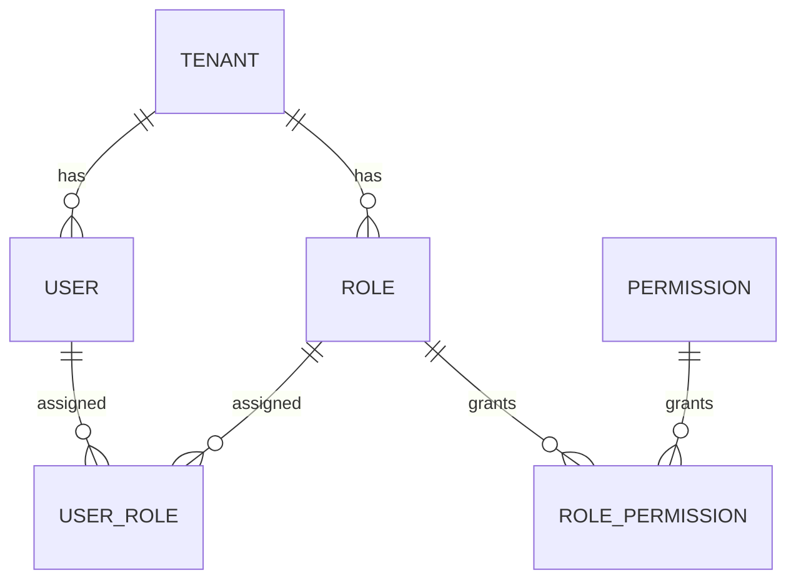

# IAM and RBAC

Access control for V1. Decision record: [`ADR-31`](../decisions/adr/ADR-31-permission-keyed-rbac.md).

## Rules

- Key grammar: `{module}.{resource}.{action}`.
- Actions: `create`, `read`, `update`, `delete` only.
- A role is a named bundle of keys, scoped to one tenant.
- The caller's grants are the union of assigned roles.
- Every route calls `require_permission` with the exact key. Missing key returns 403.
- The UI hides buttons the caller cannot use. Hiding is not the security check.
- RLS still filters rows. A grant in tenant A does not reveal tenant B.
- System roles (`TENANT_ADMIN`, `SUPERVISOR`, `EMPLOYEE`) can change their key set only through an explicit admin action. They cannot be deleted while marked system.
- Platform superuser work (migrations, seed) is not a tenant role in the V1 UI.

## Implemented keys

These exist in `backend/alembic/versions/001_iam_branches.py`.

| Key | Meaning |
| :--- | :--- |
| `iam.role.create` `read` `update` `delete` | Role records and their key sets |
| `iam.assignment.create` `read` `delete` | Attach or remove a role on a user |
| `org.branch.create` `read` `update` `delete` | Branches |
| `org.tenant.read` `update` | Tenant display name and logo |

## V1 catalog to add when the module ships

Seed the keys in the phase that adds the API. Do not check a key that has no route.

| Module | Resources | Phase |
| :--- | :--- | :--- |
| `org` | `department` | P1 |
| `employee` | `employee` | P1 |
| `shift` | `pattern`, `instance` | P2 |
| `roster` | `assignment`, `override` | P2 |
| `capture` | `device`, `punch` | P3 (`punch` create is adapter/ingest; human delete is forbidden) |
| `attendance` | `day`, `exception` | P4 |
| `leave` | `request`, `ledger` | P5 (`ledger` is read plus system postings, not free-form delete) |
| `muster` | `export` | P5 (`read` and `create` for an export run) |

`capture.punch` has no `update` or `delete` for application roles. Corrections append a new event and recalculate (`CONTEXT.md` invariants).

## Seed bundles

| Role code | V1 intent |
| :--- | :--- |
| `TENANT_ADMIN` | All keys granted for modules that are switched on |
| `SUPERVISOR` | Floor: `org.branch.read`, `org.branch.update`; later `shift.*` read, `roster` read/update, `attendance.day.read`, `attendance.exception.update`, `muster.export.read`. No IAM delete. No payroll |
| `EMPLOYEE` | Self read stubs when ESS exists. Today: `org.branch.read` only |

Current seed matches the implemented keys only (`backend/app/seed.py`).

## Data model

`permissions` is a platform catalog (no tenant id, app role is SELECT only). `roles`, `user_roles`, and `role_permissions` are tenant-scoped and under RLS.
