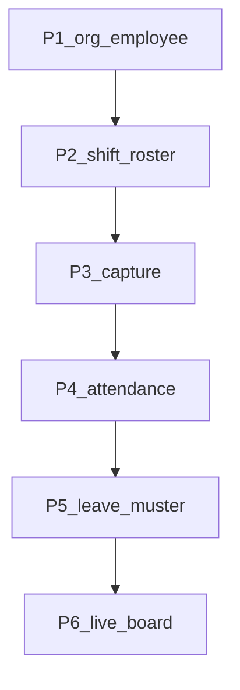

# Module build order

Maps CONTEXT modules M01–M21 onto the phases in [`DEVELOPMENT_PLAN.md`](DEVELOPMENT_PLAN.md). Permission modules follow [`IAM_RBAC.md`](IAM_RBAC.md).

## Supervisor day

## Phase map

| Phase | CONTEXT modules | Build | Permission module |
| :--- | :--- | :--- | :--- |
| P0 | M03 IAM (partial), M05 branch | Verify the existing slice | `iam`, `org.branch`, `org.tenant` |
| P1 | M01 tenant profile, M04 employee, M05 department | Master data the roster needs | `org`, `employee` |
| P2 | M07 shifts, M08 roster | Dated instances, N67 same-day change | `shift`, `roster` |
| P3 | M09 raw punch and adapters | CSV, then one biometric OEM, adapter SPI | `capture` |
| P4 | M10 attendance | Pairing, N65, N66, traces, Q4 review | `attendance` |
| P5 | M11 leave, M17 muster only | Ledger, sandwich, comp-off bank, muster export | `leave`, `muster` |
| P6 | Supervisor UI on M10 | Live in / late / missing | uses `attendance` and `roster` read keys |
| Later V1 depth | M19 mobile geo, M20 field, hospital and coaching calendars | After the plant muster path works | extend `capture` and `shift` |
| V2 | M12 OT pay, M13 allowances, M14 payroll | Not in this plan's build | none until a V2 plan |

## Explicitly not in the V1 build order

M15 ESS beyond stubs, M16 telemetry, M18 WhatsApp workflows, M21 lifecycle automation, H01–H10 HRMS, SSO, and salary math.

M02 feature flags and M06 policy engine stay thin until a phase needs a toggle or an effective-dated rule. Do not block P0–P3 on a full policy product.
