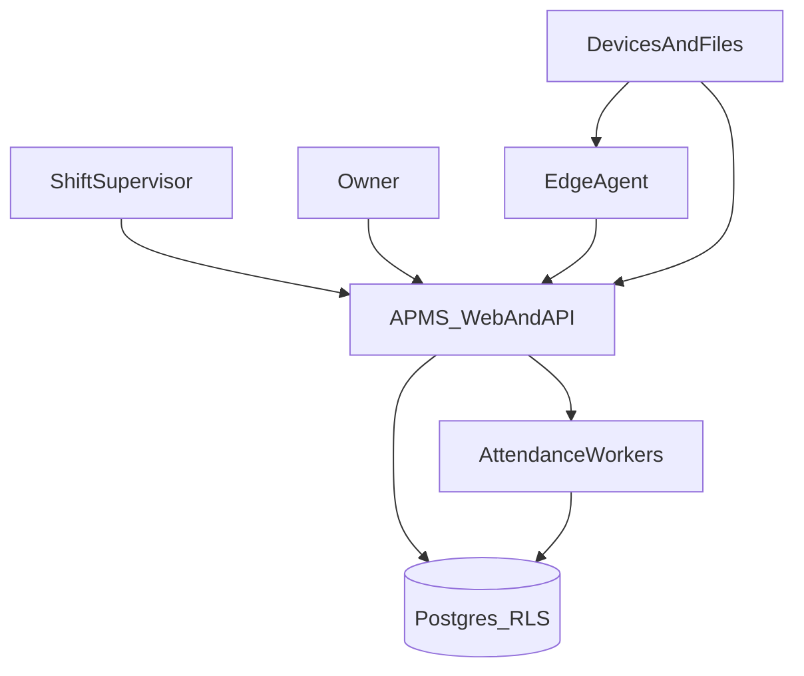
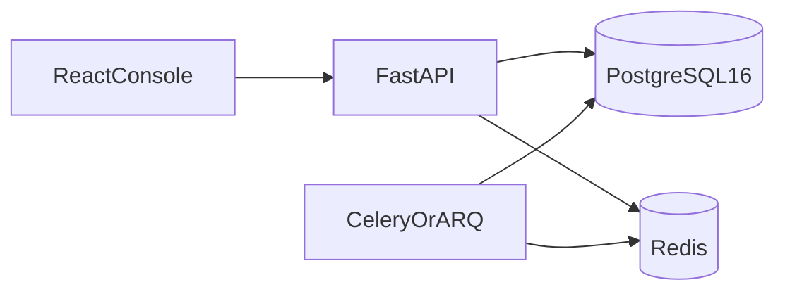
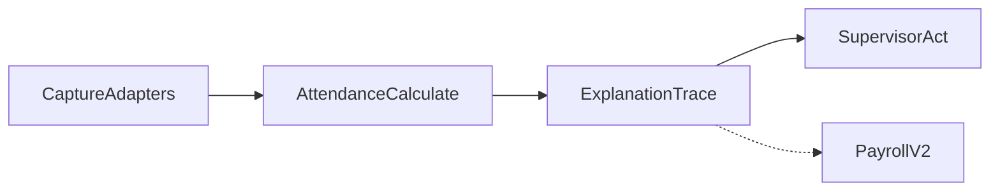
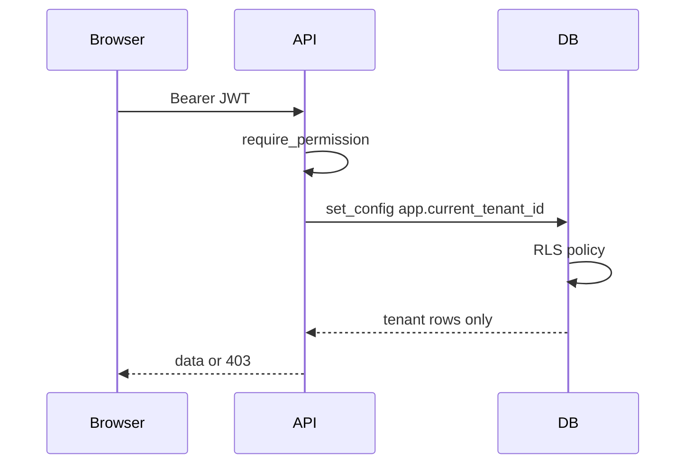

# System architecture

Engineering view of the V1 system. Product boundaries stay in [`CONTEXT.md`](../../CONTEXT.md) §2 and §3. Stack is the accepted set: Python 3.12 FastAPI, PostgreSQL 16 RLS, Redis, Celery or ARQ, React 18 TypeScript Vite, Edge agent, Docker Compose locally.

## System context

Supervisors and owners use the web app. Devices and files enter through adapters. The edge agent buffers site devices. Workers compute attendance. Payroll workers are not in the V1 deploy.

## Containers

The API sets `app.current_tenant_id` from the JWT on every tenant session and connects as `apms_app` (`NOBYPASSRLS`). Migrations and seed use a superuser or `BYPASSRLS` role.

## Processors

Adapters emit canonical punches. Attendance calculates and writes an immutable trace. Supervisors act on exceptions. Payroll reads finalized attendance later and never updates punches (`ADR-07`).

## Request path

Login uses `iam_lookup_user` (security definer) so the lookup is not blocked by RLS before the tenant is known. After that, tenant tables are visible only for the JWT tenant.

## What is in the repo today

| Piece | State |
| :--- | :--- |
| IAM, roles, permissions, branches | Implemented |
| Departments, employees, shifts, punches, attendance, leave, muster | Specified, not built |
| Payroll | V2 |
