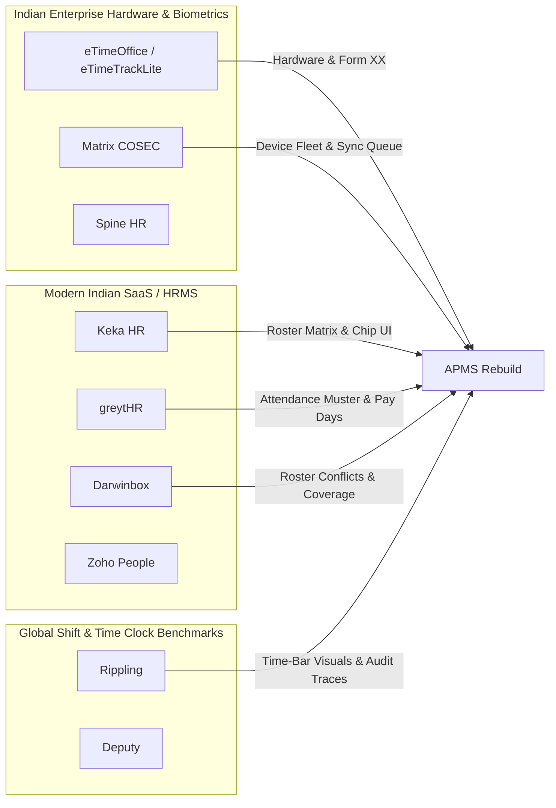

# Enterprise Attendance & Workforce Management UI Benchmarks
**Target System:** APMS Frontend (Modern India-First Multi-Tenant SaaS)  
**Document Purpose:** Comparative analysis and UI design patterns extracted from the leading Indian and global workforce, biometric attendance, and statutory payroll platforms: **Keka HR**, **greytHR**, **Matrix COSEC**, **Darwinbox**, **Zoho People**, and **Rippling / Deputy**.

---

## 1. Competitive Landscape Overview



| Product | Core Strength | Key UI Screen to Benchmark | Best-in-Class Feature |
| :--- | :--- | :--- | :--- |
| **Keka HR** | Best modern SaaS UX in India | Shift Board / Monthly Roster Grid | Color-coded shift chips, inline cell edits, coverage gap indicators |
| **greytHR** | India statutory compliance & payroll | Attendance Muster & Reports Gallery | Attendance status legend (`P`, `A`, `HD`, `WO`, `PH`), payable day tallies |
| **Matrix COSEC** | Enterprise biometric device integration | Device Fleet Dashboard & Terminal Logs | Real-time terminal health (online/offline), credential sync queue |
| **Darwinbox** | Enterprise manufacturing & shift scheduling | Shift Matrix & Rule Validation Engine | Live scheduling conflict warnings (consecutive night shifts, rest gaps) |
| **Zoho People** | Multi-channel punch ingest & tabular views | Tabular Check-in Logs & Shift Operations | Clean daily session breakdown, kiosk & GPS geo-fence status badges |
| **Rippling / Deputy** | Global modern time tracking & overtime | Visual Time-Card & Overtime Thresholds | Horizontal daily timeline bar showing In, Break, Out, and Overtime bands |

---

## 2. Deep-Dive on Top Platforms

### 1. Keka HR — Shift Board & Roster Matrix
* **Primary Route:** `Time & Attendance > Shift Board`
* **UI Layout Structure**:
  * **Top Filter Bar**: Business Unit, Branch, Department, Shift Policy, and Date Range.
  * **Header Toolbar**: "Bulk Assign", "Import Schedule (XLSX)", "Auto-Assign Rotation", "Legend Toggle".
  * **Interactive Matrix Grid**:
    * Pinned Left Columns: Employee Avatar, Full Name, Emp Code, Department.
    * Date Columns (1 to 31): Each cell displays a compact rounded pill:
      * `GS` (Teal) = General Shift `09:00 - 18:00`
      * `MS` (Blue) = Morning Shift `06:00 - 14:00`
      * `ES` (Amber) = Evening Shift `14:00 - 22:00`
      * `NS` (Purple) = Night Shift `22:00 - 06:00`
      * `WO` (Slate) = Weekly Off
      * `PH` (Gold) = Public Holiday
      * `L` (Rose) = On Approved Leave
  * **Inline Interactions**: Clicking any cell opens a lightweight popover showing:
    * Current shift name and working hours.
    * Fast switch options (e.g. swap to WO, change shift).
    * "Apply to rest of the week" toggle.
* **Why Keka Wins**: Clean micro-interactions, zero visual clutter, and instant color distinction between active shifts and off days.

---

### 2. greytHR — Attendance Muster & Statutory Workflows
* **Primary Route:** `Workforce Management > Attendance > Attendance Muster`
* **UI Layout Structure**:
  * **Muster Grid View**:
    * Clean tabular grid matching statutory payroll expectations in India.
    * Pinned Columns: `Employee ID`, `Employee Name`.
    * Calendar Day Columns: Single-letter status indicators:
      * `P` (Present), `A` (Absent), `HD` (Half-Day), `WO` (Weekly Off), `H` (Holiday), `SL` (Sick Leave), `CL` (Casual Leave), `EL` (Earned Leave).
    * Summary Columns on Far Right:
      * `Total Days` | `P` | `A` | `HD` | `WO` | `H` | `L` | `Paid Days` | `LOP Days`
  * **Swipe Details Drawer**:
    * Clicking any daily cell opens a right slide-over drawer showing the raw swipe logs from biometric hardware or mobile GPS punches, along with regularization actions.
* **Why greytHR Wins**: Clear mapping between daily attendance status and end-of-month payable days (`Payable Days = Present + Paid Leaves + Holidays + Weekly Offs - Deductions`).

---

### 3. Matrix COSEC — Biometric Fleet Management & Hardware Telemetry
* **Primary Route:** `System Administration > Device Configuration > Live Monitor`
* **UI Layout Structure**:
  * **Fleet Overview Banner**:
    * 4 Stat Cards: `Total Terminals`, `Online Terminals` (with pulsing green badge), `Offline Terminals` (with red badge), `Sync Command Queue Pending`.
  * **Terminal Monitor Table**:
    * Columns: `Device ID`, `Device Name`, `Model` (e.g., COSEC DOOR PVR, ARGO), `IP Address & Port`, `Location / Gate`, `Mode` (IN-only, OUT-only, Both), `Last Heartbeat`, `Firmware Version`, `Status`.
  * **Credential Sync Queue Modal**:
    * Displays user template distribution tasks (sending enrolled fingerprint/face templates to remote factory devices).
    * Status badges: `Queued`, `In-Transit`, `Acknowledged`, `Failed`.
* **Why Matrix Wins**: Mission-critical for multi-branch/multi-factory setups with dozens of physical biometric gates where hardware uptime directly impacts punch capture.

---

### 4. Darwinbox — Smart Shift Scheduling & Conflict Alerts
* **Primary Route:** `Workforce Scheduling > Roster Planner`
* **UI Layout Structure**:
  * **One-View Team Dashboard**:
    * Enables line managers and shift supervisors to forecast shift coverage before publishing.
  * **Inline Rule Breach Warnings (Amber / Red Badges)**:
    * **Rest Interval Breach**: Flags when an employee is scheduled for a morning shift (06:00) right after an evening/night shift (ending at 22:00) without the mandatory 11-hour rest window.
    * **Continuous Work Days**: Flags when an employee works >6 consecutive days without a weekly off (statutory Factories Act rule).
    * **Understaffing Alert**: Visual warning indicator below the date column if minimum required headcount for a shift is not met (e.g., "Night Shift requires 8 operators, currently 5").
* **Why Darwinbox Wins**: Prevents labor law violations and operational bottlenecks before rosters are locked.

---

### 5. Rippling & Deputy — Visual Time-Card & Overtime Bands
* **Primary Route:** `Time Tracking > Daily Time Cards`
* **UI Layout Structure**:
  * **Horizontal Timeline Bar (The "Visual Punch")**:
    * Instead of just displaying text numbers ("09:04 AM - 06:15 PM"), Rippling renders a proportional horizontal 24-hour visual bar:
      * **Green bar segment**: Regular worked hours.
      * **Striped gray segment**: Scheduled unpaid break (lunch).
      * **Purple segment**: Overtime duration (hours exceeding statutory 8.0/9.0 hrs).
      * **Red tick marks**: Late arrival or early departure markers relative to shift boundaries.
  * Hovering over the timeline bar surfaces exact punch timestamps and the device/method used.
* **Why Rippling Wins**: Makes attendance anomalies and overtime instantly scannable by HR without reading raw numerical timestamps.

---

## 3. High-Value UI Patterns for APMS Implementation

Based on this benchmark, here are 5 concrete UI patterns to adopt in our APMS frontend:

### Pattern 1: Roster Matrix Cell Design (`/roster`)
Adopt Keka's chip style with Darwinbox's conflict indicator:
```
+-----------------------------------------------------+
| [G] 09:00 - 18:00                             ⚠     |  <-- Amber warning icon if rule breach
| General Shift                                       |
+-----------------------------------------------------+
```
* Color tokens:
  * Regular Shift: `var(--color-primary-bg)` & `var(--color-primary-fg)`
  * Night Shift: `#f3e8ff` background & `#7e22ce` text
  * Weekly Off: `var(--bg-subtle)` & `var(--text-muted)`
  * Conflict warning: Tiny amber badge with tooltip explaining the violation.

---

### Pattern 2: Visual Day Timeline Strip (`/attendance`)
Adopt Rippling's horizontal time strip inside the Daily Attendance table and Employee Attendance cards:

```
[  Session 1 (09:00 - 13:00)  ] [ Gap / Lunch (13:00 - 14:00) ] [  Session 2 (14:00 - 18:00)  ] [ OT (18:00 - 19:15) ]
|=============================| . . . . . . . . . . . . . . . . |==============================|########################|
      4h 00m (Worked)                  1h 00m (N65 Excluded)                  4h 00m (Worked)               1h 15m (Overtime)
```
* **N65 Visual Benefit:** Clear distinction between scheduled worked sessions and excluded split-shift intervals.

---

### Pattern 3: Sticky 2-Column Header Table Architecture
For both the **Roster Matrix** (`/roster`) and the **Muster Roll** (`/muster`):
* Columns 1 and 2 (`Emp Code` and `Employee Name`) are sticky-pinned to the left (`position: sticky; left: 0; z-index: 10;`).
* A subtle drop shadow (`box-shadow: 2px 0 4px rgba(0,0,0,0.06);`) separates the pinned employee info from the horizontally scrollable 31-day calendar section.
* Prevents the user from losing context while scrolling to days 20–31.

---

### Pattern 4: Terminal Telemetry Strip (`/devices`)
Adopt Matrix COSEC's terminal status cards at the top of the Operations hub:
* **Online Status:** Green dot with subtle CSS pulse animation.
* **Backlog Pill:** Displays pending punches queued on edge agents awaiting sync.
* **Last Ping:** Relative timestamp with warning color if last heartbeat > 5 minutes ago.

---

### Pattern 5: One-Click Audit Explanation Trace Drawer
A distinguishing advantage of APMS over all legacy competitors:
* Next to any calculated day status (`PRESENT`, `HALF_DAY`, `ABSENT`), include a subtle `<Info size={14} />` icon.
* Clicking opens a slide-over drawer displaying:
  * Exact inputs (Shift window, In punch, Out punch, Grace band).
  * Arithmetic breakdown (Gross span, Gap exclusion, Net duration).
  * Matched policy rules.
  * Form XX payroll credit result (`1.0`, `0.5`, or `0.0` payable days).
