# eTimeOffice / eTimeTrackLite UI & Domain Reference Guide
**Target System:** APMS Frontend Rebuild (Module 0 & Beyond)  
**Document Purpose:** Architectural and UI benchmark capturing the screen layouts, workflows, information architecture, and data fields from eTimeOffice / eTimeTrackLite (the legacy standard for Indian biometric attendance systems) to guide APMS UI/UX development.

---

## 1. Executive Summary & Comparison

| Domain Area | Legacy eTimeOffice / eTimeTrackLite | APMS Modern Enterprise Architecture |
| :--- | :--- | :--- |
| **Tech Stack** | ASP.NET WebForms / Legacy MVC, jQuery, raw HTML tables | React 19, TypeScript, React Router, CSS Variables (Light/Dark tokens) |
| **Navigation** | Cluttered nested tree menus, slow full-page postbacks | Grouped collapsible sidebar (`AppShell`), client-side routing, instant tab switches |
| **Shift Math** | Opaque server-side calculations, frequent calculation discrepancies | Deterministic engine, N65 mid-session gap exclusion, immutable JSON explanation traces |
| **Leave System** | Mutable scalar balances (often drift on edits) | Double-entry append-only ledger (`leave_transactions`) |
| **Device Capture** | Tight coupling between hardware puller and attendance math | Vendor-agnostic push/pull adapters with append-only `raw_envelope` storage |
| **Statutory Compliance** | Hardcoded tax/PF limits, outdated Form XX tables | DB-parameterized slabs (EPF, ESI, PT), live compliant Form XX export |

---

## 2. Global Information Architecture & Navigation

The primary navigation hierarchy observed in enterprise attendance portals:

```mermaid
graph TD
    App[APMS Enterprise Portal]
    App --> Operations[1. Operations]
    App --> Scheduling[2. Scheduling]
    App --> Approvals[3. Approvals]
    App --> People[4. People & Org]
    App --> Devices[5. Device Fleet]
    App --> Admin[6. Administration]

    Operations --> Op_Live[Live Punch Log Stream]
    Operations --> Op_Daily[Daily Attendance Rollup]
    Operations --> Op_Muster[Form XX Muster Roll]
    Operations --> Op_Anomaly[Continuous Absentees / Anomalies]

    Scheduling --> Sch_Shifts[Shift Master & Schedulers]
    Scheduling --> Sch_Roster[Monthly Roster Matrix]
    Scheduling --> Sch_Policies[Attendance Policies & Penalty Slabs]

    Approvals --> App_Reg[Punch Regularization]
    Approvals --> App_Leave[Leave Applications]
    Approvals --> App_OT[Overtime Pre/Post Approval]

    People --> Peo_Emp[Employee Master Directory]
    People --> Peo_Branch[Branches & Locations]
    People --> Peo_Dept[Departments & Units]
    People --> Peo_Desig[Designations]

    Devices --> Dev_Status[Terminal Status & Heartbeats]
    Devices --> Dev_Queue[Sync Queue & Commands]

    Admin --> Adm_Roles[Roles & RBAC Matrix]
    Admin --> Adm_Users[System Users]
    Admin --> Adm_Audit[Immutable Audit Logs]
```



---

## 3. Screen Specifications & UI Component Breakdown

### Screen 1: Employee Master Directory (`/employees`)
The central hub for workforce identity, biometric mappings, and departmental placements.

* **Filter Bar**:
  * Branch selector (dropdown)
  * Department selector (cascading dropdown based on branch)
  * Designation selector (cascading dropdown based on department)
  * Employment Status filter: `All`, `Active`, `Probation`, `Notice Period`, `Resigned`
  * Full-text search (matches Employee Code, Full Name, Aadhaar/PAN, Biometric Device ID)
* **Table Columns**:
  1. `Emp Code` (monospaced badge, clickable to drawer)
  2. `Biometric ID / PIN` (device card/pin number)
  3. `Full Name` (avatar + name)
  4. `Branch / Dept` (sub-text layout)
  5. `Designation`
  6. `Default Shift` (e.g. `General (09:00 - 18:00)`)
  7. `Date of Joining (DOJ)`
  8. `Status` (`Active` [green badge] / `Inactive` [neutral badge])
  9. `Actions` (Edit modal, View Attendance, Assign Biometric)
* **Add / Edit Employee Modal Tabs**:
  * **Tab 1: Basic Info**: First Name, Last Name, Gender, Date of Birth, Blood Group, Mobile, Official Email, Personal Email.
  * **Tab 2: Organization**: Branch, Department, Designation, Reporting Manager, Date of Joining, Confirmation Date, Employment Type (`Full-time`, `Contractual`, `Apprentice`).
  * **Tab 3: Attendance & Shifts**: Assigned Shift Policy, Shift Rotation Pattern, Overtime Eligible (Toggle), Late-Mark Exempt (Toggle), Max OT limit per month.
  * **Tab 4: Statutory & Identity**: PAN, Aadhaar (Masked / Enveloped), UAN (PF), ESI IP Number, Bank Account Number & IFSC.
  * **Tab 5: Biometric Devices**: Assigned Device Groups, Enrolled Templates (Fingerprints count, Face enrolled indicator, RFID Card Number).

---

### Screen 2: Shift Master (`/shifts`)
Configures daily operating bands, grace durations, and split session gaps.

* **Shift List View**:
  * Columns: `Shift Code`, `Shift Name`, `Shift Type` (Standard, Split, Night, Rotational), `Timings`, `Grace In/Out`, `Total Hours`, `Status`, `Actions`.
* **Shift Configuration Form Fields**:
  * **Identification**: Shift Code (e.g., `S-GEN`), Shift Name (`General Shift`).
  * **Session 1 Timings**:
    * Shift Start Time (e.g., `09:00`)
    * Shift End Time (e.g., `18:00`)
    * Next Day Flag (checked for overnight shifts crossing midnight).
  * **Split Shift Parameters (N65 Gap Exclusion)**:
    * Is Split Shift? (Boolean toggle)
    * Session 1 End (e.g., `12:00`)
    * Session 2 Start (e.g., `16:00`)
    * Session 2 End (e.g., `20:00`)
    * *Rule Note:* The intermediate window (`12:00 - 16:00`) is strictly non-working; duration math must exclude this gap.
  * **Tolerance & Grace Thresholds**:
    * Late-in Grace: `15 mins` (punches up to 09:15 considered on time).
    * Early-exit Grace: `15 mins` (punches from 17:45 not flagged as early departure).
    * Min Work Hours for Half-Day: `4.0 hrs`.
    * Min Work Hours for Full-Day: `8.0 hrs`.
  * **Break / Lunch Window**:
    * Break Duration: `60 mins` (paid or deducted).
    * Auto-deduct break time flag.

---

### Screen 3: Monthly Roster Matrix (`/roster`)
A dense, high-performance horizontal spreadsheet matrix for assigning shifts across an entire department for a calendar month.

* **Top Toolbar**:
  * Month & Year Selector (e.g., `November 2026`)
  * Department filter
  * Bulk Assignment Action: "Apply Shift to Selection" (Opens modal: Date range + target shift + apply to filtered employees).
  * Quick Actions: "Auto-Fill Weekly Offs", "Export Excel Roster", "Publish Roster".
* **Interactive Matrix Layout**:
  * **Pinned Left Columns**:
    * `Emp Code` (pinned width: 100px)
    * `Name` (pinned width: 180px)
  * **Scrollable Horizontal Grid (Columns 1 to 28/29/30/31)**:
    * Header shows Day number + Day of week (`01 Mon`, `02 Tue`, ...).
    * Weekend columns (Saturdays/Sundays) highlighted with a subtle background tint (`--bg-subtle`).
    * Each cell contains a clickable Shift Chip:
      * `G` (Green) = General Shift (09:00 - 18:00)
      * `M` (Blue) = Morning Shift (06:00 - 14:00)
      * `E` (Orange) = Evening Shift (14:00 - 22:00)
      * `N` (Purple) = Night Shift (22:00 - 06:00)
      * `WO` (Gray) = Weekly Off
      * `PH` (Gold) = Public Holiday
  * Clicking a cell allows fast inline switching or dropdown selection.

---

### Screen 4: Live Punch Log Stream (`/punches`)
Real-time diagnostic feed of incoming punches ingested from biometric fingerprint/facial recognition terminals.

* **Stream Header**:
  * Live status indicator: `Ingest Engine: Healthy` (Punches/min counter).
  * Filter by Device Serial, Branch, Date Range, Direction (`IN`, `OUT`, `AUTO`).
* **Table Columns**:
  1. `Event Time` (Timestamp with seconds, e.g., `2026-11-24 09:04:12`)
  2. `Employee` (Code + Name)
  3. `Device Name / Serial` (e.g., `Main Gate Biomax #04`)
  4. `Reported Direction` (`IN`, `OUT`, or `UNSPECIFIED`)
  5. `Verification Mode` (Fingerprint, Facial Recognition, RFID Card, Mobile GPS)
  6. `Status` (`Processed`, `Debounced / Duplicate`, `Orphan / Unpaired`)
  7. `Raw Payload` (Clickable popover showing the immutable `raw_envelope` JSON)

---

### Screen 5: Daily Attendance Rollup (`/attendance`)
The primary operational daily ledger showing paired sessions, worked durations, and exceptions.

* **Filter Bar**:
  * Date picker (default today or yesterday)
  * Branch / Department / Category
  * Status Filter: `All`, `Present`, `Absent`, `Half Day`, `Late In`, `Early Out`, `Overtime`, `Missing Punch`
* **Table Columns**:
  1. `Emp Code & Name`
  2. `Shift Assigned` (e.g. `General [09:00 - 18:00]`)
  3. `First In Punch` (e.g. `09:08 AM`)
  4. `Last Out Punch` (e.g. `18:14 PM`)
  5. `Total Work Duration` (e.g. `8h 06m`)
  6. `Break Duration` (e.g. `1h 00m`)
  7. `Late Arrival` (e.g. `+8m` [within grace] or `+24m` [flagged red])
  8. `Early Departure` (e.g. `-15m` [amber])
  9. `Overtime Duration` (e.g. `0h 45m`)
  10. `Day Status` (`PRESENT` [green badge], `HALF_DAY` [amber badge], `ABSENT` [red badge])
  11. `Audit Trace` (Button opening the Explanation Trace Drawer)
* **Explanation Trace Drawer**:
  * Shows rule evaluation steps:
    1. Assigned shift policy bands.
    2. Punches detected and pairing logic.
    3. Grace period calculation.
    4. Multi-session gap deduction (N65).
    5. Final status rule trigger.

---

### Screen 6: Punch Regularization & Requests (`/requests`)
Workflow allowing employees or managers to correct missed or anomalous biometric punches.

* **Request Types**:
  * `Missed In-Punch`
  * `Missed Out-Punch`
  * `On Duty / Client Visit (OD)`
  * `Work From Home (WFH)`
* **Form Dialog Fields**:
  * Employee selector / logged-in user profile.
  * Target Date.
  * Requested Punch Time.
  * Direction (`IN` / `OUT`).
  * Reason Dropdown (`Device Not Responding`, `Power Outage`, `Field Work / Client Meeting`, `Forgot Badge`).
  * Remarks / Explanatory Text.
  * Supporting Document / File Upload (optional).
* **Manager Approval View**:
  * Side-by-side view showing:
    * Original punch log timeline for the date.
    * Requested adjustment.
    * Impact on calculated work duration and day status.
    * Action buttons: `Approve Request` / `Reject with Remarks`.

---

### Screen 7: Double-Entry Leave Ledger (`/leave`)
Clean leave management without mutable balance drift.

* **Employee View**:
  * Balances Card Grid:
    * `Casual Leave (CL)`: 3.5 Remaining (4.0 Accrued, 0.5 Used)
    * `Sick Leave (SL)`: 5.0 Remaining
    * `Earned / Privilege Leave (EL/PL)`: 12.0 Remaining
    * `Compensatory Off (Comp-Off)`: 1.0 Day
  * Action: `Apply Leave`
* **Leave Application Modal**:
  * Leave Type Dropdown
  * From Date & To Date
  * Session Option: `Full Day`, `First Half`, `Second Half`
  * Sandwich Rule Warning Banner: Live alert if intervening weekly offs/holidays are included in deduction per company policy.
  * Reason & Handover notes.
* **Leave Transactions Table (Double-Entry)**:
  * Columns: `Date`, `Transaction Ref`, `Leave Type`, `Debit/Credit`, `Amount (Days)`, `Running Balance`, `Reason / Note`, `Approved By`.

---

### Screen 8: Indian Statutory Form XX Muster Roll (`/muster`)
Statutory compliance report mandated under Factories Act / Shops and Establishments Act.

* **Header Controls**:
  * Factory / Establishment Name & Address.
  * Month / Year Selector.
  * Export Format: `Export Form XX (Excel)`, `Export PDF`, `Print View`.
* **Muster Table Structure**:
  * Pinned Columns: `Sl No.`, `Emp Code`, `Employee Name`, `Father/Spouse Name`, `Designation`, `Department`.
  * Columns 1 through 31: Daily status symbols (`P`, `A`, `HD`, `WO`, `PH`, `CL`, `SL`, `PL`).
  * Pinned Right Summary Columns:
    * `Total Working Days`
    * `Present Days (P)`
    * `Weekly Offs (WO)`
    * `Public Holidays (PH)`
    * `Paid Leaves (L)`
    * `Total Paid / Payable Days`
    * `Loss of Pay (LOP) Days`
    * `Total Overtime Hours`

---

### Screen 9: Biometric Device Fleet Manager (`/devices`)
Hardware monitoring for physical biometric devices (eSSL, Realtime, Biomax, Matrix).

* **Fleet Dashboard**:
  * Total Terminals (e.g. `14`), Online (`12`), Offline (`2`), Sync Queue Backlog (`0`).
* **Terminal Table Columns**:
  1. `Device Name` (e.g., `Spinning Mill Entry Gate`)
  2. `Device Model & Brand` (e.g., `eSSL SilkBio-101TC`, `Biomax N-K30`)
  3. `IP Address / Port / Serial Number`
  4. `Communication Mode` (`Push HTTP Webhook`, `Pull TCP/IP Socket`)
  5. `Connection Status` (`Online` [pulsing green dot], `Offline` [red badge])
  6. `Last Heartbeat Time` (Relative time, e.g., `2 mins ago`)
  7. `Pending Command Queue` (Count of employee cards/fingerprints awaiting sync)
  8. `Actions` (`Ping Test`, `Sync Clock`, `Push User Templates`, `Reboot`)

---

## 4. Standard Data Dictionary & Enums

### Attendance Day Status
```typescript
export type AttendanceDayStatus =
  | "PRESENT"
  | "HALF_DAY"
  | "ABSENT"
  | "WEEKLY_OFF"
  | "HOLIDAY"
  | "ON_DUTY"
  | "LEAVE";
```

### Punch Verification Mode
```typescript
export type PunchVerificationMode =
  | "FINGERPRINT"
  | "FACE"
  | "RFID_CARD"
  | "PIN"
  | "MOBILE_GPS"
  | "MANUAL_ENTRY";
```

### Shift Type
```typescript
export type ShiftType =
  | "REGULAR"       // Continuous single session
  | "SPLIT"         // N65 two sessions with gap exclusion
  | "NIGHT"         // Overnight crossing midnight
  | "ROTATIONAL";   // Automatic shift selection based on first punch
```

### Leave Transaction Type (Double-Entry Ledger)
```typescript
export type LeaveTransactionType =
  | "OPENING_BALANCE"
  | "MONTHLY_ACCRUAL"
  | "ANNUAL_GRANT"
  | "LEAVE_TAKEN"
  | "LEAVE_CANCELLED"
  | "LAPSED"
  | "ENCASHED"
  | "COMP_OFF_CREDIT";
```

---

## 5. UI Implementation Checklist for APMS Engineers

When developing frontend views in `frontend/src/modules/`:

1. **Table Density & Scrollbars**:
   * Muster rolls and Roster matrices require high density (`padding: 0.35rem 0.6rem`) with `overflow-x: auto` and sticky pinned columns for Employee Code and Name.
2. **Accessible Modals**:
   * Use `<Modal>` and `<ConfirmModal>` from `src/components/common/`. Never trigger raw window `confirm()` or `prompt()`.
3. **Status Badges**:
   * Map `PRESENT` / `Active` -> `<Badge variant="success">`
   * Map `HALF_DAY` / `Late` -> `<Badge variant="warning">`
   * Map `ABSENT` / `Inactive` -> `<Badge variant="danger">`
   * Map `WEEKLY_OFF` / `Holiday` -> `<Badge variant="neutral">`
   * Map `ON_DUTY` / `Info` -> `<Badge variant="info">`
4. **Idempotency**:
   * Include `Idempotency-Key` headers on destructive/creation requests (`api.ts`).
5. **No Direct Hardcoded Constants**:
   * Statutory caps (PF wage ceiling of ₹15,000, ESI threshold of ₹21,000) must never be hardcoded in frontend form calculations. Fetch them from statutory settings APIs.
6. **Explanation Traces**:
   * Daily attendance cards must always preserve a one-click action to view the immutable audit explanation trace JSON.
