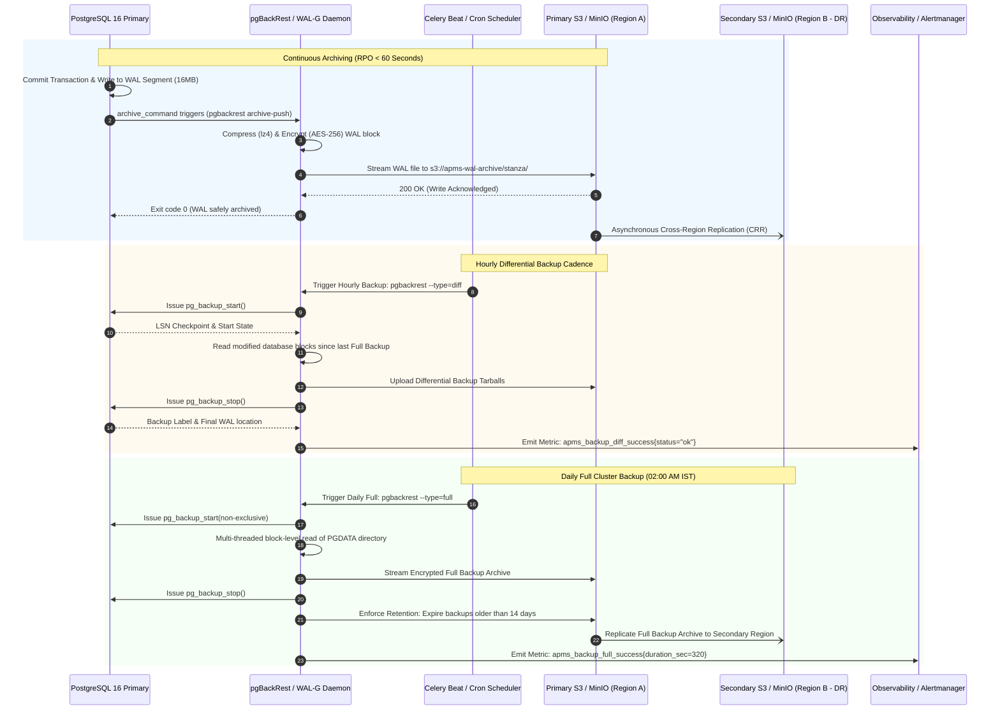
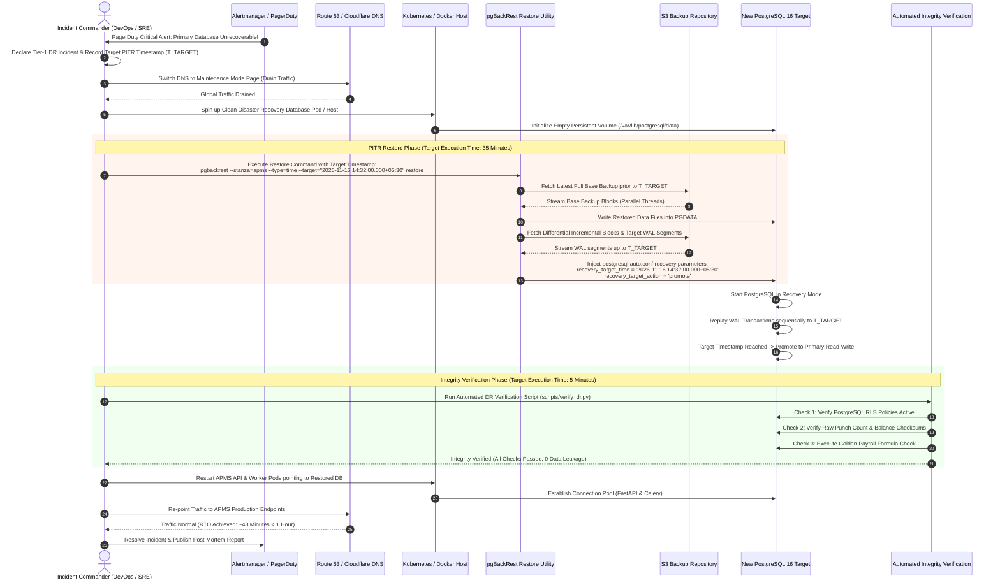

# APMS Backup Strategy, Disaster Recovery & Point-in-Time Recovery (PITR)

> **Status:** Authoritative | **Last Updated:** 2026-11-16 | **Source:** APMS Infrastructure & Operations Engineering

---

## 1. Executive Summary & Recovery Objectives

The **APMS (Automated Payroll & Attendance Management System)** stores mission-critical enterprise data: immutable raw biometric punches, daily attendance rollups, double-entry leave ledgers, and legally binding statutory payroll disbursements. 

Loss of attendance or payroll records directly disrupts employee compensation, triggers severe statutory non-compliance penalties under the EPF, ESI, and Income Tax Acts, and damages tenant trust. Therefore, APMS mandates a **continuous archiving and disaster recovery (DR) architecture** engineered around strict Recovery Point Objectives (RPO) and Recovery Time Objectives (RTO).

### 1.1 Core Recovery Invariants
- **Recovery Point Objective (RPO) < 15 Minutes**: Under any catastrophic failure (e.g. disk corruption, data center loss), maximum acceptable data loss cannot exceed 15 minutes. In steady-state operation, continuous PostgreSQL Write-Ahead Log (WAL) archiving limits data loss to **< 60 seconds**.
- **Recovery Time Objective (RTO) < 1 Hour**: The entire APMS platform—including database state, object storage, and API/worker services—must be fully restored and serving traffic within **60 minutes** of an incident declaration.
- **Continuous Cryptographic Archiving**: All database WAL files and base backups must be encrypted at rest (AES-256) and streamed off-site to durable, immutable object storage (AWS S3 or private MinIO with Object Lock).
- **Statutory 8-Year Archival Mandate**: Under Indian corporate and labor laws, completed payroll snapshots, muster rolls, and tax returns must remain retrievable for at least **8 financial years**.

---

## 2. Continuous Archiving & Backup Cadence Sequence Diagram

The following sequence diagram details the automated, tiered backup lifecycle: continuous PostgreSQL WAL streaming, hourly incremental/differential snapshots, daily full cluster backups, and MinIO object storage replication.



---

## 3. PostgreSQL Backup Architecture (pgBackRest & WAL-G)

APMS utilizes **pgBackRest** (Profile M / L) and **WAL-G** (Profile XS / S) as authoritative continuous archiving engines. Unlike traditional `pg_dump` logical backups, these tools perform block-level physical backups that support Point-in-Time Recovery (PITR) to exact microsecond timestamps.

### 3.1 PostgreSQL Engine Configuration (`postgresql.conf`)
To enable continuous WAL archiving, PostgreSQL is configured with dedicated archiving parameters:

```ini
# ==============================================================================
# APMS PostgreSQL Write-Ahead Logging & Archiving Configuration
# ==============================================================================
wal_level = replica
archive_mode = on
archive_command = 'pgbackrest --stanza=apms archive-push %p'
archive_timeout = 300            # Force WAL segment switch every 5 minutes if idle

# Checkpoints & IO Smoothing
checkpoint_completion_target = 0.9
checkpoint_timeout = 15min
max_wal_size = 16GB
min_wal_size = 2GB
wal_buffers = 16MB
```

### 3.2 pgBackRest Stanza Configuration (`pgbackrest.conf`)

```ini
[global]
repo1-type = s3
repo1-s3-endpoint = s3.ap-south-1.amazonaws.com
repo1-s3-bucket = apms-db-backups-ap-south-1
repo1-s3-region = ap-south-1
repo1-s3-key-type = auto
repo1-path = /pgbackrest
repo1-cipher-type = aes-256-cbc
repo1-cipher-pass = VerySecurePassphraseForBlockEncryption2026!
repo1-retention-full = 14
repo1-retention-diff = 30
process-max = 4
compress-type = lz4
compress-level = 3
start-fast = y
stop-auto = y

[apms]
pg1-path = /var/lib/postgresql/data
pg1-user = postgres
pg1-port = 5432
```

### 3.3 Backup Tiering & Retention Lifecycle
1. **Continuous WAL Logs**: Retained for **30 days** in hot S3 storage to allow PITR to any millisecond within the past month.
2. **Hourly Differential Backups**: Stored for **30 days** to accelerate restoration time by minimizing the number of WAL files to replay.
3. **Daily Full Backups**: Retained for **14 days** in standard S3 storage.
4. **Monthly Archival Backups**: Captured on the 1st of every month, moved to **AWS S3 Glacier Flexible Deep Archive**, and retained for **8 years** to satisfy Indian statutory compliance.

---

## 4. Object Storage Replication (MinIO / AWS S3)

In addition to the relational database, APMS stores critical unstructured artifacts in object storage:
- **`apms-payslips`**: Cryptographically signed employee PDF payslips (`pay_run_employee_snapshots.payslip_pdf_url`).
- **`apms-exports`**: Bank disbursement files (NEFT/RTGS formatted CSVs) and Tally XML vouchers.
- **`apms-audit`**: Immutable system audit exports and DPDP Act compliance bundles.

### 4.1 Cross-Region Replication (CRR) Configuration
For enterprise deployments, all primary S3 / MinIO buckets replicate asynchronously to an isolated secondary disaster recovery region:

```json
{
  "Role": "arn:aws:iam::123456789012:role/apms-s3-replication-role",
  "Rules": [
    {
      "ID": "ReplicatePayslipsAndExportsToDR",
      "Status": "Enabled",
      "Priority": 1,
      "Filter": {},
      "Destination": {
        "Bucket": "arn:aws:s3:::apms-storage-dr-ap-southeast-1",
        "ReplicationTime": {
          "Status": "Enabled",
          "Time": { "Minutes": 15 }
        },
        "Metrics": { "Status": "Enabled" },
        "EncryptionConfiguration": {
          "ReplicaKmsKeyID": "arn:aws:kms:ap-southeast-1:123456789012:key/dr-key-id"
        }
      },
      "SourceSelectionCriteria": {
        "SseKmsEncryptedObjects": { "Status": "Enabled" }
      }
    }
  ]
}
```

### 4.2 Object Lock & Write-Once-Read-Many (WORM) Compliance
To protect finalized payslips and audit trails against ransomware or malicious tampering:
- Buckets are configured with **S3 Object Lock in Compliance Mode**.
- Retention period: 8 years.
- Prevents deletion or modification of payslips even by AWS root account holders during the retention window.

---

## 5. Disaster Recovery Runbook & PITR Restore Sequence

The sequence diagram below illustrates the exact step-by-step restoration procedure when executing a **Point-in-Time Recovery (PITR)** following a catastrophic failure or accidental database corruption.



---

## 6. Concrete Point-in-Time Recovery (PITR) Commands

When executing PITR on a recovery server, the engineer executes the following shell sequence:

```bash
#!/usr/bin/env bash
# ==============================================================================
# APMS Point-in-Time Recovery (PITR) Execution Script
# ==============================================================================
set -euo pipefail

TARGET_TIMESTAMP="2026-11-16 14:32:00.000+05:30"
STANZA_NAME="apms"
PGDATA_DIR="/var/lib/postgresql/data"

echo "[1/5] Halting any running PostgreSQL instance..."
systemctl stop postgresql || true

echo "[2/5] Cleaning existing damaged data directory..."
rm -rf ${PGDATA_DIR:?}/*

echo "[3/5] Restoring base backup and configuring WAL replay to target timestamp..."
pgbackrest --stanza=${STANZA_NAME} \
           --type=time \
           --target="${TARGET_TIMESTAMP}" \
           --target-action=promote \
           --process-max=8 \
           --log-level-console=info \
           restore

echo "[4/5] Verifying permissions on restored PGDATA..."
chown -R postgres:postgres ${PGDATA_DIR}
chmod 700 ${PGDATA_DIR}

echo "[5/5] Starting restored PostgreSQL instance in recovery mode..."
systemctl start postgresql

echo "PostgreSQL is now replaying WAL segments up to ${TARGET_TIMESTAMP}."
echo "Monitor replay progress using: tail -f /var/log/postgresql/postgresql-16-main.log"
```

---

## 7. Catastrophic Failure Scenarios & Recovery Procedures

| Failure Scenario | Primary Impact | Recovery Strategy | Target RPO | Target RTO |
| :--- | :--- | :--- | :--- | :--- |
| **Scenario A: Primary Database Disk / Host Crash** | PostgreSQL primary becomes unresponsive; hardware failure. | **Profile M/L**: Automated Aurora Multi-AZ failover takes over within 30–60s.<br/>**Profile XS/S**: Mount EBS/SAN volume on standby host or restore latest differential snapshot via pgBackRest. | < 60 seconds | < 5 minutes (M/L)<br/>< 30 minutes (XS/S) |
| **Scenario B: Accidental Table Drop or Malicious Modification** | Relational records corrupted; RLS or punch tables altered. | Halt write traffic immediately; execute **Point-in-Time Recovery (PITR)** to timestamp $T - 1\text{ minute}$ prior to the destructive event. | < 1 minute | < 45 minutes |
| **Scenario C: Primary Cloud Region Total Outage** | Entire AWS `ap-south-1` region offline due to power/WAN loss. | Activate Disaster Recovery region (`ap-southeast-1`). Spin up Kubernetes cluster from Terraform/ArgoCD, restore database from cross-region replicated WALs/backups, repoint DNS. | < 15 minutes | < 60 minutes |
| **Scenario D: Object Storage Corruption (MinIO / S3)** | Payslip PDFs or bank export files deleted or encrypted by ransomware. | Revert S3 bucket objects to previous version via S3 Versioning or fetch replicas from WORM-protected secondary bucket. | 0 seconds (WORM) | < 15 minutes |

---

## 8. Disaster Recovery Drills & Audit Verification

To guarantee that disaster recovery runbooks remain operational and engineers are trained:

1. **Quarterly Automated DR Drills**:
   - Every quarter, an automated CI/CD job provisions an isolated sandbox environment.
   - Restores the production database to a timestamp 24 hours prior.
   - Executes the full verification suite (`verify_dr.py`) checking:
     - All 9 modules pass schema integrity.
     - Row-Level Security policies are active and functional on all tenant tables.
     - Raw biometric punch counts match production audit sums.
     - CA golden payroll tests yield ₹0.00 variance.
2. **Post-Drill Certification**:
   - A signed DR Drill Audit Report is generated and submitted to compliance officers to satisfy SOC 2 Type II and DPDP Act 2023 audit requirements.
