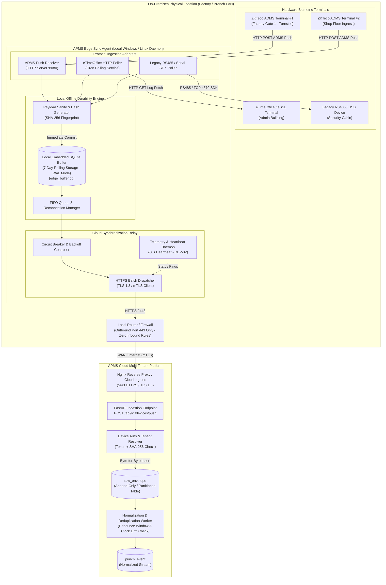
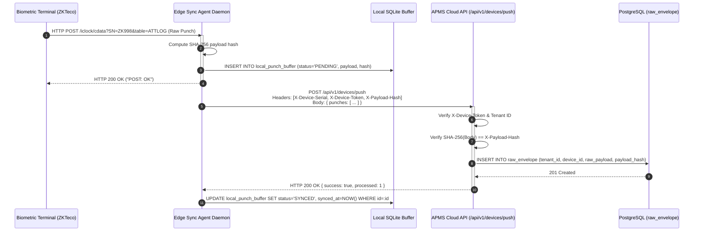
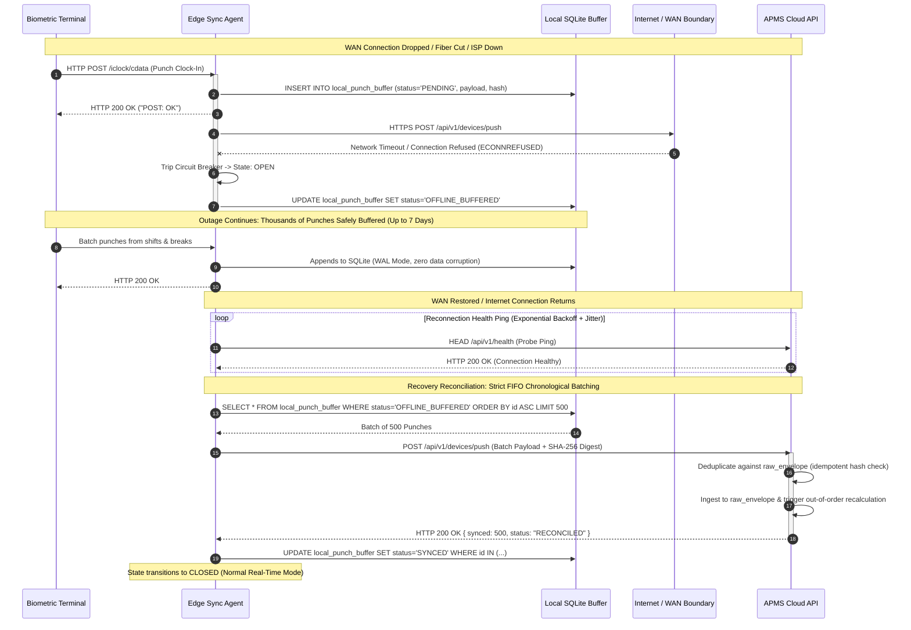

# APMS On-Premises Edge Sync Agent Specification

> **Status:** Authoritative | **Last Updated:** 2026-11-16 | **Source:** Extracted from APMS documentation

---

## 1. Executive Summary & Purpose

The **APMS On-Premises Edge Sync Agent** is an autonomous, lightweight daemon engineered for deployment on local networks at manufacturing plants, hospitals, warehouse facilities, remote branch offices, and construction sites.

Biometric hardware terminals frequently operate in environments characterized by intermittent or unreliable Internet connectivity, power instability, and legacy firmware protocols that lack native support for modern cloud security standards (TLS 1.3, JWT, HMAC signatures). 

The Edge Sync Agent bridges this divide by providing:
1. **Universal Protocol Adaptability**: Native termination of **ZKTeco ADMS push**, **eTimeOffice HTTP pull**, and local RS485/TCP polling.
2. **7-Day Air-Gapped Offline Resilience**: Zero punch loss during prolonged WAN outages via an embedded, high-performance SQLite FIFO buffer.
3. **Outbound-Only Cloud Connectivity**: No open inbound ports required on the customer firewall; pushes to APMS Cloud over HTTPS/TLS 1.3.
4. **Guaranteed Raw Immutability**: All hardware punch payloads are preserved byte-for-byte and relayed to `raw_envelope` with cryptographic SHA-256 signatures.

---

## 2. On-Premises Edge Deployment Architecture



---

## 3. Synchronization Flow & Offline Recovery Sequences

### 3.1 Normal Online Real-Time Synchronization Flow

Under healthy network conditions, punches are acknowledged locally and pushed to the cloud in sub-second latency:



---

### 3.2 Offline WAN Outage & Automatic Recovery Reconciliation

When WAN connectivity fails, the agent isolates the failure, buffers all events without terminal disruption, and recovers chronologically once connectivity returns:



---

## 4. Supported Biometric Hardware Protocols

### 4.1 ZKTeco ADMS (Automatic Data Master Server) Push Protocol
The ZKTeco ADMS protocol is an HTTP-based push protocol embedded in ZKTeco firmware:

1. **Heartbeat & Initialization Handshake**:
   - **Request**: `GET /iclock/cdata?SN={SERIAL_NUMBER}&options=all&pushver=2.4.1`
   - **Response**:
     ```text
     GET OPTION FROM: {SERIAL_NUMBER}
     Stamp=9999
     OpStamp=9999
     PhotoStamp=9999
     TransTimes=00:00;14:05
     TransInterval=1
     TransTables=User Transaction
     Realtime=1
     Encrypt=0
     ServerVersion=3.1.1
     ```
2. **Real-Time Punch Event Payload (`ATTLOG`)**:
   - **Request**: `POST /iclock/cdata?SN={SERIAL_NUMBER}&table=ATTLOG&Stamp={STAMP}`
   - **Payload Format (Tab-Separated Record Format)**:
     ```text
     10045	2026-11-16 08:58:24	1	1	0	0	0
     10082	2026-11-16 09:01:12	1	1	0	0	0
     ```
     *Fields: `[PIN / Badge] [Timestamp: YYYY-MM-DD HH:MM:SS] [Punch State: 0=Check-In, 1=Check-Out] [Verify Type: 1=Fingerprint, 15=Face] [Work Code] [Reserved] [Reserved]`*
   - **Response**: `OK` or `POST: OK\n`

### 4.2 eTimeOffice / eSSL HTTP Pull Protocol
For devices communicating through on-premises Web APIs or cloud pollers:
- **Polling Interval**: Configurable (Default: 30 seconds).
- **Endpoint**: `GET /api/public/v1/devices/{sn}/logs?since={last_log_id}`
- **Response Format**: JSON array parsed into raw string envelopes.
- **Cursor Tracking**: Local SQLite stores `high_water_mark_id` to guarantee zero skipped logs.

### 4.3 Legacy RS485 / Serial / Standalone SDK Poller
- Supports legacy terminals via Windows DLL (`zkemkeeper.dll`) or Linux CFFI socket client (`pyzk`).
- Interrogates terminals via TCP port 4370 at regular intervals:
  ```python
  zk.connect()
  zk.disable_device()
  logs = zk.get_attendance()
  zk.enable_device()
  ```

---

## 5. Offline Durability & Local Storage Architecture

### 5.1 Local SQLite Schema (`edge_buffer.db`)

The agent embeds a lightweight SQLite database engineered for zero maintenance:

```sql
CREATE TABLE local_punch_buffer (
    id INTEGER PRIMARY KEY AUTOINCREMENT,
    device_sn VARCHAR(64) NOT NULL,
    raw_payload TEXT NOT NULL,
    payload_hash VARCHAR(64) NOT NULL UNIQUE,
    event_time DATETIME NOT NULL,
    received_at DATETIME NOT NULL DEFAULT CURRENT_TIMESTAMP,
    sync_status VARCHAR(20) NOT NULL DEFAULT 'PENDING', -- PENDING, OFFLINE_BUFFERED, SYNCED, FAILED
    retry_count INTEGER NOT NULL DEFAULT 0,
    last_error TEXT,
    synced_at DATETIME,
    created_at DATETIME NOT NULL DEFAULT CURRENT_TIMESTAMP
);

CREATE INDEX idx_buffer_status_id ON local_punch_buffer(sync_status, id);
CREATE INDEX idx_buffer_event_time ON local_punch_buffer(event_time);
```

### 5.2 Storage Capacity & Sizing Analysis (7-Day Rolling Buffer)
- **Workforce Scenario**: Large manufacturing plant with 5,000 workers.
- **Punch Volume**: 4 punches per employee per day (In, Break Out, Break In, Out) = 20,000 punches/day.
- **7-Day Outage Footprint**: $20,000 \times 7 = 140,000 \text{ records}$.
- **Disk Utilization**:
  - Raw record size: ~200 bytes.
  - Total SQLite file size for 140,000 records + B-Tree indexes: **~35 MB**.
  - **Headroom**: A standard 16 GB flash storage provides over 3 years of buffer storage capacity.

### 5.3 Write-Ahead Logging (WAL) Configuration
To ensure zero database corruption during sudden factory power outages, SQLite is initialized with:
```sql
PRAGMA journal_mode = WAL;
PRAGMA synchronous = NORMAL;
PRAGMA cache_size = -64000; -- 64MB Cache
PRAGMA busy_timeout = 5000;
```

---

## 6. Resilience & Reconnect Strategy

When network failures occur, the Edge Agent avoids thundering-herd problems and API saturation using a deterministic state machine:

```mermaid
stateDiagram-v2
    [*] --> Closed_Online

    Closed_Online --> Open_Offline : HTTP Push Failure / Timeout (3 consecutive fails)
    Open_Offline --> Open_Offline : Buffer punches to SQLite; Increment retry count
    Open_Offline --> HalfOpen_Probe : Health probe succeeds after backoff window
    
    HalfOpen_Probe --> Open_Offline : Probe fails or batch rejected
    HalfOpen_Probe --> Flushing_Buffer : Batch of 500 accepted
    
    Flushing_Buffer --> Flushing_Buffer : Replaying FIFO chunks (500 records/sec)
    Flushing_Buffer --> Closed_Online : Buffer fully drained (pending_count == 0)
```



### 6.1 Exponential Backoff with Jitter Formulation
The wait interval between connection probes is calculated as:
$$T_{\text{wait}} = \min(T_{\text{max}}, T_{\text{base}} \times 2^{\text{retry}}) \pm \text{RandomJitter}$$
- $T_{\text{base}} = 5 \text{ seconds}$
- $T_{\text{max}} = 300 \text{ seconds}$ (5 minutes)
- $\text{Jitter} \in [0, 5] \text{ seconds}$

---

## 7. Security, Integrity & Immutability Standards

1. **Mutual TLS (mTLS) & TLS 1.3**:
   - All WAN communication enforces TLS 1.3 with pinned server certificates.
   - Optional client certificate authentication for high-security defense and banking tenants.

2. **Per-Device Provisioning & Secret Token**:
   - Each hardware terminal has a cryptographically random 256-bit token generated in the APMS Cloud console.
   - Injected in HTTP headers:
     - `X-Device-Serial: ZK-BLR-FAC1-09`
     - `X-Device-Token: tok_live_9f83ac04e28...`
     - `X-Payload-Hash: sha256_hex_digest`

3. **Raw Payload Immutability**:
   - The Edge Agent **never parses, modifies, rounds, or adjusts** timestamps or employee IDs.
   - Raw bytes received from the biometric device are transmitted byte-for-byte to the cloud `raw_envelope` table.

4. **Credential Protection at Rest**:
   - On Windows: API keys and database encryption keys are secured via Windows Data Protection API (DPAPI).
   - On Linux: Secured via Linux Keyutils / Kernel Keyring.

---

## 8. Telemetry & Heartbeat Specifications (`DEV-02`)

The Edge Agent transmits a telemetry heartbeat every 60 seconds to `POST /api/v1/devices/heartbeat`:

```json
{
  "device_serial": "ZK-BLR-FAC1-09",
  "agent_version": "2.4.0",
  "status": "HEALTHY",
  "clock_drift_seconds": 1.2,
  "system_metrics": {
    "cpu_percent": 3.4,
    "memory_mb": 42.1,
    "disk_free_mb": 14200
  },
  "buffer_metrics": {
    "total_buffered": 0,
    "synced_past_24h": 18450,
    "last_sync_timestamp": "2026-11-16T10:48:22Z"
  }
}
```
*If `clock_drift_seconds` exceeds $\pm 300\text{ seconds}$ (5 minutes), the APMS cloud raises an immediate high-priority maintenance ticket for NTP hardware re-synchronization.*
