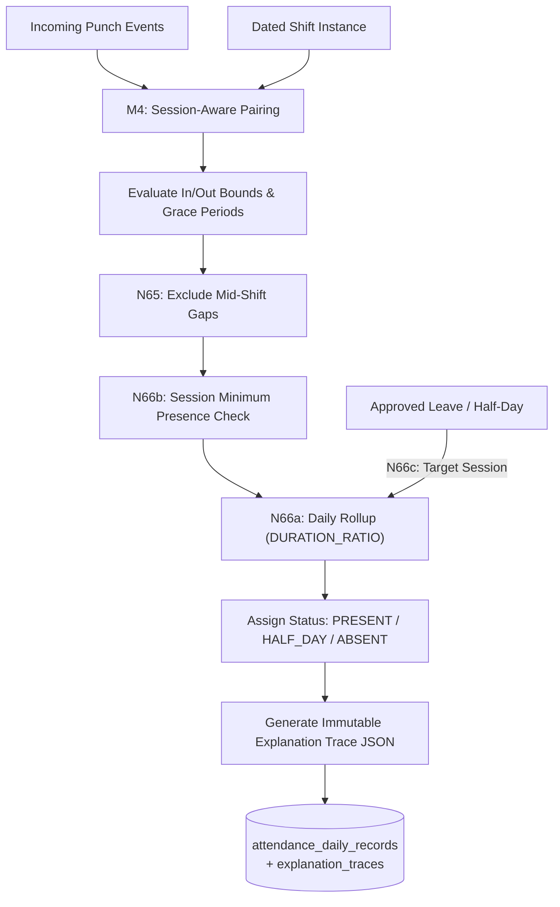

# Module Specification: Attendance & Pairing Engine (M4 & M5)

## 1. Module Overview & Scope

The Attendance Engine is responsible for ingesting normalized punch events, pairing them chronologically against active dated shift sessions, applying grace periods and break policies, and computing the daily attendance status (`PRESENT`, `HALF_DAY`, `ABSENT`, etc.) along with worked duration, late arrival, early departure, and overtime minutes.

Every calculation produces an immutable **Explanation Trace** detailing intermediate evaluations.

---

## 2. Applicable Requirements & Decisions

- **Requirements**: `ATT-01` through `ATT-18`, `PCH-01` through `PCH-06`, `OTC-01`, `OTC-02`.
- **Decisions**:
  - `N65`: Mid-shift gaps between scheduled sessions are strictly non-working time (`BR-ATT-02`).
  - `N66a`: Daily rollup defaults to `DURATION_RATIO` with configurable policy bands (`BR-ROL-01`, `BR-ROL-02`).
  - `N66b`: Session minimum-presence eligibility qualification separate from actual duration (`BR-ROL-03`).
  - `N66c`: Session-targeted half-day leave mapping (`BR-ROL-04`).
  - `N66d`: Employer-cancelled sessions marked `CANCELLED_PAID` for salaried staff (`BR-ROL-05`).
  - `Q4`: Single-punch anomalies default to `NEEDS_REVIEW` (`BR-ATT-04`).
  - `N20`: Overtime requires explicit supervisor approval (`BR-OTC-01`).

---

## 3. Pairing & Calculation Workflow



---

## 4. Mathematical Formulation

### 4.1 Session Worked Duration
For session $j$ with scheduled window $[T_{start, j}, T_{end, j}]$ and paired punches $P_{in, j}, P_{out, j}$:
$$\text{RawDuration}_j = P_{out, j} - P_{in, j}$$
$$\text{LateMinutes}_j = \max(0, P_{in, j} - (T_{start, j} + \text{GraceArrival}))$$
$$\text{EarlyExitMinutes}_j = \max(0, T_{end, j} - P_{out, j})$$
$$\text{WorkedDuration}_j = \text{RawDuration}_j - \text{IntraSessionDeductions}_j$$

### 4.2 Daily Rollup Coverage Ratio ($R$)
$$R = \frac{\sum_{j=1}^k \text{WorkedDuration}_j}{\sum_{j=1}^k \text{ScheduledDuration}_j}$$

Status Mapping:
$$\text{Status} = \begin{cases} 
\text{PRESENT} & \text{if } R \ge 0.90 \text{ and all sessions COMPLETED} \\
\text{HALF\_DAY} & \text{if } 0.50 \le R < 0.90 \text{ or exactly 1 session BELOW\_MIN in 2-session shift} \\
\text{ABSENT} & \text{if } R < 0.50 
\end{cases}$$

---

## 5. Explanation Trace JSON Schema

Every attendance record must store its trace payload in `attendance_explanation_traces.trace_payload`:

```json
{
  "version": "1.0",
  "employee_id": "018f3a5b-9a8c-7000-8b01-234567890abc",
  "attendance_date": "2026-11-13",
  "shift_instance_id": "018f3a5b-9a8c-7000-8b01-234567890def",
  "shift_type": "MULTI_SESSION",
  "sessions": [
    {
      "session_index": 1,
      "scheduled_in": "08:00:00",
      "scheduled_out": "12:00:00",
      "paired_in": "08:04:12",
      "paired_out": "12:01:05",
      "worked_minutes": 236,
      "scheduled_minutes": 240,
      "min_presence_required_minutes": 120,
      "eligibility": "COMPLETED"
    },
    {
      "session_index": 2,
      "scheduled_in": "16:00:00",
      "scheduled_out": "20:00:00",
      "paired_in": "16:00:00",
      "paired_out": "20:00:00",
      "worked_minutes": 240,
      "scheduled_minutes": 240,
      "min_presence_required_minutes": 120,
      "eligibility": "COMPLETED"
    }
  ],
  "gap_intervals": [
    {
      "start": "12:01:05",
      "end": "16:00:00",
      "duration_minutes": 238,
      "classification": "UNTRACKED_MID_SHIFT_GAP",
      "excluded_from_worked_duration": true
    }
  ],
  "rollup": {
    "mode": "DURATION_RATIO",
    "total_worked_minutes": 476,
    "total_scheduled_minutes": 480,
    "coverage_ratio": 0.9917,
    "assigned_status": "PRESENT",
    "credit": 1.0
  }
}
```

