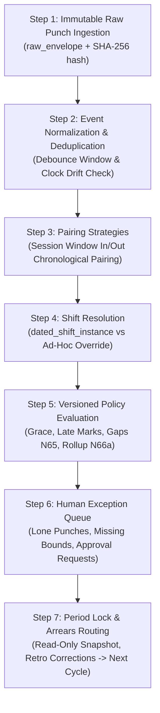

# Module Specification: Attendance & Pairing Engine (M09 & M10)

## 1. Module Overview & Scope

The Attendance Engine is the core computational heartbeat of APMS. It is responsible for ingesting normalized punch events, executing chronological session-aware pairing against active dated shift instances, enforcing grace arrival and break rules, evaluating multi-session gaps, computing daily rollup attendance statuses (`PRESENT`, `HALF_DAY`, `ABSENT`), handling multi-day hospital/manufacturing duties, and generating an immutable **Explanation Trace** for every calculation.

The engine operates on a strict **read-vs-write decoupling principle**: viewing attendance grids, running reports, or previewing pay runs never alters or mutates saved records.

---

## 2. Applicable Requirements & Decisions

- **Requirements**: `ATT-01` through `ATT-18`, `PCH-01` through `PCH-06`, `DEV-01` through `DEV-04`, `OTC-01`, `OTC-02`.
- **Decisions & Confirmed Invariants**:
  - `N65`: Mid-shift gaps between scheduled sessions are strictly non-working time (`BR-ATT-02`).
  - `N66a`: Daily rollup defaults to `DURATION_RATIO` with configurable policy bands (`BR-ROL-01`, `BR-ROL-02`).
  - `N66b`: Session minimum-presence eligibility qualification separate from actual duration (`BR-ROL-03`).
  - `N66c`: Session-targeted half-day leave mapping (`BR-ROL-04`).
  - `N66d`: Employer-cancelled sessions marked `CANCELLED_PAID` for salaried staff (`BR-ROL-05`).
  - `N67`: Ad-hoc same-day shift changes via supervisor override or employee request (`BR-ROL-06`).
  - `Q4`: Single-punch anomalies default to `NEEDS_REVIEW` with configurable tenant fallbacks (`BR-ATT-04`).
  - `Q5`: Multi-day continuous duties (>24h / 36h / 48h) attributed to the shift start calendar date (`BR-ATT-15`).
  - `N20`: Overtime requires explicit supervisor approval (`BR-OTC-01`).

---

## 3. The 7-Step Attendance Processing Pipeline

The attendance engine executes a deterministic 7-step pipeline from raw device signal to locked payroll input:



### Step 1: Immutable Raw Punch Ingestion
- Incoming punch payloads from hardware biometric terminals (Time Office, ZKTeco ADMS, eSSL), mobile apps, or CSV imports are recorded append-only in `raw_envelope`.
- Stores: `tenant_id`, `device_id`, `raw_payload`, `received_at`, and `payload_hash = sha256(tenant_id, device_id, raw_payload)`.
- Prohibits updates or deletions at the database schema level.

### Step 2: Event Normalization & Deduplication
- Normalizes raw payload into typed `punch_event` with UTC timestamp and tenant-local converted timestamp.
- **Idempotency Debounce**: Consecutive punches for the same employee within `debounce_seconds` (default: 60s) are flagged `DUPLICATE_IGNORED`.
- **Clock Drift Verification**: Compares device local punch timestamp against server `received_at`. If drift exceeds $\pm 5\text{ minutes}$, the punch is flagged `CLOCK_DRIFT_WARNING` and an alert is dispatched.

### Step 3: Pairing Strategies
- Matches punches against scheduled session windows of the resolved shift.
- Pairings are formed chronologically within the session ingestion window: $[T_{start, j} - W_{pre}, T_{end, j} + W_{post}]$.
- Resolves:
  - First punch in window $\longrightarrow$ Session IN.
  - Last punch in window $\longrightarrow$ Session OUT.
  - Intermediate punches $\longrightarrow$ Evaluated against intra-session break thresholds or recorded as informational.

### Step 4: Shift Resolution
- Evaluates the employee's active schedule for the target calendar date:
  1. Priority 1: Ad-hoc same-day supervisor override (`dated_shift_instance.override_flag = true`).
  2. Priority 2: Approved shift swap or employee request.
  3. Priority 3: Pre-materialized recurring roster pattern.
  4. Priority 4: Dynamic shift matching (for open/unassigned shifts, matching punches to the closest shift template with lowest arrival delta).

### Step 5: Versioned Policy Evaluation
- Applies the tenant's effective policy hierarchy (Org $\rightarrow$ Dept $\rightarrow$ Employee Exception).
- Evaluates:
  - Arrival grace period ($T_{start} + \text{GraceArrival}$).
  - Late arrival minutes and penalty counters (e.g., 3 late marks = 0.5 day deduction).
  - Early departure minutes.
  - **Multi-Session Gap Exclusion (N65)**: Intervals between scheduled sessions are strictly excluded from worked hours.
  - **Session Minimum Presence (N66b)**: Checks if session duration $\ge \mu \times \text{ScheduledDuration}$.
  - Daily Rollup Coverage Ratio ($R$) under `DURATION_RATIO` mode (N66a).

### Step 6: Human Exception Queue
- Records anomalies requiring human intervention into the Exception Queue:
  - `LONE_PUNCH_ANOMALY`: Missing IN or OUT punch.
  - `CLOCK_DRIFT_ANOMALY`: Hardware clock desynchronization.
  - `OVERLAPPING_SHIFT_ANOMALY`: Conflicting shift schedules.
  - `UNRESOLVED_OUT_OF_BOUNDS`: Punches outside any valid shift window.
- Employees can regularize exceptions via ESS; supervisors approve or modify with mandatory audit notes.

### Step 7: Period Lock & Arrears Routing
- At payroll freeze, attendance ledgers for the period are stamped `LOCKED`.
- Backdated regularizations or retrospective schedule alterations for locked periods **never alter historical ledgers**. Instead, they generate an **Arrears Adjustment entry in the next open pay cycle**.

---

## 4. Mathematical Formulation

### 4.1 Session Worked Duration
For session $j$ with scheduled window $[T_{start, j}, T_{end, j}]$ and paired punches $P_{in, j}, P_{out, j}$:
$$\text{RawDuration}_j = P_{out, j} - P_{in, j}$$
$$\text{LateMinutes}_j = \max(0, P_{in, j} - (T_{start, j} + \text{GraceArrival}))$$
$$\text{EarlyExitMinutes}_j = \max(0, T_{end, j} - P_{out, j})$$
$$\text{WorkedDuration}_j = \max(0, \text{RawDuration}_j - \text{IntraSessionBreaks}_j)$$

### 4.2 Daily Rollup Coverage Ratio ($R$)
$$R = \frac{\sum_{j=1}^k \text{WorkedDuration}_j}{\sum_{j=1}^k \text{ScheduledDuration}_j}$$

Status Mapping Bands (Configurable Tenant Policy):
$$\text{Status} = \begin{cases} 
\text{PRESENT} & \text{if } R \ge 0.90 \text{ and all sessions COMPLETED} \\
\text{HALF\_DAY} & \text{if } 0.50 \le R < 0.90 \text{ or exactly 1 session BELOW\_MIN in 2-session shift} \\
\text{ABSENT} & \text{if } R < 0.50 
\end{cases}$$

---

## 5. Edge Cases & Specialized Industry Handlers

### 5.1 Continuous Multi-Day Duty Engine (>24h / 36h / 48h)
- In hospitals (doctors on 36-hour emergency calls) and continuous manufacturing:
  - A shift window may span across 2 or 3 calendar dates (e.g., Start: Nov 13, 08:00 $\rightarrow$ End: Nov 14, 20:00 = 36 hours).
  - **Start Date Attribution**: The entire worked duration is anchored to the **shift start calendar date** (Nov 13).
  - The calendar date Nov 14 is marked `POST_DUTY_REST` (statutory rest period) with zero penalty.
  - Long-Duty Allowance is automatically triggered when continuous worked duration exceeds 16 hours.

### 5.2 Configurable Lone-Punch Policy
When only an IN or only an OUT punch exists:
- System tags the record with `LONE_PUNCH_ANOMALY`.
- Configurable tenant resolution strategies:
  1. *Review Mandatory (Default)*: Enqueued in HR exception queue. If unresolved at payroll close, falls back to Strategy 2 or 3.
  2. *Loss of Pay (Strict)*: Marked `ABSENT` (0 credit).
  3. *Floor Half-Day Credit (Lenient)*: Assigned `HALF_DAY` (0.5 credit) with late penalty flag.
- **Invariant**: A lone punch can **never** generate overtime hours or full-day worked credit.

### 5.3 Split WFH Sessions
- For knowledge workers or split telecommuting shifts:
  - System aggregates multiple punch pairs within the day.
  - Total pay is computed strictly based on cumulative validated minutes.
  - Phantom overtime is blocked by capping worked minutes at the scheduled shift maximum unless explicit overtime is pre-authorized.

### 5.4 Read-vs-Write Safety Invariant
- Opening attendance summary screens, generating muster rolls, or simulating payroll runs executes strictly in `SELECT` mode with zero side-effects.
- Calculation state is updated **only** when punch events arrive or an authorized user explicitly submits a regularization or reprocess command.

---

## 6. Device Telemetry & Sync Health

To avoid end-of-month payroll discovery of failed devices, APMS tracks device health continuously:
- **Periodic Heartbeat (`DEV-02`)**: Biometric terminals and Edge Agents transmit a heartbeat ping every 60 seconds.
- **Sync Queue Lag Monitoring**: Tracks the delta between device event time and cloud ingestion time. If lag $> 15\text{ minutes}$, an alert is flagged.
- **Clock Drift Detection**: System monitors discrepancy between device clock and NTP time. Discrepancy $> 5\text{ minutes}$ raises a high-priority maintenance ticket.

---

## 7. Explanation Trace JSON Schema

Every attendance record persists an immutable trace in `attendance_explanation_traces.trace_payload`:

```json
{
  "version": "2.0",
  "trace_id": "018f3a5b-9a8c-7000-8b01-234567890abc",
  "tenant_id": "018f3a5b-9a8c-7000-8b01-111111111111",
  "employee_id": "018f3a5b-9a8c-7000-8b01-222222222222",
  "attendance_date": "2026-11-13",
  "shift_instance_id": "018f3a5b-9a8c-7000-8b01-333333333333",
  "shift_type": "MULTI_SESSION",
  "is_multi_day": false,
  "sessions": [
    {
      "session_index": 1,
      "scheduled_in": "08:00:00",
      "scheduled_out": "12:00:00",
      "paired_in": "08:04:12",
      "paired_out": "12:01:05",
      "worked_minutes": 236,
      "scheduled_minutes": 240,
      "min_presence_required_minutes": 120,
      "eligibility": "COMPLETED",
      "late_minutes": 0,
      "early_exit_minutes": 0
    },
    {
      "session_index": 2,
      "scheduled_in": "16:00:00",
      "scheduled_out": "20:00:00",
      "paired_in": "16:00:00",
      "paired_out": "20:00:00",
      "worked_minutes": 240,
      "scheduled_minutes": 240,
      "min_presence_required_minutes": 120,
      "eligibility": "COMPLETED",
      "late_minutes": 0,
      "early_exit_minutes": 0
    }
  ],
  "gap_intervals": [
    {
      "start": "12:01:05",
      "end": "16:00:00",
      "duration_minutes": 238,
      "classification": "UNTRACKED_MID_SHIFT_GAP",
      "excluded_from_worked_duration": true
    }
  ],
  "anomalies": [],
  "rollup": {
    "mode": "DURATION_RATIO",
    "total_worked_minutes": 476,
    "total_scheduled_minutes": 480,
    "coverage_ratio": 0.9917,
    "assigned_status": "PRESENT",
    "credit": 1.0
  },
  "period_lock_status": "OPEN"
}
```
