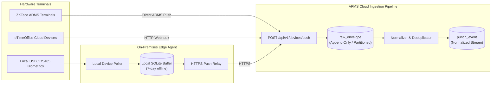

# Module Specification: Device Ingestion & Integrations (M2 & Integrations)

## 1. Module Overview & Scope

The Device Ingestion & Integrations Engine provides universal connectivity between physical biometric hardware terminals, edge devices, third-party ERPs, and the APMS cloud platform.

It is architected around a pluggable **Connector Service Provider Interface (SPI)**, an on-premises **Edge Sync Agent** for air-gapped or unreliable network factory sites, and an append-only raw ingestion pipeline with SHA-256 payload deduplication.

---

## 2. Applicable Requirements & Decisions

- **Requirements**: `DEV-01`, `DEV-02`, `PCH-01` through `PCH-06`, `INT-01` (Tally XML), `INT-02` (Webhooks).
- **Decisions**:
  - `ADR-05`: Append-only raw punch ingestion (`raw_envelope`).
  - `ADR-12`: Python/Rust on-premises Edge Sync Agent.
  - `ADR-28`: Declarative table partitioning on ingestion tables.

---

## 3. Pluggable Connector Architecture

---

## 4. Ingestion Specifications

### 4.1 Push Endpoint Protocol (`PCH-01`, `PCH-02`)
- **URL**: `POST /api/v1/devices/push`
- **Headers**:
  - `X-Device-Serial`: Hardware terminal serial number.
  - `X-Device-Token`: Secret authentication token provisioned during device registration.
  - `X-Payload-Hash`: SHA-256 signature of request body.
- **Processing**:
  1. Authenticate device and resolve `tenant_id`.
  2. Compute SHA-256 hash. If duplicate within 60s, return `200 OK` (idempotent ignore).
  3. Insert into `raw_envelope` partition.
  4. Parse payload into normalized `punch_event` records.
  5. Enqueue background pairing task.

### 4.2 Edge Sync Agent (`PCH-04`, `ADR-12`)
- Lightweight, self-contained service running on local Windows/Linux machines at branch/factory locations.
- Connects to local hardware SDKs (e.g. ZKTeco Standalone SDK, RS485/TCP polling).
- Buffers punches locally in an embedded SQLite database if the internet connection is disrupted.
- Automatically pushes buffered punches upon network restoration with exponential backoff and rate limiting.

### 4.3 Third-Party Integrations
- **Tally ERP/Prime XML Export (`INT-01`)**: Exports finalized payroll journal vouchers with debit to Salary Expense ledgers and credits to Bank, PF Payable, ESI Payable, and TDS Payable.
- **Outbound Webhooks (`INT-02`)**: Secure HMAC-SHA256 event notifications to external systems upon key operational events (`pay_run.locked`, `attendance.finalized`).

