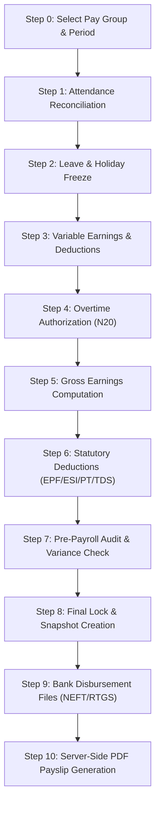

# Module Specification: Payroll & Statutory Engine (M7)

## 1. Module Overview & Scope

The Payroll & Statutory Engine manages the end-to-end execution of compensation calculations, statutory compliance deductions, and disbursement artifacts.

It is driven by a deterministic **Guided 10-Step Pay Run Wizard** with automated pre-run reconciliation, variance anomaly detection, immutable post-lock snapshots, and server-side cryptographic PDF payslip generation.

---

## 2. Applicable Requirements & Decisions

- **Requirements**: `PAY-01` through `PAY-05`, `STA-01` through `STA-05`, `PSL-01` through `PSL-03`.
- **Decisions**:
  - `ADR-07`: Attendance decoupled from payroll (attendance ledger is read-only input).
  - `ADR-09`: Guided 10-step pay run wizard.
  - `ADR-25`: Indian statutory packs governed by parameterized, versioned tables.
  - `ADR-26`: Server-side cryptographic PDF payslips.
  - `N20`: Overtime hours require explicit supervisor approval (`BR-OTC-01`).
  - `N18`: Pay cut-off cycles configured per Pay Group.

---

## 3. The Guided 10-Step Pay Run Wizard

The pay run operates as a strict finite-state machine. A step cannot proceed until all prerequisite reconciliations and validations pass.

### Step Details:
1. **Attendance Reconciliation**: Identifies un-finalized attendance records, un-regularized single punches (`Q4`), and missing dates.
2. **Leave & Holiday Freeze**: Evaluates sandwich rules, computes Loss of Pay (LOP) days, and freezes balances.
3. **Variable Earnings & Deductions**: Pulls ad-hoc bonuses, commissions, loan repayments, and salary advances.
4. **Overtime Authorization**: Pulls only manager-approved overtime hours (`N20`). Rejects unapproved hours.
5. **Gross Earnings Computation**: Applies salary structure formulas; pro-rates earnings for LOP days and mid-month joiners.
6. **Statutory Deductions**:
   - EPF: Computes employee 12% and employer splits against statutory ₹15,000 ceiling (`STA-01`).
   - ESI: Evaluates ₹21,000 gross ceiling, calculates employee 0.75% and employer 3.25% (`STA-02`).
   - PT: State slab lookup with February annual adjustments (`STA-03`).
   - TDS: Projected annual taxable income and tax deduction under Section 115BAC / Old Regime (`STA-04`).
7. **Pre-Payroll Audit**: Flags employees with net pay variation > 20% compared to prior month, negative net pay, or statutory limit anomalies.
8. **Final Lock & Snapshot Creation**: Transitions pay run state to `LOCKED`. Writes immutable rows to `pay_run_employee_snapshots`.
9. **Disbursement Files**: Exports bank-specific NEFT/RTGS CSV files.
10. **Payslip Publishing**: Generates password-protected PDF payslips and publishes to ESS portal.

---

## 4. Immutable Pay Run Snapshot Schema

Once Step 8 locks the pay run, calculations are frozen permanently:
- Complete breakdown of every earning and deduction component stored in JSONB.
- Master employee demographic snapshot (designation, bank account, PAN, EPF UAN) captured at run time.
- Statutory table versions recorded.
- Historical queries for past payslips read directly from the immutable snapshot, never re-running formulas.

