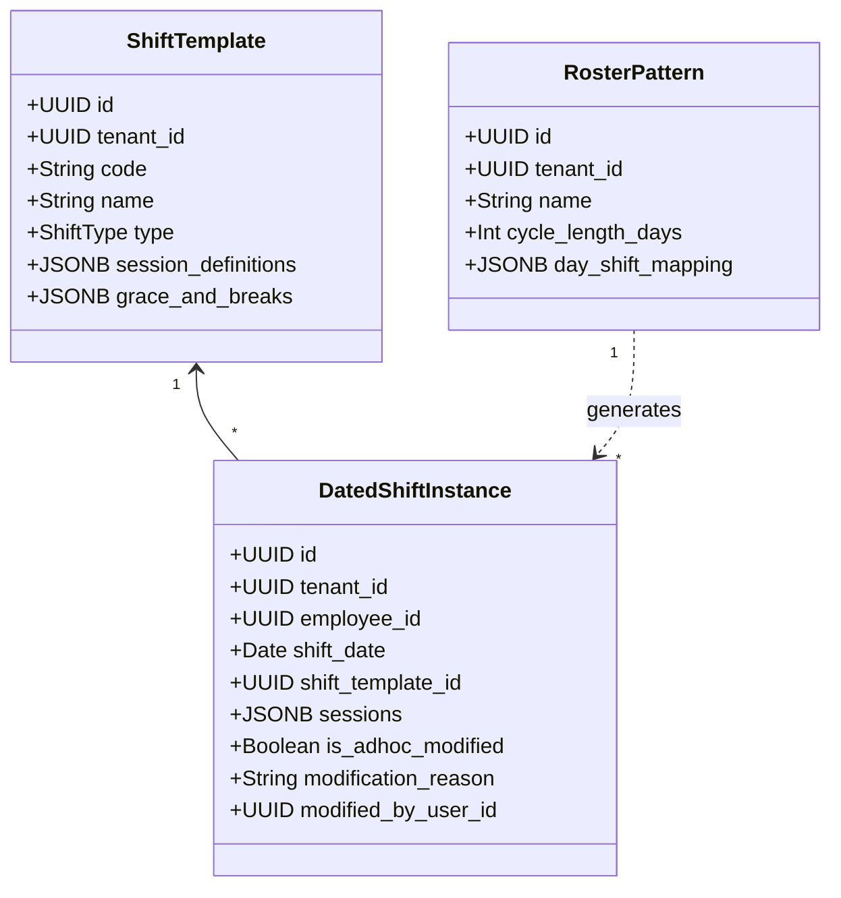

# Module Specification: Shifts & Rostering Engine (M3)

## 1. Module Overview & Scope

The Shifts & Rostering Engine manages the lifecycle of work schedules across the organization. It enables defining recurring shift templates, complex rotation patterns (e.g. 6-1, cyclical 3-shift rotations), and materializing them into concrete, immutable **Dated Shift Instances** (`dated_shift_instance`).

It handles the confirmed **N67 dual-path same-day schedule modifications**, ensuring that ad-hoc supervisor overrides and approved employee requests update the dated instance and trigger attendance recalculation without mutating master templates.

---

## 2. Applicable Requirements & Decisions

- **Requirements**: `SHF-01` (Fixed Shift), `SHF-02` (Overnight Shift), `SHF-03` (Multi-Session Shift), `SHF-04` (Flexible Window), `ROS-01` through `ROS-06`, `ROS-10`.
- **Decisions**:
  - `N67`: Dual-path ad-hoc same-day schedule modifications (`BR-ROL-06`).
  - `N66d`: Employer-cancelled sessions (`ROS-10`, `BR-ROL-05`).
  - `ADR-15`: Materialized dated shift instances.

---

## 3. Shift Data Architecture

---

## 4. Key Workflows & Invariants

### 4.1 Shift Instance Materialization (`ROS-03`)
- A background scheduler periodically materializes dated shift instances $N$ days in advance (default: 30 days).
- Shift instances copy session start/end definitions, grace thresholds, and break configurations from the active template at creation time.
- Future changes to a `ShiftTemplate` do not retroactively alter previously materialized instances.

### 4.2 Ad-Hoc Same-Day Modifications (`N67`, `BR-ROL-06`)
- **Direct Supervisor Override**:
  - Endpoint: `POST /api/v1/shifts/instances/{id}/override`
  - Requires supervisor role.
  - Updates `DatedShiftInstance` with new shift timings, sets `is_adhoc_modified = true`, and logs previous state.
- **Employee Request**:
  - Endpoint: `POST /api/v1/shifts/requests/adhoc-change`
  - Routes through approval workflow (`M9`). Upon supervisor approval, executes update.
- **Recalculation Trigger**:
  - In both paths, a `shift.modified` event is published to Redis.
  - The attendance engine immediately un-pairs existing punches for that employee/date and executes re-pairing against the modified shift instance.

