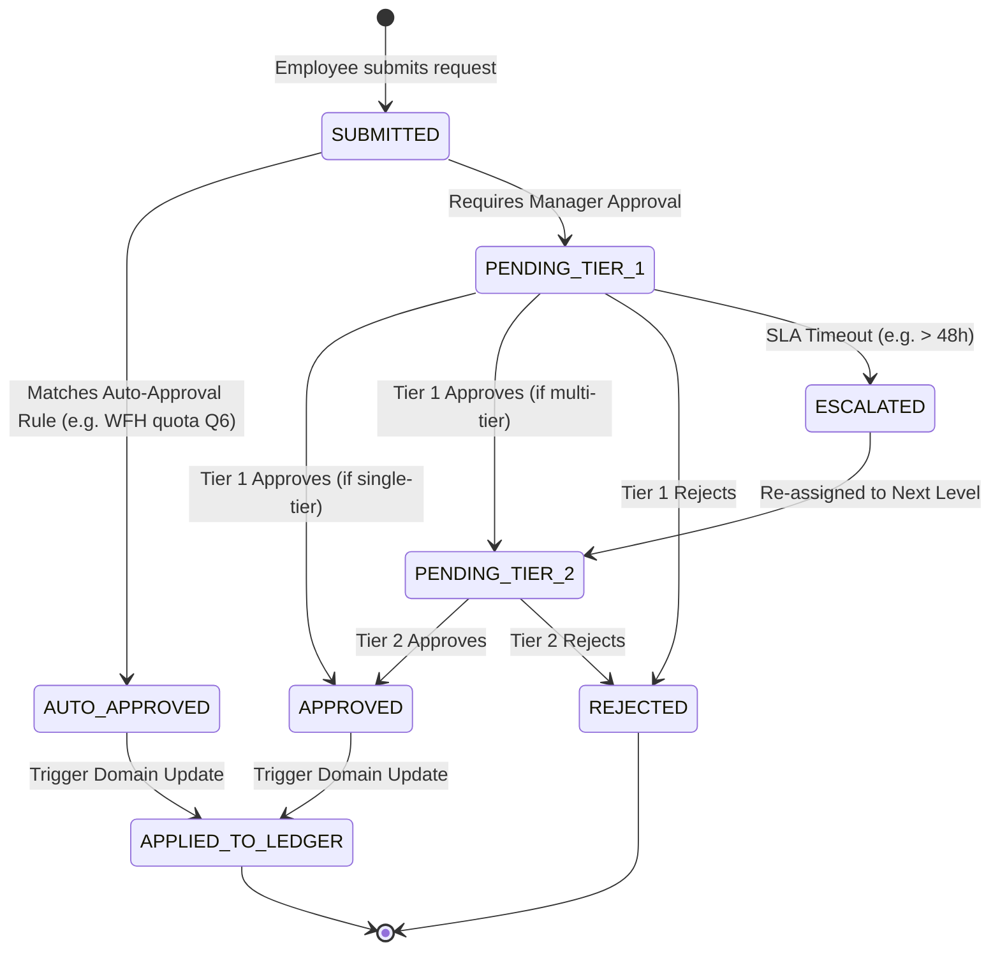

# Module Specification: Workflows & Approvals Engine (M9)

## 1. Module Overview & Scope

The Workflows & Approvals Engine is a shared platform service that orchestrates all employee self-service (ESS) and administrative requests requiring multi-step authorization.

It manages requests for:
- Leave applications
- Attendance regularizations (missed punches)
- Overtime pre/post authorizations (`N20`)
- Ad-hoc shift changes and peer shift swaps (`N67`)
- Work-from-home requests (`Q6`)

---

## 2. Applicable Requirements & Decisions

- **Requirements**: `WFL-01` (Configurable Approval Chains), `WFL-02` (Auto-Approval Rules), `WFL-03` (Delegation & Out-of-Office), `NTF-01` (Notifications).
- **Decisions**:
  - `ADR-23`: Auto-approval of WFH within configured monthly quota (`Q6`).
  - `ADR-24`: Approval-gated overtime hours (`N20`).
  - `ADR-21`: Approval workflow for employee-initiated ad-hoc shift modifications (`N67`).

---

## 3. Workflow State Machine

---

## 4. Key Engine Capabilities

### 4.1 Configurable Approval Chains (`WFL-01`)
- Workflows support 1 to $N$ approval tiers configured per Department, Branch, or Request Type.
- Approval actors can be dynamic:
  - `REPORTING_MANAGER`: Immediate direct supervisor from Employee Master.
  - `DEPARTMENT_HEAD`: Head of the employee's assigned department.
  - `HR_MANAGER`: Any user holding the `HR_PAYROLL` role.
  - `NAMED_USER`: Specific designated user.

### 4.2 Auto-Approval Engine (`WFL-02`, `Q6`)
- Evaluates deterministic policy expressions prior to routing to managers.
- Example: WFH requests evaluate `monthly_wfh_used + requested_days <= monthly_wfh_quota`. If true, status transitions immediately to `AUTO_APPROVED` with zero manager delay.

### 4.3 Delegation & Escalation (`WFL-03`)
- **Out-of-Office Delegation**: Managers can designate a temporary delegate for a specific date range. Active requests automatically route to the delegate.
- **SLA Escalation**: Configurable timeouts (e.g. 48 hours). If Tier 1 does not act within the SLA window, an automated background job escalates the request to Tier 2 with email notifications.

