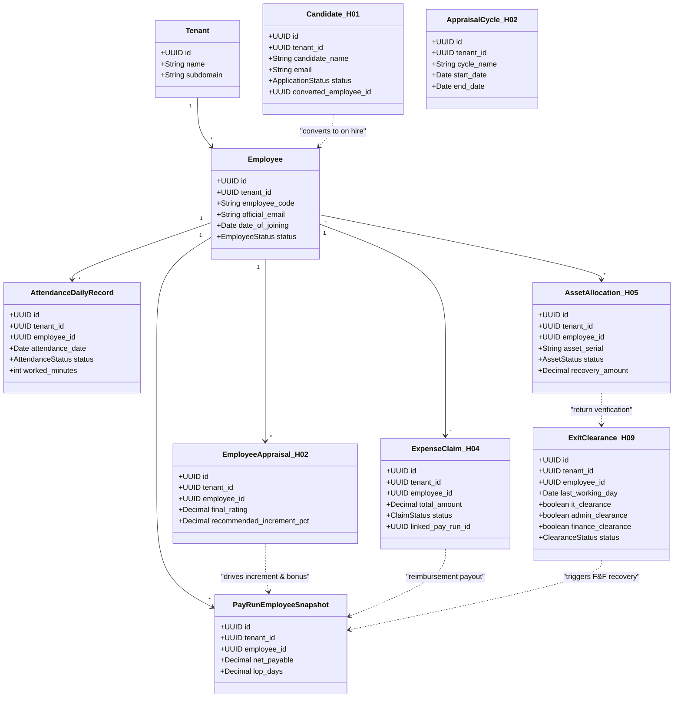

# APMS to Full HRMS: Strategic Extension Roadmap & Module Specifications

> **Document Status:** Strategic Architecture & Future Product Roadmap  
> **Target Version:** HRMS Horizon (Phased Post-APMS GA)  
> **Core Principle:** APMS is the authoritative Base Engine (Workforce Scheduling, Biometrics, Leave Ledgers, Statutory Payroll). The platform is architected to seamlessly expand into a full-suite Enterprise HRMS without disrupting core attendance or payroll invariants.

---

## 1. Executive Summary & Evolutionary Strategy

### 1.1 Two-Stage Product Evolution
```
┌────────────────────────────────────────────────────────────────────────┐
│                      STAGE 1: BASE PLATFORM (APMS)                     │
│               Workforce Scheduling · Biometrics · Payroll              │
├────────────────────────────────────────────────────────────────────────┤
│ • Industrial-strength Shift Rostering (M05, M06)                       │
│ • Hardware Ingestion & Biometric Pairing Engine (M07, M08)             │
│ • Deterministic Daily Attendance Ledger & N65 Gap Exclusion (M09)      │
│ • Double-Entry Leave Ledger & Sandwich Rule (M11)                      │
│ • 10-Step Statutory Payroll Engine: EPF, ESI, PT, TDS (M15, M16)       │
│ • Row-Level Security, AES-256 PII Encryption & Audit Traces            │
└───────────────────────────────────┬────────────────────────────────────┘
                                    │ Extends seamlessly via
                                    │ In-Process Modular Monolith
                                    ▼
┌────────────────────────────────────────────────────────────────────────┐
│                   STAGE 2: STRATEGIC EXTENSION (FULL HRMS)             │
│                 Hire-to-Retire Enterprise Employee Lifecycle           │
├────────────────────────────────────────────────────────────────────────┤
│ • H01: Applicant Tracking System (ATS) & Pre-Hire Onboarding           │
│ • H02: Performance Management System (PMS), OKRs & 360° Appraisals     │
│ • H03: Learning Management System (LMS) & Compliance Training (POSH)   │
│ • H04: Corporate Travel Desk & OCR Expense Reimbursements              │
│ • H05: IT & Physical Hardware Asset Lifecycle & F&F Recovery           │
│ • H06: Employee Engagement, Mood Bot & eNPS Pulse Surveys              │
│ • H07: HR Helpdesk Ticketing & POSH Act 2013 Grievance Redressal       │
│ • H08: Visitor & Gate Pass Management                                  │
│ • H09: Alumni Portal & Multi-Department "No-Due" Exit Clearance        │
│ • H10: Psychometric Candidate Testing & Cognitive Assessment           │
└────────────────────────────────────────────────────────────────────────┘
```

### 1.2 Architectural Invariants for HRMS Extension
To prevent HRMS extensions from compromising the rock-solid reliability of core attendance and payroll:
1. **Zero Impact on Raw Ingestion**: HRMS modules never write to `raw_envelope` or mutate `punch_events`.
2. **Attendance Decoupling Preserved**: Performance ratings, training certifications, and expense claims flow through their own domain boundaries and interact with payroll only via standard exported Service Interfaces (`SERVICE_INTERACTION_CONTRACTS.md`).
3. **Unified Multi-Tenancy & Security**: All HRMS extension tables strictly inherit `tenant_id`, PostgreSQL 16+ Row-Level Security (`ENABLE ROW LEVEL SECURITY`), composite foreign keys, and AES-256 PII encryption.
4. **Centralized WORM Audit Logging**: All HRMS state mutations (appraisal submissions, expense approvals, disciplinary grievances) automatically route through the centralized, tamper-evident `audit_logs` engine.

---

## 2. Granular Module Specifications (H01 – H10)

### H01: Applicant Tracking System (ATS) & Digital Onboarding
- **Competitor Benchmarks:** greytHR (Recruit), Keka (Hire), HROne, Zimyo, Darwinbox, Akrivia HCM, PeopleStrong.
- **Problem Statement:** APMS currently starts strictly post-hire at `M04: Employee Master`. Organizations are forced to manage recruitment via external spreadsheets, disjointed job boards, or expensive point solutions.
- **Functional Scope:**
  - **Job Requisitions:** Multi-level approval chains for new headcount or replacement hiring.
  - **Career Page & Job Board Syndication:** Automated posting to LinkedIn, Naukri, Indeed, and white-labeled tenant career portals.
  - **AI/Resume Parsing:** Extraction of skills, experience, and contact data into candidate profiles.
  - **Interview Management:** Round-robin interviewer scheduling, Google/Outlook calendar sync, structured scorecards, and rubric ratings.
  - **Digital Offer Letter Release:** Template-based offer generation with e-signature integration (Aadhaar eSign / DocuSign) and candidate pre-onboarding portal.
- **Base APMS Integration Touchpoint:**
  - **M04 (Employee Master):** Upon offer acceptance, the candidate record seamlessly converts into an active `employees` row, auto-populating personal details, documents, and emergency contacts with zero manual re-entry.
  - **M15 (Payroll):** Offer CTC breakdown automatically maps to `employee_salary_profiles` and statutory wage groups.

---

### H02: Performance Management System (PMS), OKRs & 360° Appraisals
- **Competitor Benchmarks:** Keka, HROne, factoHR (Ultimate), Zoho People, Darwinbox, Pocket HRMS (360°), ZingHR.
- **Problem Statement:** Base APMS only stores a basic salary revision effective date (`LFC-05`); it lacks appraisal cycles, goal tracking, and review workflows.
- **Functional Scope:**
  - **Goal Management:** Cascading Objective & Key Results (OKRs) and Key Result Areas (KRAs) with milestone progress tracking.
  - **Continuous Feedback:** Weekly/monthly 1-on-1 check-in notes between managers and direct reports.
  - **Multi-Rater 360° Reviews:** Peer, subordinate, supervisor, and self-evaluations with configurable anonymity controls.
  - **Calibration & Bell-Curve Normalization:** HR moderation dashboard with forced distribution curves and 9-Box talent matrix (Performance vs. Potential).
  - **Performance Improvement Plans (PIP):** Formal PIP tracking with check-in milestones, escalation alerts, and outcome logging.
- **Base APMS Integration Touchpoint:**
  - **M15 (Payroll Engine):** Finalized appraisal ratings directly compute annual increment percentages, performance bonuses, and variable pay.
  - **M15 (Arrears Engine):** Retroactive appraisal effective dates trigger automated arrears calculations in the next pay cycle (`PAYROLL_ARREARS_ENGINE.md`).

---

### H03: Learning Management System (LMS) & Compliance Training
- **Competitor Benchmarks:** Zimyo (₹40/u/mo), Zoho People, Darwinbox, Akrivia HCM, SAP SuccessFactors.
- **Problem Statement:** Modern enterprise compliance mandates annual employee training (POSH Act, Fire Safety, OSH). APMS currently has no course catalog or training records.
- **Functional Scope:**
  - **Course Management:** SCORM 1.2 / 2004 compliance course player, video modules, PDF reading materials, and evaluation quizzes.
  - **Statutory Compliance Tracking:** Automated mandatory enrollment for new hires in POSH (Prevention of Sexual Harassment), Industrial Safety, and Information Security.
  - **Certification & Expiry Alerts:** Digital completion certificate issuance with validity tracking and automated renewal reminders.
  - **Training Budgeting & Cost Centers:** Department-level training budget allocation and actual spend reconciliation.
- **Base APMS Integration Touchpoint:**
  - **M05/M06 (Shifts & Rostering):** Mandatory safety certification can act as an automated prerequisite gate, preventing assignment of uncertified staff to hazardous industrial shifts.

---

### H04: Expense Management & Corporate Travel Desk
- **Competitor Benchmarks:** greytHR (₹35/u/mo), Pocket HRMS, factoHR (Premium), Zimyo (Trip), Akrivia, Beehive.
- **Problem Statement:** APMS tracks field force duty travel routes (`M20`), but lacks corporate expense claim workflows, receipt OCR parsing, or per-diem management.
- **Functional Scope:**
  - **Multi-Category Expense Claims:** Travel, lodging, meals, client entertainment, phone/broadband, and fuel allowance.
  - **Receipt OCR & Mobile Upload:** Mobile camera receipt scanning with automated date, vendor, tax, and total amount extraction.
  - **Per-Diem Policy Engine:** Tier-based daily allowance policies (Metro vs. Non-Metro cities, Grade-based caps).
  - **Corporate Travel Desk:** Pre-travel authorization requests, ticket/hotel booking requisition, and advance cash disbursement.
  - **Mileage Calculator:** GPS route-based kilometer reimbursement for field sales and service staff.
- **Base APMS Integration Touchpoint:**
  - **M15 (Payroll Engine):** Approved non-taxable expense reimbursements automatically append as reimbursement line items in the monthly payslip, while travel cash advances settle against net salary.

---

### H05: IT & Physical Asset Lifecycle Management
- **Competitor Benchmarks:** HROne, Pocket HRMS, Rippling (IT hardware & auto-provisioning), Deel IT.
- **Problem Statement:** Base APMS does not track physical company property. Asset loss or unreturned laptops upon resignation result in financial leakage.
- **Functional Scope:**
  - **Asset Master Registry:** Laptops, desktop monitors, mobile phones, SIM cards, vehicles, security badges, and specialized tooling.
  - **Serial / IMEI & Barcode Tagging:** Tracking asset serial numbers, warranty expiry, MAC addresses, and vendor maintenance contracts.
  - **Allocation & Custodial Handover:** Digital acknowledgement of hardware receipt with policy sign-off by employees.
  - **Maintenance & Depreciation:** Repair ticketing, scheduled servicing, and asset book depreciation calculations.
- **Base APMS Integration Touchpoint:**
  - **H09 (Exit Clearance):** Asset return sign-off is a mandatory blocking gate before HR can execute separation.
  - **M15 (Payroll Full & Final):** Unreturned or damaged asset replacement costs are automatically deducted as recovery line items from the employee's Full & Final (F&F) salary settlement.

---

### H06: Employee Engagement, Mood Bot & eNPS Surveys
- **Competitor Benchmarks:** HROne (Mood Bot & budgets), greytHR (Gratitude Wall), factoHR (Surveys), Darwinbox.
- **Problem Statement:** Traditional attendance systems feel transactional. Organizations require sentiment monitoring and peer recognition to reduce voluntary attrition.
- **Functional Scope:**
  - **Clock-In Mood Bot:** 1-click sentiment check-in (😊 😐 😞) presented immediately upon morning biometric punch or ESS mobile app launch.
  - **Anonymous Pulse & eNPS Surveys:** Scheduled quarterly pulse surveys with automated sentiment clustering and manager heatmaps.
  - **Peer Recognition & Kudos Wall:** Employees award peer recognition badges with monthly allocated recognition point budgets.
  - **Reward Points Marketplace:** Conversion of kudos points into gift vouchers or company merchandise.
  - **Internal Social Broadcast:** Company-wide announcements, welcome posts for new hires, birthday/anniversary wishes.
- **Base APMS Integration Touchpoint:**
  - **M13/M14 (ESS & Mobile):** Embedded directly into the employee daily clock-in flow without introducing separate app logins.
  - **M15 (Payroll):** Taxable reward voucher redemptions automatically feed into payroll fringe benefit tax computation.

---

### H07: HR Helpdesk, Ticketing & POSH Act 2013 Grievance Redressal
- **Competitor Benchmarks:** Beehive (Grievance Matrix), Pocket HRMS (ePOSH), Zoho People (Cases), HROne (Helpdesk).
- **Problem Statement:** Employee payroll disputes, tax inquiries, and statutory grievances are handled via unstructured emails, leading to SLA breaches and compliance risks.
- **Functional Scope:**
  - **Categorized Employee Helpdesk:** Category ticketing (Payroll queries, PF/ESI issues, Leave discrepancies, IT support).
  - **SLA Escalation Matrix:** Multi-tier response and resolution SLAs with automatic escalation to department heads upon breach.
  - **POSH Act 2013 Confidential Grievance Module:**
    - Highly restricted, cryptographically sealed case logging for the Internal Complaints Committee (ICC).
    - Preserving complainant anonymity with end-to-end access audit logs.
    - Statutory 90-day inquiry timeline countdown and report generation complying with Indian POSH Act mandates.
- **Base APMS Integration Touchpoint:**
  - **M09/M15 (Attendance & Payroll):** Helpdesk tickets can directly link to the specific muster date or payslip snapshot in question, giving HR instant context.
  - **M10 (Workflow Engine):** Reuses the central SLA escalation timer and notification dispatchers.

---

### H08: Visitor & Gate Pass Management
- **Competitor Benchmarks:** Pulse HRM, Spine HRMS.
- **Problem Statement:** Manufacturing plants, hospital campuses, and corporate head offices need to track both external visitors and employee physical facility entry/exit.
- **Functional Scope:**
  - **Visitor Pre-Registration & Kiosk Check-In:** Host employee pre-invitation via link, generating visitor QR pass.
  - **Digital Badge & NDA Signing:** Camera selfie capture, thermal printing of visitor badges, and digital NDA acknowledgement.
  - **Host Notification:** Real-time push alert (WhatsApp / SMS / Teams) sent to host employee upon visitor arrival at reception.
  - **Vehicle Entry/Exit & Material Gate Pass:** Vehicle registration logging and material outward/inward returnable gate pass tracking.
- **Base APMS Integration Touchpoint:**
  - **M07 (Device & Ingestion Engine):** Operates on the same factory turnstiles and security barrier hardware, consolidating facility security into a unified access log.

---

### H09: Alumni Portal & Multi-Department "No-Due" Exit Clearance
- **Competitor Benchmarks:** greytHR (Alumni Portal ₹20/u/mo), HROne (Full & Final Exit Desk).
- **Problem Statement:** Employee offboarding involves manual sign-offs across IT, Admin, Finance, and HR, followed by post-termination requests for tax documents.
- **Functional Scope:**
  - **Resignation & Notice Period Tracking:** Employee resignation submission, manager counter-notice negotiation, and last working day (LWD) calculation.
  - **Multi-Department "No-Due" Clearance:** Parallel sign-off gates:
    - *IT Desk:* Hardware return verification, email/SSO account de-provisioning.
    - *Finance Desk:* Travel advance recovery, loan balance verification.
    - *Admin Desk:* Access card return, locker clearance.
    - *HR Desk:* Exit interview completion.
  - **Alumni Self-Service Portal:** Lifelong secure portal for ex-employees to download past Form 16s, digital payslips, experience letters, and PF transfer proofs without burdening HR staff.
- **Base APMS Integration Touchpoint:**
  - **M04 (Employee Master):** Automatically sets employee status to `SEPARATED` upon clearance completion.
  - **M05/M06 (Shifts & Roster):** Immediately purges employee from upcoming roster schedules.
  - **M11 (Leave Ledger):** Computes unutilized earned leave balance eligible for statutory leave encashment.
  - **M15 (Payroll Engine):** Triggers Full & Final (F&F) salary calculation, applying asset recoveries, notice pay recovery/shortfall, and gratuity payouts.

---

### H10: Psychometric Candidate Assessment & Pre-Employment Testing
- **Competitor Benchmarks:** HR Mantra, Mercer | Mettl.
- **Problem Statement:** Industrial and customer-facing roles require verified cognitive, behavioral, and safety aptitude evaluation prior to interview scheduling.
- **Functional Scope:**
  - **Standardized Assessment Battery:** Big Five personality tests, situational judgement tests (SJT), cognitive reasoning, and workplace safety compliance aptitude.
  - **Automated Anti-Cheating & Proctoring:** Web-camera proctoring, tab-switch monitoring, and randomized question banks.
  - **Candidate Fit Scoring:** Benchmark scoring against tenant-defined competency profiles with auto-shortlisting recommendations.
- **Base APMS Integration Touchpoint:**
  - **H01 (ATS):** Psychometric test links dispatch automatically upon candidate application; scores bind directly to the candidate scorecard for interview panels.

---

## 3. Modular Monolith Architecture & Schema Growth Strategy



---

## 4. Phased Implementation Horizon

| Horizon | Phase | Target Modules | Primary Focus |
|---|---|---|---|
| **Horizon 0** | **Base APMS (Active)** | `M01 – M21` | **Workforce Core**: Biometric Ingestion, Roster Instantiation, Daily Rollups, Double-Entry Leaves, Statutory Payroll (EPF/ESI/PT/TDS), RLS & Encryption. |
| **Horizon 1** | **Talent Acquisition & Offboarding** | `H01`, `H09`, `H05` | Complete the entry & exit gates: ATS candidate conversion to M04, Asset Allocation, and Exit No-Due clearance driving F&F payroll settlement. |
| **Horizon 2** | **Compensation & Daily Workplace** | `H04`, `H07`, `H08` | Corporate Travel Desk & Expense Claims (feeding M15), HR Helpdesk & POSH Grievances, Visitor Management on turnstiles. |
| **Horizon 3** | **Continuous Talent & Culture** | `H02`, `H03`, `H06`, `H10` | 360° PMS & OKRs, LMS & Mandatory Statutory Compliance Training, Employee Engagement Mood Bot, and Psychometric Testing. |

---

## 5. Architectural Guardrail Summary

1. **APMS Remains Autonomous**: The base APMS product operates with 100% functional completeness even if zero HRMS extension modules are enabled.
2. **Feature-Flag Isolation**: Every HRMS module is governed by Layer 1 Feature Flags (`M02`) and Layer 2 Tenant Policies (`M06`), ensuring lightweight deployments for clients purchasing attendance/payroll only.
3. **Paisa-Level Payroll Integrity**: HRMS modules may inject reimbursement additions or damage deductions into payroll only as explicit, immutable line items during Step 3 of the 10-step payroll wizard (`PAYROLL_CALCULATION_PIPELINE.md`), preserving exact statutory calculations down to ±₹0.00.
