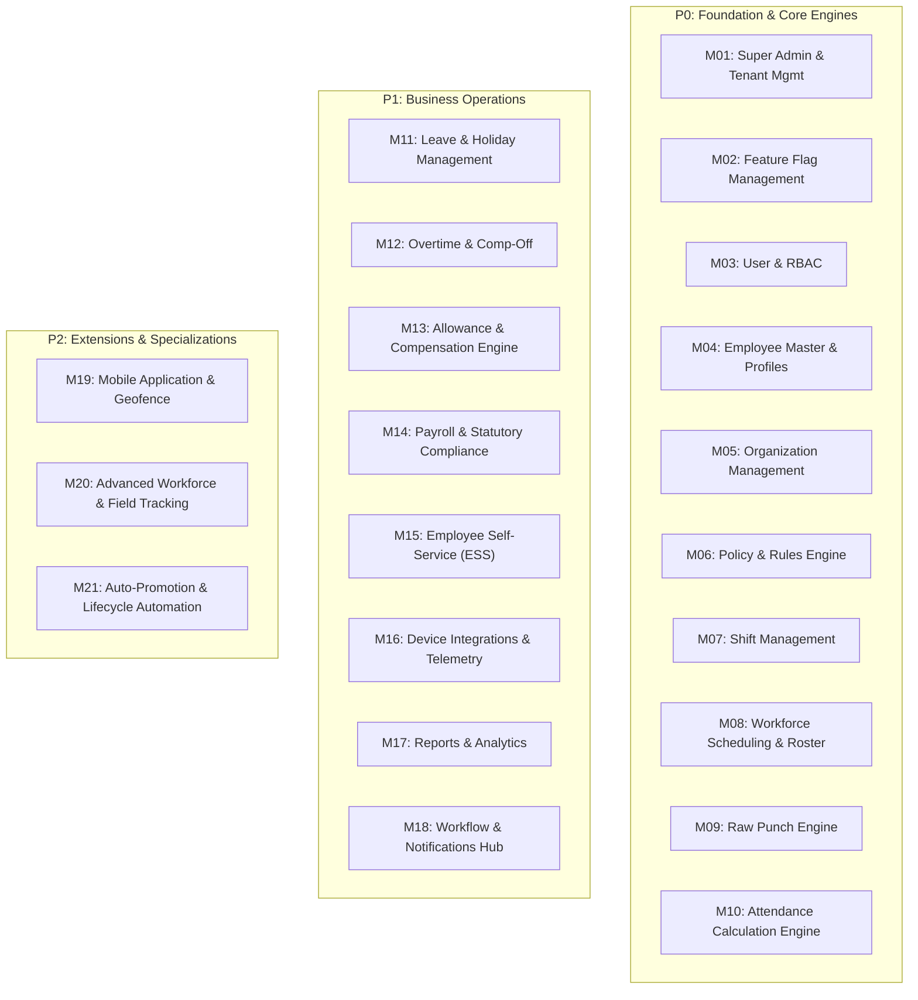

# APMS Product Requirements Document (PRD)

## 1. Product Overview & Purpose

**APMS (Automated Payroll & Attendance Management System)** is an enterprise-grade, multi-tenant B2B SaaS platform engineered to unify workforce scheduling, multi-source biometric attendance pairing, double-entry leave ledgers, and 100% compliant statutory payroll execution (India-first: EPF, ESI, PT, TDS) into a coherent, highly reliable system.

The core objective is to eliminate error-prone manual spreadsheets, solve complex scheduling anomalies (overnight shifts, multi-day 24h/36h/48h duties, split sessions, rotating rosters), enforce an uncompromised audit trail, and guarantee statutory compliance down to the exact paisa (±₹0.00).

---

## 2. Core Architectural Principles & Invariants

1. **One Shared Platform, Configurable Workflows**:
   One codebase serves all target industries (Manufacturing, Healthcare, IT/Corporate, Retail, Education, Security/Facility Management).
   > [!IMPORTANT]
   > **Configuration-Driven Rule**: Never hardcode industry or department logic (`if department == 'Hospital'` or `if tenant_type == 'Factory'` is strictly prohibited). All industry behaviors are driven by configurable tenant policies and feature flags.

2. **The 3-Way Separation Model (Foundational Architecture)**:
   Every capability is governed by three strictly decoupled layers:
   - **Layer 1: Feature Flags**: *Is the capability available?* (e.g., Payroll enabled for Tenant A, disabled for Tenant B).
   - **Layer 2: Tenant Policies**: *How does the feature behave?* Evaluated via the Policy Hierarchy:
     $$\text{Organization Policy} \longrightarrow \text{Department Policy} \longrightarrow \text{Employee Exception} \Longrightarrow \text{Effective Policy}$$
   - **Layer 3: User Permissions (RBAC)**: *Who has authority to execute the action?* (e.g., Only HR Operations can approve attendance regularizations).

3. **Infrastructure Cost Ceiling**:
   - Total operational hosting and compute infrastructure cost is strictly capped at **₹80 per active employee per month**.
   - Facial recognition and biometric matching run locally on the employee mobile device or local edge kiosk/camera, avoiding expensive third-party cloud vision per-punch API charges.
   - Raw biometric fingerprint/facial templates remain strictly on edge hardware; plain-text biometric templates are never uploaded to cloud databases.

4. **Immutable Raw Ingestion**:
   All incoming punches are stored append-only in `raw_envelope` with SHA-256 payload hashing. Normalization into `punch_event` preserves raw data without modification. Deletions and in-place updates are prohibited.

5. **Attendance Decoupled from Payroll**:
   The attendance engine evaluates worked duration, session completeness, and status (`PRESENT`, `HALF_DAY`, `ABSENT`). Payroll consumes finalized attendance summaries as read-only inputs; attendance never calculates wages, and payroll never alters raw punches.

6. **Deterministic Explanation Trace**:
   Every daily attendance rollup and payroll pay run must persist an immutable JSON explanation trace detailing exact rule inputs, policy bands, and intermediate calculations.

7. **Double-Entry Leave Ledgers**:
   Leave balances are derived from append-only transaction ledgers (`leave_transactions`), never stored as mutable scalar numbers.

8. **Strict Period Locking & Arrears Engine**:
   Once a pay period is closed, attendance and payroll ledgers become strictly read-only (`LOCKED`). Any backdated attendance regularizations, retroactive salary revisions, or late-arriving punches generate an **Arrears Adjustment entry in the next open payroll cycle**, never mutating finalized historical periods.

9. **DPDP Act 2023 & Minor / Student Governance**:
   Full compliance with the Indian Digital Personal Data Protection Act (DPDP Act 2023). For educational institutions with student/minor profiles (<18 years), verifiable parental/guardian consent is mandatory prior to data collection or biometric processing.

---

## 3. Target Personas & Primary User Journeys

### 3.1 Persona Definitions
1. **Tenant Administrator (`ADM`)**: Manages organizational master data, branches, departments, security policies, feature flags, and subscription settings.
2. **HR Operations & Payroll Executive (`HRO`)**: Configures pay groups, executes the 10-step payroll wizard, generates bank disbursement files, handles attendance regularizations, and manages muster rolls.
3. **Shift Supervisor / Department Head (`MGR`)**: Allocates roster patterns, executes ad-hoc same-day shift changes, approves leaves, and verifies overtime pre-authorizations.
4. **Employee (`EMP`)**: Clocks in/out via mobile or biometric hardware, tracks daily worked duration, checks leave balances, requests shift swaps, regularizes missed punches, and downloads payslips.
5. **Student / Guardian (`STU` / `GRD`)**: Student marks attendance via kiosk/app; guardians track daily attendance, timetable, and academic announcements.
6. **System Integrator / Device Admin (`DEV_ADM`)**: Registers hardware biometrics, monitors Edge Sync Agents, tracks device heartbeats, and diagnoses communication failures or clock drift.

### 3.2 Primary User Journeys

#### Journey 1: Monthly Payroll Execution (HR Operations)
1. **Initiate Pay Run**: HR selects tenant, Pay Group, and target pay period (e.g., Nov 1 to Nov 30).
2. **Step 1: Attendance Reconciliation**: System identifies unfinalized records, pending regularizations, and single-punch anomalies.
3. **Step 2: Leave & Holiday Freeze**: Snapshot active leave balances and verify sandwich rule deductions.
4. **Step 3: Variable Earnings & Deductions**: Upload or pull ad-hoc components (bonuses, advance repayments, meal deductions).
5. **Step 4: Overtime Authorization**: Verify manager-approved overtime hours against policy caps.
6. **Step 5: Gross Salary Computation**: Calculate base salary, allowances, and per-session lecture fees.
7. **Step 6: Statutory Deductions**: Execute deterministic EPF, ESI, Professional Tax, and TDS calculations.
8. **Step 7: Pre-Payroll Audit & Variance Check**: System flags outliers (>20% salary variation from prior month).
9. **Step 8: Final Lock & Ledger Post**: Pay run is locked; immutable snapshots are generated.
10. **Step 9: Disbursement Artifacts**: Generate bank NEFT/RTGS/NACH batch files and statutory returns (EPF ECR, ESI, Form 24Q).
11. **Step 10: Payslip Release**: Securely publish encrypted digital payslips to Employee Self-Service (ESS).

#### Journey 2: Punch Ingestion to Attendance Status (Engine Workflow)
1. Biometric device pushes punch to APMS API (`POST /api/v1/devices/push`) or Edge Agent relays buffered punches.
2. Punch is recorded in immutable `raw_envelope` and normalized into `punch_event`.
3. Background task identifies employee's active `dated_shift_instance` for the day.
4. Session-aware pairing evaluates In/Out bounds, grace periods, and break policies.
5. Daily rollup calculates worked duration, missed duration, and assigns status (`PRESENT`, `HALF_DAY`, `ABSENT`).
6. Immutable `attendance_explanation_trace` records exact rule evaluations.

---

## 4. The 21-Module Catalog

APMS defines 21 discrete functional modules structured into three implementation tiers:

### 4.1 P0: Foundation & Core Engines
- **M01: Super Admin & Tenant Management**: Tenant onboarding wizard, subscription plans, usage telemetry, tenant status (Active/Suspended), cross-tenant diagnostics.
- **M02: Feature Flag Management**: Per-tenant capability enablement (Layer 1 of the 3-Way Separation Model).
- **M03: User & RBAC**: Role definitions, granular permissions, session management, TOTP MFA, enterprise SSO.
- **M04: Employee Master & Profiles**: Master demographic data, employment terms, encrypted bank/statutory identity details, document repository.
- **M05: Organization Management**: Legal entities, branches, departments, designations, cost centers, financial year, tenant timezone.
- **M06: Policy & Rules Engine**: Tiered policy inheritance (Org $\rightarrow$ Dept $\rightarrow$ Employee Exception), effective/expiry dates, policy conflict resolution.
- **M07: Shift Management**: Standard fixed shifts, overnight shifts, multi-session split shifts, 12h/24h/36h/48h continuous duties, grace rules, break policies, versioned shift definitions.
- **M08: Workforce Scheduling & Roster**: Pattern-based recurring rosters, bulk team allocations, dated shift instance generation (`dated_shift_instance`), ad-hoc same-day overrides, shift swaps.
- **M09: Raw Punch Engine**: Immutable raw punch ingestion (`raw_envelope`), deduplication debounce, device mapping, out-of-order handling, deterministic reprocessing.
- **M10: Attendance Calculation Engine**: Session-aware pairing, gap exclusion (N65), daily status rollup (`DURATION_RATIO`), session qualification, immutable JSON explanation trace.

### 4.2 P1: Business Operations
- **M11: Leave & Holiday Management**: Double-entry ledger (`leave_transactions`), pro-rata accruals, sandwich rule engine, tenant/branch holiday calendars, session-targeted half-day leave.
- **M12: Overtime & Comp-Off**: Pre/post-authorization workflows, Factories Act multipliers (1.5x, 2.0x), statutory overtime caps, compensatory off conversion.
- **M13: Allowance & Compensation Engine**: Separation of allowance configuration from calculation; fixed, percentage, per-day, per-hour, per-shift, on-call medical allowances, night duty allowances.
- **M14: Payroll & Statutory Compliance**: Guided 10-step monthly pay run wizard, EPF (₹15,000 ceiling + ECR text), ESI (₹21,000 gross limit), State-specific PT & LWF, dual-regime TDS (Old vs 115BAC), Form 16 Part A/B, NEFT/RTGS/NACH bank disbursement files, ERP exports (Tally Prime XML, Zoho Books, SAP).
- **M15: Employee Self-Service (ESS)**: Web & mobile self-service portal: punch clock, monthly attendance calendar, leave/regularization applications, payslip downloads.
- **M16: Device Integrations & Telemetry**: Native adapters for Time Office API, ZKTeco ADMS/Push, eSSL SDK; local Edge Sync Agent; device heartbeat telemetry, un-synced log tracking, clock drift monitoring.
- **M17: Reports & Analytics**: Form 25 statutory muster roll, monthly attendance summaries, statutory contribution schedules, real-time executive dashboards.
- **M18: Workflow & Notifications Hub**: 1-to-N tier approval chains, SLA escalation, auto-approval rules, multi-channel alerts (Official WhatsApp BSP, SMS, Email, Push).

### 4.3 P2: Extensions & Specializations
- **M19: Mobile Application & Geofence**: Native Android/iOS employee app, offline punch queue with cryptographic replay protection, geofenced clock-in, mock GPS detection.
- **M20: Advanced Workforce & Field Tracking**: 4-tier field tracking model (Level 1 Punch GPS to Level 4 Duty Route Tracking), task assignment, visit check-ins with photo proof-of-work, performance metrics.
- **M21: Auto-Promotion & Lifecycle Automation**: Automated employee lifecycle transitions, probation confirmation workflows, contract renewal alerts, appraisal/increment scheduling.

---

## 5. Detailed Specifications for High-Impact Capabilities

### 5.1 Module 21: Auto-Promotion & Lifecycle Automation
- **Status Transition Pipelines**:
  - `Trainee` $\longrightarrow$ `Probationary Employee` $\longrightarrow$ `Confirmed Full-Time Employee`.
  - `Intern` $\longrightarrow$ `Full-Time Employee`.
  - `Contractor` $\longrightarrow$ Contract renewal or offboarding workflow.
- **Automated Lifecycle Triggers**:
  - Configured at onboarding: probationary period duration (e.g., 90 or 180 days).
  - Configurable policy: *Does unpaid leave extend probation?* (Default: Yes, extends end date by total LOP days).
  - T-30, T-15, and T-7 day reminder notifications to reporting manager and HR Operations.
  - On confirmation effective date: automated trigger adjusts leave accrual entitlements (unlocks earned leave) and alters notice period parameters.
  - Manager review approval gate: manager can approve, extend probation (with reason code), or trigger separation.

### 5.2 Tiered Field Workforce & GPS Tracking Model
To ensure battery preservation, employee privacy, and DPDP Act compliance, field tracking is strictly partitioned into 4 configurable tiers:

| Tier | Capability | Trigger Condition | Battery Impact | Privacy Level | Governance |
| :--- | :--- | :--- | :--- | :--- | :--- |
| **Level 1** | **Punch GPS Only** | Instant of Clock-In / Clock-Out | Negligible | Low | Standard mobile punch |
| **Level 2** | **Geofenced Site Visits** | Entering/exiting defined client radius | Low | Low | Plant, pump, client site |
| **Level 3** | **Visit Check-Ins** | Employee checks in with notes & photo | Low | Medium | Sales/service proof-of-work |
| **Level 4** | **Duty-Hours Route Tracking** | Continuous location during shift window | Moderate | High | Explicit tenant opt-in + on-duty banner |

> [!CAUTION]
> **Level 4 Tracking Constraints**: Active tracking is permitted **strictly during scheduled shift hours**. The mobile app displays an omnipresent persistent "On-Duty Location Tracking Active" notification. Tracking automatically terminates the moment the shift ends or the employee clocks out. Off-hours tracking is strictly impossible.

### 5.3 Shared Tablet / Kiosk Attendance Mode
- For factory gates, retail outlets, construction sites, and petrol pumps (PumpOps) where individual biometric terminals are unavailable or uneconomical.
- Runs on low-cost Android tablets / browser kiosks.
- Employees authenticate via PIN or QR code, followed by instantaneous on-device facial matching / selfie verification.
- Stores punches locally in SQLite when offline; automatically flushes to cloud API upon network restoration.

### 5.4 Continuous Multi-Day Duty Engine (>24h / 36h / 48h)
- Designed specifically for multi-specialty hospitals (resident doctors, emergency nurses) and process manufacturing plants.
- Accommodates continuous duty windows spanning 24, 36, or 48 hours without breaking daily rollups.
- **Date Attribution Rule**: The entire multi-day continuous duty is attributed to the **calendar date on which the shift commenced**.
- Automatically qualifies the employee for configurable Long-Duty Allowances and enforces statutory mandatory rest periods prior to the next scheduled assignment.

### 5.5 Configurable Lone-Punch Policy Engine
Addresses the legacy failure where lone punches resulted in either ₹0 pay or phantom overtime:
- A session with a missing IN or missing OUT punch is flagged with anomaly code `LONE_PUNCH_ANOMALY`.
- Tenant Policy specifies the fallback behavior if unregularized by payroll cut-off:
  - *Option A (Default)*: Mark as `NEEDS_REVIEW`; route to HR exception queue.
  - *Option B (Penalty)*: Mark as `ABSENT` (Loss of Pay) until regularized.
  - *Option C (Floor Credit)*: Credit half-day duration ($0.5$ credit) with mandatory warning flag.
- Under no circumstances does a lone punch compute overtime or unearned full-day pay.

---

## 6. Key Non-Functional Requirements (NFRs)

1. **Multi-Tenancy & Data Isolation (`NFR-SEC-01`)**:
   - Zero cross-tenant data leakage guaranteed by database-level Row-Level Security (RLS) on PostgreSQL 16+.
   - Tenant context injected strictly via authenticated session claims (`app.current_tenant_id`).
2. **Ingestion Throughput & Scalability (`NFR-PERF-01`)**:
   - Ingestion API must sustain up to 10,000 raw punches/minute with response latency < 200ms.
   - Idempotent deduplication using payload hash keys (`sha256(tenant_id, device_id, raw_payload)`).
3. **Auditability & Traceability (`NFR-AUD-01`)**:
   - Every attendance status calculation and payroll run must persist an immutable JSON explanation trace.
   - System must provide full point-in-time reconstruction of employee attendance records.
4. **Availability & Resilience (`NFR-REL-01`)**:
   - 99.9% uptime target.
   - Offline-capable Edge Agent buffers punches up to 7 days during internet outages and safely relays upon reconnect.
5. **Regulatory & Statutory Compliance (`NFR-REG-01`)**:
   - Full compliance with Indian DPDP Act 2023 for PII consent, purpose limitation, and right to erasure/masking.
   - Verifiable parental/guardian consent logging for minors in educational institutions.
   - Audit trail retention for minimum 8 statutory fiscal years.
