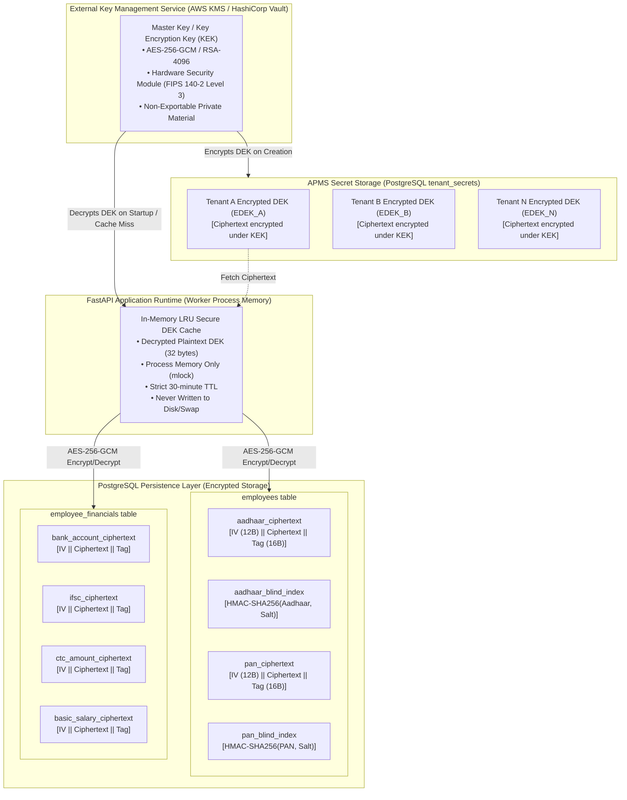
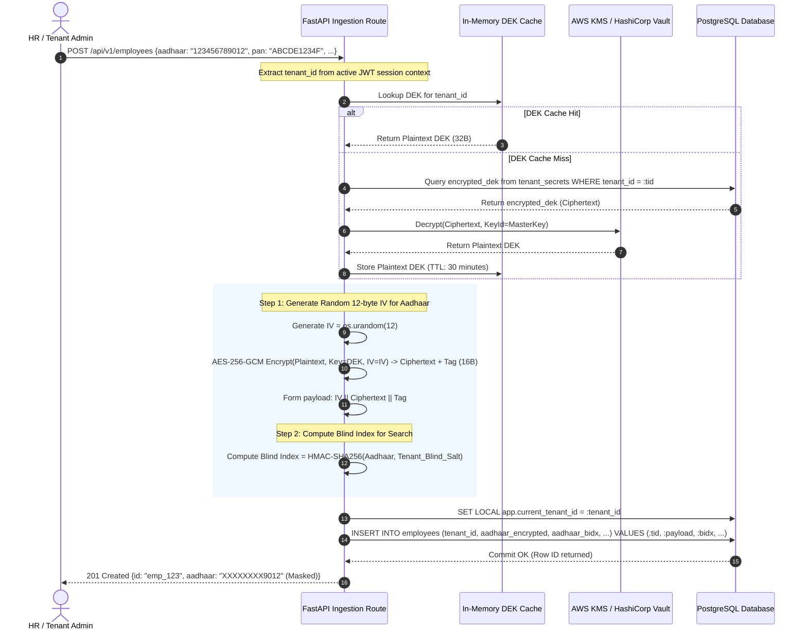
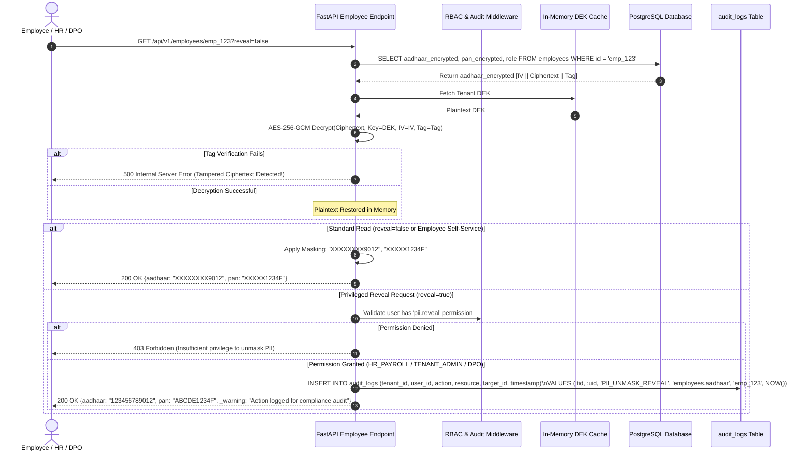
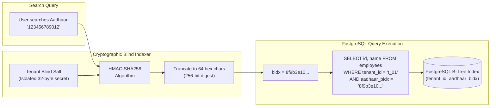

# APMS Field-Level Envelope Encryption Architecture

> **Status:** Authoritative | **Last Updated:** 2026-11-16 | **Source:** Extracted from APMS documentation

---

## 1. Executive Summary & Security Objectives

In a multi-tenant enterprise Payroll & Attendance SaaS platform such as **APMS**, persistent storage contains high-value Personally Identifiable Information (PII) and sensitive financial records. A conventional database-at-rest encryption approach (such as AWS RDS EBS volume encryption or PostgreSQL Transparent Data Encryption) safeguards physical disk assets against theft, but fails to prevent insider threat vectors, unauthorized database superuser queries, compromised database dump exposure, or SQL injection data exfiltration.

To guarantee zero-compromise confidentiality and comply with the **Digital Personal Data Protection (DPDP) Act 2023** and **UIDAI Aadhaar data security regulations**, APMS mandates **Application-Layer Field-Level Envelope Encryption (AES-256-GCM)**.

### Core Cryptographic Invariants:
1. **Envelope Key Hierarchy (`ADR-13`)**: Data Encryption Keys (DEKs) encrypt field plaintexts; Key Encryption Keys (KEKs / Master Keys) residing in hardware security modules (HSM / AWS KMS / HashiCorp Vault) encrypt DEKs.
2. **Tenant Cryptographic Isolation**: Every tenant organization possesses a distinct, cryptographically isolated Data Encryption Key (DEK). No two tenants share the same DEK.
3. **Authenticated AEAD Ciphertext**: All field encryption uses **AES-256-GCM** (Galois/Counter Mode) with a unique 96-bit (12-byte) initialization vector (IV) per field write and a 128-bit (16-byte) authentication tag, preventing ciphertext tampering or bit-flipping attacks.
4. **Deterministic Search via Blind Indexing**: Encrypted sensitive columns requiring equality search (e.g., PAN, Aadhaar) utilize a keyed HMAC-SHA256 blind index with tenant-isolated salt, preserving searchability without exposing plaintexts or DEKs.
5. **Cryptographic Erasure / Shredding**: Deleting a tenant's DEK from the key registry renders all historical encrypted PII and financial records cryptographically unrecoverable within milliseconds.

---

## 2. Cryptographic Key Hierarchy

The key hierarchy establishes a strict separation of concerns between master secret storage, tenant key management, and application runtime data access.



### Key Hierarchy Components:
1. **Master Key (KEK - Key Encryption Key)**:
   - Resides in AWS KMS (Customer Managed Key - CMK) or HashiCorp Vault Transit Engine.
   - Root cryptographic trust. KEK private material never leaves the secure HSM boundary.
   - Rotated automatically every 365 days by KMS without invalidating existing ciphertext.
2. **Tenant Data Encryption Key (DEK)**:
   - A cryptographically strong 256-bit random key generated via OS CSPRNG (`os.urandom(32)`).
   - Generated during tenant onboarding:
     $$\text{EDEK} = \text{Encrypt}_{\text{KEK}}(\text{DEK})$$
   - Persisted exclusively in ciphertext form in `tenant_secrets` table.
3. **Tenant Blind Index Salt / Pepper**:
   - Unique 256-bit secret per tenant used as the HMAC secret key for blind indices.
   - Also encrypted under KEK and stored in `tenant_secrets`.

---

## 3. Cryptographic Primitives & Storage Format

### 3.1 Field-Level Ciphertext Wire Format
All encrypted field columns are persisted as binary (`BYTEA`) or base64-encoded strings with the following byte-exact layout:

```
+-------------------+------------------------------+--------------------+
|  IV / Nonce (12B) | Ciphertext (Variable Length) | Auth Tag (16 Bytes)|
+-------------------+------------------------------+--------------------+
```

- **Algorithm**: `AES-256-GCM` (NIST SP 800-38D).
- **IV / Nonce**: 12 bytes (96 bits) generated per field write using a cryptographically secure random number generator (`os.urandom(12)`). Reusing an IV with the same DEK destroys GCM security; the CSPRNG guarantees non-repeating IVs.
- **Authentication Tag**: 16 bytes (128 bits) appended to the end of the ciphertext. Verification of this tag ensures that the ciphertext has not been modified or truncated in the database.
- **Associated Authenticated Data (AAD)**: Optional binding of `tenant_id` and `record_id` as AAD to prevent ciphertext swapping between different tenants or records.

### 3.2 Sensitive Fields Catalog

| Table | Encrypted Column | Blind Index Column | Data Type | Regulatory Driver |
| :--- | :--- | :--- | :--- | :--- |
| `employees` | `aadhaar_encrypted` | `aadhaar_bidx` | `BYTEA` / `VARCHAR(64)` | UIDAI Regulations & DPDP Act 2023 |
| `employees` | `pan_encrypted` | `pan_bidx` | `BYTEA` / `VARCHAR(64)` | Income Tax Act 1961 & DPDP Act 2023 |
| `employees` | `passport_encrypted` | `passport_bidx` | `BYTEA` / `VARCHAR(64)` | DPDP Act 2023 Section 8 |
| `employee_financials`| `bank_account_encrypted` | `bank_account_bidx` | `BYTEA` / `VARCHAR(64)` | RBI Guidelines & DPDP Act 2023 |
| `employee_financials`| `ifsc_code_encrypted` | `ifsc_bidx` | `BYTEA` / `VARCHAR(64)` | Financial Confidentiality |
| `employee_financials`| `ctc_amount_encrypted` | *(None - Not searchable)*| `BYTEA` | Compensation Privacy |
| `employee_financials`| `basic_salary_encrypted`| *(None - Not searchable)*| `BYTEA` | Compensation Privacy |
| `pay_run_employee_snapshots`| `bank_account_snapshot`| *(None)* | `BYTEA` | Statutory Payroll Freeze (`ADR-26`) |
| `pay_run_employee_snapshots`| `pan_snapshot` | *(None)* | `BYTEA` | Statutory Payroll Freeze (`ADR-26`) |

---

## 4. Field Write (Encryption) Data Flow



---

## 5. Field Read (Decryption & Masking) Data Flow



---

## 6. Searchable Ciphertext via Blind Indexing

A fundamental challenge of strong, authenticated non-deterministic encryption (where every encryption of the same value produces a completely distinct ciphertext due to randomized IVs) is the inability to perform indexed equality queries:
```sql
-- THIS WILL NOT WORK WITH NON-DETERMINISTIC CIPHERTEXT:
SELECT * FROM employees WHERE aadhaar_encrypted = :cipher;
```

APMS resolves this without weakening encryption by implementing **Keyed Blind Indexing**:



### Properties of the Blind Index:
1. **One-Way Trapdoor**: HMAC-SHA256 cannot be reversed to discover the underlying Aadhaar or PAN.
2. **Tenant-Isolated Salt**: Even if Tenant A and Tenant B have an employee with the exact same PAN or Aadhaar, their blind indices are completely different because each tenant has a distinct blind index salt.
3. **High-Performance B-Tree Indexing**: A composite index `CREATE INDEX idx_emp_aadhaar_bidx ON employees(tenant_id, aadhaar_bidx);` achieves sub-millisecond point lookups without requiring full-table decryption.

---

## 7. Key Lifecycle Management & Cryptographic Shredding

### 7.1 Key Lifecycle States

```mermaid
stateDiagram-v2
    [*] --> GENERATING: Tenant Provisioning
    GENERATING --> ACTIVE: DEK encrypted with KEK & stored
    ACTIVE --> ROTATING: Annual / Scheduled Rotation
    ROTATING --> ACTIVE: New writes use DEK v2; v1 archived
    ACTIVE --> SUSPENDED: Tenant Subscription Suspended
    SUSPENDED --> ACTIVE: Reactivated
    ACTIVE --> SHREDDED: Tenant Offboarding / GDPR / DPDP Erasure
    SUSPENDED --> SHREDDED: Retention Expired
    SHREDDED --> [*]: Irreversible Cryptographic Erasure
```


### 7.2 Key Rotation Procedures
1. **KEK (Master Key) Rotation**:
   - AWS KMS / Vault rotates the root CMK automatically every 12 months.
   - Transparent to APMS: Existing DEKs are decrypted with old KEK versions and re-encrypted under the new KEK version.
2. **DEK (Tenant Key) Rotation**:
   - `tenant_secrets` maintains versioned DEKs: `version_1`, `version_2`.
   - **Phase 1 (Immediate)**: New writes encrypt with DEK $v_{new}$.
   - **Phase 2 (Background Migration)**: Celery batch worker reads batches of records, decrypts with DEK $v_{old}$, re-encrypts with DEK $v_{new}$, and updates the database row.
   - **Phase 3 (Retirement)**: Once 100% of rows are updated, DEK $v_{old}$ is marked `RETIRED`.

### 7.3 Cryptographic Shredding (`DPDP Act Section 12`)
When a tenant requests full data deletion, or after the statutory retention period (8 fiscal years for Indian tax/payroll compliance) expires:
```sql
-- Cryptographic shredding command
DELETE FROM tenant_secrets WHERE tenant_id = :target_tenant_id;
```
Without the tenant's DEK, all historical ciphertexts stored in backups, replicas, and disk storage are rendered undecipherable random noise, providing absolute mathematical proof of data destruction.

---

## 8. Implementation Code Architecture

Below is the production-grade SQLAlchemy `TypeDecorator` pattern used across the APMS backend:

```python
import os
import hmac
import hashlib
from typing import Optional
from cryptography.hazmat.primitives.ciphers.aead import AESGCM
from sqlalchemy.types import TypeDecorator, LargeBinary

class EncryptedString(TypeDecorator):
    """
    SQLAlchemy TypeDecorator implementing AES-256-GCM Envelope Encryption.
    Packs: 12-byte IV + Variable Ciphertext + 16-byte Auth Tag into BYTEA.
    """
    impl = LargeBinary
    cache_ok = True

    def process_bind_param(self, value: Optional[str], dialect) -> Optional[bytes]:
        if value is None:
            return None
        
        # 1. Acquire current tenant DEK from request-scoped context
        dek: bytes = get_current_tenant_dek()  # 32-byte secret
        
        # 2. Generate cryptographically random 96-bit (12-byte) IV
        iv = os.urandom(12)
        aesgcm = AESGCM(dek)
        
        # 3. Encrypt plaintext (returns ciphertext + 16-byte tag)
        ciphertext = aesgcm.encrypt(iv, value.encode("utf-8"), associated_data=None)
        
        # 4. Pack IV || Ciphertext (includes tag)
        return iv + ciphertext

    def process_result_value(self, value: Optional[bytes], dialect) -> Optional[str]:
        if value is None:
            return None
            
        # 1. Unpack IV (first 12 bytes) and ciphertext+tag (remaining bytes)
        iv = value[:12]
        ciphertext = value[12:]
        
        # 2. Acquire current tenant DEK
        dek: bytes = get_current_tenant_dek()
        aesgcm = AESGCM(dek)
        
        # 3. Decrypt and verify authentication tag
        plaintext_bytes = aesgcm.decrypt(iv, ciphertext, associated_data=None)
        return plaintext_bytes.decode("utf-8")


def generate_blind_index(value: str, tenant_salt: bytes) -> str:
    """
    Computes a deterministic, one-way HMAC-SHA256 blind index for equality queries.
    """
    normalized_value = value.strip().upper()
    return hmac.new(tenant_salt, normalized_value.encode("utf-8"), hashlib.sha256).hexdigest()
```

---

## 9. Regulatory Compliance Mapping

| Regulatory Authority / Statute | Mandatory Obligation | APMS Architectural Control |
| :--- | :--- | :--- |
| **DPDP Act 2023, Section 8(5)** | Duty of Data Fiduciary to implement reasonable security safeguards to prevent personal data breach | Application-layer AES-256-GCM envelope encryption with distinct tenant DEKs |
| **UIDAI Aadhaar Act Regulation 3** | Mandatory masking of first 8 digits of Aadhaar number; encryption at rest | `XXXXXXXX1234` masking format on display; AES-256-GCM ciphertext persistence |
| **RBI Cyber Security Framework** | Storage of customer bank account numbers and financial credentials in encrypted form | `bank_account_encrypted` and `ifsc_code_encrypted` with strict KMS hierarchy |
| **DPDP Act 2023, Section 12** | Right to Erasure upon purpose completion or consent withdrawal | Instant cryptographic shredding via tenant DEK deletion |
| **ISO/IEC 27001:2022 Control A.8.24** | Use of Cryptography and Key Management | Split-knowledge key management, automated KEK rotation, non-exportable master keys in KMS |
