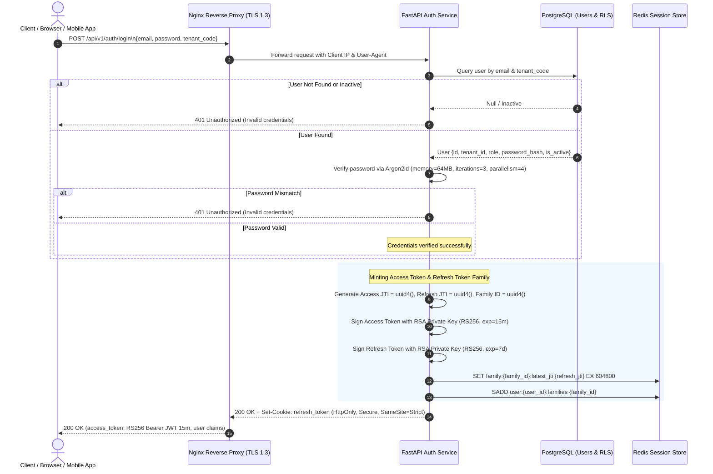
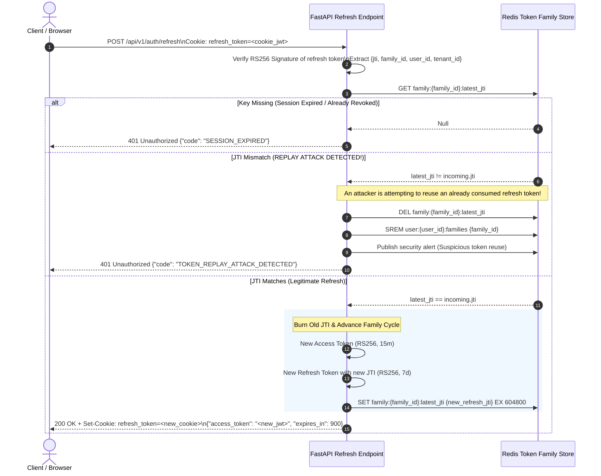
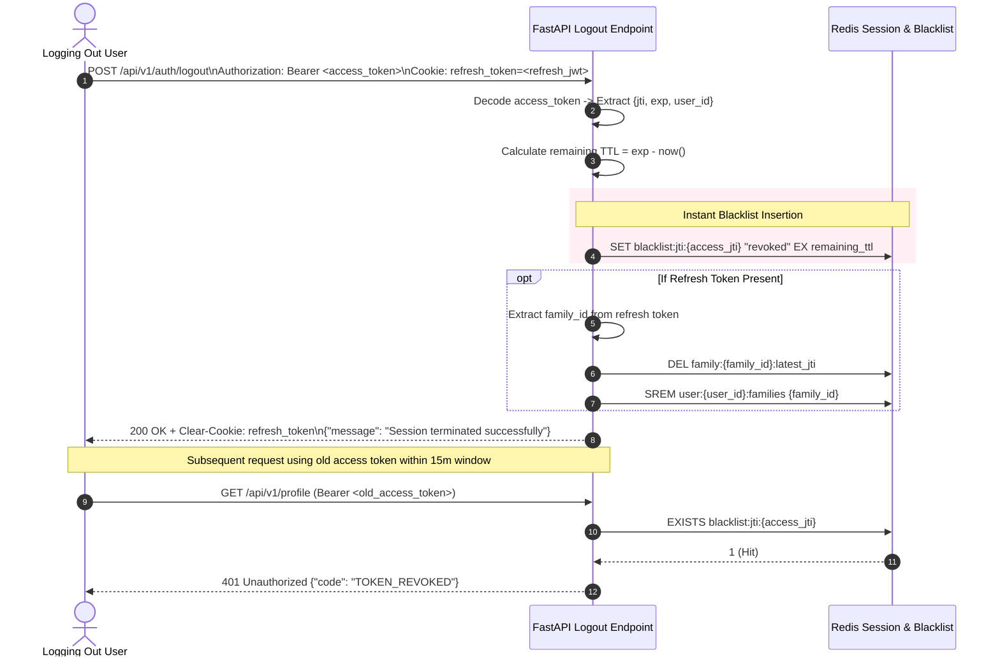

# APMS JWT Session Security, RS256 Verification & Revocation Architecture

> **Status:** Authoritative | **Last Updated:** 2026-11-16 | **Source:** Extracted from APMS documentation

---

## 1. Executive Summary & Security Objectives

In a multi-tenant enterprise system handling biometric records and payroll disbursements, user authentication and session management must satisfy three rigorous guarantees:
1. **Stateless High-Throughput Verification**: Microservices and modular API endpoints must verify user authenticity with zero database round-trips for standard reads and writes.
2. **Instant Revocation Capability**: Despite statelessness, compromised accounts, employee termination, device loss, or explicit user logouts must terminate active sessions instantaneously across all API nodes.
3. **Cryptographic Tenant Isolation**: Every session token must be cryptographically bound to a verified `tenant_id`, which is injected directly into PostgreSQL Row-Level Security (`SET LOCAL app.current_tenant_id`) without allowing client spoofing.

To achieve this, APMS implements an asymmetric **RS256 Dual-Token Architecture** coupled with a distributed **Redis Revocation Blacklist & Token Family Rotation Engine**.

---

## 2. Token Architecture & Cryptographic Parameters

```
+-------------------------------------------------------------------------------------------------+
|                                APMS Dual-Token System Parameters                                |
+-----------------------+-----------------------------+-------------------------------------------+
| Parameter             | Access Token                | Refresh Token                             |
+-----------------------+-----------------------------+-------------------------------------------+
| Cryptographic Alg     | RS256 (RSA-SHA256, 2048-bit)| RS256 or High-Entropy CSPRNG (32 Bytes)   |
| Lifetime / TTL        | 15 Minutes (900 seconds)    | 7 Days (604,800 seconds)                  |
| Delivery Channel      | HTTP Authorization: Bearer  | HTTP-Only, Secure, SameSite=Strict Cookie |
| Storage Location      | Client In-Memory (JavaScript)| Browser Cookie Jar (Inaccessible to JS)   |
| Verification          | Asymmetric Public Key (JWKS)| Redis Token Family Registry               |
| Invalidation Trigger  | Redis Blacklist (JTI check) | Family Deletion / Rotation on Use         |
+-----------------------+-----------------------------+-------------------------------------------+
```

### Key Security Invariants:
1. **Asymmetric Key Pair (`RS256`)**:
   - **Private Key**: Held strictly in secret storage by the Authentication Service. Used exclusively to sign newly minted JWTs.
   - **Public Key**: Distributed to and cached in-memory across all FastAPI gateway worker processes via an internal JWKS (JSON Web Key Set) endpoint. API nodes can verify tokens without accessing private keys.
2. **Rotating Refresh Token Family**:
   - Refresh tokens are strictly **single-use**.
   - Every refresh operation burns the submitted refresh token and issues a new access token AND a new refresh token.
   - If an expired or already-used refresh token is presented, APMS detects a **Token Replay Attack** and immediately revokes all refresh tokens in that family, logging out the user on all devices.
3. **Redis Revocation Blacklist**:
   - When a user logs out, their active access token's unique ID (`jti`) is persisted in Redis with a TTL equal to the token's remaining lifetime.
   - Any API request bearing a blacklisted `jti` is rejected with `401 Unauthorized` (`TOKEN_REVOKED`).

---

## 3. Complete Authentication Flow: Login & Dual-Token Issuance



---

## 4. Authenticated Request, Verification & RLS Injection

Every inbound API request to a protected endpoint must validate the asymmetric signature, ensure the token has not been revoked in Redis, and bind the tenant context to the active PostgreSQL database connection.

```mermaid
sequenceDiagram
    autonumber
    actor Client as Authenticated Client
    participant Nginx as Nginx Reverse Proxy
    participant Middleware as FastAPI Security Middleware
    participant JWKS as In-Memory Public Key Cache
    participant Redis as Redis Revocation Blacklist
    participant Pool as SQLAlchemy Connection Pool
    participant DB as PostgreSQL 16+ Engine

    Client->>Nginx: GET /api/v1/attendance-records\nAuthorization: Bearer <access_token>
    Nginx->>Middleware: Forward request headers

    %% Step 1: Cryptographic Verification
    rect rgb(240, 255, 240)
    Note over Middleware: 1. Asymmetric RS256 Verification
    Middleware->>Middleware: Parse JWT header -> Extract 'kid' (Key ID)
    Middleware->>JWKS: Lookup Public Key for 'kid'
    JWKS-->>Middleware: RSA Public Key (2048-bit)
    Middleware->>Middleware: Verify RS256 signature & standard claims (iss, aud, nbf, exp)
    alt Signature Invalid or Token Expired
        Middleware-->>Client: 401 Unauthorized {"code": "TOKEN_EXPIRED" | "INVALID_TOKEN"}
    else Valid Cryptographic Signature
        Note over Middleware: Token payload authenticated
    end
    end

    %% Step 2: Redis Revocation Blacklist Check
    rect rgb(255, 250, 240)
    Note over Middleware: 2. Distributed Revocation Check
    Middleware->>Redis: EXISTS blacklist:jti:{token.jti}
    alt Blacklist Hit (Token Revoked / User Logged Out)
        Redis-->>Middleware: 1 (True)
        Middleware-->>Client: 401 Unauthorized {"code": "TOKEN_REVOKED"}
    else Blacklist Miss (Token Active)
        Redis-->>Middleware: 0 (False)
    end
    end

    %% Step 3: Database Session RLS Injection
    rect rgb(240, 248, 255)
    Note over Middleware, DB: 3. Tenant Context Injection into PostgreSQL
    Middleware->>Pool: Acquire async connection from pool
    Pool-->>Middleware: Connection object (conn)
    Middleware->>DB: SET LOCAL app.current_tenant_id = :token.tenant_id;
    Middleware->>DB: SET LOCAL app.current_user_id = :token.sub;
    Middleware->>DB: SET LOCAL app.current_user_role = :token.role;
    DB-->>Middleware: OK (Context set for current transaction)
    end

    %% Step 4: Query Execution & Response
    Middleware->>DB: SELECT * FROM attendance_records WHERE date = '2026-11-16';\n(PostgreSQL enforces RLS: tenant_id = current_setting('app.current_tenant_id'))
    DB-->>Middleware: Filtered rows for tenant_id only
    Middleware-->>Client: 200 OK {"data": [...]}
```

---

## 5. Token Refresh & Replay Attack Defense

When an access token approaches expiry, the client invokes `/api/v1/auth/refresh`. The refresh token family mechanism prevents token theft and replay attacks.



---

## 6. Instant Logout & Distributed Redis Blacklist

When a user initiates an explicit logout, or when a security administrator terminates an employee's session immediately:



---

## 7. Token Payload Schemas

### 7.1 Access Token Payload (`RS256`)
```json
{
  "iss": "https://auth.apms.cloud",
  "sub": "usr_9b1deb4d-3b7d-4bad-9bdd-2b0d7b3dcb6d",
  "aud": "https://api.apms.cloud",
  "exp": 1794931200,
  "nbf": 1794930300,
  "iat": 1794930300,
  "jti": "jwt_d8f76e34-5b72-4d56-a361-9c1e7a2b9e81",
  "tid": "ten_8e3f412a-6a5b-4c28-98e3-5b8f7a6c9d12",
  "branch_id": "br_01",
  "role": "HR_PAYROLL",
  "scopes": [
    "attendance:read",
    "attendance:write",
    "payroll:read",
    "payroll:execute",
    "leave:approve"
  ],
  "token_type": "access"
}
```

### 7.2 Refresh Token Payload (`RS256`)
```json
{
  "iss": "https://auth.apms.cloud",
  "sub": "usr_9b1deb4d-3b7d-4bad-9bdd-2b0d7b3dcb6d",
  "aud": "https://auth.apms.cloud/refresh",
  "exp": 1795535100,
  "iat": 1794930300,
  "jti": "ref_1a2b3c4d-5e6f-7a8b-9c0d-1e2f3a4b5c6d",
  "tid": "ten_8e3f412a-6a5b-4c28-98e3-5b8f7a6c9d12",
  "family_id": "fam_4f8c2e1b-7a9d-4e5c-8b3a-2f1d0e9c8a7b",
  "token_type": "refresh"
}
```

---

## 8. Threat Modeling & Defensive Security Controls

| Threat Vector | Attack Scenario | APMS Cryptographic / System Defense |
| :--- | :--- | :--- |
| **Algorithm Confusion Attack** | Attacker modifies JWT header to `alg: "HS256"` or `alg: "none"`, signing with the public key as HMAC secret | The verification middleware enforces `algorithms=["RS256"]` explicitly. Any token with an algorithm other than RS256 is rejected immediately. |
| **Token Replay / Theft** | Stolen refresh token used by malicious third party | Refresh Token Rotation: Every refresh rotates the token. If an already-burned token is submitted, the entire family is invalidated in Redis, revoking all active sessions. |
| **Cross-Tenant Context Spoofing** | Attacker modifies URL parameters (`/api/v1/tenants/ten_B/users`) while holding a token for `ten_A` | RLS Enforcement: The tenant ID is extracted exclusively from the cryptographically verified JWT claim `tid`. Route parameters cannot override `app.current_tenant_id`. |
| **Cross-Site Scripting (XSS)** | Malicious script in browser attempts to read stored credentials | Refresh token is placed in an `HttpOnly` cookie, inaccessible to JavaScript. Access token is held in-memory (not `localStorage`), destroyed on page reload. |
| **Cross-Site Request Forgery (CSRF)** | Malicious website triggers unwanted state-changing action using browser cookies | Cookies use `SameSite=Strict` and `Secure`. Protected write endpoints accept authentication strictly via the `Authorization: Bearer` header, which browsers never send automatically. |
| **Zombie Sessions on Termination** | Terminated employee retains 15-minute access token | HR termination trigger immediately pushes user's active access tokens to Redis blacklist and deletes all active token families. |

---

## 9. Implementation Architecture & Code Snippets

### 9.1 FastAPI Security Middleware (RS256 & Redis Verification)

```python
import jwt
from fastapi import Request, HTTPException, status
from redis.asyncio import Redis

class APMSSecurityMiddleware:
    def __init__(self, public_key: str, redis_client: Redis):
        self.public_key = public_key
        self.redis = redis_client

    async def __call__(self, request: Request, call_next):
        # Allow open routes (e.g., login, health)
        if request.url.path in ["/api/v1/auth/login", "/api/v1/health", "/api/v1/devices/push"]:
            return await call_next(request)

        auth_header = request.headers.get("Authorization")
        if not auth_header or not auth_header.startswith("Bearer "):
            raise HTTPException(status_code=status.HTTP_401_UNAUTHORIZED, detail="Missing or malformed authorization token")

        token_str = auth_header.split(" ")[1]

        try:
            # 1. Asymmetric RS256 verification
            payload = jwt.decode(
                token_str,
                self.public_key,
                algorithms=["RS256"],
                audience="https://api.apms.cloud",
                issuer="https://auth.apms.cloud"
            )
        except jwt.ExpiredSignatureError:
            raise HTTPException(status_code=status.HTTP_401_UNAUTHORIZED, detail="Token has expired")
        except jwt.InvalidTokenError:
            raise HTTPException(status_code=status.HTTP_401_UNAUTHORIZED, detail="Invalid cryptographic token signature")

        # 2. Redis Blacklist verification
        jti = payload.get("jti")
        if await self.redis.exists(f"blacklist:jti:{jti}"):
            raise HTTPException(status_code=status.HTTP_401_UNAUTHORIZED, detail="Token has been revoked")

        # 3. Attach tenant & user context to request state
        request.state.tenant_id = payload["tid"]
        request.state.user_id = payload["sub"]
        request.state.user_role = payload.get("role")
        request.state.scopes = payload.get("scopes", [])

        return await call_next(request)
```

### 9.2 PostgreSQL Session Dependency (RLS Injection)

```python
from fastapi import Depends, Request
from sqlalchemy.ext.asyncio import AsyncSession
from myapp.database import async_session_factory

async def get_db_with_rls(request: Request) -> AsyncSession:
    """
    Acquires an async DB session and injects the authenticated tenant_id into PostgreSQL RLS context.
    """
    async with async_session_factory() as session:
        tenant_id = getattr(request.state, "tenant_id", None)
        user_id = getattr(request.state, "user_id", None)
        user_role = getattr(request.state, "user_role", None)

        if not tenant_id:
            raise HTTPException(status_code=403, detail="Unresolved tenant context")

        # Set transaction-local RLS variables
        await session.execute(f"SET LOCAL app.current_tenant_id = '{tenant_id}';")
        if user_id:
            await session.execute(f"SET LOCAL app.current_user_id = '{user_id}';")
        if user_role:
            await session.execute(f"SET LOCAL app.current_user_role = '{user_role}';")

        try:
            yield session
        finally:
            await session.close()
```
