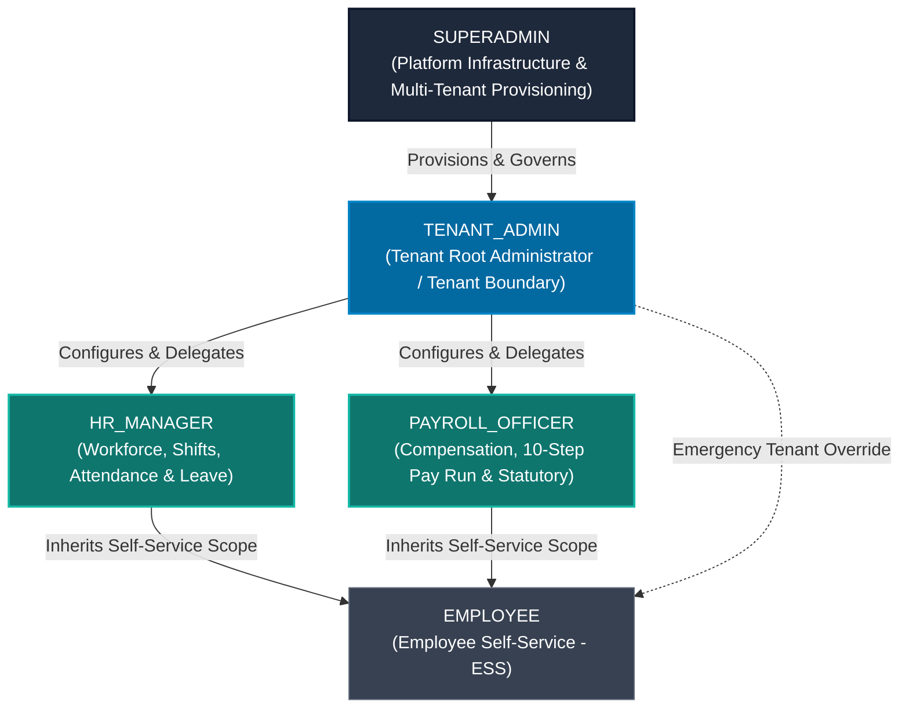
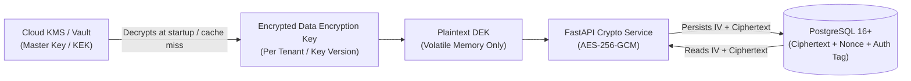

# APMS Role-Based Access Control (RBAC) Permission Matrix

> **Status:** Authoritative | **Last Updated:** 2026-11-16 | **Source:** Extracted from APMS documentation

---

## 1. Executive Summary & Role Definitions

APMS enforces a 5-tier Role-Based Access Control (RBAC) model operating alongside PostgreSQL Row-Level Security (RLS). Every API request carries a cryptographically signed JWT identifying the actor's identity (`sub`), organizational scope (`tenant_id`), and authorized system role (`role`).

The 5 authoritative APMS system roles are:

1. **`SUPERADMIN`** (Platform Super Admin): Cross-tenant platform maintenance, tenant provisioning, system health monitoring, and global configuration. Operates outside normal tenant RLS restrictions via specific platform administrative endpoints.
2. **`TENANT_ADMIN`** (Tenant Administrator): Full executive control within a single tenant boundary. Manages tenant configuration, organization hierarchy (branches, departments), billing, administrative user accounts, hardware integrations, and security audit logs.
3. **`HR_MANAGER`** (Human Resources & Operations Manager): Manages employee lifecycles, roster and shift scheduling, leave policies and ledger overrides, attendance regularization approvals, and organizational master records.
4. **`PAYROLL_OFFICER`** (Payroll & Finance Specialist): Executes monthly payroll runs via the 10-step wizard, manages salary structures, views encrypted financial details with authorized audit trails, and exports statutory schedules and banking disbursement files.
5. **`EMPLOYEE`** (Employee Self-Service / ESS): Self-service access restricted strictly to the user's own profile, attendance records, leave balances and requests, shift calendar, and personal payslips.

---

## 2. Role Hierarchy & Inheritance Architecture

The role hierarchy follows a strict administrative delegation model. Higher operational roles inherit functional capabilities of downstream roles within their operational domain, with explicit privilege separation between HR operational duties and payroll financial disbursement.



> [!NOTE]
> `SUPERADMIN` cannot view tenant payroll, attendance, or employee PII without explicit break-glass consent and audit logging. Tenant data remains segregated at the database level by Row-Level Security (`tenant_id`).

---

## 3. Comprehensive RBAC Permission Matrix

**Legend:**
- ✅ **Full Access**: Unrestricted read/write/execute access within tenant boundary.
- ❌ **No Access**: Explicitly denied; produces `403 Forbidden`.
- ⚠️ **Partial / Scoped Access**: Restricted by ownership (self-only), approval delegation, or field masking.

| Resource Domain | Action / Endpoint Scope | `SUPERADMIN` | `TENANT_ADMIN` | `HR_MANAGER` | `PAYROLL_OFFICER` | `EMPLOYEE` | Notes / Authorization Constraints |
| :--- | :--- | :---: | :---: | :---: | :---: | :---: | :--- |
| **Tenants** | Provision new tenant (`POST /tenants`) | ✅ | ❌ | ❌ | ❌ | ❌ | Platform-level provisioning only (`PLT-02`) |
| | View tenant metadata & license | ✅ | ✅ | ⚠️ (Read-only) | ⚠️ (Read-only) | ❌ | Tenant Admin can edit settings |
| | Delete / Suspend tenant | ✅ | ❌ | ❌ | ❌ | ❌ | Platform Superadmin disaster action |
| **Users & IAM** | Manage tenant administrators | ✅ | ❌ | ❌ | ❌ | ❌ | Superadmin controls tenant roots |
| | Manage HR & Payroll staff accounts | ❌ | ✅ | ❌ | ❌ | ❌ | Tenant Admin governs role assignments |
| | Reset passwords & MFA enforcement | ⚠️ (Tenant Admin only) | ✅ | ⚠️ (Employees only) | ❌ | ⚠️ (Self password only) | Self-service restricted to self profile |
| **Employees** | Create / Onboard employee (`EMP-01`) | ❌ | ✅ | ✅ | ❌ | ❌ | HR Master ownership |
| | Update personal / job details | ❌ | ✅ | ✅ | ❌ | ⚠️ (Contact info only) | Employee edits subject to approval |
| | Terminate / Offboard employee | ❌ | ✅ | ✅ | ❌ | ❌ | Initiates retention & masking workflow |
| | View unmasked PII (PAN/Aadhaar) | ❌ | ⚠️ (Audit logged) | ⚠️ (Masked only) | ⚠️ (Audit logged) | ⚠️ (Own profile unmasked) | Governed by AES-256 envelope encryption |
| **Shifts & Rosters**| Create / Edit shift templates (`SHF-01..06`)| ❌ | ✅ | ✅ | ❌ | ❌ | Shift rule definition |
| | Generate / Publish rosters (`ROS-01..03`) | ❌ | ✅ | ✅ | ❌ | ⚠️ (View assigned roster) | Employee sees own and team roster |
| | Ad-hoc shift modification (`ROS-04`) | ❌ | ✅ | ✅ | ❌ | ⚠️ (Request swap only) | Supervisor/HR override (`ADR-21`) |
| **Attendance** | Ingest raw device punch (`PCH-01`) | ❌ | ✅ (Edge Sync / API) | ❌ | ❌ | ❌ | Machine service account or edge daemon |
| | View daily attendance summary (`ATT-07`)| ❌ | ✅ | ✅ | ✅ (Read-only) | ⚠️ (Own calendar only) | Read-only input to Payroll (`ADR-07`) |
| | Regularize missing punch (`ATT-10`) | ❌ | ✅ | ✅ (Approve/Reject) | ❌ | ⚠️ (Request self only) | Multi-tier approval workflow |
| | Manual attendance override (`ATT-12`) | ❌ | ✅ | ✅ | ❌ | ❌ | Requires mandatory reason & audit trace |
| **Leave Management**| Configure leave types & rules (`LVE-02`)| ❌ | ✅ | ✅ | ❌ | ❌ | Policy master setup |
| | Submit leave request | ❌ | ⚠️ (Self) | ⚠️ (Self) | ⚠️ (Self) | ✅ (Self) | ESS self-service portal (`ESS-01`) |
| | Approve / Reject leave requests | ❌ | ✅ | ✅ | ❌ | ⚠️ (If designated peer delegate) | Hierarchical approval workflow (`WFL-01`) |
| | Manual ledger adjustment (`LVE-01`) | ❌ | ✅ | ✅ | ❌ | ❌ | Double-entry append-only transaction |
| **Payroll Runs** | Execute 10-step wizard (`PAY-01`) | ❌ | ⚠️ (Read/Lock) | ❌ | ✅ | ❌ | Payroll officer owns execution state machine |
| | Manage salary structures & CTC (`PAY-02`)| ❌ | ✅ | ⚠️ (View grade only) | ✅ | ❌ | Encrypted CTC details at rest |
| | Freeze & Lock pay period (`PAY-06`) | ❌ | ✅ | ❌ | ✅ | ❌ | Creates immutable point-in-time snapshot |
| | Recalculate / Rerun open period | ❌ | ❌ | ❌ | ✅ | ❌ | Restricted to unlocked state runs |
| **Payslips** | Generate server-side PDF (`PSL-01`) | ❌ | ✅ | ❌ | ✅ | ❌ | Headless signed generator (`ADR-26`) |
| | View / Download payslip | ❌ | ✅ | ❌ | ✅ (Batch download) | ⚠️ (Own payslip only) | Password protected with employee DOB/PAN |
| | Bank disbursement export (`PSL-02`)| ❌ | ⚠️ (Approval only) | ❌ | ✅ | ❌ | NACH/NEFT/RTGS batch format export |
| **Reports** | Statutory muster roll (Form 25) | ❌ | ✅ | ✅ | ✅ | ❌ | Compliance reporting (`RPT-01`) |
| | EPF ECR / ESI / PT reports (`RPT-03`) | ❌ | ✅ | ❌ | ✅ | ❌ | Government portal upload format |
| | System audit log report | ✅ (System level) | ✅ (Tenant level) | ❌ | ❌ | ❌ | DPO and compliance audit trail (`PLT-04`) |
| **Hardware Devices**| Register / Configure biometric device | ❌ | ✅ | ⚠️ (View status) | ❌ | ❌ | Device master & push token config (`DEV-01`) |
| | Monitor device health & clock drift | ❌ | ✅ | ✅ | ❌ | ❌ | 60s ping telemetry (`DEV-02`, `DEV-04`) |
| **Integrations** | Configure Tally XML / ERP Webhooks | ❌ | ✅ | ❌ | ⚠️ (Export Tally XML) | ❌ | ERP Accounting export (`INT-01`, `INT-02`) |
| | Rotate API keys & Webhook secrets | ❌ | ✅ | ❌ | ❌ | ❌ | Tenant Admin security configuration |
| **Audit Logs** | View immutable audit trail (`PLT-04`) | ✅ (Global) | ✅ (Tenant) | ❌ | ❌ | ❌ | Strictly append-only; tamper-proof |
| **Own Profile (ESS)**| View / Update personal contact info | ⚠️ (Self) | ✅ (Self) | ✅ (Self) | ✅ (Self) | ✅ (Self) | Employee Self-Service profile |
| | View own attendance, leaves, payslips | ⚠️ (Self) | ✅ (Self) | ✅ (Self) | ✅ (Self) | ✅ (Self) | Scored against `current_user.employee_id` |

---

## 4. Digital Personal Data Protection (DPDP) Act 2023 Compliance

APMS is engineered from the ground up to satisfy the statutory mandates of India's **Digital Personal Data Protection Act, 2023** (DPDP Act) under requirements `PRV-01`, `PRV-02`, `PRV-03`, and `SEC-02`.

### 4.1 Explicit Notice and Biometric Consent Architecture (`PRV-01`)
- **Digital Consent Log**: During employee onboarding or prior to registering biometric device templates, the employee must be presented with an itemized, multilingual consent notice outlining:
  1. Specific purpose: Workforce timekeeping, automated shift pairing, and statutory payroll execution.
  2. Data retention timeframe: Strictly during employment + statutory post-separation period (8 fiscal years under Income Tax and Factories Acts).
  3. Third-party recipients: Statutory government portals (EPFO, ESIC, State PT departments) and designated salary disbursement banking partners.
- **Biometric Template Isolation**: Biometric templates stored on-premises or cloud databases are stored as proprietary mathematical feature vectors (hash hashes/minutiae), never raw fingerprint or facial photographs.
- **Parental/Guardian Consent (`PRV-03`)**: For apprentice, vocational trainee, or minor students below 18 years, verifiable digital consent from a parent or legal guardian is captured and verified before biometric enrollment.

### 4.2 Right to Correction, Erasure & Anonymization Pipeline (`PRV-02`)
- **Right to Rectification**: Employees may raise an amendment ticket via ESS for incorrect Aadhaar, PAN, bank details, or address data, accompanied by supporting documentary evidence.
- **Statutory Retention vs. Erasure**:
  - The DPDP Act provides an exemption for retention necessary for compliance with Indian law. Under Section 44 of the Income Tax Act, 1961 and Factories Act, 1948, payroll ledgers, muster rolls, and tax deduction certificates must be retained for **8 fiscal years** (`NFR-02`).
  - **Automated Anonymization Lifecycle**:
    ```mermaid
    stateDiagram-v2
        [*] --> ActiveEmployee: Onboarding + DPDP Consent
        ActiveEmployee --> Terminated: Separation / Resignation
        Terminated --> RetainedStatutory: 8-Year Statutory Lock (Tax & Muster Roll)
        RetainedStatutory --> Anonymized: Automated Cron Task (PRV-02)
        Anonymized --> [*]: Permanent PII Scrubbing
    ```
  - When the 8-year clock elapses:
    1. Employee names, contact numbers, email addresses, and residential addresses are wiped or replaced with irreversible hashes (`SHA-256`).
    2. Bank accounts, PAN, and Aadhaar envelope ciphertexts are deleted from the database.
    3. Attendance and payroll ledgers retain de-identified UUIDs for aggregate macro-reporting without personal linkage.

### 4.3 Data Protection Officer (DPO) Audit Logs
- Every attempt to view unmasked PII, decrypt salary figures, or export master registers generates a non-repudiable audit event in `audit_logs` storing:
  - `actor_id` (User UUID)
  - `tenant_id`
  - `action`: `PII_UNMASK_VIEW`
  - `resource_id`: Employee UUID
  - `ip_address` & `user_agent`
  - `timestamp` (UTC ISO 8601)
  - `justification_reason`: Mandatory input modal prompt in UI before unmasking.

---

## 5. Field-Level Envelope Encryption Scope (`SEC-02`, `ADR-13`)

To protect highly confidential Personally Identifiable Information (PII) and compensation figures against database compromises or unauthorized operational access, APMS implements **AES-256-GCM Envelope Encryption**.



### 5.1 Encrypted Data Elements

| Target Field | Table Name | Storage Format | Masked Display Rule | Authorized Decryptors |
| :--- | :--- | :--- | :--- | :--- |
| **Aadhaar Number** | `employee_identity` | `BYTEA` / Base64 Envelope | `XXXXXXXX1234` (Last 4 digits visible) | Tenant Admin, Employee (Self) |
| **Permanent Account Number (PAN)** | `employee_identity` | `BYTEA` / Base64 Envelope | `ABCDE****F` (First 5 & last letter) | Tenant Admin, Payroll Officer, Employee (Self) |
| **Bank Account Number** | `employee_bank_details` | `BYTEA` / Base64 Envelope | `XXXX-XXXX-9876` (Last 4 digits visible) | Payroll Officer, Tenant Admin, Employee (Self) |
| **Bank IFSC Code** | `employee_bank_details` | `VARCHAR(11)` (Plain/Validated) | Full string (Public routing code) | All authorized HR / Payroll staff |
| **Base Salary / CTC Breakdown** | `salary_structure_assignment`| `BYTEA` / Base64 Envelope | `₹ **,***.00` (Masked on general UI) | Payroll Officer, Tenant Admin, Employee (Self) |

### 5.2 Encryption Scheme & Key Architecture
- **Key Encryption Key (KEK)**: Stored in an HSM-backed Key Management Service (AWS KMS, Google Cloud KMS, or HashiCorp Vault). Never touches disk or database.
- **Data Encryption Key (DEK)**: Unique 256-bit symmetric key per tenant. Stored in encrypted form in `tenant_key_store`, decrypted only in ephemeral application memory using the KEK.
- **Cipher**: **AES-256-GCM** (Galois/Counter Mode) providing both confidentiality and cryptographic integrity verification.
- **Storage Structure**: Encrypted payload serialized as JSON or packed binary containing:
  ```json
  {
    "version": 1,
    "kid": "dek-tenant-018f3a5b-v1",
    "iv": "dGVzdF9pbml0X3ZlY3Rvcg==",
    "tag": "YXV0aGVudGljYXRpb25fdGFn",
    "ciphertext": "ZW5jcnlwdGVkX3ZhbHVlX2J5dGVz"
  }
  ```
- **Zero Raw PII in Logs**: Log formatters automatically redact regex patterns matching PAN (`[A-Z]{5}[0-9]{4}[A-Z]{1}`) and Aadhaar (`[2-9]{1}[0-9]{3}[0-9]{4}[0-9]{4}`).
