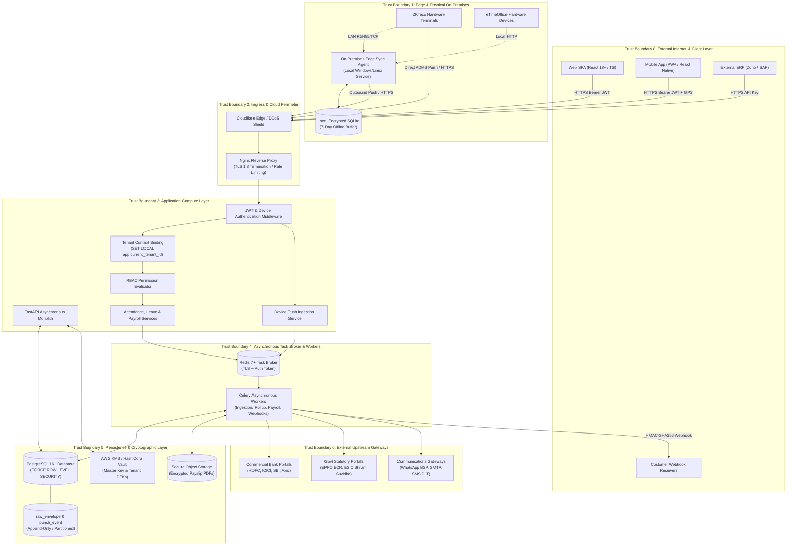

# APMS Comprehensive STRIDE Threat Surface Analysis & Security Model

> **Status:** Authoritative | **Last Updated:** 2026-11-16 | **Domain:** Platform Security & Threat Modeling | **Author:** integrations-webhooks specialist

---

## 1. Executive Summary & Threat Modeling Framework

The **Automated Payroll & Attendance Management System (APMS)** is an enterprise multi-tenant B2B SaaS platform that orchestrates workforce scheduling, hardware biometric attendance ingestion, double-entry leave ledgers, and legally binding statutory payroll disbursements (EPF, ESI, PT, TDS) across hundreds of corporate clients.

Because APMS processes high-value financial payouts, sensitive biometric templates, and confidential Personal Identifiable Information (PII) regulated under the **Digital Personal Data Protection (DPDP) Act 2023**, the platform enforces a zero-trust, defense-in-depth posture.

This document establishes the authoritative **STRIDE Threat Model** across all physical and logical boundaries of the APMS ecosystem, systematically evaluating:
- **S**poofing (Identity & Credential Impersonation)
- **T**ampering (Data & Code In-Flight/At-Rest Modification)
- **R**epudiation (Denial of Operational Actions)
- **I**nformation Disclosure (Data Leakage & Multi-Tenant Breaches)
- **D**enial of Service (Resource Starvation & Flooding)
- **E**levation of Privilege (Vertical & Horizontal Authorization Bypass)

---

## 2. Threat Boundary & Trust Zones Architecture Diagram

The APMS platform is partitioned into seven distinct **Trust Boundaries (TB0 to TB6)**. Every boundary crossing represents a critical attack surface that mandates strict cryptographic validation, rate limiting, and tenant context isolation.



---

## 3. Comprehensive STRIDE Threat Modeling Matrix

The following matrix categorizes all identified threat vectors across APMS boundaries, detailing inherent severity, automated architectural mitigations, residual risk, and verification standards.

| Threat ID | STRIDE Category | Trust Boundary / Asset | Threat Vector & Attack Scenario | Inherent Severity | Architectural Mitigation & Defense-in-Depth | Residual Risk | Verification Standard |
| :--- | :--- | :--- | :--- | :---: | :--- | :---: | :--- |
| **T-SP-01** | Spoofing | TB0 $\rightarrow$ TB3 (API) | **JWT Forgery & Algorithm Confusion**: Attacker crafts tokens using `alg: none`, symmetric/asymmetric key confusion, or reuses leaked refresh tokens. | **CRITICAL** | Strict asymmetric RS256/EdDSA signing with public key pinning; token type verification; Redis-backed cryptographic revocation blocklist. | LOW | Automated fuzz testing of JWT headers; expired and tampered token test suite. |
| **T-SP-02** | Spoofing | TB1 $\rightarrow$ TB3 (Hardware) | **Biometric Punch Ingestion Spoofing**: Adversary replays valid raw punches or impersonates hardware terminal serial number to register fake clock-ins. | **CRITICAL** | Device Pre-Shared Key (PSK) + HMAC-SHA256 header (`X-Payload-Hash`) + 60-second sliding debounce window deduplication on `raw_envelope`. | LOW | Hardware replay test suite; duplicate packet injection tests. |
| **T-SP-03** | Spoofing | TB0 $\rightarrow$ TB3 (Mobile) | **GPS Mock Location Spoofing**: Employee uses Android/iOS mock location developer apps or VPN proxies to clock in outside geofenced office premises. | **HIGH** | Native mock location detection (`isFromMockProvider`); client Wi-Fi BSSID and cell tower triangulation verification; hardware geofence bounds check. | MEDIUM | Mobile mock provider penetration tests; geofence fuzz testing. |
| **T-TM-01** | Tampering | TB1 (Edge Storage) | **Edge Sync Agent SQLite Database Tampering**: Local factory IT administrator directly opens local SQLite file to alter punch timestamps before WAN push. | **CRITICAL** | Local cryptographic row hash chaining (SHA-256 chain from previous punch); SQLCipher whole-database encryption with hardware-tied key derivation. | LOW | Tampered SQLite row rejection test; offline sync integrity audit. |
| **T-TM-02** | Tampering | TB3 $\rightarrow$ TB5 (Persistence) | **Database Ledger Mutation**: Malicious insider or SQL injection attempts to modify historical `punch_event`, `leave_transactions`, or finalized payroll records. | **CRITICAL** | PostgreSQL database triggers raising exceptions on `UPDATE` or `DELETE` for append-only tables; separate read-only DB roles for reporting. | LOW | Direct SQL update penetration test on ledger tables. |
| **T-TM-03** | Tampering | TB3 $\rightarrow$ TB6 (Disbursement) | **In-Flight Banking Batch Manipulation**: Man-in-the-Middle attacker intercepts salary CSV batch file and alters beneficiary account numbers before bank upload. | **CRITICAL** | Strict TLS 1.3 mutual auth; PGP public-key encryption of generated batch files; companion SHA-256 integrity checksum manifest (`.sha256`). | LOW | End-to-end PGP verification test; modified CSV byte checksum mismatch test. |
| **T-RP-01** | Repudiation | TB1 $\rightarrow$ TB3 (Attendance) | **Employee Repudiation of Clock-In**: Employee denies punching at a given timestamp, or claims supervisor or colleague performed "buddy punching". | **HIGH** | Ingestion stores immutable raw hardware log ID, terminal serial, client IP, physical sensor modality, and exact hardware timestamp in `raw_envelope`. | LOW | Audit trail inspection verification; forensic raw log reconstruction test. |
| **T-RP-02** | Repudiation | TB3 (Workflows) | **Supervisor Repudiation of Overtime / Leave Approvals**: Supervisor approves overtime or leave then denies authorization during payroll audits. | **HIGH** | Tamper-evident `audit_logs` record capturing user UUID, tenant UUID, client IP, user agent, old state, new state, and immutable timestamp. | LOW | Workflow state transition audit trail audit. |
| **T-ID-01** | Info Disclosure | TB3 $\rightarrow$ TB5 (Multi-Tenant) | **Multi-Tenant RLS Bypass**: Attacker exploits query without tenant filter or database connection pool leakage to read Tenant B records from Tenant A session. | **CRITICAL** | PostgreSQL native `FORCE ROW LEVEL SECURITY` on all tenant tables; middleware executes `SET LOCAL app.current_tenant_id` on every checked-out connection. | LOW | Automated CI cross-tenant isolation test suite (`test_rls_isolation.py`). |
| **T-ID-02** | Info Disclosure | TB5 (Data at Rest) | **PII & Financial Data Leakage in Database Dump**: Database backup stolen or leaked, exposing employee PAN, Aadhaar, bank accounts, and salary details. | **CRITICAL** | Field-level AES-256-GCM envelope encryption using per-tenant Data Encryption Keys (DEKs) wrapped by AWS KMS / HashiCorp Vault. | LOW | Backup plaintext entropy scan; key separation verification test. |
| **T-ID-03** | Info Disclosure | TB0 $\rightarrow$ TB3 (API) | **IDOR on Payslip & Report Downloads**: Employee manipulates UUID in `/api/v1/payslips/{id}/download` to view or download a peer's confidential salary slip. | **CRITICAL** | Object-level authorization dependency verifying `employee_id == current_user.employee_id` or verifying caller holds `HR_PAYROLL` role within tenant. | LOW | IDOR automated penetration test across employee role boundaries. |
| **T-DS-01** | Denial of Service | TB1 $\rightarrow$ TB2 (Ingress) | **Biometric Push Flooding / Terminal DoS**: Compromised or malfunctioning biometric terminal floods `/api/v1/devices/push` with millions of requests. | **HIGH** | Nginx leaky-bucket rate limiting ($100\text{ req/s/IP}$); Redis token-bucket per `device_serial` ($20\text{ req/s}$); early 429 drop before database access. | LOW | Load testing under simulated $50,000\text{ req/min}$ hardware push flood. |
| **T-DS-02** | Denial of Service | TB3 $\rightarrow$ TB4 (Compute) | **Heavy Payroll Recalculation Starvation**: Malicious tenant admin repeatedly triggers 1,000-employee recalculation pay runs to starve Celery workers. | **HIGH** | Celery dedicated queue partitioning; per-tenant concurrent pay run limit ($1\text{ active run/tenant}$); Celery task execution timeout ($600\text{s}$). | LOW | Concurrent pay run queue saturation test. |
| **T-EP-01** | Elevation of Privilege | TB3 (Authorization) | **Tenant Admin to Platform Super Admin Escalation**: Tenant administrator manipulates JWT claims or updates platform settings to control other tenants. | **CRITICAL** | Hard cryptographic separation: `SUPER_ADMIN` endpoints reside under `/api/v1/admin/*`, requiring dedicated superadmin JWT issuer and distinct claims. | LOW | Privilege escalation test suite; cross-tenant admin route probes. |
| **T-EP-02** | Elevation of Privilege | TB3 (RBAC) | **Employee Role Accessing HR / Payroll Endpoints**: Self-service employee calls administrative endpoints (e.g. `POST /api/v1/pay-runs/execute`). | **HIGH** | Explicit FastAPI route guards via `RequirePermission(Permission.PAYROLL_EXECUTE)` verifying normalized database role claims. | LOW | Automated matrix test evaluating every API endpoint against all 5 roles. |

---

## 4. In-Depth STRIDE Category Threat Analysis

### 4.1 Spoofing (Identity & Credential Impersonation)

#### T-SP-01: JWT Token Forgery & Algorithm Confusion
- **Attack Mechanism**: Attackers attempt to bypass signature verification by rewriting JWT headers to `{"alg": "none"}` or substituting an asymmetric public key into an HMAC symmetric verification routine. Alternatively, attackers attempt to reuse stolen refresh tokens across multiple devices.
- **Architectural Defense**:
  1. The authentication middleware explicitly rejects any token specifying `alg: none` or symmetric algorithms when asymmetric keys (RS256/EdDSA) are configured.
  2. Tokens must present a non-empty `tid` (tenant ID) claim that matches the database tenant record.
  3. Revoked tokens and user session logouts are registered immediately in a Redis-backed Distributed Token Revocation Blocklist with TTL matching token expiration.

#### T-SP-02: Biometric Terminal Punch Ingestion Spoofing
- **Attack Mechanism**: Rogue actors on the factory network sniff network traffic or extract device credentials to craft synthetic HTTP push payloads to `/api/v1/devices/push`, injecting fraudulent punch events.
- **Architectural Defense**:
  1. **Device Provisioning Tokens**: Each physical terminal is provisioned with a high-entropy secret token (`X-Device-Token`) hashed and verified using constant-time comparison against `device_registry.token_hash`.
  2. **Cryptographic Payload Chaining**: Every push must present `X-Payload-Hash` containing the SHA-256 digest of the request body.
  3. **Sliding Ingestion Window**: Punches with timestamps older than 7 days or further into the future than 10 minutes are rejected.

#### T-SP-03: Mobile App Clock-In GPS Mock Location Spoofing
- **Attack Mechanism**: Remote employees use location-mocking tools (e.g. "Fake GPS" on Android) or developer options to falsify their GPS coordinates when clocking in via the APMS Mobile App.
- **Architectural Defense**:
  1. **OS Mock Detection**: The mobile client invokes native Android `Location.isFromMockProvider()` and iOS location simulation checks, rejecting clock-in if mock location is active.
  2. **Multi-Factor Geolocation Verification**: The mobile client transmits the connected Wi-Fi BSSID (MAC address of office router) alongside GPS coordinates. APMS validates that the BSSID matches the branch office router registry.

---

### 4.2 Tampering (Data & Integrity Tampering)

#### T-TM-01: On-Premises Edge Sync Agent SQLite Tampering
- **Attack Mechanism**: During prolonged internet outages, punches are buffered locally on the factory PC running the Edge Sync Agent. An attacker with local admin privileges opens `punch_buffer.db` and modifies punch times to erase tardiness.
- **Architectural Defense**:
  1. **Cryptographic Hash Chaining**: Every punch inserted into the local SQLite database includes a `row_hash`:
     $$\text{row\_hash}_n = \text{SHA256}(\text{row\_hash}_{n-1} + \text{device\_serial} + \text{user\_pin} + \text{punch\_time})$$
  2. **Storage Encryption**: The SQLite file is encrypted using SQLCipher (AES-256), with the key derived at runtime from machine hardware identifiers.
  3. **Verification on Cloud Push**: The cloud ingestion engine verifies the hash chain upon receiving the batch. Any broken link marks the entire batch `SUSPECT_TAMPERED` and raises a security alert.

#### T-TM-02: Database Ledger Mutation
- **Attack Mechanism**: A malicious backend process, rogue admin, or compromised SQL connection attempts to retroactively alter `leave_transactions` to grant unearned leave days, or mutates `punch_event` records.
- **Architectural Defense**:
  1. **Append-Only Invariant**: The database enforces append-only immutability using PostgreSQL triggers:
     ```sql
     CREATE OR REPLACE FUNCTION prevent_ledger_mutation()
     RETURNS TRIGGER AS $$
     BEGIN
         RAISE EXCEPTION 'APMS Security Violation: Modification or deletion of ledger rows is strictly prohibited.';
     END;
     $$ LANGUAGE plpgsql;

     CREATE TRIGGER trg_immutable_leave_transactions
     BEFORE UPDATE OR DELETE ON leave_transactions
     FOR EACH ROW EXECUTE FUNCTION prevent_ledger_mutation();
     ```
  2. **Reversals via Compensating Entries**: Corrections are never performed via `UPDATE`; they require an append-only compensating transaction referencing the original transaction UUID.

---

### 4.3 Repudiation (Dispute of Authorship or Action)

#### T-RP-01: Employee Repudiation of Clock-In / Buddy Punching
- **Attack Mechanism**: An employee disputing a salary deduction for an unexcused absence claims they punched in on time and that the system failed, or a supervisor claims an employee's coworker clocked in on their behalf ("buddy punching").
- **Architectural Defense**:
  1. **Immutable Forensic Metadata**: `raw_envelope` captures and retains byte-for-byte:
     - Exact hardware terminal log ID (`log_id`).
     - Terminal serial number and network IP.
     - Verification modality: `FINGERPRINT`, `FACIAL_RECOGNITION`, `PALM_VEIN`, `RFID_CARD`, or `PIN`.
     - Raw hardware timestamp prior to time zone normalization.
  2. **Audit Explanation Trace**: Daily rollup calculations preserve an immutable JSON explanation trace (`calc_trace`) detailing the exact session matching rule, punch pair bounds, and policy applied.

#### T-RP-02: Supervisor Repudiation of Overtime & Leave Approvals
- **Attack Mechanism**: A supervisor approves unauthorized overtime or leave, but during corporate financial audit, claims their credentials were compromised or that the system auto-approved it.
- **Architectural Defense**:
  1. **Tamper-Evident Audit Logging**: Every state transition in `approval_requests` creates an append-only row in `audit_logs`:
     - `actor_id` (UUID of approving user).
     - `tenant_id` (RLS enforced).
     - `action` (e.g. `LEAVE_APPROVE`, `SHIFT_OVERRIDE`).
     - `ip_address` and `user_agent`.
     - `old_state` and `new_state` JSON snapshots.
     - `client_cert_hash` or session fingerprint.

---

### 4.4 Information Disclosure (Confidentiality & Multi-Tenant Breaches)

#### T-ID-01: Multi-Tenant Row-Level Security (RLS) Bypass
- **Attack Mechanism**: In a shared database architecture, an attacker exploits a query where the developer forgot to append `WHERE tenant_id = :current_tenant_id`, or leverages connection pooling where connection state leaks across requests.
- **Architectural Defense**:
  1. **PostgreSQL Native RLS**: Every tenant table is secured by:
     ```sql
     ALTER TABLE attendance_daily_rollup ENABLE ROW LEVEL SECURITY;
     ALTER TABLE attendance_daily_rollup FORCE ROW LEVEL SECURITY;

     CREATE POLICY tenant_isolation_policy ON attendance_daily_rollup
     FOR ALL
     USING (tenant_id = NULLIF(current_setting('app.current_tenant_id', true), '')::uuid);
     ```
  2. **Zero-Trust Middleware Binding**: When an async session is checked out from SQLAlchemy pool:
     `await session.execute(text("SET LOCAL app.current_tenant_id = :tid"), {"tid": tenant_id})`
  3. **Strict Isolation Testing**: Automated CI tests execute every query as Tenant A and verify that Tenant B rows return 0 records even under `SELECT * FROM table`.

#### T-ID-02: Field-Level Envelope Encryption of PII & Banking Details
- **Attack Mechanism**: A database administrator, hosting provider snapshot, or database dump exposes unencrypted PAN, Aadhaar, bank accounts, or salary figures.
- **Architectural Defense**:
  1. Sensitive columns are stored as ciphertext using **AES-256-GCM**.
  2. Each tenant has a unique Data Encryption Key (DEK). DEKs are encrypted using a Master Key residing in **AWS KMS** or **HashiCorp Vault** (Envelope Encryption).
  3. Masking on Retrieval: Standard API endpoints return masked strings (`XXXX-XXXX-1234`). Only privileged operations with explicit audit logging can decrypt raw PII.

---

### 4.5 Denial of Service (Availability Destruction)

#### T-DS-01: Biometric Terminal Push Flooding
- **Attack Mechanism**: A compromised device terminal or network bot sends millions of push events per minute to `/api/v1/devices/push`, exhausting API server threads and database connections.
- **Architectural Defense**:
  1. **Multi-Tier Rate Limiting**:
     - Nginx Edge: 100 requests/sec per IP address.
     - Redis Token Bucket: 20 requests/sec per `X-Device-Serial`.
  2. **Lightweight Ingestion**: The push endpoint performs only authentication and raw insertion into `raw_envelope`. It offloads all parsing, deduplication, and pairing to Celery workers.

#### T-DS-02: Heavy Payroll Recalculation Starvation
- **Attack Mechanism**: A tenant administrator triggers retroactive payroll recalculations for thousands of employees over multiple past months, consuming 100% of CPU worker capacity and starving attendance processing.
- **Architectural Defense**:
  1. **Queue Isolation**: Payroll tasks run on a dedicated Celery queue (`queue: payroll_engine`) with strict concurrency caps (max 4 concurrent workers), completely isolated from real-time punch ingestion (`queue: punch_ingestion`).
  2. **Per-Tenant Concurrency Limits**: Redis locks enforce a maximum of 1 active pay run recalculation per tenant at any given moment.

---

### 4.6 Elevation of Privilege (Authorization Circumvention)

#### T-EP-01: Tenant Admin to Platform Super Admin Escalation
- **Attack Mechanism**: A rogue tenant administrator attempts to access global platform routes (e.g. creating new tenants, altering platform billing, viewing cross-tenant logs).
- **Architectural Defense**:
  1. **Architectural Separation of Super Admin**: Platform administrative APIs are isolated under `/api/v1/platform/*` and protected by a dedicated `SuperAdminGuard` dependency.
  2. **Dual-Key Authorization**: Super admin actions require multi-factor authentication (MFA) and explicit IP whitelisting.

#### T-EP-02: Employee Role Accessing HR / Payroll Endpoints
- **Attack Mechanism**: An authenticated employee discovers an administrative endpoint URL (e.g. `POST /api/v1/pay-runs/{id}/execute`) and invokes it using their valid employee JWT.
- **Architectural Defense**:
  1. **Declarative RBAC Route Guards**: Every mutating endpoint requires explicit permissions:
     ```python
     @router.post("/pay-runs/{id}/execute", dependencies=[Depends(RequirePermission(Permission.PAYROLL_EXECUTE))])
     async def execute_pay_run(id: UUID, current_user: CurrentUser = Depends(get_current_user)):
         ...
     ```
  2. Any unauthorized attempt returns an immediate `403 Forbidden` and logs a high-severity security audit event.

---

## 5. DPDP Act 2023 & Statutory Privacy Threat Mitigation

As an enterprise HRMS platform operating in India, APMS addresses specific statutory compliance threats mandated by the **Digital Personal Data Protection (DPDP) Act 2023**:

| Statutory Requirement | DPDP Threat Vector | APMS Mitigation Architecture |
| :--- | :--- | :--- |
| **Notice & Consent (`PRV-01`)** | Processing biometric attendance without verifiable, uncoerced consent. | Onboarding workflow captures cryptographically signed digital consent logs prior to hardware template enrollment. Templates are restricted strictly to attendance calculation. |
| **Right to Erasure / Masking (`PRV-02`)** | Retaining former employee biometric templates and PII indefinitely after termination. | Upon employee exit, biometric templates are deleted immediately from hardware devices and cloud databases. Personal records are pseudonymized upon expiry of the mandatory 8-year statutory tax retention period. |
| **Minor / Student Parental Consent (`PRV-03`)** | Capturing biometric attendance of minor apprentices or students without verifiable parental consent. | The platform mandates verified digital parental/guardian consent verification before activating biometric credentials for any user flagged under 18 years of age. |

---

## 6. Continuous Threat Verification & Automated Security Testing

Security assurance in APMS is maintained via automated continuous integration controls:

1. **Automated Cross-Tenant Leakage Test Suite**:
   CI runs hundreds of automated test cases executing cross-tenant access attempts. Any test returning a row from another tenant immediately halts the build.
2. **Cryptographic Algorithm & Token Fuzzing**:
   Automated fuzz testing verifies that tampered JWTs, malformed signatures, expired timestamps, and unsupported algorithms (`none`, `HS256` on asymmetric routes) are rejected with standard HTTP 401/403 responses.
3. **Statutory Integrity & Golden Tests**:
   Payroll calculation outputs are validated against Golden Datasets to ensure zero tampering with EPF ceilings, ESI rates, PT slabs, and TDS formulas.
