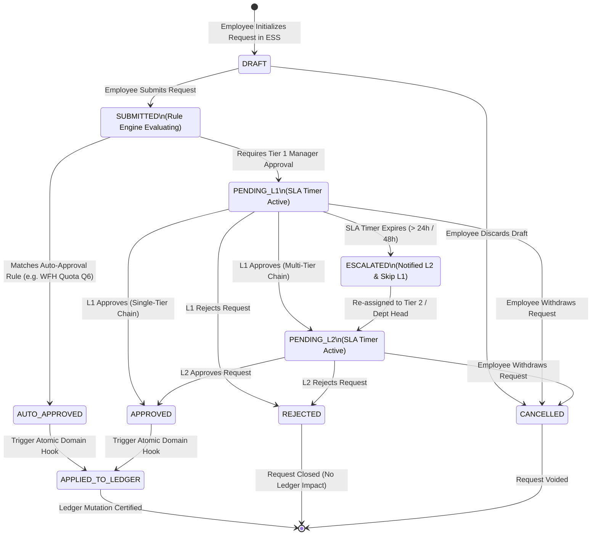
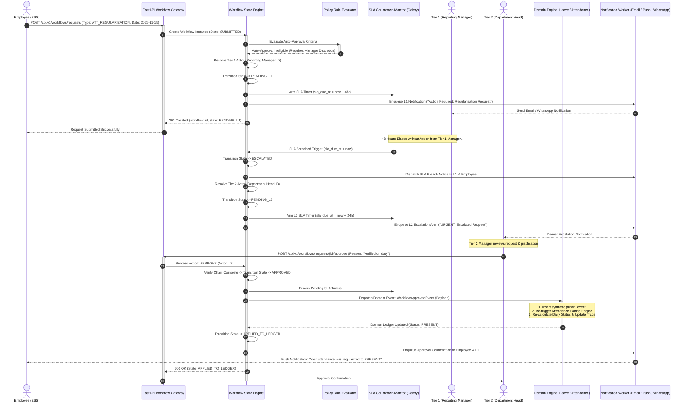
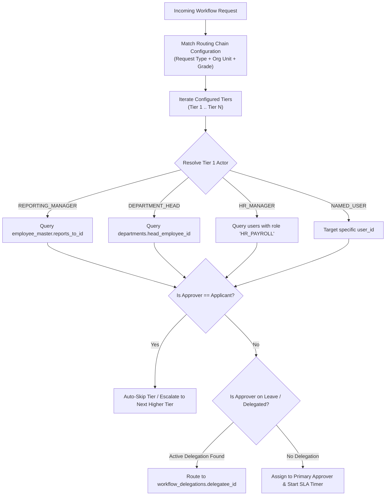

# APMS Workflows & Multi-Tier Approval State Machine

> **Status:** Authoritative | **Last Updated:** 2026-11-16 | **Source:** Extracted from APMS documentation (`workflows/SPEC.md` §3, `leave/SPEC.md`, `BUSINESS_RULES.md`)

---

## 1. Executive Overview & Architecture Principles

The APMS Workflows & Approvals Engine (`M9`) is a centralized platform orchestrator that manages all employee self-service (ESS) and administrative requests requiring multi-step authorization. It operates on asynchronous state transitions, decoupled domain ledger hooks, policy-driven auto-approvals, and automated SLA escalation.

### Architectural Principles
1. **Decoupled Domain Handlers**: The workflow engine manages states, tiers, notifications, and SLAs, but **never directly mutates domain data**. Upon reaching `APPROVED` or `AUTO_APPROVED`, it emits strongly typed domain events (e.g. `WorkflowApprovedEvent`) that domain handlers consume to execute atomic ledger writes.
2. **Deterministic Auto-Approval Engine (`WFL-02`)**: Policy expressions (such as WFH quota evaluation `Q6`) are executed synchronously upon submission. Qualifying requests transition directly to `AUTO_APPROVED` without human latency.
3. **Fail-Safe Multi-Tier Routing (`WFL-01`)**: Approval chains support 1 to $N$ hierarchical tiers with dynamic actor resolution (`REPORTING_MANAGER`, `DEPARTMENT_HEAD`, `HR_MANAGER`).
4. **Automated SLA Escalation (`WFL-03`)**: Every active approval step is bound to a countdown SLA timer. Upon SLA expiration, requests automatically escalate to secondary tiers or department administrators.
5. **Immutable Financial Audit Trail**: Every submission, delegation, view, comment, approval, escalation, and rejection is persisted in an append-only workflow audit ledger.

---

## 2. Approval Request Lifecycle State Machine

The following state machine depicts the entire lifecycle of an approval request—from initial draft formulation to ledger application.



---

## 3. End-to-End Approval & SLA Escalation Sequence

The sequence diagram below models an employee submitting an attendance regularization request where Tier 1 breaches the SLA window, triggering automated escalation to Tier 2, followed by final approval and ledger persistence.



---

## 4. Supported Domain Request Types & Policies

The Workflow Engine unifies five distinct business domain request types under a standardized finite state model:

| Request Type Code | Domain Module | Primary Evaluation Rule | Auto-Approval Policy | Domain Ledger Action on Approval |
| :--- | :--- | :--- | :--- | :--- |
| `LEAVE_APPLICATION` | Leave (`M6`) | Check available balance; enforce negative balance lock (`BR-LVE-03`). | None (Strict human authorization). | Inserts debit into `leave_transactions` (`BR-LVE-01`). Stamped on attendance daily record. |
| `HALF_DAY_LEAVE` | Leave (`M6`) | Requires `session_target` (`FIRST_HALF` or `SECOND_HALF`) (`N66c`). | None. | Inserts 0.5 debit into `leave_transactions`; waives targeted session in attendance pairing. |
| `ATT_REGULARIZATION` | Attendance (`M10`) | Employee provides missing punch, timestamp, and audit reason (`Q4`). | None. | Creates certified `punch_event` with type `REGULARIZED`; triggers re-pairing. |
| `OVERTIME_PRE_AUTH` | Attendance (`M10`) | Employee requests scheduled extra hours prior to shift commencement (`N20`). | None. | Sets authorized overtime ceiling on `dated_shift_instance`. |
| `OVERTIME_POST_AUTH` | Attendance (`M10`) | Manager validates unapproved worked hours logged as `UNAUTHORIZED_EXTRA_TIME`. | None. | Converts unapproved hours into payable `overtime_minutes` for payroll. |
| `SHIFT_SWAP_REQUEST` | Shifts (`M08`) | Peer employee agrees to swap shift instance for date $D$ (`N67`). | None. | Updates `dated_shift_instance` for both employees; invalidates existing pairings. |
| `WFH_APPLICATION` | Attendance (`M10`) | Evaluates monthly WFH quota (`Q6` / `BR-WFH-01`). | **Auto-Approved** if $\text{MonthlyUsed} + \text{ReqDays} \le \text{Quota}$. | Updates attendance mode to `WORK_FROM_HOME`; enables split WFH accounting. |

---

## 5. Dynamic Actor Resolution & Chain Configurations (`WFL-01`)

Approval chains are defined declaratively per tenant, organization unit, branch, or request type.



### Chain Configuration JSON Schema
```json
{
  "chain_id": "018f3a5b-9a8c-7000-8b01-555555555555",
  "request_type": "LEAVE_APPLICATION",
  "org_unit_id": "DEPT-ENG-01",
  "auto_approval_rule": null,
  "tiers": [
    {
      "tier_index": 1,
      "actor_type": "REPORTING_MANAGER",
      "sla_hours": 48,
      "on_sla_breach": "ESCALATE_TO_NEXT_TIER",
      "reminder_intervals_hours": [24, 44]
    },
    {
      "tier_index": 2,
      "actor_type": "DEPARTMENT_HEAD",
      "sla_hours": 24,
      "on_sla_breach": "ESCALATE_TO_HR",
      "reminder_intervals_hours": [12, 20]
    }
  ]
}
```

---

## 6. SLA Escalation & Out-of-Office Delegation (`WFL-03`)

### 6.1 SLA Countdown Engine
- Upon entering `PENDING_L1` or `PENDING_L2`, the system calculates:
  $$\text{sla\_due\_at} = \text{transitioned\_at} + \text{Tier.sla\_hours}$$
- A scheduled Celery Beat worker runs every 5 minutes:
  ```sql
  SELECT instance_id, current_step_id 
  FROM workflow_instances 
  WHERE state IN ('PENDING_L1', 'PENDING_L2') 
    AND sla_due_at <= NOW()
    AND is_escalated = false;
  ```
- For matching instances:
  1. Stamps `is_escalated = true` and `escalated_at = NOW()`.
  2. Creates an audit record in `workflow_actions` with action `SYSTEM_ESCALATED`.
  3. Transitions state to `ESCALATED`, then immediately forwards assignment to the designated escalation actor (`PENDING_L2` or HR).
  4. Dispatches escalation alerts to the primary manager and the escalation manager.

### 6.2 Out-of-Office Delegation
When a manager is scheduled to be on leave or away, they register a temporary delegation record:
- Table: `workflow_delegations`
- Fields: `delegator_id`, `delegatee_id`, `start_date`, `end_date`, `request_types[]`, `is_active`.
- Routing rule: Before assigning a workflow step to `approver_id`, the engine checks:
  ```sql
  SELECT delegatee_id 
  FROM workflow_delegations 
  WHERE delegator_id = :approver_id 
    AND :request_date BETWEEN start_date AND end_date 
    AND is_active = true 
  LIMIT 1;
  ```
- If an active delegation exists, the task is assigned to `delegatee_id`, and the audit log records: `"Assigned to Delegatee [ID] on behalf of Delegator [ID]"`.

---

## 7. Audit Trail & Ledger Mutation Safeguards

### 7.1 Database Table Schema (`workflow_instances`, `workflow_steps`, `workflow_actions`)

```sql
-- Main workflow instance
CREATE TABLE workflow_instances (
    instance_id UUID PRIMARY KEY DEFAULT gen_random_uuid(),
    tenant_id UUID NOT NULL,
    request_type VARCHAR(64) NOT NULL,
    applicant_id UUID NOT NULL,
    current_state VARCHAR(32) NOT NULL,
    chain_id UUID NOT NULL,
    current_tier_index INT DEFAULT 1,
    sla_due_at TIMESTAMPTZ,
    is_escalated BOOLEAN DEFAULT FALSE,
    payload JSONB NOT NULL,
    created_at TIMESTAMPTZ NOT NULL DEFAULT NOW(),
    updated_at TIMESTAMPTZ NOT NULL DEFAULT NOW(),
    CONSTRAINT fk_wf_tenant FOREIGN KEY (tenant_id) REFERENCES tenants(tenant_id)
);

-- Individual steps in the approval chain
CREATE TABLE workflow_steps (
    step_id UUID PRIMARY KEY DEFAULT gen_random_uuid(),
    instance_id UUID NOT NULL REFERENCES workflow_instances(instance_id),
    tenant_id UUID NOT NULL,
    tier_index INT NOT NULL,
    assigned_actor_id UUID NOT NULL,
    actor_type VARCHAR(32) NOT NULL,
    status VARCHAR(32) NOT NULL DEFAULT 'PENDING',
    sla_due_at TIMESTAMPTZ NOT NULL,
    action_taken_at TIMESTAMPTZ,
    created_at TIMESTAMPTZ DEFAULT NOW()
);

-- Immutable audit log of every action performed
CREATE TABLE workflow_actions (
    action_id UUID PRIMARY KEY DEFAULT gen_random_uuid(),
    instance_id UUID NOT NULL REFERENCES workflow_instances(instance_id),
    tenant_id UUID NOT NULL,
    step_id UUID REFERENCES workflow_steps(step_id),
    actor_id UUID NOT NULL,
    action VARCHAR(32) NOT NULL, -- SUBMIT, APPROVE, REJECT, CANCEL, ESCALATE, DELEGATE
    comments TEXT,
    ip_address INET,
    user_agent TEXT,
    created_at TIMESTAMPTZ NOT NULL DEFAULT NOW()
);
```

### 7.2 Post-Approval Atomic Ledger Application
To guarantee idempotency and prevent double-credit anomalies:
1. Every domain event includes the unique `workflow_instance_id`.
2. The domain ledger checks if `source_workflow_id = :instance_id` already exists:
   - For Leave: Checks `leave_transactions.workflow_id`.
   - For Attendance: Checks `punch_event.workflow_id`.
3. If not present, the ledger performs an atomic `INSERT` within the active transaction.
4. If the database transaction fails, the workflow engine catches the exception, retains state in `APPROVED_PENDING_SYNC`, and alerts technical operations without losing state.
