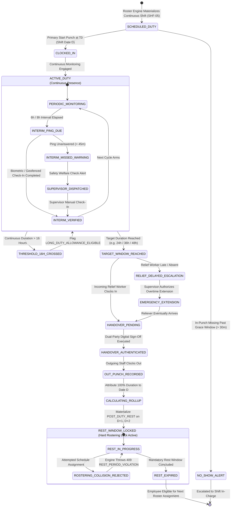
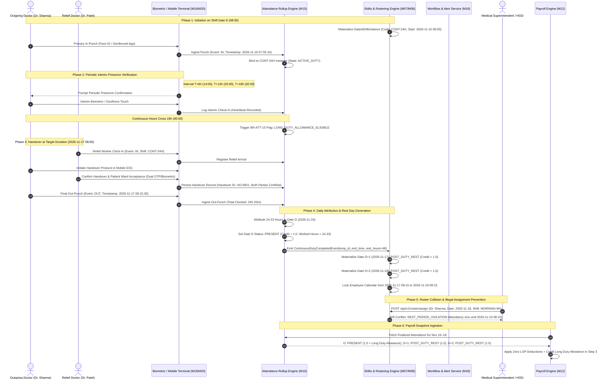

# APMS Continuous Multi-Day Duty & Mandatory Rest Workflow Specification

> **Status:** Authoritative | **Last Updated:** 2026-11-16 | **Source:** Extracted from APMS documentation (`shifts/SPEC.md` §2–§4, `attendance/SPEC.md` §5.1, `BUSINESS_RULES.md` `BR-ATT-15`, `SHF-05`, `ROS-02`, `ATT-13`, Confirmed Architecture Decision `Q5`)

---

## 1. Executive Overview & Domain Context

Continuous multi-day duty is an enterprise workforce requirement in mission-critical industries where operations cannot pause and staff must maintain continuous physical presence across extended 24-hour, 36-hour, or 48-hour windows. Typical operational environments include:
- **Tertiary Healthcare & Hospitals**: Resident physicians, trauma surgeons, ICU registrars, and emergency response teams.
- **Continuous Process Plants**: Petrochemical refineries, nuclear/thermal power plants, blast furnace crews, and chemical reactor operators.
- **Critical Infrastructure & Public Safety**: Air traffic control, municipal emergency dispatchers, and deep-sea or offshore facilities.

Managing these extended shifts requires specialized handling: standard midnight day-boundary splitting would fragment an unbroken surgical or plant monitoring shift into disjointed calendar records. Furthermore, severe sleep deprivation necessitates strict statutory post-duty rest guarantees to prevent workplace accidents and clinical errors.

### Core Architectural Invariants (`Q5`, `BR-ATT-15`)
1. **Start-Date Attribution Invariant (`BR-ATT-15`)**: For any continuous duty spanning multiple calendar days (e.g. 24h, 36h, or 48h), the **entire worked duration is attributed strictly to the shift start calendar date ($D$)**.
2. **Mandatory Post-Duty Rest (`POST_DUTY_REST`)**: Calendar dates covered by the duty window beyond the start date (e.g., $D+1$) and mandatory recovery rest dates ($D+2$, $D+3$) are automatically materialized as `POST_DUTY_REST` with **full paid attendance credit (1.0)** and zero attendance penalties.
3. **Rostering Lockout & Collision Prevention**: The Roster Engine (`M08`) enforces a non-overridable hard lock preventing any shift, relief duty, or on-call scheduling during the employee's calculated post-duty rest window.
4. **Long-Duty Allowance Automation**: Continuous shifts exceeding 16 continuous hours automatically qualify for the contractual/statutory Long-Duty Allowance, passed directly to Step 3 (Variable Earnings) of the Payroll Engine.
5. **Dual-Party Handover Protocol**: A continuous duty shift cannot be legally closed until the outgoing worker and incoming relief worker execute a mutual digital handover confirmation.

---

## 2. Continuous Duty State Machine

The following `stateDiagram-v2` tracks the complete lifecycle of a continuous duty assignment—from schedule publishing to post-duty rest expiration.



---

## 3. End-to-End Continuous Duty Sequence Diagram

This sequence diagram illustrates a 24-hour medical continuous duty shift, showing periodic interim biometric confirmations, the dual-party handover, mandatory rest generation, and an attempted illegal rostering rejection.



---

## 4. Mathematical Specification of Rest Windows

Statutory labor frameworks and medical council guidelines dictate that extended wakefulness severely degrades cognitive function and physical safety. APMS enforces recovery rest through a deterministic multiplier formula:

### 4.1 Rest Duration Formula
Let $H_{\text{duty}}$ be the verified continuous duty duration in hours. The mandatory rest hours $R_{\text{mandatory}}$ is computed as:

$$R_{\text{mandatory}} = \max\left(k_{\text{rest}} \times H_{\text{duty}}, \ R_{\text{floor}}\right)$$

Where:
- $k_{\text{rest}}$ is the tenant policy rest ratio multiplier (Standard: $2.0\times$ for 24h shifts, giving 48 hours rest; $1.5\times$ to $2.0\times$ for plant industrial shifts).
- $R_{\text{floor}}$ is the absolute statutory floor for any shift exceeding 16 continuous hours (Default: 24 hours minimum continuous rest).

### 4.2 Standard Rest Matrix

| Scheduled Duty Type | Nominal Duty Window | Mandatory Rest Multiplier ($k$) | Total Mandatory Rest ($R$) | Generated Calendar Rest Days | Attendance Credit Allocation |
| :--- | :--- | :--- | :--- | :--- | :--- |
| **24-Hour Continuous** | 24 Hours | $2.0\times$ | **48 Hours** | $D+1$ and $D+2$ (`POST_DUTY_REST`) | $D$: 1.0, $D+1$: 1.0, $D+2$: 1.0 (All Paid) |
| **36-Hour Emergency** | 36 Hours | $1.5\times$ to $2.0\times$ | **54 to 72 Hours** | $D+1$, $D+2$, $D+3$ (`POST_DUTY_REST`) | $D$: 1.0, $D+1$: 1.0, $D+2$: 1.0, $D+3$: 1.0 |
| **48-Hour Critical** | 48 Hours | $2.0\times$ | **96 Hours** | $D+1$ through $D+4$ (`POST_DUTY_REST`) | All intervening dates credited 1.0 |

---

## 5. Architectural Breakdown by Subsystem

### 5.1 Shift Scheduling & Instance Materialization (`M07`, `M08`)
- Continuous shift templates (`ShiftTemplate`) are flagged with `is_continuous_multiday = true` and `span_hours IN (24, 36, 48)`.
- When generating roster instances (`DatedShiftInstance`), the start date $D$ holds the primary shift definition.
- The roster generator automatically reserves subsequent dates ($D+1, D+2$) as provisional rest placeholders (`PROVISIONAL_REST`), which lock permanently once the continuous duty is completed.

### 5.2 Interim Periodic Presence Checks (`M16`, `M20`)
- Because an employee might clock in and leave the premises during a 36-hour window, the system enforces **periodic biometric check-in intervals** (configurable: every 6, 8, or 12 hours).
- The worker confirms active presence via:
  1. Biometric punch on any terminal within their designated department zone.
  2. Mobile ESS GPS check-in (validating geofence coordinates).
- If an interim check-in is not logged within the grace period (45 minutes post-schedule), an automated high-severity push notification is dispatched to the Shift Supervisor for a physical welfare confirmation.

### 5.3 Digital Handover Protocol
- Shift handover is legally sensitive in continuous operations. APMS prevents unilateral clock-out without replacement.
- The mobile app / kiosk prompts a structured handover dialog:
  - Identification of relieving employee (`reliever_employee_id`).
  - Handover checklist verification (e.g. ward patient summary, equipment status, active alerts).
  - Mutual confirmation via OTP or biometric authentication by both outgoing and incoming employees.
- If a relief worker fails to arrive, the outgoing worker's mobile interface enables an **Emergency Extension Request**, immediately notifying department leadership while maintaining the continuous duty clock.

### 5.4 Daily Attendance Attribution Engine (`M10`)
- The daily rollup engine executes special handling for shifts marked `is_continuous_multiday`:
  - It bypasses midnight split logic (`00:00:00` cut-off).
  - It anchors all accumulated duration (e.g., 1,460 minutes for a 24.33h shift) to date $D$.
  - It writes `POST_DUTY_REST` records to the daily attendance ledger for $D+1$ and $D+2$:
    ```sql
    INSERT INTO daily_attendance_rollup (
        id, tenant_id, employee_id, date, status, 
        attendance_credit, worked_minutes, is_statutory_rest, 
        parent_continuous_shift_date, explanation_trace
    ) VALUES (
        gen_random_uuid(), :tenant_id, :employee_id, :rest_date, 'POST_DUTY_REST',
        1.0, 0, true, :start_date,
        jsonb_build_object(
            'rule', 'BR-ATT-15',
            'duty_start_date', :start_date,
            'duty_hours_worked', 24.33,
            'rest_day_sequence', :seq
        )
    );
    ```

### 5.5 Rostering Collision Prevention (`M08`)
- The Shift & Roster Engine exposes a validation interceptor on every manual assignment, shift swap, or bulk roster import:
  ```python
  def validate_roster_assignment(tenant_id: UUID, employee_id: UUID, target_date: date):
      active_rest = db.query(RestLockout).filter(
          RestLockout.tenant_id == tenant_id,
          RestLockout.employee_id == employee_id,
          RestLockout.lockout_start <= target_date,
          RestLockout.lockout_end >= target_date
      ).first()
      if active_rest:
          raise RosteringConflictException(
              code="REST_PERIOD_VIOLATION",
              detail=f"Employee is under mandatory recovery rest until {active_rest.lockout_end} "
                     f"following continuous duty on {active_rest.duty_start_date} (BR-ATT-15)."
          )
  ```

---

## 6. Long-Duty Allowance & Payroll Integration (`M12`)

Continuous duty is compensated with premium allowances beyond normal base salary:
1. **Long-Duty Allowance Trigger (`BR-ATT-15`)**:
   - Continuous shifts exceeding 16 hours automatically set the boolean flag `long_duty_allowance_eligible = true` in the attendance summary.
2. **Payroll Wizard Ingestion (Step 3 - Variable Earnings)**:
   - The payroll engine queries all attendance rows for the month where `long_duty_allowance_eligible = true`.
   - It multiplies the count of qualifying continuous shifts by the pay group's defined `continuous_duty_allowance_rate` (e.g. ₹1,500/shift for doctors, ₹750/shift for plant technicians).
   - This item is added as an automatic non-statutory earnings line item on the employee's payslip.
3. **Overtime Multipliers for Excess Continuous Hours**:
   - Hours worked beyond the scheduled continuous window (e.g., 26 hours worked on a 24-hour shift due to emergency handover delay) are routed to the Overtime Engine (`M12` / `M18`) with a mandatory **Emergency Extension Multiplier ($2.0\times$)**.

---

## 7. Deterministic Explanation Trace Example

```json
{
  "trace_version": "1.0",
  "employee_id": "018f4a12-8871-7000-a222-000000000109",
  "shift_assignment": {
    "shift_code": "ICU-CONT-24H",
    "is_continuous_multiday": true,
    "scheduled_start": "2026-11-16T08:00:00+05:30",
    "scheduled_end": "2026-11-17T08:00:00+05:30",
    "scheduled_duration_hours": 24.0
  },
  "punch_analysis": {
    "in_punch": "2026-11-16T07:55:10+05:30",
    "out_punch": "2026-11-17T08:15:30+05:30",
    "interim_check_ins": [
      {"timestamp": "2026-11-16T14:02:11+05:30", "method": "BIOMETRIC_TERMINAL_ICU_A", "status": "VERIFIED"},
      {"timestamp": "2026-11-16T20:15:44+05:30", "method": "BIOMETRIC_TERMINAL_ICU_A", "status": "VERIFIED"},
      {"timestamp": "2026-11-17T02:08:19+05:30", "method": "MOBILE_GEOFENCE_ACTIVE", "status": "VERIFIED"}
    ],
    "handover_record": {
      "handover_id": "ho_88291a_20261117",
      "relief_employee_id": "018f4a12-8871-7000-a222-000000000214",
      "completed_at": "2026-11-17T08:12:00+05:30",
      "authentication": "DUAL_BIOMETRIC_VERIFIED"
    },
    "total_clocked_minutes": 1460.33,
    "total_clocked_hours": 24.34
  },
  "attribution_and_allowances": {
    "attributed_calendar_date": "2026-11-16",
    "attendance_status": "PRESENT",
    "attendance_credit": 1.0,
    "exceeds_16h_threshold": true,
    "long_duty_allowance_eligible": true,
    "overtime_excess_minutes": 20,
    "overtime_status": "EMERGENCY_HANDOVER_EXTENSION"
  },
  "mandatory_rest_generation": {
    "duty_hours": 24.34,
    "rest_multiplier": 2.0,
    "mandatory_rest_hours": 48.68,
    "lockout_start": "2026-11-17T08:15:30+05:30",
    "lockout_end": "2026-11-19T08:56:00+05:30",
    "generated_rest_dates": [
      {"date": "2026-11-17", "status": "POST_DUTY_REST", "credit": 1.0, "paid": true},
      {"date": "2026-11-18", "status": "POST_DUTY_REST", "credit": 1.0, "paid": true}
    ]
  }
}
```

---

## 8. Failure Modes & Edge Case Guardrails

1. **Lone Punch on Continuous Duty**: If a worker clocks in for a 24-hour shift but never clocks out or executes handover, the system does **not** assume 24 hours of presence. At $T+28\text{h}$ (4 hours past scheduled completion without Out-Punch), the shift is flagged `INCOMPLETE_CONTINUOUS_DUTY`, an emergency ticket is dispatched to the HOD, and the attendance status is held in `PENDING_INVESTIGATION`.
2. **Early Termination (Medical Emergency / Evacuation)**: If a worker falls ill 10 hours into a 24-hour shift, an authorized emergency relief handover is performed. The worked 10 hours are attributed to date $D$ as a standard shift. Rest lockout is adjusted dynamically based on actual worked duration ($10\text{h} \times 1.5 = 15\text{h}$ rest).
3. **Consecutive Continuous Duty Ban**: The system strictly forbids scheduling back-to-back continuous shifts (e.g. 24h duty, then another 24h duty). Any override requires Chief Medical Officer / Factory Inspector approval with immutable cryptographic sign-off.
