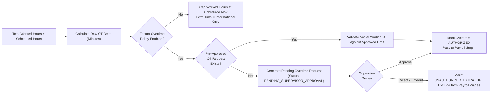

# APMS Daily Attendance Rollup Decision Tree & Engine Specification

> **Status:** Authoritative | **Last Updated:** 2026-11-16 | **Source:** Extracted from APMS documentation (`attendance/SPEC.md` §3–§7, `BUSINESS_RULES.md` §2–§3, `ADR-07`, `N65`, `N66a-d`, `N67`, `Q4`, `Q5`)

---

## 1. Executive Overview & Core Architectural Invariants

The APMS Daily Attendance Rollup Engine is the deterministic calculation pipeline that transforms raw biometric terminal events, mobile geofenced signals, and manual exceptions into certified daily attendance records. Every calculation executes against versioned tenant policy parameters and produces an immutable, auditable **Explanation Trace**.

### Non-Negotiable Invariants
1. **Read-vs-Write Decoupling (`BR-ATT-18`)**: Queries for roster views, attendance grids, and payroll previews operate strictly in read-only (`SELECT`) mode without triggering side-effect mutations.
2. **Raw Punch Immutability (`BR-ING-01`)**: All incoming punch signals are stored append-only in `raw_envelope`. Deletions, overwrites, and in-place mutations are forbidden.
3. **Multi-Session Mid-Gap Exclusion (`BR-ATT-02` / `N65`)**: Intervals between explicitly scheduled split-shift sessions are strictly non-working time, excluded from worked hours, late marks, and overtime denominators.
4. **Session Minimum Presence Qualification (`BR-ROL-03` / `N66b`)**: In multi-session shifts, each session must independently satisfy a minimum presence ratio ($\mu = 0.50$). If either session is `BELOW_MIN`, daily status is strictly capped at `HALF_DAY`.
5. **Deterministic Traceability (`SPEC §7`)**: Every rollup execution persists an immutable JSON explanation trace capturing input punch pairs, policy bands, gap deductions, and intermediate equations.
6. **Decoupled from Payroll (`ADR-07`)**: Attendance records serve as read-only inputs for the payroll engine. Attendance never calculates wages, and payroll never alters attendance records.

---

## 2. Complete Daily Attendance Rollup Decision Tree

The following Mermaid flowchart models the complete evaluation pipeline executed for an employee on a target calendar date $D$.

```mermaid
flowchart TD
    Start(["Start Daily Rollup Evaluation (Date D, Employee E)"]) --> FetchShift["1. Fetch Dated Shift Instance for Date D"]

    %% Step 1: Shift & Schedule Presence Check
    FetchShift --> CheckScheduleExists{"Schedule Instance\nFound?"}
    CheckScheduleExists -- "No" --> UnassignedPool{"Employee in\nDynamic Shift Pool?"}
    UnassignedPool -- "Yes (SHF-06)" --> DynamicMatch["Execute Dynamic Shift Matching\n(Evaluate min arrival delta)"]
    UnassignedPool -- "No" --> FlagNoShift["Assign Status: NO_SCHEDULE\nFlag Exception: UNRESOLVED_OUT_OF_BOUNDS"]
    DynamicMatch --> DynamicMatchSuccess{"Matching Shift\nFound?"}
    DynamicMatchSuccess -- "Yes" --> MaterializeDynamic["Materialize DatedShiftInstance\n(resolution_mode = AUTO_DYNAMIC_MATCH)"]
    DynamicMatchSuccess -- "No" --> FlagNoShift
    MaterializeDynamic --> CheckHoliday
    CheckScheduleExists -- "Yes" --> CheckHoliday

    %% Step 2: Non-Working Day Pre-Filters
    CheckHoliday{"Is Date D a Branch\nPublic Holiday (HOL)?"}
    CheckHoliday -- "Yes" --> CheckHolidayPunches{"Any Punches\nRecorded on D?"}
    CheckHolidayPunches -- "No" --> AssignHoliday["Assign Status: HOLIDAY\nCredit = 1.0 (Paid)"]
    CheckHolidayPunches -- "Yes" --> HolidayWorkDuty["Assign Status: HOLIDAY\nCredit = 1.0 + Route Holiday Work to OT Engine"]

    CheckHoliday -- "No" --> CheckWeekOff{"Is Date D Scheduled\nas Weekly Off (WO)?"}
    CheckWeekOff -- "Yes" --> CheckWOPunches{"Any Punches\nRecorded on D?"}
    CheckWOPunches -- "No" --> AssignWO["Assign Status: WEEK_OFF\nCredit = 1.0 (Subject to Sandwich Audit)"]
    CheckWOPunches -- "Yes" --> WOWorkDuty["Assign Status: WEEK_OFF\nCredit = 1.0 + Route Rest-Day Duty to OT Engine"]

    %% Step 3: Approved Leave & Employer Cancellations
    CheckWeekOff -- "No" --> CheckLeave{"Approved Leave\nActive for Date D?"}
    CheckLeave -- "Yes (Full Day)" --> AssignFullLeave["Assign Status: ON_LEAVE\nCredit = 1.0 (Leave Ledger Debit)"]
    CheckLeave -- "Yes (Half Day - N66c)" --> FlagTargetedHalfDay["Record Session-Targeted Half-Day\n(Target Session Waived: Credit = 0.5)"]
    CheckLeave -- "No" --> CheckEmployerCancelled{"Employer Cancelled\nSession? (N66d)"}

    FlagTargetedHalfDay --> CheckEmployerCancelled
    CheckEmployerCancelled -- "Yes (Salaried)" --> MarkCancelledPaid["Assign Session Status: CANCELLED_PAID\nAttendance Credit = 1.0 for Session"]
    CheckEmployerCancelled -- "No" --> FetchPunches["Fetch Normalized Punches\nfor Ingestion Window"]
    MarkCancelledPaid --> FetchPunches

    %% Step 4: Punch Ingestion & Pairing
    FetchPunches --> CheckPunchCount{"Punch Count\nin Window?"}
    CheckPunchCount -- "0 Punches" --> CheckLeaveZero{"Half-Day Leave\nApplied?"}
    CheckLeaveZero -- "Yes" --> AssignHalfDayZero["Assign Status: HALF_DAY\nWorked = 0m, Leave Credit = 0.5"]
    CheckLeaveZero -- "No" --> AssignAbsentZero["Assign Status: ABSENT\nCredit = 0.0 (Loss of Pay)"]

    CheckPunchCount -- "1 Punch (Lone Punch)" --> HandleLonePunch["Tag Anomaly: LONE_PUNCH_ANOMALY (Q4)\nRoute to Human Exception Queue"]
    HandleLonePunch --> CheckLonePolicy{"Tenant Lone Punch\nPolicy Fallback"}
    CheckLonePolicy -- "Strict LOP" --> AssignAbsentLone["Assign Status: ABSENT (Credit = 0.0)"]
    CheckLonePolicy -- "Lenient Floor" --> AssignHalfDayLone["Assign Status: HALF_DAY (Credit = 0.5)"]
    CheckLonePolicy -- "Review Required" --> AssignNeedsReview["Assign Status: NEEDS_REVIEW\n(Awaiting Supervisor Action)"]

    CheckPunchCount -- ">= 2 Punches" --> ExecutePairing["Execute Chronological Session Pairing\n(BR-ATT-01)"]

    %% Step 5: Session Timing, Gap Deduction & Grace Evaluation
    ExecutePairing --> EvaluateSessions["Evaluate Each Session j:"]
    EvaluateSessions --> DeductGap["Apply N65 Mid-Shift Gap Exclusion\n(Inter-session gap minutes strictly excluded = 0m worked)"]
    DeductGap --> DeductIntraBreak["Deduct Intra-Session Unpaid Breaks\n(Break Duration > Break Threshold)"]
    DeductIntraBreak --> CalcSessionWorked["Compute Session Worked Minutes:\nWorkedDuration = (P_out - P_in) - Deductions"]
    CalcSessionWorked --> EvaluateGrace["Evaluate Arrival Grace Window:\nLateMinutes = max(0, P_in - (T_start + GraceArrival))\nEarlyExitMinutes = max(0, T_end - P_out)"]

    %% Step 6: Session Minimum-Presence Qualification (N66b)
    EvaluateGrace --> CheckSessionMin{"For all sessions:\nWorkedDuration >= mu * ScheduledDuration?\n(Default mu = 0.50)"}
    CheckSessionMin -- "All Sessions Pass" --> AllSessionsComplete["Set All Sessions: COMPLETED"]
    CheckSessionMin -- "1 Session Below Min" --> OneSessionFailed["Set Failed Session: BELOW_MIN\nSet Flag: SPLIT_DEFICIT_TRIGGERED"]
    CheckSessionMin -- "All Sessions Below Min" --> AllSessionsFailed["Set All Sessions: BELOW_MIN"]

    %% Step 7: Daily Rollup Coverage Ratio (N66a)
    AllSessionsComplete --> CalcRatio["Calculate Daily Coverage Ratio R:\nR = TotalWorkedMinutes / TotalScheduledMinutes"]
    OneSessionFailed --> CalcRatio
    AllSessionsFailed --> CalcRatio

    CalcRatio --> CheckSplitFlag{"Is Split Deficit\nTriggered?"}
    CheckSplitFlag -- "Yes" --> CapHalfDay["Cap Status at HALF_DAY\n(BR-ROL-03: Max Status = HALF_DAY)"]
    CheckSplitFlag -- "No" --> EvaluateRatio{"Evaluate Coverage\nRatio R"}

    EvaluateRatio -- "R >= 0.90 (Present Band)" --> AssignPresent["Assign Status: PRESENT\nCredit = 1.0"]
    EvaluateRatio -- "0.50 <= R < 0.90 (Half-Day Band)" --> AssignHalfDay["Assign Status: HALF_DAY\nCredit = 0.5"]
    EvaluateRatio -- "R < 0.50 (Absent Band)" --> AssignAbsent["Assign Status: ABSENT\nCredit = 0.0"]
    CapHalfDay --> AssignHalfDay

    %% Step 8: Multi-Day Duty Check (Q5)
    AssignPresent --> CheckMultiDay{"Continuous Multi-Day\nDuty (>24h / 36h / 48h)?"}
    AssignHalfDay --> CheckMultiDay
    AssignAbsent --> CheckMultiDay

    CheckMultiDay -- "Yes" --> HandleMultiDay["Anchor Full Duration to Start Date D\nMark Following Date(s) D+1 as POST_DUTY_REST (Credit = 1.0)\nCheck Long-Duty Allowance (>16h)"]
    CheckMultiDay -- "No" --> CheckOvertime

    HandleMultiDay --> CheckOvertime

    %% Step 9: Overtime Authorization (N20)
    CheckOvertime{"Worked Duration >\nScheduled Duration?"}
    CheckOvertime -- "No" --> GenerateTrace["Compile Explanation Trace JSON"]
    CheckOvertime -- "Yes" --> EvaluateOTThreshold["Calculate Raw OT Minutes:\nRawOT = TotalWorkedMinutes - TotalScheduledMinutes"]
    EvaluateOTThreshold --> CheckOTAuth{"Supervisor Pre/Post\nApproval Granted? (N20)"}
    CheckOTAuth -- "Approved" --> CreditPayableOT["Record Approved OT Minutes\n(Payable in Payroll Step 4)"]
    CheckOTAuth -- "Not Approved" --> MarkUnauthorizedOT["Flag as UNAUTHORIZED_EXTRA_TIME\n(Non-Payable, Audit Logged)"]

    CreditPayableOT --> GenerateTrace
    MarkUnauthorizedOT --> GenerateTrace

    %% Step 10: Trace Persistence & Final DB Commit
    GenerateTrace --> WriteTraceRecord["Persist to attendance_explanation_traces\n(trace_payload JSONB)"]
    WriteTraceRecord --> UpdateDailyRecord["Update attendance_daily_records:\n(status, worked_minutes, late_in_minutes, early_exit_minutes, credit)"]
    UpdateDailyRecord --> EndRollup(["Rollup Execution Certified & Complete"])
```



---

## 3. Detailed Decision Logic & Mathematical Formulations

### 3.1 Session Worked Duration & Gap Calculation
For a dated shift instance with $k$ scheduled sessions:

$$\text{ScheduledDuration}_j = T_{end, j} - T_{start, j}$$

$$\text{RawSessionDuration}_j = P_{out, j} - P_{in, j}$$

$$\text{LateMinutes}_j = \max(0, P_{in, j} - (T_{start, j} + \text{GraceArrival}_j))$$

$$\text{EarlyExitMinutes}_j = \max(0, T_{end, j} - P_{out, j})$$

$$\text{WorkedDuration}_j = \max(0, \text{RawSessionDuration}_j - \text{IntraSessionUnpaidBreaks}_j)$$

### 3.2 Multi-Session Mid-Gap Exclusion (`N65`)
Between any two consecutive sessions $j$ and $j+1$:

$$\text{Gap}_j = [T_{end, j}, T_{start, j+1}]$$

- **Non-Working Invariant**: $\text{WorkedTime}(\text{Gap}_j) \equiv 0\text{ minutes}$.
- **Overtime Invariant**: $\text{Overtime}(\text{Gap}_j) \equiv 0\text{ minutes}$.
- Employees have complete freedom to leave the premises during $\text{Gap}_j$. Any biometric signals recorded inside $\text{Gap}_j$ are tagged `INFORMATIONAL_GAP_PUNCH` and do **not** contribute to worked hours.

### 3.3 Daily Rollup Coverage Ratio ($R$) (`BR-ROL-01`, `BR-ROL-02` / `N66a`)
The daily coverage ratio $R$ measures net worked minutes relative to scheduled duration:

$$R = \frac{\sum_{j=1}^k \text{WorkedDuration}_j}{\sum_{j=1}^k \text{ScheduledDuration}_j}$$

The status mapping is governed by versioned tenant policy thresholds $(\theta_{present}, \theta_{half\_day})$:

$$\text{Status} = \begin{cases}
\text{PRESENT} & \text{if } R \ge \theta_{present} \text{ AND } \forall j: \text{SessionEligibility}_j = \text{COMPLETED} \\
\text{HALF\_DAY} & \text{if } \theta_{half\_day} \le R < \theta_{present} \text{ OR } (\exists ! j: \text{SessionEligibility}_j = \text{BELOW\_MIN}) \\
\text{ABSENT} & \text{if } R < \theta_{half\_day} \text{ OR } (\forall j: \text{SessionEligibility}_j = \text{BELOW\_MIN})
\end{cases}$$

*System Default Thresholds:* $\theta_{present} = 0.90$ (90%), $\theta_{half\_day} = 0.50$ (50%).

### 3.4 Session Minimum-Presence Eligibility (`BR-ROL-03` / `N66b`)
Each individual session must meet its statutory minimum presence requirement:

$$\text{MinPresence}_j = \mu_j \times \text{ScheduledDuration}_j \quad (\text{Default } \mu_j = 0.50)$$

$$\text{SessionEligibility}_j = \begin{cases}
\text{COMPLETED} & \text{if } \text{WorkedDuration}_j \ge \text{MinPresence}_j \\
\text{BELOW\_MIN} & \text{if } \text{WorkedDuration}_j < \text{MinPresence}_j
\end{cases}$$

**The Split Deficit Cap Rule**: In a multi-session shift (e.g. Session 1: 4h, Session 2: 4h), if an employee works 5 hours in Session 1 but 0 hours in Session 2:
- Aggregate worked ratio: $R = \frac{5}{8} = 0.625$ (falls in Half-Day band).
- Even if Session 1 had 6 hours of work ($R = \frac{6}{8} = 0.75$), Session 2 remains `BELOW_MIN`.
- Daily status can **never** exceed `HALF_DAY`.

---

## 4. Specialized Branching Scenarios

### 4.1 Session-Targeted Half-Day Leave (`N66c`, `BR-ROL-04`)
When an employee applies for an approved half-day leave on a split-shift day:
- Employee selects `target_session`: `FIRST_HALF` (Session 1) or `SECOND_HALF` (Session 2).
- The target session is marked `LEAVE_COVERED` with $\text{Attendance Credit} = 0.50$.
- The non-targeted session is evaluated strictly against its individual scheduled parameters:
  - If worked: Status = `PRESENT` (0.50 worked credit + 0.50 leave credit = 1.0 total day credit).
  - If unworked: Status = `HALF_DAY` (0.00 worked credit + 0.50 leave credit = 0.5 total day credit, 0.5 LOP).

### 4.2 Employer-Cancelled Sessions (`N66d`, `BR-ROL-05`, `ROS-10`)
If management cancels a scheduled shift session (e.g. heavy rain, facility maintenance):
- **Salaried Employees**: Session marked `CANCELLED_PAID`. Full attendance credit granted; 0 late marks; 0 penalty.
- **Per-Session Contractors (`PAY-14`)**: Tenant policy determines whether retainer fee is paid or session is excluded without penalty.

### 4.3 Lone-Punch Anomaly Resolution (`Q4`, `BR-ATT-04`, `BR-ATT-16`)
When an employee registers only an IN punch or only an OUT punch:
1. Engine flags record with `LONE_PUNCH_ANOMALY` and status `NEEDS_REVIEW`.
2. Record enters the Supervisor Exception Queue.
3. Employee submits an ESS Regularization (`ATT-10`) specifying missing punch time and justification.
4. If approved prior to payroll cut-off, punches re-pair and recalculate.
5. If unregularized when the payroll period locks:
   - *Strict Policy (Default)*: Converts to `ABSENT` (1.0 LOP day).
   - *Lenient Policy*: Converts to `HALF_DAY` (0.5 LOP day).
   - *Guardrail (`BR-ATT-16`)*: Lone punch can never earn overtime or full-day credit.

### 4.4 Continuous Multi-Day Duty Engine (`Q5`, `BR-ATT-15`)
For emergency healthcare (e.g., 36-hour surgeon shift) and continuous industrial plant operations:
- A single shift instance spans across consecutive calendar days $[D, D+1]$.
- **Attribution Rule**: The entire 36 hours of worked duration is anchored to **Date $D$**.
- **Statutory Recovery Rule**: Date $D+1$ is automatically assigned `POST_DUTY_REST` status with full attendance credit (1.0) and zero required hours.
- If continuous active hours $> 16\text{h}$, the engine flags `LONG_DUTY_ALLOWANCE_ELIGIBLE` for payroll processing.

---

## 5. Overtime Authorization Workflow (`N20`, `BR-OTC-01`)



---

## 6. Immutable Explanation Trace JSON Schema

Every attendance evaluation commits a JSON payload to `attendance_explanation_traces.trace_payload`:

```json
{
  "$schema": "https://json-schema.org/draft/2020-12/schema",
  "title": "AttendanceExplanationTrace",
  "type": "object",
  "required": [
    "version",
    "trace_id",
    "tenant_id",
    "employee_id",
    "attendance_date",
    "shift_instance_id",
    "rollup",
    "sessions",
    "gap_intervals",
    "anomalies"
  ],
  "properties": {
    "version": { "type": "string", "const": "2.0" },
    "trace_id": { "type": "string", "format": "uuid" },
    "tenant_id": { "type": "string", "format": "uuid" },
    "employee_id": { "type": "string", "format": "uuid" },
    "attendance_date": { "type": "string", "format": "date" },
    "shift_instance_id": { "type": "string", "format": "uuid" },
    "shift_type": { "type": "string", "enum": ["FIXED_STANDARD", "OVERNIGHT", "MULTI_SESSION", "FLEXIBLE_WINDOW", "CONTINUOUS_MULTI_DAY", "DYNAMIC_POOL"] },
    "is_multi_day": { "type": "boolean" },
    "sessions": {
      "type": "array",
      "items": {
        "type": "object",
        "properties": {
          "session_index": { "type": "integer" },
          "scheduled_in": { "type": "string" },
          "scheduled_out": { "type": "string" },
          "paired_in": { "type": ["string", "null"] },
          "paired_out": { "type": ["string", "null"] },
          "worked_minutes": { "type": "integer" },
          "scheduled_minutes": { "type": "integer" },
          "min_presence_required_minutes": { "type": "integer" },
          "eligibility": { "type": "string", "enum": ["COMPLETED", "BELOW_MIN", "WAIVED_LEAVE", "CANCELLED_PAID"] },
          "late_minutes": { "type": "integer" },
          "early_exit_minutes": { "type": "integer" }
        }
      }
    },
    "gap_intervals": {
      "type": "array",
      "items": {
        "type": "object",
        "properties": {
          "start": { "type": "string" },
          "end": { "type": "string" },
          "duration_minutes": { "type": "integer" },
          "classification": { "type": "string" },
          "excluded_from_worked_duration": { "type": "boolean" }
        }
      }
    },
    "anomalies": {
      "type": "array",
      "items": { "type": "string" }
    },
    "rollup": {
      "type": "object",
      "properties": {
        "mode": { "type": "string", "const": "DURATION_RATIO" },
        "total_worked_minutes": { "type": "integer" },
        "total_scheduled_minutes": { "type": "integer" },
        "coverage_ratio": { "type": "number" },
        "assigned_status": { "type": "string" },
        "credit": { "type": "number" },
        "overtime_authorized_minutes": { "type": "integer" },
        "unauthorized_extra_minutes": { "type": "integer" }
      }
    }
  }
}
```

---

## 7. Concrete Execution Trace Example (Split Shift with N65 Gap)

```json
{
  "version": "2.0",
  "trace_id": "018f3a5b-9a8c-7000-8b01-234567890abc",
  "tenant_id": "018f3a5b-9a8c-7000-8b01-111111111111",
  "employee_id": "018f3a5b-9a8c-7000-8b01-222222222222",
  "attendance_date": "2026-11-16",
  "shift_instance_id": "018f3a5b-9a8c-7000-8b01-333333333333",
  "shift_type": "MULTI_SESSION",
  "is_multi_day": false,
  "sessions": [
    {
      "session_index": 1,
      "scheduled_in": "08:00:00",
      "scheduled_out": "12:00:00",
      "paired_in": "08:04:12",
      "paired_out": "12:01:05",
      "worked_minutes": 236,
      "scheduled_minutes": 240,
      "min_presence_required_minutes": 120,
      "eligibility": "COMPLETED",
      "late_minutes": 0,
      "early_exit_minutes": 0
    },
    {
      "session_index": 2,
      "scheduled_in": "16:00:00",
      "scheduled_out": "20:00:00",
      "paired_in": "15:58:20",
      "paired_out": "20:00:10",
      "worked_minutes": 240,
      "scheduled_minutes": 240,
      "min_presence_required_minutes": 120,
      "eligibility": "COMPLETED",
      "late_minutes": 0,
      "early_exit_minutes": 0
    }
  ],
  "gap_intervals": [
    {
      "start": "12:01:05",
      "end": "15:58:20",
      "duration_minutes": 237,
      "classification": "UNTRACKED_MID_SHIFT_GAP",
      "excluded_from_worked_duration": true
    }
  ],
  "anomalies": [],
  "rollup": {
    "mode": "DURATION_RATIO",
    "total_worked_minutes": 476,
    "total_scheduled_minutes": 480,
    "coverage_ratio": 0.9917,
    "assigned_status": "PRESENT",
    "credit": 1.0,
    "overtime_authorized_minutes": 0,
    "unauthorized_extra_minutes": 0
  },
  "period_lock_status": "OPEN"
}
```
