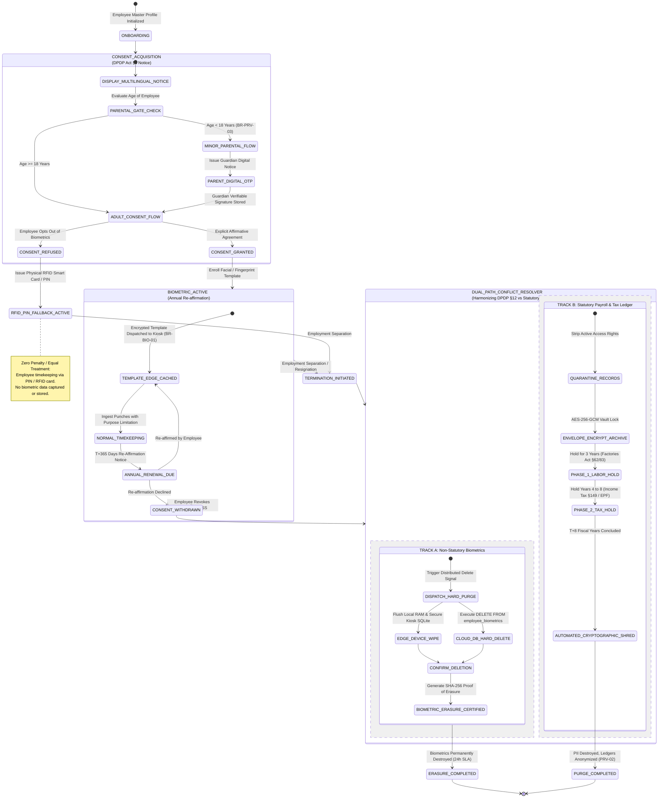

# APMS DPDP Act 2023 Biometric Consent Lifecycle & Statutory Data Retention Specification

> **Status:** Authoritative | **Last Updated:** 2026-11-16 | **Source:** Extracted from APMS documentation (`architecture/SECURITY_ARCHITECTURE.md` §4, `requirements/BUSINESS_RULES.md` `BR-PRV-01`–`BR-PRV-03`, `PRV-01`, `PRV-02`, `PRV-03`, `SEC-01`, `SEC-02`, `NFR-02`, Digital Personal Data Protection Act 2023 §6, §8, §12, Factories Act 1948 §62/§83, Income Tax Act 1961 §149)

---

## 1. Statutory Context & The Regulatory Conflict

The Indian workforce management domain is governed by two competing, non-negotiable legal mandates that must be harmonized inside the APMS data architecture:

1. **Digital Personal Data Protection (DPDP) Act 2023 (§6, §8, §12)**:
   - Grants employees (Data Principals) the **Right to Erasure** of personal data when purpose is fulfilled or consent is withdrawn (§12).
   - Mandates explicit, granular, and multilingual consent notices (§6).
   - Enforces strict purpose limitation: personal data cannot be retained beyond the time necessary for the specified purpose (§8(7)).
   - Mandates verifiable parental/guardian consent for minors under 18 years (§16 / `BR-PRV-03`).
2. **Indian Statutory Labor & Financial Preservation Laws**:
   - **Factories Act 1948 (§62 & §83)**: Mandates employer preservation of adult worker registers, leave records, and attendance muster rolls for at least **3 calendar years**.
   - **Income Tax Act 1961 (§149 & §44AA)**: Authorizes tax assessments and reassessments up to **7 assessment years (effectively 8 fiscal years)**; employers must produce salary computation records, proof of tax deduction at source (TDS / Form 24Q), and PAN payout vouchers.
   - **Employees' Provident Funds & MP Act 1952 / ESI Act 1948**: Mandates preservation of electronic challan return (ECR) contribution ledgers for a minimum of **5 years**.

### The Technical-Legal Resolution (Statutory Exception Clause §8(7))
DPDP Act 2023 §8(7) explicitly carves out an exception: personal data must be erased *unless retention is necessary for compliance with any law for the time being in force*.

APMS executes a **Dual-Path Isolation Protocol**:
- **Non-Statutory Biometric Vectors (Immediate Erasure)**: Facial mathematical embeddings, fingerprint templates, raw kiosk photos, and mobile selfies have **zero statutory standing** under labor laws. They are **permanently wiped within 24 hours** from all cloud databases and edge devices.
- **Statutory Financial & Attendance Ledgers (Cryptographic Freeze)**: Monthly attendance rollups, LOP days, payslip line items, EPF/ESI challans, and TDS logs cannot be deleted. They are immediately transitioned to an encrypted, read-only `STATUTORY_FROZEN_ARCHIVE` vault, accessible solely under certified DPO warrant or court order, until statutory expiry at T+8 fiscal years.

---

## 2. DPDP Biometric Consent & Data Retention State Machine

The following `stateDiagram-v2` details the complete lifecycle of employee personal data—from onboarding consent acquisition to post-retention cryptographic shredding.



---

## 3. End-to-End Right-to-Erasure Sequence Diagram

The following sequence diagram illustrates an employee exercising their Right to Erasure under DPDP Section 12, showing immediate biometric destruction coupled with statutory legal freeze.

```mermaid
sequenceDiagram
    autonumber
    actor Emp as Ex-Employee (Data Principal)
    participant Portal as Employee Portal / DPDP API
    participant DPO as Data Protection Officer (DPO) Console
    participant Orch as DPDP Privacy Orchestrator (M01/M04)
    participant EdgeDaemon as Edge Biometric Agent (M16)
    participant BioDB as Biometric Vector Store
    participant Vault as Statutory Archive Vault (M12/M14)
    participant Audit as Immutable Audit Ledger (audit_logs)

    Emp->>Portal: POST /api/v1/privacy/erasure-request (Auth: JWT + Aadhaar/Mobile OTP)
    Portal->>Orch: Ingest Erasure Request (Type: RIGHT_TO_FORGOTTEN_DPDP_SEC_12)
    Orch->>DPO: Issue Privacy Notification & Verification Alert
    DPO->>Orch: Validate Request & Authorize Processing

    Note over Orch, BioDB: Phase 1: Immediate Biometric Destruction (SLA: < 24 Hours)
    Orch->>EdgeDaemon: MQTT Command: PURGE_BIOMETRIC_TEMPLATE (emp_id, serial_keys)
    EdgeDaemon->>EdgeDaemon: Erase Face/Fingerprint Templates from Edge Kiosk Memory & SQLite
    EdgeDaemon-->>Orch: ACK_EDGE_PURGE_SUCCESS (kiosk_id: KSK-001, KSK-002)

    Orch->>BioDB: HARD DELETE FROM employee_biometric_templates WHERE emp_id = :id
    BioDB-->>Orch: Rows Deleted: 2 (Face embedding vector, Fingerprint minutiae)

    Note over Orch, Vault: Phase 2: Statutory Ledger Quarantine & Legal Freeze
    Orch->>Vault: Lock & Quarantine Employee Records (emp_id)
    Vault->>Vault: Mask PII in Operational Views (Name -> "ANONYMIZED_018F", Mobile -> "******")
    Vault->>Vault: Encrypt Bank, PAN, Aadhaar with Statutory Archive Key (AES-256-GCM)
    Vault->>Vault: Tag Retention Lock: EXPIRE_ON = CURRENT_DATE + 8 Fiscal Years
    Vault-->>Orch: ACK_STATUTORY_HOLD_ENGAGED (Factories Act §62, IT Act §149)

    Note over Orch, Audit: Phase 3: Cryptographic Certificate & Compliance Logging
    Orch->>Audit: Append Immutable Audit Row (Action: DPDP_ERASURE_PROCESSED, Hashes, Timestamps)
    Orch->>Portal: Issue Cryptographic Proof-of-Erasure Certificate (PDF signed with RSA-4096)
    Portal-->>Emp: Erasure Certificate Delivered (Biometrics Erased; Statutory Notice Attached)
```

---

## 4. Architectural Deep-Dive: Consent Architecture

### 4.1 Multilingual Notice Requirements (DPDP Act §6)
The system presents a standalone, itemized consent dialog during mobile or web onboarding. Consent notices are versioned in `dpdp_consent_notices` and rendered in the employee’s chosen language:
- **Languages Supported**: English, Hindi, Marathi, Tamil, Telugu, Kannada, Gujarati, Bengali.
- **Specific Purpose Itemization**:
  - Purpose 1: Timekeeping and automated attendance logging.
  - Purpose 2: Statutory payroll calculation and direct tax withholding.
  - Purpose 3: On-premises physical security and access control.
- **Affirmative Opt-In**: Pre-ticked checkboxes or forced agreements are prohibited by application code. The employee must toggle an explicit switch and enter an SMS OTP verification.

### 4.2 Non-Coercion & The RFID/PIN Alternative Fallback
Under DPDP §6(1), consent cannot be a condition for employment if an alternative is viable:
- If an employee rejects biometric consent:
  - System flags `biometric_consent_status = REFUSED`.
  - Generates an automated work-order to Security/HR to issue an **RFID Proximity Card** or a **6-Digit Secure PIN**.
  - Clock-in occurs via RFID touch or PIN entry on the physical terminal.
  - The employee suffers zero operational penalty or discrimination.

### 4.3 Verifiable Parental Consent for Minors (`BR-PRV-03` / DPDP §16)
If an onboarded apprentice, intern, or student worker is under 18 years of age:
- Standard self-consent is locked.
- The system dispatches a digital consent mandate to the verified phone/email of the parent or legal guardian.
- Consent requires Aadhaar-based OTP verification or digital signature from the guardian before any biometric enrollment or shift scheduling can proceed.

---

## 5. Append-Only Consent Ledger Schema

Consent grants, modifications, renewals, and revocations are persisted in an append-only relational ledger protected by Row-Level Security:

```sql
CREATE TABLE dpdp_consent_logs (
    id UUID PRIMARY KEY DEFAULT gen_random_uuid(),
    tenant_id UUID NOT NULL REFERENCES tenants(id) ON DELETE RESTRICT,
    employee_id UUID NOT NULL REFERENCES employees(id) ON DELETE RESTRICT,
    notice_id UUID NOT NULL REFERENCES dpdp_consent_notices(id),
    notice_version VARCHAR(20) NOT NULL,
    language_code VARCHAR(10) NOT NULL, -- 'en', 'hi', 'ta', etc.
    consent_category VARCHAR(50) NOT NULL, -- 'BIOMETRIC_TIMEKEEPING', 'GPS_FIELD_TRACKING', 'PARENTAL_GUARDIAN'
    status VARCHAR(30) NOT NULL, -- 'GRANTED', 'REFUSED', 'RENEWED', 'WITHDRAWN'
    is_minor BOOLEAN DEFAULT FALSE,
    guardian_name VARCHAR(255),
    guardian_contact_hash VARCHAR(64),
    captured_at TIMESTAMPTZ NOT NULL DEFAULT clock_timestamp(),
    ip_address INET,
    user_agent TEXT,
    otp_reference VARCHAR(64),
    client_signature TEXT NOT NULL, -- RSA/ECDSA signature over payload
    created_at TIMESTAMPTZ NOT NULL DEFAULT clock_timestamp()
);

-- RLS Enforcement
ALTER TABLE dpdp_consent_logs ENABLE ROW LEVEL SECURITY;
ALTER TABLE dpdp_consent_logs FORCE ROW LEVEL SECURITY;
CREATE POLICY tenant_isolation_dpdp_consent ON dpdp_consent_logs
    USING (tenant_id = NULLIF(current_setting('app.current_tenant_id', true), '')::uuid);
```

---

## 6. Retention Schedules & The Cryptographic Purge Engine

### 6.1 Retention Schedule Matrix

| Data Category | Data Elements | DPDP Status Upon Withdrawal | Statutory Basis | Retention Duration | Post-Retention Action |
| :--- | :--- | :--- | :--- | :--- | :--- |
| **Biometric Vectors** | Facial 512-d embeddings, fingerprint minutiae, selfies | Immediate Erasure | None (Not statutory) | **0 Days (Hard wipe < 24 Hours)** | Cryptographic zero-fill across disk and memory |
| **Attendance Muster** | Daily status, in/out timestamps, overtime hours | Statutory Hold | Factories Act 1948 §62/§83 | **3 Calendar Years** post-exit | Permanent Anonymization (`PRV-02`) |
| **Payroll Ledgers** | Gross pay, net pay, LOP deductions, salary slips | Statutory Hold | Income Tax Act 1961 §44AA | **8 Fiscal Years** post-exit | Automated cryptographic key destruction |
| **Statutory Returns** | EPF ECR returns, ESI monthly contributions, Form 24Q | Statutory Hold | EPF Act 1952, ESI Act 1948 | **5 to 8 Fiscal Years** | Secure permanent purge |
| **Core Identity PII** | Aadhaar (masked), PAN, Bank Account Number | Statutory Hold | Income Tax / AML Guidelines | **8 Fiscal Years** | Unlink profile, purge raw encrypted fields |

### 6.2 The Automated Purge & Anonymization Engine (`PRV-02`)
A monthly Celery job (`StatutoryPurgeWorker`) scans the `statutory_archive_vault` for records where `retention_lock_until < CURRENT_DATE`:
1. **Cryptographic Key Destruction (Crypto-Shredding)**: The data encryption key (DEK) uniquely wrapping the ex-employee's historical record partition is permanently deleted from the Key Management Service (AWS KMS / HashiCorp Vault). Once the DEK is destroyed, the archived ciphertext is mathematically irrecoverable.
2. **PII Overwriting**: All textual identity columns are replaced with non-invertible hashes or fixed pseudonyms:
   ```sql
   UPDATE employees 
   SET 
       first_name = 'ERASED',
       last_name = 'DATA_PRINCIPAL',
       email = 'erased_' || id || '@purged.apms.internal',
       phone = NULL,
       pan_encrypted = NULL,
       aadhaar_vault_token = NULL,
       bank_account_encrypted = NULL,
       anonymization_status = 'ANONYMIZED_PURGED',
       anonymized_at = clock_timestamp()
   WHERE id = :target_employee_id;
   ```
3. **Statistical Aggregation Preservation**: The overall financial ledger totals (e.g. Total Wages Paid by Branch in FY 2025-26) remain intact for corporate accounting balance sheets, but can never be re-associated with a natural person.

---

## 7. DPO Proof-of-Erasure Cryptographic Certificate

Upon processing an erasure request, APMS automatically generates a signed, tamper-proof PDF audit certificate for the employee and the Data Protection Board of India (DPBI):

```json
{
  "certificate_type": "DPDP_PROOF_OF_ERASURE",
  "certificate_id": "cert_dpdp_8829104_20261116",
  "data_principal_id": "018f4a12-8871-7000-a222-000000000109",
  "tenant_id": "018f4a00-0000-7000-a000-000000000001",
  "dpo_authorized_by": "dpo@enterprise-client.com",
  "request_timestamp": "2026-11-16T09:12:04Z",
  "completion_timestamp": "2026-11-16T14:30:22Z",
  "purged_biometric_assets": [
    {"asset": "FACIAL_RECOGNITION_TEMPLATE", "status": "HARD_DELETED_ALL_TERMINALS", "count": 4},
    {"asset": "RAW_ENVELOPE_SELFIE_BLOBS", "status": "OVERWRITTEN_ZERO_FILLED", "count": 18}
  ],
  "statutory_hold_assets": [
    {
      "ledger": "PAYROLL_AND_TAX_REGISTER",
      "governing_law": "INCOME_TAX_ACT_1961_SEC_149",
      "retention_until": "2035-03-31T23:59:59Z",
      "status": "ENCRYPTED_VAULT_ISOLATION"
    },
    {
      "ledger": "ADULT_WORKER_ATTENDANCE_REGISTER",
      "governing_law": "FACTORIES_ACT_1948_SEC_62",
      "retention_until": "2029-11-16T23:59:59Z",
      "status": "READ_ONLY_QUARANTINE"
    }
  ],
  "digital_signature": {
    "algorithm": "SHA256withRSA",
    "signature_hex": "4a7f9b8c2e1d0f5a8b7c6d5e4f3a2b1c0d9e8f7a6b5c4d3e2f1a0b9c8d7e6f5a..."
  }
}
```

---

## 8. Failure Modes & Audit Logging Invariants

1. **Edge Terminal Offline During Biometric Purge**: If an edge kiosk is offline when an erasure command is issued, the DPDP Orchestrator places the kiosk on a **Quarantined Sync Blocklist**. The kiosk is forbidden from processing punches until it reconnects, executes the template deletion script, and provides cryptographic proof of template destruction.
2. **Premature Statutory Erasure Attempt**: Any SQL command or administrative script attempting to drop or delete records inside `statutory_archive_vault` prior to the statutory expiration date is blocked by database trigger rules (`PREVENT_PREMATURE_STATUTORY_DELETION`) and generates an immediate critical security incident alert.
3. **Audit Trail Immutability**: All consent transitions and DPO erasure actions are recorded in the system `audit_logs` table with irreversible sequential chaining (`prev_log_hash`). Tampering with the privacy audit log invalidates the cryptographic chain, alerting platform administrators.
