# APMS Mobile Field Force Tracking, Anti-Spoofing & Geofencing Specification

> **Status:** Authoritative | **Last Updated:** 2026-11-16 | **Source:** Extracted from APMS documentation (`attendance/SPEC.md` §3–§4, `BUSINESS_RULES.md` `BR-FLD-01`, `BR-FLD-02`, `FLD-01` through `FLD-04`, `PCH-01`, `PCH-03`, `SEC-01`, `SEC-02`)

---

## 1. Executive Overview & 4-Tier Geolocation Model

The APMS Field Force & Mobile Tracking Engine (`M20`) governs mobile timekeeping, dynamic geofence validation, and field visit auditing for distributed workforces—including sales representatives, field service engineers, healthcare home-care workers, and logistics delivery personnel.

Because mobile devices operate in untrusted client environments susceptible to GPS mocking, fake hardware signals, and rooted OS tampering, APMS employs a zero-trust multi-layer verification pipeline combining kernel integrity checks, mathematical polygon geofencing, cryptographic offline queues, and encrypted HTTPS sync.

### The 4-Tier Tracking Model (`BR-FLD-01`)
APMS categorizes location capture into four distinct, privacy-compliant tiers:
1. **Level 1 (Punch GPS)**: Coordinates are captured strictly at the exact instant of Clock-In, Break, or Clock-Out. Zero ongoing location logging.
2. **Level 2 (Geofenced Site Visits)**: Automated boundary arrival and departure logging when an employee crosses predefined polygon boundaries of customer premises, factories, or warehouse hubs.
3. **Level 3 (Visit Check-Ins)**: Formal proof-of-work records capturing geostamped timestamps, GPS accuracy metrics, textual site notes, and mandatory compressed camera selfies.
4. **Level 4 (Duty-Hours Route Tracking)**: Periodic GPS breadcrumb logging active **strictly during scheduled shift hours**. Under `BR-FLD-02`, route tracking is strictly deactivated outside shift hours, and the mobile OS must display a persistent, non-dismissible system notification (*"APMS is tracking your work route while on duty"*).

---

## 2. End-to-End Field Clock-In & Verification Flowchart

The following Mermaid flowchart models the complete lifecycle of a field punch—from mobile user initiation through local security gates, polygon geofence math, offline buffering, and cloud ingestion.

```mermaid
flowchart TD
    Start(["Mobile User Taps 'Clock In' / 'Visit Check-In'"]) --> HardwareCheck["1. Hardware & OS Integrity Verification"]

    %% Step 1: Device Integrity
    HardwareCheck --> RootCheck{"Device Rooted or Jailbroken?\n(Check su, Magisk, Frida, Substrate)"}
    RootCheck -- "Yes" --> RejectSecurity["REJECT PUNCH\nThrow SecurityViolationException\nLog Security Event to Cloud"]
    RootCheck -- "No" --> DevModeCheck{"Developer Options or\nMock Location App Active?"}
    
    DevModeCheck -- "Yes" --> RejectSecurity
    DevModeCheck -- "No" --> FetchLocation["2. Acquire Hardware GPS Fix\n(Fused Location Provider / CoreLocation)"]

    %% Step 2: GPS Sanity & Anti-Mocking
    FetchLocation --> MockLocationCheck{"Location Flagged as Mock?\n(isFromMockProvider / isMock = true)"}
    MockLocationCheck -- "Yes" --> FlagSpoof["REJECT PUNCH\nFlag TAMPERED_MOCK_LOCATION\nUpload Evidence to Security Log"]
    MockLocationCheck -- "No" --> AccuracyCheck{"Horizontal Accuracy < Max Threshold?\n(e.g., accuracy <= 50 meters)"}
    
    AccuracyCheck -- "No (Signal Degraded)" --> PromptHighAccuracy["Prompt: Low GPS Accuracy (>50m)\nWait for Fine Satellites / Cellular Triangulation"]
    PromptHighAccuracy --> FetchLocation
    AccuracyCheck -- "Yes (Fine Fix)" --> VelocityCheck{"Velocity Jump from Prior Fix?\n(Speed > 200 km/h Teleportation)"}
    
    VelocityCheck -- "Yes" --> FlagTeleport["REJECT PUNCH\nFlag IMPOSSIBLE_VELOCITY_TELEPORTATION"]
    VelocityCheck -- "No" --> FetchTargetSite["3. Fetch Assigned Site Boundaries\n(Target Geofence Definitions)"]

    %% Step 3: Geofence Validation
    FetchTargetSite --> GeofenceType{"Geofence Geometry Type?"}
    
    GeofenceType -- "Circular (Radius)" --> CalcHaversine["Compute Haversine Distance (d):\nd = 2R * arcsin(sqrt(...))"]
    CalcHaversine --> CheckCircleBounds{"Distance d <=\n(Radius R + Accuracy ε)?"}
    
    GeofenceType -- "Complex Polygon (N-Sided)" --> RayCasting["Execute Ray-Casting Algorithm\n(Count Horizontal Ray Edge Crossings)"]
    RayCasting --> CheckPolygonBounds{"Intersection Count\nis ODD (Inside)?"}
    
    CheckCircleBounds -- "No (Outside)" --> BoundaryException["Tag OUT_OF_GEOFENCE_VIOLATION\n(Allow with Manager Override OR Hard Block)"]
    CheckPolygonBounds -- "No (Outside)" --> BoundaryException
    
    CheckCircleBounds -- "Yes (Inside)" --> RequireSelfie{"Shift Requires Selfie\nProof-of-Work? (Level 3)"}
    CheckPolygonBounds -- "Yes (Inside)" --> RequireSelfie
    
    %% Step 4: Biometric Selfie (Optional Level 3)
    RequireSelfie -- "Yes" --> CaptureCamera["Capture Live Camera Selfie\n(Extract Face Vector + Timestamp Overlay)"]
    CaptureCamera --> AssemblePayload["4. Assemble Encrypted Punch Envelope"]
    RequireSelfie -- "No" --> AssemblePayload

    %% Step 5: Network & Offline Storage
    AssemblePayload --> SignPayload["Sign Payload with Device Private Key\nGenerate HMAC-SHA256 Client Signature"]
    SignPayload --> CheckConnectivity{"Network Connected?\n(HTTPS Available)"}

    CheckConnectivity -- "Offline (No Signal)" --> StoreOffline["5. Append to Encrypted Local SQLite Queue\n(SQLCipher: pending_punches table)\nDisplay 'Saved Offline' Toast to User"]
    StoreOffline --> BackgroundListener["Background Network Connectivity Listener Active"]
    BackgroundListener --> CheckConnectivity

    CheckConnectivity -- "Online (HTTPS)" --> HTTPSPost["6. POST /api/v1/punches/mobile-sync\n(Include Idempotency-Key & Signature)"]
    
    %% Step 6: Server Ingestion & Deduplication
    HTTPSPost --> ServerVerify["7. Server Gateway Verification\nVerify HMAC Signature & Tenant Token"]
    ServerVerify --> Deduplicate{"Punch Duplicate?\n(Debounce Window = 60s / UUIDv5 Check)"}
    Deduplicate -- "Yes" --> AcknowledgeSuccess["Acknowledge 200 OK\nFlag DUPLICATE_IGNORED (No Double Count)"]
    Deduplicate -- "No" --> IngestRaw["Ingest into raw_envelope (Immutable Append)\nMap to punch_event (PCH-02)"]
    
    IngestRaw --> AcknowledgeSuccess
    AcknowledgeSuccess --> PurgeLocal["Purge Synced Record from Local SQLite\nUpdate Local Sync Watermark"]
    PurgeLocal --> EndSuccess(["Clock-In Verified & Certified"])
```



---

## 3. Anti-Spoofing & Device Integrity Controls

Mobile devices operate in hostile environments where employees may deploy GPS spoofing utilities, mock providers, or rooted ROMs to fake work presence. APMS enforces a five-layer defense matrix:

### 3.1 Root & Jailbreak Detection
The APMS mobile client executes low-level kernel inspections prior to reading location APIs:
- **Android Checks**:
  - Scans standard system binaries for `/system/bin/su`, `/system/xbin/su`, `/sbin/su`, `/system/app/Superuser.apk`.
  - Probes for Magisk mounts (`/sbin/.magisk/`, `magiskpolicy`).
  - Detects dynamic hook engines (Frida server open ports `27042`, Xposed Bridge classes).
  - Inspects `Build.TAGS` for `test-keys` indicating custom or unsigned ROMs.
- **iOS Checks**:
  - Checks for Cydia / Sileo sandbox escapements (`/Applications/Cydia.app`, `/Library/MobileSubstrate/MobileSubstrate.dylib`).
  - Tests for write permissions outside application container (`/private/jailbreak.txt`).
  - Probes `fork()` system calls (restricted in standard iOS sandbox).

### 3.2 Mock Location & Virtual Provider Defenses
- **Android `Location.isFromMockProvider()` / `Location.isMock()`**: Native framework inspection for Android 6.0+ through 14+.
- **App Ops Mode Verification**: Verifies `AppOpsManager.OPSTR_MOCK_LOCATION` via reflection to ensure mock location permissions are not granted to any active package.
- **Sensor Fusion Validation**: APMS compares GPS location changes with hardware accelerometer and gyroscope dead-reckoning. If GPS reports walking at $1.5\text{ m/s}$ but hardware inertial sensors report zero movement, a spoofing alert is raised.
- **Network / Cell-ID Sanity Check**: The client verifies that the reported GPS coordinates align within reasonable geographic proximity to the connected Cellular Cell Tower (MCC/MNC/LAC/CID) and nearby BSSID Wi-Fi network vectors.

### 3.3 Kinematic Velocity & Teleportation Guardrails
The backend and client compute kinematic speed between consecutive location fixes:

$$v = \frac{\text{Distance}(P_{t-1}, P_t)}{\Delta t}$$

If computed velocity $v > 200\text{ km/h}$ ($55.5\text{ m/s}$) in urban terrain without an authorized airline flight status, the punch is immediately rejected with `IMPOSSIBLE_VELOCITY_TELEPORTATION`.

### 3.4 Hardware Clock Tampering Defenses
Employees may roll back device clocks to disguise tardiness. APMS protects time integrity through:
1. **Monotonic Boot Clock**: Compares `SystemClock.elapsedRealtime()` (which ticks continuously including deep sleep and cannot be rolled back by user settings) with wall-clock time.
2. **Server NTP Time Comparison**: Upon sync, the server compares the device timestamp with its authoritative NTP clock. If drift exceeds $\pm 5\text{ minutes}$, the punch is permanently flagged `CLOCK_DRIFT_WARNING` (`BR-DEV-01`).

---

## 4. Mathematical Geofencing Algorithms

APMS supports two geofencing models: standard circular zones and arbitrary polygonal perimeters.

### 4.1 Circular Geofence: Haversine Formulation
For simple sites (e.g. retail stores or cell towers) defined by center coordinate $(\phi_c, \lambda_c)$ and radius $R$:

$$a = \sin^2\left(\frac{\Delta \phi}{2}\right) + \cos(\phi_1) \cos(\phi_2) \sin^2\left(\frac{\Delta \lambda}{2}\right)$$

$$c = 2 \cdot \operatorname{atan2}\left(\sqrt{a}, \sqrt{1-a}\right)$$

$$d = R_{\text{earth}} \cdot c \quad (R_{\text{earth}} \approx 6,371,000 \text{ meters})$$

**Boundary Condition**:
$$\text{Inside} \iff d \le R + \epsilon_{\text{accuracy}}$$

Where $\epsilon_{\text{accuracy}}$ is an allowance for GPS horizontal dilution of precision (capped at $\max(\epsilon) = 15\text{ meters}$).

### 4.2 Complex Polygon Geofence: Ray-Casting Algorithm
For multi-acre factories, refinery perimeters, or construction sites with non-convex irregular boundaries, APMS executes the **Ray-Casting Algorithm** (Jordan Curve Theorem):

```
       Ray from P(x0, y0) towards (+∞, y0)
                 ───────────────────────────────►
       Outside           │            │
       ─────────►        │   Inside   │         Outside
                         │            │
                 Edge 1 (Cross 1)   Edge 2 (Cross 2)
                 Count = 1 (ODD)    Count = 2 (EVEN)
```

#### Algorithm Mathematical Formulation
Given a test point $P = (x_0, y_0)$ representing $(\text{longitude}, \text{latitude})$ and an ordered set of polygon vertices $V_0, V_1, \dots, V_{n-1}, V_n = V_0$:
1. Cast an imaginary semi-infinite horizontal ray starting at $(x_0, y_0)$ extending to $(+\infty, y_0)$.
2. For each edge $(V_i, V_{i+1})$ with endpoints $(x_i, y_i)$ and $(x_{i+1}, y_{i+1})$:
   - Check if $y_0$ lies between $y_i$ and $y_{i+1}$:
     $$\min(y_i, y_{i+1}) < y_0 \le \max(y_i, y_{i+1})$$
   - If true, compute the x-coordinate of the ray-edge intersection:
     $$x_{\text{intersect}} = x_i + \frac{(y_0 - y_i)(x_{i+1} - x_i)}{y_{i+1} - y_i}$$
   - If $x_{\text{intersect}} > x_0$, increment intersection counter $C \leftarrow C + 1$.
3. **Jordan Curve Decision**:
   $$\text{Inside} \iff (C \bmod 2) = 1$$

---

## 5. Offline-First Architecture & Resilient Sync

Field employees frequently operate in basements, rural zones, or remote industrial sites lacking reliable 4G/5G cellular coverage. APMS implements a robust, tamper-resistant offline queue.

### 5.1 Local Encrypted Storage Schema (`SQLCipher`)
All offline punch attempts are written to an encrypted SQLite database on the mobile device (`SQLCipher` with AES-256):

```sql
CREATE TABLE pending_punches (
    local_id TEXT PRIMARY KEY,
    tenant_id TEXT NOT NULL,
    employee_id TEXT NOT NULL,
    idempotency_key TEXT UNIQUE NOT NULL,
    client_sequence_number INTEGER NOT NULL,
    event_type TEXT NOT NULL, -- 'IN', 'OUT', 'BREAK_IN', 'BREAK_OUT', 'VISIT_CHECKIN'
    captured_at_utc TEXT NOT NULL,
    monotonic_elapsed_ms INTEGER NOT NULL,
    latitude REAL NOT NULL,
    longitude REAL NOT NULL,
    accuracy_meters REAL NOT NULL,
    is_mock_location INTEGER DEFAULT 0,
    geofence_id TEXT,
    geofence_status TEXT NOT NULL, -- 'INSIDE', 'OUTSIDE', 'RADIUS_FALLBACK'
    selfie_image_blob BLOB,
    payload_hmac_signature TEXT NOT NULL,
    sync_status TEXT DEFAULT 'PENDING', -- 'PENDING', 'SYNCING', 'FAILED'
    retry_count INTEGER DEFAULT 0,
    created_at TEXT DEFAULT CURRENT_TIMESTAMP
);
```

### 5.2 Cryptographic Client Idempotency Key
To ensure no punch can be recorded twice during network reconnects or partial packet drops, each punch generates a deterministic UUIDv5 key:

$$\text{idempotency\_key} = \operatorname{UUIDv5}\Big(\text{Namespace}_{\text{APMS}}, \ \text{tenant\_id} + \text{employee\_id} + \text{captured\_at\_utc} + \text{client\_sequence\_number}\Big)$$

### 5.3 Batch Synchronization Protocol
When the OS network callback triggers an active internet connection:
1. The background worker queries `SELECT * FROM pending_punches WHERE sync_status = 'PENDING' ORDER BY client_sequence_number ASC LIMIT 50`.
2. Encodes the batch into an encrypted JSON envelope.
3. Transmits over TLS 1.3 to `POST /api/v1/punches/mobile-sync`.
4. If HTTP 200 OK is received with validated server IDs, the mobile client executes an atomic `DELETE FROM pending_punches WHERE local_id IN (...)`.
5. On HTTP 5xx or connection drop, an exponential backoff schedule is triggered ($2^n$ seconds with jitter).

---

## 6. Server Ingestion Contract & Explanation Trace

### 6.1 Ingestion Contract (`PCH-01`, `PCH-02`)
The server receives the batch, verifies the HMAC-SHA256 signature using the employee device public key, and inserts raw payloads into `raw_envelope`.

```json
{
  "sync_batch_id": "bat_mobile_88319a_20261116",
  "device_id": "dev_android_pix7_9918231",
  "app_version": "2.4.1",
  "punches": [
    {
      "idempotency_key": "c3b99184-6019-5d41-9c88-e274b71109a1",
      "employee_id": "018f4a12-8871-7000-a222-000000000109",
      "event_type": "IN",
      "timestamp_utc": "2026-11-16T03:28:15Z",
      "local_time": "2026-11-16T08:58:15+05:30",
      "location": {
        "latitude": 19.076090,
        "longitude": 72.877426,
        "horizontal_accuracy_m": 12.4,
        "altitude_m": 14.2,
        "provider": "fused_gps",
        "is_mock": false
      },
      "integrity": {
        "device_rooted": false,
        "developer_mode": false,
        "mock_location_app_detected": false,
        "monotonic_drift_ms": 110
      },
      "geofence_match": {
        "matched_site_id": "site_mumbai_depot_04",
        "algorithm": "RAY_CASTING_POLYGON",
        "status": "INSIDE",
        "distance_to_centroid_m": 42.1
      },
      "hmac_signature": "e3b0c44298fc1c149afbf4c8996fb92427ae41e4649b934ca495991b7852b855"
    }
  ]
}
```

---

## 7. Exception Scenarios & Recovery Workflows

1. **Cellular Signal Shadow / Basement Ingress**: If an employee enters a shielded basement warehouse where GPS is lost, the app prompts for **Near-Field NFC Tag** or **QR Verification** affixed at the site entry point. The punch is tagged `INDOOR_PROXIMITY_OVERRIDE` with the physical NFC tag serial number.
2. **Boundary Boundary Edge Cases (GPS Scatter)**: If an employee is physically standing right at the perimeter wall of a factory and GPS inaccuracy bounces the coordinate outside by 5 meters, the engine applies an **Accuracy Buffer Allowance** ($\epsilon = \min(\text{reported\_accuracy}, 15\text{m})$). If still outside, the punch is captured as `OUT_OF_GEOFENCE_PENDING_APPROVAL`, alerting the supervisor for single-click mobile approval.
3. **App Cache Deletion Attempt**: If an employee clears app data to hide spoofing flags, the backend detects the missing monotonic sequence number ($S_{k} \ne S_{k-1} + 1$), marks the device session invalidated, and requires administrative re-pairing.
