# APMS Double-Entry Leave Ledger Lifecycle & Sandwich Rule Engine Specification

> **Status:** Authoritative | **Last Updated:** 2026-11-16 | **Source:** Extracted from APMS documentation (`leave/SPEC.md` §1–§4, `payroll/SPEC.md` §3, `BUSINESS_RULES.md` §5, `ADR-08`, `N66c`, `Q6`, `BR-LVE-01`, `BR-LVE-02`, `BR-LVE-03`)

---

## 1. Executive Overview & Core Architectural Invariants

The APMS Leave & Holiday Management Engine governs employee time-off requests, statutory accruals, branch holiday schedules, weekly-off configurations, and policy enforcement engines such as the **Sandwich Rule**.

### Non-Negotiable Invariants
1. **Append-Only Double-Entry Architecture (`ADR-08` / `BR-LVE-01`)**: Leave balances are **never** stored as mutable scalar numbers in employee tables. Every credit, debit, lapse, cancellation, and statutory conversion is persisted as an immutable row in `leave_transactions`.
2. **Dynamic Balance Derivation**: Current available leave balance is derived dynamically via:
   $$\text{Balance}_{\text{type}} = \sum \text{days} \quad (\text{WHERE tenant\_id} = :t \text{ AND employee\_id} = :e \text{ AND leave\_type\_id} = :l)$$
3. **Negative Balance Lock (`BR-LVE-03`)**: Unless a leave type is explicitly configured with `allow_negative_balance = true` (advance leave), requests resulting in $\text{Balance} < 0$ are rejected at submission, and excess uncredited days convert automatically to `LOSS_OF_PAY` (LOP).
4. **Sandwich Rule Statutory Isolation (`BR-LVE-02`)**: Intervening weekly offs and public holidays bridged by absences or unapproved leaves are converted to Leave or Loss of Pay during the monthly payroll pre-run freeze.
5. **Session-Targeted Half-Day Mapping (`BR-ROL-04` / `N66c`)**: Half-day leaves require explicit targeting (`FIRST_HALF` or `SECOND_HALF`), waiving presence requirements for that session and leaving the remaining session subject to normal attendance qualification.

---

## 2. Double-Entry Leave Transaction Matrix

Every balance event is recorded as an immutable ledger transaction:

| Transaction Type | Mathematical Sign | Description & Trigger | Primary Reference Table | Running Balance Impact |
| :--- | :--- | :--- | :--- | :--- |
| **`ACCRUAL`** | **Positive (+)** | Automated monthly or annual statutory entitlement credit (e.g. 1.5 days CL accrued on 1st of month). | Cron scheduler / `leave_allocations` | Increases |
| **`APPLICATION`** | **Negative (-)** | Debit upon formal approval of an ESS leave request (Full Day = -1.0, Half Day = -0.5). | `leave_requests.id` | Decreases |
| **`CANCELLATION`** | **Positive (+)** | Credit reversal when an approved leave request is subsequently cancelled or revoked prior to period lock. | `leave_requests.id` | Increases |
| **`ENCASHMENT`** | **Negative (-)** | Debit of earned leave balance converted into statutory cash payment during annual payroll settlement. | `pay_runs.id` | Decreases |
| **`LAPSE`** | **Negative (-)** | Annual expiration of unused leave balances that exceed statutory carry-forward limits at financial year-end. | Fiscal year-end cron | Decreases |
| **`SANDWICH_CONVERSION`** | **Negative (-)** | Debit converting an intervening Weekly Off or Holiday into paid leave when bridged by absences. | `pay_runs.id` (Step 2 Freeze) | Decreases |
| **`LOSS_OF_PAY` (LOP)** | **Informational (0)** | Zero leave balance debit recorded when an absence cannot be covered by paid leave balances; routes directly to payroll salary deduction. | `attendance_daily_records.id` | No change to paid ledger; increments LOP counter |

---

## 3. End-to-End Leave Request & Transaction Lifecycle

The following flowchart illustrates the entire lifecycle of leave management—from submission and automated balance verification to approval, ledger commit, cancellation reversal, and payroll freeze.

```mermaid
flowchart TD
    Start(["Employee Submits Leave Request (ESS)"]) --> CheckDates["Validate Dates & Session Target:\n- Full Day vs Half Day (N66c: FIRST_HALF / SECOND_HALF)\n- Check Duplicate Requests for Dates"]

    CheckDates --> FetchBalance["Query Current Balance from Ledger:\nSELECT SUM(days) FROM leave_transactions\nWHERE tenant_id=:t AND employee_id=:e AND leave_type_id=:l"]

    FetchBalance --> BalanceSufficiency{"Current Balance >=\nRequested Days?"}

    BalanceSufficiency -- "No" --> CheckAllowNegative{"Is Leave Type Configured with\nallow_negative_balance = true\n(Advance Leave)?"}
    CheckAllowNegative -- "No" --> RejectRequest["Reject Submission (BR-LVE-03):\nError 422: Insufficient Leave Balance.\nPrompt Employee to Apply for Loss of Pay (LOP)"]
    CheckAllowNegative -- "Yes" --> CheckAdvanceLimit{"Within Advance Limit?"}
    CheckAdvanceLimit -- "No" --> RejectRequest
    CheckAdvanceLimit -- "Yes" --> RouteApproval

    BalanceSufficiency -- "Yes" --> CheckWFHQuota{"Is Category WFH\n& within Monthly Quota?\n(Q6 / BR-WFH-01)"}

    CheckWFHQuota -- "Yes (Count < Quota)" --> AutoApproveWFH["Auto-Approve WFH Request Immediately\n(Skip Supervisor Queue)"]
    CheckWFHQuota -- "No (Standard Leave / WFH Exceeded)" --> RouteApproval["Route to Supervisor Approval Queue\nStatus: PENDING_APPROVAL"]

    RouteApproval --> SupervisorDecision{"Supervisor\nReview"}
    SupervisorDecision -- "Rejected" --> RejectBySupervisor["Set Status = REJECTED\nLog Rejection Reason\nNotify Employee (0 Ledger Impact)"]
    SupervisorDecision -- "Approved" --> CommitDebit["Commit Debit to leave_transactions:"]

    AutoApproveWFH --> CommitDebit

    CommitDebit --> WriteTransactionRow["INSERT INTO leave_transactions:\n- transaction_type = 'APPLICATION'\n- days = -requested_days (e.g. -1.0 or -0.5)\n- running_balance = current_balance - requested_days\n- reference_id = leave_request_id"]

    WriteTransactionRow --> UpdateCalendar["Publish to Attendance Calendar:\n- Dates updated to status ON_LEAVE\n- If Half-Day (N66c), target session marked LEAVE_COVERED"]

    UpdateCalendar --> ActiveLeaveState(["Approved Leave Active"])

    %% Cancellation Sub-Workflow
    ActiveLeaveState --> CancellationEvent{"Employee Submits\nCancellation Request?"}
    CancellationEvent -- "No" --> AwaitPayroll["Proceed to Monthly Payroll Cycle"]
    CancellationEvent -- "Yes" --> CheckPeriodLocked{"Is Pay Period\nAlready LOCKED?"}

    CheckPeriodLocked -- "Yes (BR-PAY-12)" --> BlockDirectCancel["Reject Direct Cancellation:\nLocked period cannot be mutated.\nMust route as Retrospective Arrears in Next Pay Cycle"]
    CheckPeriodLocked -- "No (Period OPEN)" --> SupervisorCancelReview{"Supervisor Approves\nCancellation?"}

    SupervisorCancelReview -- "Yes" --> CommitReversal["Commit Reversal Credit to leave_transactions:\n- transaction_type = 'CANCELLATION'\n- days = +requested_days\n- running_balance = current_balance + requested_days\n- reference_id = leave_request_id"]
    SupervisorCancelReview -- "No" --> ActiveLeaveState

    CommitReversal --> RestoreAttendance["Restore Attendance Date(s) to NO_PUNCH / Evaluating\nRe-trigger pairing if punches exist"]
    RestoreAttendance --> AwaitPayroll

    %% Payroll Integration
    AwaitPayroll --> Step2PayrollFreeze(["Pay Run Step 2: Leave & Holiday Freeze"])
```



---

## 4. The Sandwich Rule Decision Engine (`BR-LVE-02`)

The **Sandwich Rule** prevents absenteeism bridging across designated non-working days (Weekly Offs and Public Holidays). Under this rule, non-working days sandwiched between unexcused absences or unapproved leaves are stripped of their paid status and converted to Leave or Loss of Pay.

### 4.1 Chronological Evaluation Topology

```
Calendar Days:       [ D-1 ]            [ D ]             [ D+1 ]
Schedule Type:     Scheduled Work     Weekly Off /      Scheduled Work
                        Day              Holiday             Day
                     (Friday)          (Saturday/Sun)      (Monday)
                        │                     │                │
Actual Attendance:    ABSENT             INTERVENING         ABSENT
                     or Unapproved      NON-WORKING       or Unapproved
                        Leave               DAYS              Leave
                        ▼                     ▼                ▼
Condition:         [Preceding Day]    [Sandwich Bridge]   [Succeeding Day]
                       ABSENT         ==> CONVERTED <==        ABSENT
```

### 4.2 Sandwich Rule Decision Tree

```mermaid
flowchart TD
    StartSandwich(["Pay Run Step 2: Sandwich Rule Evaluation Engine"]) --> CheckTenantConfig{"Is Sandwich Rule Enabled\nin Tenant Policy?\n(BR-LVE-02)"}

    CheckTenantConfig -- "Disabled" --> PassThrough["Retain Weekly Off & Holiday Credits\n(attendance_daily_records status unchanged)"]
    CheckTenantConfig -- "Enabled" --> FetchIntervening["Scan Pay Period for Non-Working Spans:\nSpan S = [D_start_nw, ..., D_end_nw]\nWhere status IN ('WEEK_OFF', 'HOLIDAY')"]

    FetchIntervening --> ForEachSpan["Evaluate Each Span S:"]
    ForEachSpan --> CheckPreceding["Identify Preceding Scheduled Workday (D_pre = D_start_nw - 1)"]
    CheckPreceding --> PrecedingStatus{"Status of D_pre?"}

    PrecedingStatus -- "PRESENT / APPROVED_LEAVE / POST_DUTY_REST" --> SpanSafe["Preceding Day Compliant:\nSpan S is NOT Sandwiched -> Retain Paid Credit"]
    PrecedingStatus -- "ABSENT or UNAPPROVED_LEAVE" --> CheckSucceeding["Identify Succeeding Scheduled Workday (D_post = D_end_nw + 1)"]

    CheckSucceeding --> SucceedingStatus{"Status of D_post?"}
    SucceedingStatus -- "PRESENT / APPROVED_LEAVE / POST_DUTY_REST" --> SpanSafe
    SucceedingStatus -- "ABSENT or UNAPPROVED_LEAVE" --> SandwichTriggered["SANDWICH CONDITION SATISFIED:\nBoth Boundary Workdays are Unexcused Absences"]

    SandwichTriggered --> CalcInterveningDays["Count Intervening Non-Working Days:\nSpanLength = (D_end_nw - D_start_nw + 1) Days"]

    CalcInterveningDays --> CheckSandwichPolicy{"Tenant Sandwich\nTreatment Policy"}

    %% Treatment Path A: Paid Leave Conversion
    CheckSandwichPolicy -- "Convert to Paid Leave First" --> QueryLeaveBal["Query Available Balance for Casual / Earned Leave"]
    QueryLeaveBal --> HasBal{"Balance >=\nSpanLength?"}

    HasBal -- "Yes" --> DebitSandwichLeave["Commit Debit to leave_transactions:\n- transaction_type = 'SANDWICH_CONVERSION'\n- days = -SpanLength\n- notes = 'Sandwich rule conversion for dates D_start to D_end'"]
    DebitSandwichLeave --> UpdateAttendanceLeave["Update attendance_daily_records for Span S:\n- set status = 'ON_LEAVE'\n- set credit = 1.0 (Paid Leave)"]

    HasBal -- "No (Partial / Zero Balance)" --> SplitSandwich["Exhaust Remaining Paid Balance:\n- Debit remaining balance as SANDWICH_CONVERSION\n- Remainder converted to LOSS_OF_PAY (LOP)"]

    %% Treatment Path B: Strict Loss of Pay
    CheckSandwichPolicy -- "Strict Loss of Pay (LOP)" --> ConvertStrictLOP["Convert All Intervening Days to LOSS_OF_PAY"]
    SplitSandwich --> ConvertStrictLOP

    ConvertStrictLOP --> UpdateAttendanceLOP["Update attendance_daily_records for Span S:\n- set status = 'ABSENT'\n- set credit = 0.0\n- increment pay_run lop_days by SpanLength"]

    UpdateAttendanceLeave --> NextSpan["Evaluate Next Span"]
    UpdateAttendanceLOP --> NextSpan
    SpanSafe --> NextSpan
    PassThrough --> EndSandwich(["Sandwich Audit Concluded & Leave Frozen"])
    NextSpan --> CheckMoreSpans{"More Spans to\nEvaluate?"}
    CheckMoreSpans -- "Yes" --> ForEachSpan
    CheckMoreSpans -- "No" --> EndSandwich
```



---

## 5. Concrete Ledger Audit Table Simulation

The following ledger illustrates double-entry transactions for Employee `EMP-401` over a 3-month operational cycle, demonstrating Accrual, Application, Cancellation, Sandwich Conversion, and LOP deduction.

| Tx ID | Date | Employee | Leave Type | Transaction Type | Days (+/-) | Running Balance | Reference Link | Notes / Reason |
| :--- | :--- | :--- | :--- | :--- | :--- | :--- | :--- | :--- |
| `TX-101` | 2026-09-01 | `EMP-401` | Casual Leave (CL) | `ACCRUAL` | **+1.50** | **1.50** | `alloc-sept-2026` | Monthly statutory credit |
| `TX-102` | 2026-10-01 | `EMP-401` | Casual Leave (CL) | `ACCRUAL` | **+1.50** | **3.00** | `alloc-oct-2026` | Monthly statutory credit |
| `TX-103` | 2026-10-12 | `EMP-401` | Casual Leave (CL) | `APPLICATION` | **-1.00** | **2.00** | `req-oct-12` | Personal family emergency |
| `TX-104` | 2026-10-18 | `EMP-401` | Casual Leave (CL) | `APPLICATION` | **-0.50** | **1.50** | `req-oct-18-h1` | Session-targeted First Half leave (`N66c`) |
| `TX-105` | 2026-10-19 | `EMP-401` | Casual Leave (CL) | `CANCELLATION` | **+0.50** | **2.00** | `req-oct-18-h1` | Employee reported to work; leave revoked |
| `TX-106` | 2026-11-01 | `EMP-401` | Casual Leave (CL) | `ACCRUAL` | **+1.50** | **3.50** | `alloc-nov-2026` | Monthly statutory credit |
| `TX-107` | 2026-11-16 | `EMP-401` | Casual Leave (CL) | `SANDWICH_CONVERSION` | **-2.00** | **1.50** | `payrun-nov-2026` | Sandwich rule: Absent Friday 13th & Monday 16th; converted Sat/Sun WO |

### SQL Verification Query
```sql
-- Certified balance derivation query for EMP-401
SELECT 
    lt.leave_type_id,
    typ.name AS leave_type_name,
    SUM(lt.days) AS verified_available_balance,
    MAX(lt.running_balance) FILTER (WHERE lt.created_at = sub.max_created) AS latest_running_snapshot
FROM leave_transactions lt
JOIN leave_types typ ON typ.id = lt.leave_type_id
JOIN (
    SELECT leave_type_id, MAX(created_at) AS max_created
    FROM leave_transactions
    WHERE tenant_id = '018f3a5b-9a8c-7000-8b01-111111111111'
      AND employee_id = '018f3a5b-9a8c-7000-8b01-222222222222'
    GROUP BY leave_type_id
) sub ON sub.leave_type_id = lt.leave_type_id
WHERE lt.tenant_id = '018f3a5b-9a8c-7000-8b01-111111111111'
  AND lt.employee_id = '018f3a5b-9a8c-7000-8b01-222222222222'
GROUP BY lt.leave_type_id, typ.name, sub.max_created;
```
